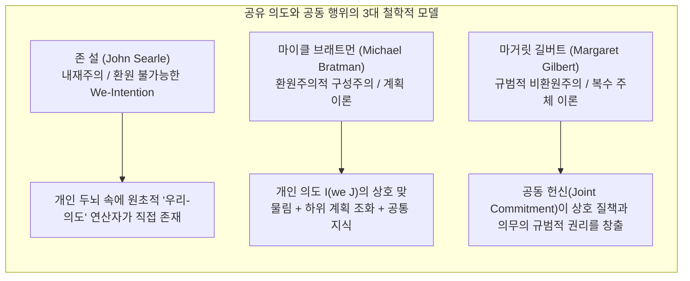
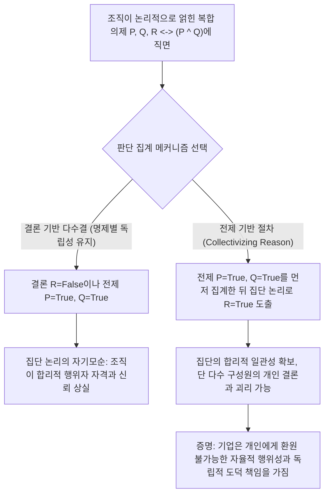
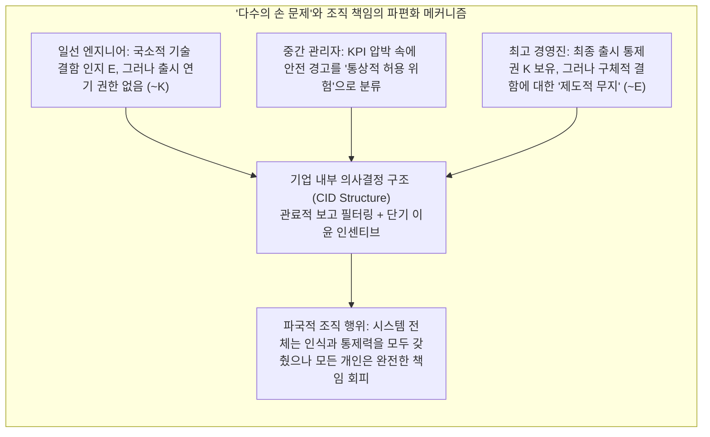

## 서론: "저주받을 영혼도 없고, 걷어차일 육체도 없다"

18세기 영국의 대법관 에드워드 설로 남작(Baron Edward Thurlow)은 유명한 경구를 남겼습니다. "어찌 기업이 양심을 가질 것이라 기대하는가? 기업에는 저주받을 영혼도 없고, 걷어차일 육체도 없다(no soul to be damned, and no body to be kicked)." 수 세기 동안 이 아포리즘은 법철학, 도덕철학, 조직사회학을 괴롭혀 왔습니다.

대규모 조직 참사가 발생할 때—예컨대 1987년 선수문이 열린 채 출항해 침몰한 '헤럴드 오브 프리 엔터프라이즈(Herald of Free Enterprise)' 여객선 참사, MCAS 설계 결함과 규제 회피가 빚어낸 보잉 737 MAX 추락 사고, 2010년 BP의 '딥워터 호라이즌(Deepwater Horizon)' 폭발 사고, 혹은 자율주행차 사망 사고—대중과 법정은 불안한 역설에 직면합니다. <strong>엄청난 도덕적 해악이 발생했음에도 불구하고, 전통적인 형법이나 개인 윤리학이 요구하는 완전한 고의/인식(mens rea)과 실행 행위(actus reus)의 결합을 온전히 갖춘 단일 개인을 찾아낼 수 없다는 역설</strong>입니다.

책임을 오직 고립된 개인의 고의나 과실로만 환원한다면, 거대한 구조적 악은 조직 분업의 틈새로 증발해 버립니다. 반대로 "기업 자체가 도덕적으로 유죄다"라고 주장하면, 회의론자들은 정관, 이사회 결의, 알고리즘으로 이루어진 추상적 법적 허구물이 어떻게 심적 상태나 도덕적 행위성(moral agency)을 가질 수 있는지 반문합니다.

본고에서는 사회존재론(Social Ontology), 행위철학, 사회선택이론(Social Choice Theory)의 교차점에서 집단 행위성(Collective Agency)과 기업의 도덕적 책임(Corporate Moral Responsibility)을 지탱하는 5대 핵심 이론적 기둥을 체계적으로 해부합니다.

---

## 제1장: 방법론적 개인주의와 비환원주의적 기업 실재론의 대결

집단이 어떻게 행동하는지 묻기 전에, 우리는 근본적인 형이상학적 질문과 마주해야 합니다. 집단은 과연 실재하는 행위 주체인가?

### 1.1 방법론적 개인주의와 제거주의(Eliminativism)
막스 베버(Max Weber), 프리드리히 하이에크(Friedrich Hayek)부터 분석윤리학자 H.D. 루이스(H.D. Lewis)와 마누엘 벨라스케스(Manuel Velasquez)에 이르기까지, <strong>방법론적 개인주의(Methodological Individualism)</strong>는 오직 생물학적 인간 개인만이 의식, 양심, 자유의지를 가진다고 주장합니다. 벨라스케스에 따르면 "어느 기업이 소비자를 기만하려 의도했다"는 말은 수사적 은유나 약어에 불과하며, 그 실제 의미는 "기업 내부의 특정 임원이나 직원이 기만하려 했다"는 것으로 남김없이 환원됩니다. 주관적 체험(qualia)이 없는 조직에 도덕적 책임을 묻는 것은 길버트 라일(Gilbert Ryle)이 말한 <strong>범주 오류(Category Mistake)</strong>를 범하는 것이며, 무고한 구성원에게 연좌제를 적용하는 부정의로 이어진다는 것입니다.

### 1.2 비환원주의적 집단 행위성 실재론
이에 맞서 피터 프렌치(Peter French), 마거릿 길버트(Margaret Gilbert), 크리스티안 리스트(Christian List), 필립 페팃(Philip Pettit) 등은 <strong>비환원주의적 집단 행위성 실재론(Non-Reductive Realism about Group Agency)</strong>을 발전시켰습니다. 리스트와 페팃은 『집단 행위성』(*Group Agency*, 2011)에서 어떤 시스템이 '행위자(agent)'가 되기 위해 생물학적 두뇌나 현상적 의식이 필요한 것이 아니라, 다음 세 가지 <strong>기능주의적(Functionalist)</strong> 최소 조건을 충족하는지가 핵심이라고 논증합니다.
1. <strong>표상적 상태(Representational states)</strong>: 환경의 사실에 대해 믿음이나 판단을 형성하는 능력.
2. <strong>동기적 상태(Motivational states)</strong>: 목표, 선호, 가치를 설정하는 능력.
3. <strong>합리적 개입 능력(Capacity to intervene)</strong>: 위 믿음과 목표에 따라 합리성 규범을 준수하며 세계에 개입해 행위하는 능력.

| 비교 차원 | 방법론적 개인주의 / 제거주의 (Weber, Velasquez) | 비환원주의적 기업 실재론 / 기능주의 (French, List & Pettit) |
| :--- | :--- | :--- |
| <strong>집단의 존재론적 지위</strong> | 법적 허구(legal fiction), 수사적 은유, 개인 행위의 단순 합 | 개인들에 수반(Supervene)하지만 환원 불가능한 자율적 행위 시스템 |
| <strong>의도와 믿음의 귀속</strong> | 생물학적 개인의 마음에만 존재; '기업의 의도'는 비유일 뿐 | 내부 의사결정 구조(CID)나 판단 집계 절차를 통해 시스템 수준에서 실재화 |
| <strong>도덕적 책임의 핵심 주체</strong> | 직접적 과실이 있는 특정 임원, 엔지니어, 작업자에 국한 | 조직 실체 자체가 비환원적 집단 책임을 부담 (개인의 공범 책임도 병존) |
| <strong>구조적 참사에 대한 설명력</strong> | 단일 개인에게 완전한 고의가 없을 때 '책임의 공백'에 빠짐 | 구조적 인센티브, 기업 문화, 제도 설계 자체의 도덕적 결함을 정확히 포착 |

---

## 제2장: 공유 의도(Shared Intention)와 공동 행위의 미시적 기초

비 오는 날 두 사람이 우연히 동시에 같은 정자로 뛰어가는 것은 단지 <strong>평행한 개인 행위들의 합</strong>일 뿐이지만, 두 무용수가 함께 탱고를 추거나 엔지니어들이 협력해 우주정거장을 짓는 것은 <strong>공동 행위(Joint Action)</strong>입니다. 비트겐슈타인은 "내가 팔을 든다는 사실에서 내 팔이 올라간다는 물리적 사실을 빼면 무엇이 남는가?"라고 물었습니다. 집단 수준에서 평행한 행동들에 무엇이 더해져야 진정한 '우리의 공동 행위'가 될까요? 현대 분석철학은 세 가지 고전적 모델을 제시했습니다.

### 2.1 존 설(John Searle): 환원 불가능한 '우리-의도'(We-Intentions)
존 설은 『사회적 실재의 구성』(1995)에서 "우리가 $J$를 의도한다"를 "나는 내 몫을 의도하고, 너도 네 몫을 의도한다고 믿는다"로 환원하는 모든 시도를 거부합니다. 상호 믿음과 조율이 있더라도 진정한 협력 정신이 없다면 공동 행위가 아니기 때문입니다. 따라서 설은 인간의 생물학적 마음 안에 원초적이고 환원 불가능한 심리적 연산자인 <strong>'우리-의도'(We-intention)</strong>가 직접 존재한다고 주장합니다.

$$\text{We-intend}(J) \xrightarrow{\text{causes}} \text{Individual My-part}(A_i)$$

### 2.2 마이클 브래트먼(Michael Bratman): 공유 의도의 계획 이론(Planning Theory)
브래트먼은 설의 '신비로운 원초적 연산자'를 도입할 필요가 없다고 봅니다. 그에 따르면 개인들의 일상적인 계획 의도(planning intentions)들 사이에 적절한 <strong>상호 맞물림과 하위 계획의 조화(interlocking and meshing subplans)</strong>가 구축되면 공유 의도가 성립합니다. 개인 $A$와 $B$가 공유 의도 $I(\text{we } J)$를 갖는 필요충분조건은 다음과 같습니다.

$$I(\text{we } J) \iff \begin{cases} \text{(1a) } A \text{ intends that we } J, \text{ and (1b) } B \text{ intends that we } J \\ \text{(2) } A \text{ and } B \text{ intend that we } J \text{ by way of each other's intentions and meshing subplans} \\ \text{(3) Conditions (1) and (2) are Common Knowledge between } A \text{ and } B \end{cases}$$

여기서 '하위 계획의 조화(meshing subplans)'란 세부 사항에서 완전한 일치가 없더라도 서로의 하위 계획이 충돌하지 않도록 조율하고 상호 지원할 것을 의도함을 뜻합니다.

### 2.3 마거릿 길버트(Margaret Gilbert): 복수 주체 이론(Plural Subject Theory)과 공동 헌신
길버트는 브래트먼 모델이 놓친 결정적 요소를 지적합니다. 바로 <strong>규범적 의무(Normative Obligation)</strong>입니다. 두 사람이 함께 산책하기로 하고 걷다가 한 사람이 아무 말 없이 돌아서 가버린다면, 남은 사람은 단순한 예측 실패를 넘어 상대를 <strong>질책할 자격(standing to rebuke)</strong>을 가집니다. 길버트에 따르면 공유 의도의 핵심은 개인적 계획의 우연한 일치가 아니라, 당사자들이 명시적·묵시적 의사표시를 통해 맺은 <strong>공동 헌신(Joint Commitment)</strong>이며, 이를 통해 다수의 개인이 하나의 <strong>복수 주체(Plural Subject)</strong>로 묶입니다.

---

## 제3장: 담론적 딜레마(Discursive Dilemma)와 판단 집계 불가능성 정리

소규모 공동 행위는 브래트먼의 계획 이론으로 설명할 수 있을지 몰라도, 수만 명의 직원을 거느린 다국적 기업이나 합의제 법원은 어떻게 <strong>모든 구성원의 개인적 결론과 정면으로 배치되는 '집단적 판단'</strong>을 합리적으로 도출할 수 있을까요?

이는 법학자 코른하우저(Lewis Kornhauser)와 세이거(Lawrence Sager)가 제기한 <strong>'법리적 역설'(Doctrinal Paradox)</strong>이자, 필립 페팃(Philip Pettit)이 보편적 철학 문제로 정식화한 <strong>'담론적 딜레마'(Discursive Dilemma)</strong>입니다.

### 3.1 담론적 딜레마의 $3 \times 3$ 행렬 분석
어느 항공사의 3인 안전위원회(위원 1, 위원 2, 위원 3)가 특정 여객기의 운항 재개 승인 여부(결론 $R$)를 표결한다고 가정합시다. 안전 규정에 따르면 운항 재개 승인($R$)은 두 가지 전제가 모두 충족될 때 그리고 그때에만 성립합니다.
* <strong>전제 $P$</strong>: 비행제어 소프트웨어의 이중화 안전 검증이 완료되었다.
* <strong>전제 $Q$</strong>: 조종사들이 시뮬레이터 극한 상황 훈련을 완전히 이수했다.
* <strong>논리 규칙</strong>: $R \leftrightarrow (P \land Q)$.

세 명의 합리적이고 성실한 위원이 각각 내린 논리적으로 일관된 판단은 다음과 같습니다.

| 위원회 구성원 | 전제 $P$ (소프트웨어 검증) | 전제 $Q$ (조종사 훈련) | 논리 규칙 $R \leftrightarrow (P \land Q)$ | 결론 $R$ (운항 재개 승인) |
| :--- | :---: | :---: | :---: | :---: |
| <strong>위원 1</strong> | 참 (True) | 참 (True) | 참 (True) | <strong>참 (True)</strong> |
| <strong>위원 2</strong> | 참 (True) | 거짓 (False) | 참 (True) | <strong>거짓 (False)</strong> |
| <strong>위원 3</strong> | 거짓 (False) | 참 (True) | 참 (True) | <strong>거짓 (False)</strong> |
| <strong>다수결 집계 (Majority)</strong> | <strong>참 (2/3 True)</strong> | <strong>참 (2/3 True)</strong> | <strong>참 (3/3 True)</strong> | <strong>거짓 (1/3 True) / 역설!</strong> |

마지막 행의 놀라운 결과를 보십시오.
* <strong>결론 기반 절차(Conclusion-Based Procedure)</strong>: 위원회가 최종 결론 $R$에 대해서만 다수결 투표를 하면, 위원 1만 찬성하고 위원 2와 3이 반대하므로(1대 2), 집단 결정은 <strong>'운항 재개 불허'($R = \text{False}$)</strong>가 됩니다.
* <strong>전제 기반 절차(Premise-Based Procedure)</strong>: 위원회가 전제 $P$와 전제 $Q$에 대해 먼저 각각 다수결 투표를 하면, $P$도 2:1로 참이고 $Q$도 2:1로 참이 됩니다. 그러면 만장일치로 승인된 논리 규칙 $R \leftrightarrow (P \land Q)$에 의해 위원회는 필연적으로 <strong>'운항 재개 승인'($R = \text{True}$)</strong>이라는 집단 결론을 도출합니다!

### 3.2 리스트-페팃 판단 집계 불가능성 정리(List-Pettit Theorem)
크리스티안 리스트와 필립 페팃(2002)은 이 딜레마가 우연한 현상이 아니라 케네스 애로(Kenneth Arrow)의 불가능성 정리를 논리적 판단 영역으로 확장한 보편적 법칙임을 증명했습니다. 개인 집합 $N = \{1, 2, \dots, n\}$ ($n \ge 3$)과 논리적으로 연결된 명제 의제 $X$에 대해 판단 집계 함수 $F$를 다음과 같이 정의합시다.

$$F: \{0, 1\}^{n \times |X|} \to \{0, 1\}^{|X|}$$

리스트와 페팃은 <strong>다음 네 가지 당연해 보이는 공리를 동시에 만족하는 판단 집계 함수 $F$는 수학적으로 존재하지 않음</strong>을 증명했습니다.
1. <strong>보편적 정의역(Universal Domain)</strong>: 논리적으로 일관되고 완전한 모든 개인 판단 프로필을 입력으로 허용한다.
2. <strong>집단적 합리성(Collective Rationality)</strong>: 출력된 집단 판단 집합은 논리적으로 일관되고 완전해야 한다.
3. <strong>익명성(Anonymity)</strong>: 모든 개인의 가중치는 동등하다(독재자가 존재하지 않는다).
4. <strong>체계성 / 독립성(Systematicity / Independence)</strong>: 임의의 명제 $\phi$에 대한 집단 판단은 오직 그 명제 $\phi$에 대한 개인들의 투표에만 의존하며 모든 명제에 동일한 규칙이 적용된다.

### 3.3 왜 '이성을 집단화'(Collectivizing Reason)해야 하는가?
페팃은 조직이 사회 속에서 신뢰할 수 있고 대화 가능한 합리적 행위자(conversable agent)로 기능하려면, 전제 $P$와 $Q$가 참임을 공식 인정하면서 동시에 결론 $R$을 부정하는 자기모순을 저지를 수 없다고 지적합니다. 따라서 조직은 명제별 독립 다수결(체계성 공리)을 포기하고 <strong>전제 기반 절차</strong>, 즉 <strong>'이성의 집단화'(Collectivizing Reason)</strong>를 채택해야 합니다.

그러나 이 선택은 충격적인 존재론적 귀결을 낳습니다. 전제 기반 절차를 채택하는 순간(위 표에서 구성원의 3분의 2가 개인적으로 운항 재개에 반대함에도 위원회는 운항 재개를 승인함!), <strong>조직의 집단적 판단과 의도는 개인들의 심리 상태의 단순 합으로부터 완전히 창발(emerge)하여 독립</strong>하게 됩니다. 조직이 어떤 개인에게도 환원되지 않는 자율적 마음(autonomous mind)을 가진 이상, 조직은 독립된 도덕적 주체로서 책임을 져야만 합니다!

---

## 제4장: 기업 내부 의사결정 구조(CID)와 '다수의 손 문제'(Problem of Many Hands)

### 4.1 피터 프렌치의 CID 구조(Corporate Internal Decision Structure)
1979년 피터 프렌치는 『도덕적 인격체로서의 기업』(*The Corporation as a Moral Person*)에서 기업이 진정한 데이비드슨적 의도적 행위자(intentional agent)인 근거로 <strong>기업 내부 의사결정 구조(CID Structure)</strong>를 제시했습니다. CID 구조는 두 가지 요소로 구성됩니다.
1. <strong>조직 책임 흐름도(Organizational Flow Chart)</strong>: 부서와 직급 간에 정보, 검토, 승인이 흐르는 통사론적 구조.
2. <strong>기업 정책 승인 규칙(Corporate Decision Recognition Rules)</strong>: H.L.A. 하트 법철학의 '승인 규칙'처럼, 어떤 개인적 결정들이 기업의 목적과 정책에 부합하여 공식적인 '기업의 결정'으로 합성되는지를 규정하는 의미론적 규칙.

직원들이 보고서와 코드를 CID 구조에 입력하면, CID 구조는 생물학적 개인들의 파편화된 의도를 <strong>종속시키고 합성(subordinate and synthesize)</strong>하여 순수한 <strong>기업의 의도성(Corporate Intentionality)</strong>으로 변환합니다.

### 4.2 데니스 톰슨의 '다수의 손 문제'(Problem of Many Hands)
그러나 이 정교한 관료제와 분업은 현대 윤리학의 가장 골치 아픈 난제인 데니스 톰슨(Dennis Thompson, 1980)의 <strong>'다수의 손 문제'(The Problem of Many Hands)</strong>를 낳습니다.

전통적 개인 윤리와 형법에서 완전한 도덕적 비난 가능성(Moral Culpability $C$)이 성립하려면 동일한 행위자 $x$가 <strong>인식/의도 조건(Mens Rea / Epistemic Condition $E$)</strong>과 <strong>인과적 통제 조건(Actus Reus / Control Condition $K$)</strong>을 동시에 충족해야 합니다.

$$C(x) \iff E(x) \land K(x)$$

하지만 거대 조직에서는 분업으로 인해 인식과 통제가 구조적으로 분리됩니다.
* 일선 소프트웨어 엔지니어는 특정 센서 오류 시 코드의 위험성을 알고 있지만(국소적 $E$ 보유), 상위 아키텍처를 바꾸거나 출시를 연기할 권한이 없습니다(전역적 $K$ 결여).
* 최고경영진은 출시를 최종 승인할 막강한 권한을 행사하지만(전역적 $K$ 보유), 다단계 보고 필터링으로 인해 현장의 구체적 기술 경고를 전달받지 못합니다(구체적 $E$ 결여).

결과적으로 조직 내 모든 개인 $i \in \{1, \dots, n\}$에 대해 $\neg(E(i) \land K(i))$가 성립하지만, 조직 전체 수준에서는 위험을 인지하면서도 위험 행위를 실행한 셈이 됩니다! 기업 수준의 집단적 도덕 책임을 부정한다면, 모든 구조적 참사는 '아무도 책임지지 않는 자연재해'로 둔갑하고 맙니다.

---

## 제5장: 알고리즘 행위성, AI 책임 격차와 '도덕적 크럼플 존'

21세기에 들어 조직의 의사결정 노드가 인간 관료에서 딥러닝 모델과 자율 알고리즘으로 대체되면서, '다수의 손 문제'는 두 가지 새로운 기술윤리 위기로 진화했습니다.

### 5.1 안드레아스 마티아스(Andreas Matthias)의 '책임 격차'(Responsibility Gap)
마티아스(2004)는 전통적인 제조물 책임이나 운영자 과실 책임이 '시스템의 행동을 설계 규칙에 따라 합리적으로 예측할 수 있다'는 전제 위에 서 있다고 지적합니다. 그러나 현대 심층강화학습과 거대언어모델은 <strong>런타임 자율 학습과 가중치의 불투명성(opacity)</strong>을 특징으로 합니다. 의료 진단 AI나 자율주행 시스템이 배포 후 자기 진화를 통해 개발자조차 예측할 수 없었던 치명적 결정을 내렸다면, 엔지니어에게 개인적 도덕 과실을 묻는 것은 부당합니다. 반면 AI 자체는 고통을 느낄 의식도, 처벌받을 재산도 없습니다. 이로 인해 인간에게도 기계에게도 책임을 귀속시킬 수 없는 <strong>'책임 격차'(Responsibility Gap)</strong>가 발생합니다.

### 5.2 매들린 클레어 엘리시(Madeleine Clare Elish)의 '도덕적 크럼플 존'(Moral Crumple Zones)
인류학자 매들린 엘리시(2019)는 항공기 자동항법장치와 자율주행차 사고 분석을 통해 매우 위선적인 제도적 현상인 <strong>'도덕적 크럼플 존'(Moral Crumple Zones)</strong>을 폭로했습니다.

자동차 공학에서 '크럼플 존(crumple zone, 충격흡수구역)'은 충돌 시 차체 앞부분이 대신 찌그러져 에너지를 흡수함으로써 탑승자를 보호하는 구조입니다. 반면 인간-기계 복합 시스템(Human-in-the-Loop)에서는 <strong>가장 말단에 위치한 인간 작업자(안전요원, 당직 간호사, 부조종사)가 거대 기술 기업과 알고리즘 결함을 대신해 법적·도덕적 비난의 충격을 온몸으로 흡수하는 '도덕적 크럼플 존'으로 소모</strong>됩니다. 기업은 자동화의 효율성과 상업적 찬사를 독차지하면서도, 약관을 통해 인간 운영자에게 통제 불능에 빠진 복잡한 알고리즘을 0.5초 만에 인수할 것을 요구합니다. 사고가 터지면 기업은 모든 죄책을 일선 인력의 '부주의'나 '조작 실수'로 떠넘기고, 알고리즘 설계 결함과 공격적인 상업 배포의 책임에서 빠져나갑니다.

### 5.3 아이리스 매리언 영(Iris Marion Young)의 '사회적 연결 모델'과 미래지향적 제도 설계
'다수의 손 문제'와 '도덕적 크럼플 존'을 극복하기 위해 정치철학자 아이리스 매리언 영은 『정의에 대한 책임』(*Responsibility for Justice*, 2011)에서 두 가지 책임 모델을 구분했습니다.
1. <strong>과거지향적 배상/책임 모델(Backward-Looking Liability Model)</strong>: 과거의 직접적 인과 행위자를 찾아내 처벌하는 모델로, 구조적 부정의나 복잡한 인간-AI 시스템에서는 작동 불능에 빠지거나 말단 희생양을 찾는 도구로 전락합니다.
2. <strong>미래지향적 사회적 연결 모델(Forward-Looking Social Connection Model)</strong>: 제도, 공급망, 기술 아키텍처에 참여하고 그 구조적 과정에서 혜택을 누리는 모든 주체는, 해악을 낳는 제도적 구조(CID) 자체를 집단적 행동을 통해 개혁해야 할 <strong>미래지향적 정치·도덕적 의무</strong>를 공유합니다.

---

## 결론: 하이브리드 집단(Hybrid Collectives)의 입헌적 책임성 재구축

설로 남작의 '영혼 없는 기업'에 대한 조롱에서 시작해 설·브래트먼·길버트의 공유 의도 분석, 페팃의 담론적 딜레마와 프렌치의 CID 구조에 이르기까지, 현대 철학은 <strong>기업과 고도로 조직화된 시스템이 결코 개인들의 단순한 산술적 합이 아니라 자율적 합리성과 막강한 인과력을 지닌 집단 행위자</strong>임을 논증해 왔습니다.

인간과 자율 AI가 얽혀 '하이브리드 집단(Hybrid Collectives)'을 이루는 오늘날, 집단 수준의 비환원적 도덕 책임을 인정하는 것은 부패한 경영진에게 면죄부를 주기 위함이 아닙니다. 오히려 그것은 '다수의 손 문제'라는 면책 방패와 '도덕적 크럼플 존'이라는 희생양 메커니즘을 타파하고, 말단 개인의 처벌에만 매달리던 낡은 패러다임을 넘어 기업의 의사결정 헌법, 인센티브 알고리즘, 기술 거버넌스 아키텍처 자체를 근본적으로 개혁하기 위한 필수불가결한 철학적 토대입니다.
