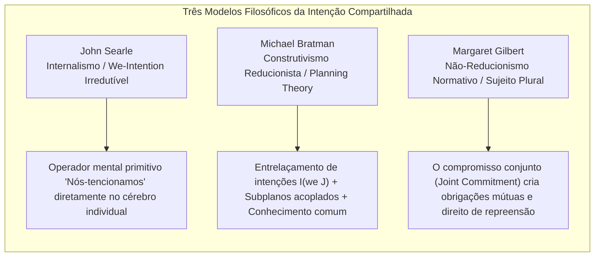
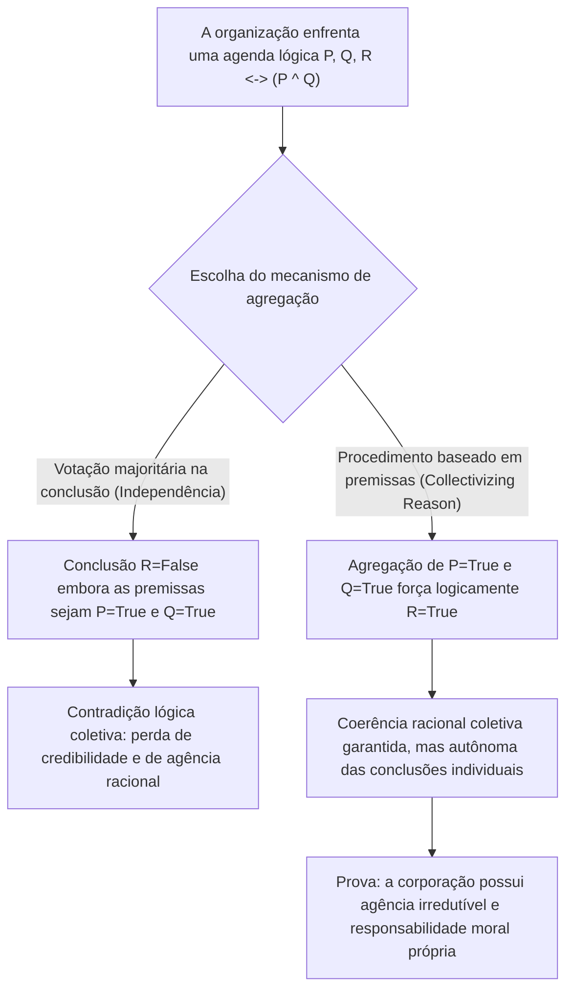
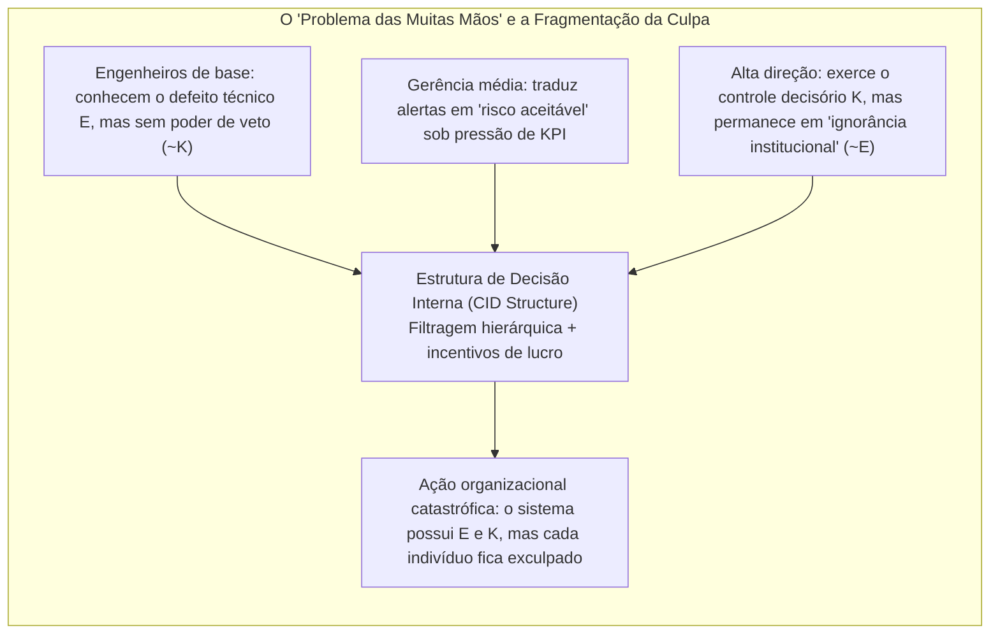

## Introdução: “Sem alma para ser condenada, nem corpo para ser chutado”

No século XVIII, o Lorde Chanceler britânico Barão Edward Thurlow cunhou uma frase célebre: “Acaso esperáveis que uma corporação tivesse consciência, quando ela não tem alma para ser condenada nem corpo para ser chutado (*no soul to be damned, and no body to be kicked*)?”. Durante séculos, esse aforismo assombrou a filosofia do direito, a ética normativa e a sociologia das organizações.

Quando ocorrem grandes catástrofes organizacionais — como o naufrágio da balsa *Herald of Free Enterprise* em 1987, as quedas do Boeing 737 MAX decorrentes de falhas do sistema MCAS e ocultação regulatória, a explosão da plataforma *Deepwater Horizon* da BP em 2010 ou acidentes fatais com veículos autônomos —, os tribunais e o público deparam-se com um paradoxo inquietante: <strong>um dano moral devastador foi produzido, mas nenhum indivíduo isolado reúne plenamente tanto a intenção culposa (mens rea) quanto o controle causal do ato (actus reus) exigidos pelo direito penal e pela ética individual clássica.</strong>

Se reduzirmos a responsabilidade apenas às faltas intencionais de indivíduos isolados, o mal sistêmico evapora-se nas frestas da divisão burocrática do trabalho. Por outro lado, se afirmarmos que “a própria corporação é moralmente culpada”, os céticos questionam imediatamente: como pode uma ficção jurídica abstrata composta por estatutos, conselhos de administração e algoritmos possuir estados mentais, intenções ou agência moral (*moral agency*)?

Este artigo analisa, na interseção da ontologia social (*Social Ontology*), da filosofia da ação e da teoria da escolha social (*Social Choice Theory*), os cinco pilares teóricos que sustentam a agência coletiva e a responsabilidade moral corporativa.

---

## 1. Individualismo Metodológico versus Realismo Não Reducionista

Antes de explicar como um coletivo age, precisamos responder a uma questão metafísica fundamental: os coletivos são agentes reais?

### 1.1 Individualismo Metodológico e Eliminativismo
De Max Weber e Friedrich Hayek a filósofos analíticos como H. D. Lewis e Manuel Velasquez, o <strong>individualismo metodológico</strong> sustenta que apenas seres humanos biológicos possuem consciência, livre-arbítrio e intencionalidade. Segundo Velasquez, dizer que “uma empresa teve a intenção de enganar os consumidores” é apenas uma metáfora retórica ou abreviação que significa que certos diretores ou funcionários agiram com tal intenção. Atribuir culpa moral a uma organização desprovida de experiência subjetiva (*qualia*) seria cometer um <strong>erro categorial (*Category Mistake*)</strong> no sentido de Gilbert Ryle e levaria à injustiça da punição coletiva.

### 1.2 Realismo Não Reducionista da Agência de Grupo
Em oposição, Peter French, Margaret Gilbert, bem como Christian List e Philip Pettit desenvolveram um <strong>realismo não reduccionista sobre a agência coletiva (*Non-Reductive Realism about Group Agency*)</strong>. Em *Group Agency* (2011), List e Pettit demonstram que ser um “agente” não exige um cérebro biológico, mas sim satisfazer três condições <strong>funcionalistas</strong> mínimas:
1. <strong>Estados representacionais (*Representational states*)</strong>: capacidade de formar crenças ou juízos sobre fatos do ambiente;
2. <strong>Estados motivacionais (*Motivational states*)</strong>: capacidade de estabelecer metas, preferências ou valores normativos;
3. <strong>Capacidade de intervenção racional (*Capacity to intervene*)</strong>: capacidade de agir no mundo com base nessas crenças e metas, respeitando normas de coerência racional.

| Dimensão Comparativa | Individualismo Metodológico / Eliminativismo (Weber, Velasquez) | Realismo Não Reducionista / Funcionalismo (French, List & Pettit) |
| :--- | :--- | :--- |
| <strong>Estatuto ontológico do grupo</strong> | Ficção jurídica, metáfora retórica, mera soma de ações individuais | Sistema de ação autônomo que sobrevém (*supervenes*) aos indivíduos, mas é irredutível |
| <strong>Atribuição de intenções</strong> | Existe apenas em mentes biológicas; “intenção corporativa” é figurada | Instanciada realmente em nível sistêmico via estrutura CID ou agregação de juízos |
| <strong>Sujeito da responsabilidade moral</strong> | Limitado apenas a executivos, engenheiros ou operadores com culpa direta | A entidade organizacional assume responsabilidade irredutível (sem eximir a cumplicidade individual) |
| <strong>Poder explicativo em crises</strong> | Cai num “vazio de responsabilidade” quando nenhum indivíduo tem dolo completo | Captura com precisão incentivos estruturais, cultura corporativa e desenho institucional |

---

## 2. Microfundamentos: Intenção Compartilhada (Shared Intention) e Ação Conjunta

Quando dois pedestres correm simultaneamente para a mesma marquise durante uma tempestade repentina, temos apenas uma <strong>soma de ações individuais paralelas</strong>. Mas quando dois dançarinos executam um tango ou uma equipe de engenheiros constrói uma estação espacial, estamos diante de uma <strong>ação conjunta (*Joint Action*)</strong>. O que transforma o comportamento paralelo num autêntico “agir em conjunto”? A filosofia analítica contemporânea propõe três grandes modelos:

### 2.1 John Searle: As “Intenções-Nós” Irredutíveis (We-Intentions)
Em *A Construção da Realidade Social* (1995), John Searle rejeita qualquer tentativa de reduzir “Nós temos a intenção de fazer $J$” a “Eu tenho a intenção de fazer a minha parte + acredito que tu tens a intenção de fazer a tua”. Sem um verdadeiro espírito cooperativo, mesmo a coordenação perfeita entre concorrentes permanece individual. Searle postula, portanto, um operador mental biologicamente primitivo e irredutível na mente individual — a <strong>intenção-Nós (*We-intention*)</strong>:

$$\text{We-intend}(J) \xrightarrow{\text{causes}} \text{Individual My-part}(A_i)$$

### 2.2 Michael Bratman: A Teoria Planejadora da Intenção Compartilhada (Planning Theory)
Michael Bratman considera desnecessário o operador primitivo de Searle. Segundo a sua *Planning Theory*, a intenção compartilhada emerge quando as intenções planejadoras ordinárias dos indivíduos formam uma <strong>rede entrelaçada com subplanos acoplados (*interlocking and meshing subplans*)</strong>. Dois agentes $A$ e $B$ compartilham a intenção $I(\text{we } J)$ se e somente se:

$$I(\text{we } J) \iff \begin{cases} \text{(1a) } A \text{ intends that we } J, \text{ and (1b) } B \text{ intends that we } J \\ \text{(2) } A \text{ and } B \text{ intend that we } J \text{ by way of each other's intentions and meshing subplans} \\ \text{(3) Conditions (1) and (2) are Common Knowledge between } A \text{ and } B \end{cases}$$

O “acoplamento de subplanos (*meshing subplans*)” significa que ambos se comprometem a negociar para evitar que os seus planos parciais entrem em conflito e a apoiar-se mutuamente diante de obstáculos.

### 2.3 Margaret Gilbert: A Teoria do Sujeito Plural (Plural Subject Theory) e o Compromisso Conjunto
Margaret Gilbert aponta um ponto cego crucial no modelo de Bratman: a <strong>obrigação normativa (*Normative Obligation*)</strong>. Se combinarmos dar um passeio juntos e, no meio do caminho, você der meia-volta sem dizer uma palavra, não falha apenas a minha previsão: tenho a <strong>legitimidade para repreendê-lo (*standing to rebuke*)</strong>. Para Gilbert, a ação conjunta baseia-se num <strong>compromisso conjunto (*Joint Commitment*)</strong> que funde vários indivíduos num <strong>sujeito plural (*Plural Subject*)</strong> normativamente vinculado.

---

## 3. O Dilema Discursivo e o Teorema da Impossibilidade da Agregação de Juízos

Se um passeio a dois se explica por Bratman, como pode uma corporação multinacional ou um tribunal colegiado formar um <strong>juízo coletivo racional que contradiz diretamente a conclusão pessoal da maioria dos seus próprios membros</strong>?

Esse fenômeno foi identificado na teoria jurídica por Lewis Kornhauser e Lawrence Sager como o <strong>“paradoxo doutrinário” (*Doctrinal Paradox*)</strong> e generalizado na filosofia por Philip Pettit como o <strong>“dilema discursivo” (*Discursive Dilemma*)</strong>.

### 3.1 A Matriz $3 \times 3$ do Dilema Discursivo
Suponhamos que um comitê de segurança aeronáutica de três membros (Membros 1, 2 e 3) deva votar se autoriza o retorno ao voo de uma aeronave (conclusão $R$). Segundo o estatuto de segurança, a autorização $R$ ocorre se e somente se duas premissas forem simultaneamente satisfeitas:
* <strong>Premissa $P$</strong>: O software de controle de voo passou nos testes de redundância.
* <strong>Premissa $Q$</strong>: Os pilotos concluíram o treinamento extremo em simulador.
* <strong>Regra lógica</strong>: $R \leftrightarrow (P \land Q)$.

Os três especialistas emitem os seguintes juízos individuais, cada um logicamente consistente:

| Membro do Comitê | Premissa $P$ (Software seguro) | Premissa $Q$ (Treinamento completo) | Regra lógica $R \leftrightarrow (P \land Q)$ | Conclusão $R$ (Autorizar o voo) |
| :--- | :---: | :---: | :---: | :---: |
| <strong>Membro 1</strong> | Verdadeiro (True) | Verdadeiro (True) | Verdadeiro (True) | <strong>Verdadeiro (True)</strong> |
| <strong>Membro 2</strong> | Verdadeiro (True) | Falso (False) | Verdadeiro (True) | <strong>Falso (False)</strong> |
| <strong>Membro 3</strong> | Falso (False) | Verdadeiro (True) | Verdadeiro (True) | <strong>Falso (False)</strong> |
| <strong>Maioria (Majority)</strong> | <strong>Verdadeiro (2/3 True)</strong> | <strong>Verdadeiro (2/3 True)</strong> | <strong>Verdadeiro (3/3 True)</strong> | <strong>Falso (1/3 True) / Paradoxo!</strong> |

Observe-se a última linha:
* <strong>Procedimento baseado na conclusão (*Conclusion-Based Procedure*)</strong>: Se o comitê votar diretamente sobre a conclusão $R$, a autorização é <strong>rejeitada por 1 voto contra 2 ($R = \text{False}$)</strong>.
* <strong>Procedimento baseado nas premissas (*Premise-Based Procedure*)</strong>: Se o comitê votar primeiro separadamente sobre $P$ e sobre $Q$, tanto $P$ quanto $Q$ são aprovadas por 2 a 1 (Verdadeiro). Aplicando-se então a regra lógica unânime $R \leftrightarrow (P \land Q)$, o comitê deduz necessariamente a conclusão coletiva: <strong>o voo é autorizado ($R = \text{True}$)</strong> — embora dois terços dos membros se oponham pessoalmente!

### 3.2 O Teorema da Impossibilidade de List e Pettit
Christian List e Philip Pettit (2002) demonstraram que esse dilema é uma generalização profunda do teorema da impossibilidade de Kenneth Arrow para o domínio da agregação de juízos lógicos. Seja $N = \{1, 2, \dots, n\}$ ($n \ge 3$) o conjunto de indivíduos e $X$ uma agenda de proposições logicamente conectadas. Nenhuma função de agregação

$$F: \{0, 1\}^{n \times |X|} \to \{0, 1\}^{|X|}$$

pode <strong>satisfazer simultaneamente os quatro axiomas seguintes</strong>:
1. <strong>Domínio universal (*Universal Domain*)</strong>: aceita como entrada qualquer perfil de juízos individuais consistentes e completos;
2. <strong>Racionalidade coletiva (*Collective Rationality*)</strong>: produz como saída um juízo coletivo logicamente consistente e completo;
3. <strong>Anonimato (*Anonymity*)</strong>: todos os indivíduos têm peso igual (ausência de ditador);
4. <strong>Sistematicidade / Independência (*Systematicity / Independence*)</strong>: o juízo coletivo sobre qualquer proposição $\phi$ depende apenas dos votos individuais sobre $\phi$, aplicando a mesma regra a todas as proposições.

### 3.3 Por que é necessário “coletivizar a razão” (Collectivizing Reason)?
Pettit demonstra que, para uma organização funcionar na sociedade como um agente racional confiável (*conversable agent*), ela não pode afirmar publicamente $P$ e $Q$ enquanto nega a sua conjunção lógica $P \land Q$. Deve, portanto, abandonar o axioma da sistematicidade e adotar o <strong>procedimento baseado nas premissas</strong> — isto é, <strong>“coletivizar a razão” (*collectivize reason*)</strong>.

A consequência ontológica é decisiva: assim que a organização coletiviza a razão no nível das premissas, <strong>emerge uma mente corporativa autônoma cujos juízos e intenções são irredutíveis à soma das opiniões individuais dos seus membros</strong>. E, por possuir uma mente racional própria, a corporação torna-se um sujeito autônomo de responsabilidade moral.

---

## 4. Estrutura de Decisão Interna (CID) e o “Problema das Muitas Mãos”

### 4.1 A Estrutura CID de Peter French (Corporate Internal Decision Structure)
Já em 1979, em *The Corporation as a Moral Person*, Peter French argumentou que as empresas são pessoas morais plenas graças à sua <strong>estrutura de decisão interna (*CID Structure*)</strong>, composta por:
1. <strong>O organograma procedimental (*Organizational Flow Chart*)</strong>: a sintaxe organizacional que define níveis hierárquicos, fluxos de informação e cadeias de aprovação;
2. <strong>As regras de reconhecimento da política corporativa (*Corporate Decision Recognition Rules*)</strong>: análogas à “regra de reconhecimento” de H. L. A. Hart, determinam quando as decisões tomadas por razões corporativas são sintetizadas oficialmente como “decisões da corporação”.

A estrutura CID subordina e transforma as intenções biológicas dispersas dos funcionários numa genuína <strong>intencionalidade corporativa (*Corporate Intentionality*)</strong>.

### 4.2 O “Problema das Muitas Mãos” de Dennis Thompson (Problem of Many Hands)
Contudo, essa complexa divisão burocrática do trabalho gera o famoso <strong>“problema das muitas mãos” (*The Problem of Many Hands*)</strong> formulado por Dennis Thompson (1980).

Na ética tradicional e no direito penal, a plena culpabilidade moral ($C$) exige que um mesmo agente $x$ reúna simultaneamente a <strong>condição epistêmica / intencional ($E$)</strong> e a <strong>condição de controle causal ($K$)</strong>:

$$C(x) \iff E(x) \land K(x)$$

Mas, numa grande corporação, a especialização separa sistematicamente o conhecimento e o controle:
* O engenheiro de software conhece a falha potencial de uma rotina diante de um erro de sensor (possui conhecimento local $E$), mas não tem autoridade para mudar a arquitetura ou adiar o lançamento (carece de controle $K$);
* O diretor executivo detém o poder supremo de autorizar o lançamento comercial (possui controle global $K$), mas os filtros burocráticos e relatórios de KPI ocultam-lhe os alertas técnicos (“ignorância institucional”, $\neg E$).

Consequentemente, para cada indivíduo $i \in \{1, \dots, n\}$ verifica-se $\neg(E(i) \land K(i))$, ao passo que o sistema organizacional como um todo possuía tanto o conhecimento quanto o controle! Se negarmos a responsabilidade moral corporativa, as catástrofes sistêmicas ficam impunes sob uma <strong>irresponsabilidade organizada</strong>.

---

## 5. Agência Algorítmica, Lacuna de Responsabilidade na IA e “Zonas de Deformação Moral”

No século XXI, à medida que os nós burocráticos são substituídos por modelos de aprendizagem profunda e algoritmos autônomos, o problema das muitas mãos evolui para duas novas crises éticas:

### 5.1 A “Lacuna de Responsabilidade” (Responsibility Gap) de Andreas Matthias
Andreas Matthias (2004) alertou que a responsabilidade tradicional do fabricante ou do operador pressupõe que o comportamento da máquina seja previsível a partir das suas regras de projeto. Entretanto, os sistemas modernos de aprendizagem por reforço profundo e os grandes modelos de linguagem modificam os seus pesos internos durante a execução e apresentam <strong>opacidade epistêmica</strong>. Quando uma IA médica ou um veículo autônomo toma uma decisão letal imprevisível até para os seus criadores, é injusto culpar moralmente o programador, enquanto a máquina carece de consciência ou patrimônio para ser punida: surge assim uma <strong>“lacuna de responsabilidade” (*Responsibility Gap*)</strong>.

### 5.2 As “Zonas de Deformação Moral” (Moral Crumple Zones) de Madeleine Clare Elish
A antropóloga Madeleine Clare Elish (2019), analisando acidentes de aviação automatizada e condução assistida, revelou o fenômeno das <strong>“zonas de deformação moral” (*Moral Crumple Zones*)</strong>.

Na engenharia automotiva, a zona de deformação mecânica (*crumple zone*) é projetada para amassar num impacto e absorver a energia cinética, protegendo os passageiros. Nos sistemas sociotécnicos (*Human-in-the-Loop*), porém, <strong>o operador humano situado no final da cadeia (o motorista de segurança, a enfermeira de plantão, o copiloto) é usado institucionalmente como “zona de deformação moral” para absorver todo o impacto jurídico e midiático, protegendo a corporação tecnológica e a sua arquitetura algorítmica defeituosa</strong>. A empresa colhe os lucros da automação, mas exige contratualmente que o humano assuma o controle de um algoritmo complexo em meio segundo; quando ocorre a tragédia, tudo é atribuído ao “erro humano” do operador de linha de frente.

### 5.3 O “Modelo de Conexão Social” (Social Connection Model) de Iris Marion Young
Para superar o problema das muitas mãos e as zonas de deformação moral, a filósofa política Iris Marion Young (*Responsibility for Justice*, 2011) distingue entre:
1. <strong>O modelo retrospectivo de culpabilidade (*Backward-Looking Liability Model*)</strong>: busca isolar um culpado causal passado, mas falha diante de injustiças estruturais ou transforma os elos mais fracos em bodes expiatórios;
2. <strong>O modelo prospectivo de conexão social (*Forward-Looking Social Connection Model*)</strong>: todos os agentes que participam e se beneficiam de um processo estrutural ou algorítmico compartilham uma <strong>obrigação política e moral voltada para o futuro</strong> de reformar coletivamente as estruturas de decisão (CID) que produzem danos.

---

## Conclusão: Reconstruir a Responsabilidade Constitucional dos Coletivos Híbridos

Do sarcasmo do Barão Thurlow sobre a corporação “sem alma”, passando pelas teorias da intenção compartilhada de Searle, Bratman e Gilbert, até o dilema discursivo de Pettit e a estrutura CID de French, a filosofia contemporânea demonstrou de forma irrefutável que <strong>as corporações e os sistemas altamente organizados não são meras somas aritméticas de indivíduos, mas agentes coletivos emergentes com lógica racional própria e enorme poder causal</strong>.

Hoje, quando humanos e algoritmos autônomos se entrelaçam formando <strong>“coletivos híbridos” (*Hybrid Collectives*)</strong>, reconhecer a responsabilidade moral irredutível das organizações não visa exonerar executivos negligentes, mas sim demolir o escudo de impunidade do “problema das muitas mãos” e o mecanismo de bode expiatório das “zonas de deformação moral”, submetendo a própria constituição corporativa e a governança algorítmica ao escrutínio da justiça.
