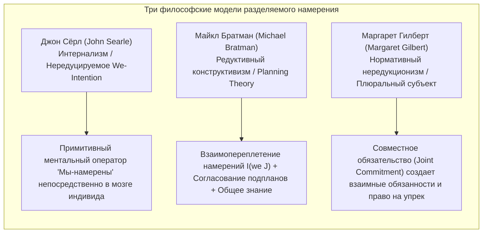
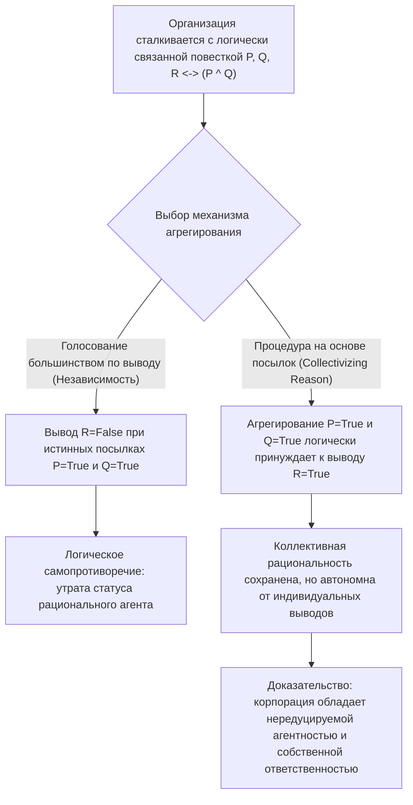
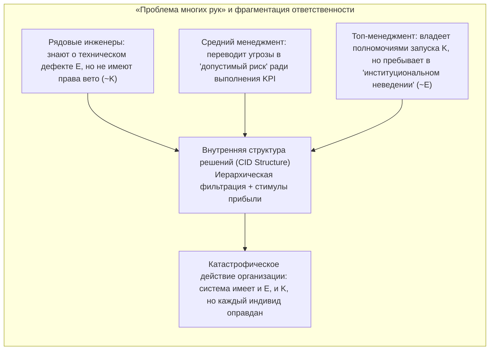

## Введение: «Нет ни души, чтобы проклясть, ни тела, чтобы пнуть»

В XVIII веке лорд-канцлер Великобритании барон Эдвард Тёрлоу произнес знаменитую фразу: «Неужели вы ожидали, что у корпорации будет совесть, когда у неё нет ни души, которую можно проклясть, ни тела, которое можно пнуть (*no soul to be damned, and no body to be kicked*)?» На протяжении веков этот афоризм преследовал философию права, нормативную этику и социологию организаций.

Когда происходят масштабные организационные катастрофы — такие как крушение парома *Herald of Free Enterprise* в 1987 году, авиакатастрофы Boeing 737 MAX из-за уязвимостей системы MCAS и обхода регуляторов, взрыв платформы *Deepwater Horizon* компании BP в 2010 году или смертельные ДТП с участием беспилотных автомобилей, — суды и общество сталкиваются с тревожным парадоксом: <strong>причинен колоссальный моральный вред, но ни один отдельно взятый человек не объединяет в себе одновременно и полный преступный умысел (mens rea), и полный каузальный контроль над действием (actus reus), которых требуют классическое уголовное право и индивидуальная этика.</strong>

Если мы редуцируем моральную ответственность исключительно к умыслу или халатности изолированных индивидов, системное зло испаряется в зазорах бюрократического разделения труда. И наоборот, если мы заявляем, что «сама корпорация морально виновна», скептики тут же спрашивают: как может абстрактная юридическая фикция, состоящая из уставов, советов директоров и алгоритмов, обладать ментальными состояниями, намерениями или моральной агентностью (*moral agency*)?

В этой статье на стыке социальной онтологии (*Social Ontology*), философии действия и теории общественного выбора (*Social Choice Theory*) системно разбираются пять фундаментальных столпов коллективной агентности и корпоративной моральной ответственности.

---

## 1. Методологический индивидуализм против нередуктивного реализма

Прежде чем выяснять, как действует коллектив, мы должны ответить на фундаментальный метафизический вопрос: являются ли коллективы реальными агентами?

### 1.1 Методологический индивидуализм и элиминативизм
От Макса Вебера и Фридриха Хайека до аналитических этиков Х. Д. Льюиса и Мануэля Веласкеса <strong>методологический индивидуализм</strong> утверждает, что только биологические человеческие индивиды обладают сознанием, совестью и свободой воли. По мнению Веласкеса, фраза «корпорация намеревалась обмануть потребителей» — это лишь риторическая метафора или сокращение, означающее, что определенные топ-менеджеры или сотрудники внутри компании имели такое намерение. Приписывать моральную вину организации, лишенной субъективного опыта (*квалиа*), — значит совершать <strong>категориальную ошибку (*Category Mistake*)</strong> в смысле Гилберта Райла и оправдывать несправедливую коллективную ответственность.

### 1.2 Нередуктивный реализм групповой агентности
В противоположность этому Питер Френч, Маргарет Гилберт, а также Кристиан Лист и Филип Петтит разработали <strong>нередуктивный реализм в отношении групповой агентности (*Non-Reductive Realism about Group Agency*)</strong>. В книге *Group Agency* (2011) Лист и Петтит доказывают, что для статуса «агента» не требуется биологический мозг; достаточно удовлетворять трем минимальным <strong>функционалистским</strong> условиям:
1. <strong>Репрезентациональные состояния (*Representational states*)</strong>: способность формировать убеждения или суждения о фактах окружающей среды;
2. <strong>Мотивационные состояния (*Motivational states*)</strong>: способность устанавливать цели, предпочтения или нормативные задачи;
3. <strong>Способность к рациональному вмешательству (*Capacity to intervene*)</strong>: способность действовать в мире на основе этих убеждений и целей, соблюдая нормы рациональной непротиворечивости.

| Критерий сравнения | Методологический индивидуализм / Элиминативизм (Weber, Velasquez) | Нередуктивный реализм / Функционализм (French, List & Pettit) |
| :--- | :--- | :--- |
| <strong>Онтологический статус группы</strong> | Юридическая фикция, метафора, простая сумма индивидуальных действий | Автономная система действия, супервентная (*supervening*) на индивидах, но нередуцируемая к ним |
| <strong>Приписывание намерений</strong> | Существует только в биологическом сознании; «корпоративное намерение» фигурально | Реально инстанциируется на системном уровне через структуру CID или агрегирование суждений |
| <strong>Субъект моральной ответственности</strong> | Только конкретные менеджеры, инженеры или операторы, допустившие прямую вину | Сама организация несет нередуцируемую ответственность (не отменяя индивидуального соучастия) |
| <strong>Объяснительная сила при кризисах</strong> | Порождает «вакуум ответственности», когда ни у одного лица нет полного умысла | Точно фиксирует структурные стимулы, корпоративную культуру и пороки институционального дизайна |

---

## 2. Микрооснования: разделяемое намерение (Shared Intention) и совместное действие

Когда два прохожих во время внезапного ливня одновременно бегут под один навес, это лишь <strong>сумма параллельных индивидуальных действий</strong>. Но когда два танцора исполняют танго или команда инженеров строит космическую станцию — это <strong>совместное действие (*Joint Action*)</strong>. Что превращает параллельное поведение в подлинное «мы-действие»? Современная аналитическая философия предлагает три классические модели:

### 2.1 Джон Сёрл: нередуцируемые «Мы-намерения» (We-Intentions)
В работе *Конструирование социальной реальности* (1995) Джон Сёрл отвергает любые попытки свести «Мы намереваемся сделать $J$» к «Я намереваюсь сделать свою часть + я верю, что ты намереваешься сделать свою». Без подлинного духа кооперации даже идеальная координация конкурентов остается индивидуальной. Поэтому Сёрл постулирует биологически встроенный в индивидуальное сознание примитивный и нередуцируемый ментальный оператор — <strong>«Мы-намерение» (*We-intention*)</strong>:

$$\text{We-intend}(J) \xrightarrow{\text{causes}} \text{Individual My-part}(A_i)$$

### 2.2 Майкл Братман: планирующая теория разделяемого намерения (Planning Theory)
Майкл Братман считает «таинственный примитивный оператор» Сёрла излишним. Согласно его *Planning Theory*, разделяемое намерение возникает тогда, когда обычные планирующие намерения индивидов образуют <strong>взаимопереплетенную сеть с согласованными подпланами (*interlocking and meshing subplans*)</strong>. Два агента $A$ и $B$ разделяют намерение $I(\text{we } J)$ тогда и только тогда, когда:

$$I(\text{we } J) \iff \begin{cases} \text{(1a) } A \text{ intends that we } J, \text{ and (1b) } B \text{ intends that we } J \\ \text{(2) } A \text{ and } B \text{ intend that we } J \text{ by way of each other's intentions and meshing subplans} \\ \text{(3) Conditions (1) and (2) are Common Knowledge between } A \text{ and } B \end{cases}$$

«Согласование подпланов (*meshing subplans*)» означает обязательство участников координировать шаги реализации без взаимных противоречий и помогать друг другу при возникновении препятствий.

### 2.3 Маргарет Гилберт: теория плюрального субъекта (Plural Subject Theory) и совместное обязательство
Маргарет Гилберт указывает на слепое пятно модели Братмана — <strong>нормативное обязательство (*Normative Obligation*)</strong>. Если мы договорились пойти на прогулку вместе, а на полпути вы молча разворачиваетесь и уходите, рушится не просто мой прогноз: я получаю <strong>нормативное право упрекнуть вас (*standing to rebuke*)</strong>. По Гилберт, в основе совместного действия лежит <strong>совместное обязательство (*Joint Commitment*)</strong>, сплавляющее индивидов в единый <strong>плюральный субъект (*Plural Subject*)</strong>.

---

## 3. Дискурсивная дилемма и теорема о невозможности агрегирования суждений

Если прогулку вдвоем можно объяснить по Братману, то как транснациональная корпорация или коллегия судей может вынести <strong>рациональное коллективное суждение, которое прямо противоречит личным выводам большинства её собственных членов</strong>?

Этот феномен был открыт в теории права Льюисом Корнхаузером и Лоуренсом Сейгером как <strong>«доктринальный парадокс» (*Doctrinal Paradox*)</strong> и обобщен Филипом Петтитом как <strong>«дискурсивная дилемма» (*Discursive Dilemma*)</strong>.

### 3.1 Матрица $3 \times 3$ дискурсивной дилеммы
Предположим, комитет по авиационной безопасности из трех экспертов (Члены 1, 2 и 3) голосует по вопросу о разрешении возврата самолета в эксплуатацию (вывод $R$). Согласно уставу безопасности, разрешение $R$ выдается тогда и только тогда, когда одновременно истинны две посылки:
* <strong>Посылка $P$</strong>: Программное обеспечение управления полетом прошло все тесты на отказоустойчивость.
* <strong>Посылка $Q$</strong>: Пилоты полностью прошли экстремальную подготовку на тренажере.
* <strong>Логическое правило</strong>: $R \leftrightarrow (P \land Q)$.

Три эксперта выносят следующие индивидуально непротиворечивые суждения:

| Член комитета | Посылка $P$ (ПО безопасно) | Посылка $Q$ (Обучение пройдено) | Логическое правило $R \leftrightarrow (P \land Q)$ | Вывод $R$ (Разрешить полеты) |
| :--- | :---: | :---: | :---: | :---: |
| <strong>Член 1</strong> | Истина (True) | Истина (True) | Истина (True) | <strong>Истина (True)</strong> |
| <strong>Член 2</strong> | Истина (True) | Ложь (False) | Истина (True) | <strong>Ложь (False)</strong> |
| <strong>Член 3</strong> | Ложь (False) | Истина (True) | Истина (True) | <strong>Ложь (False)</strong> |
| <strong>Большинство (Majority)</strong> | <strong>Истина (2/3 True)</strong> | <strong>Истина (2/3 True)</strong> | <strong>Истина (3/3 True)</strong> | <strong>Ложь (1/3 True) / Парадокс!</strong> |

Посмотрите на последнюю строку:
* <strong>Процедура на основе выводов (*Conclusion-Based Procedure*)</strong>: Если комитет голосует непосредственно по итоговому выводу $R$, разрешение <strong>отклоняется большинством 1 против 2 ($R = \text{False}$)</strong>.
* <strong>Процедура на основе посылок (*Premise-Based Procedure*)</strong>: Если комитет сначала голосует отдельно по посылкам $P$ и $Q$, то и $P$, и $Q$ принимаются большинством 2 против 1 (Истина). Применяя единогласно признанное правило $R \leftrightarrow (P \land Q)$, комитет логически выводит коллективное решение: <strong>разрешить полеты ($R = \text{True}$)</strong> — хотя две трети членов комитета лично против!

### 3.2 Теорема Листа — Петтита о невозможности агрегирования суждений
Кристиан Лист и Филип Петтит (2002) доказали, что эта дилемма является фундаментальным обобщением теоремы о невозможности Кеннета Эрроу на область логических суждений. Пусть $N = \{1, 2, \dots, n\}$ ($n \ge 3$) — множество индивидов, а $X$ — логически связанная повестка высказываний. Никакая функция агрегирования суждений

$$F: \{0, 1\}^{n \times |X|} \to \{0, 1\}^{|X|}$$

не может <strong>одновременно удовлетворять следующим четырем аксиомам</strong>:
1. <strong>Универсальная область определения (*Universal Domain*)</strong>: принимает на вход любой профиль логически непротиворечивых и полных индивидуальных суждений;
2. <strong>Коллективная рациональность (*Collective Rationality*)</strong>: выдает на выходе логически непротиворечивое и полное коллективное суждение;
3. <strong>Анонимность (*Anonymity*)</strong>: все индивиды имеют равный вес (отсутствие диктатора);
4. <strong>Систематичность / Независимость (*Systematicity / Independence*)</strong>: коллективное суждение по любому высказыванию $\phi$ зависит только от индивидуальных голосов по $\phi$ по единому для всех высказываний правилу.

### 3.3 Почему необходимо «коллективизировать разум» (Collectivizing Reason)?
Петтит показывает: чтобы организация могла выступать в обществе как заслуживающий доверия рациональный агент (*conversable agent*), она не может публично признавать истинность $P$ и $Q$ и одновременно отрицать $P \land Q$. Следовательно, организация обязана отказаться от аксиомы систематичности и выбрать <strong>процедуру на основе посылок</strong> — то есть <strong>«коллективизировать разум» (*collectivize reason*)</strong>.

Онтологическое следствие этого шага огромно: как только организация коллективизирует разум на уровне посылок, <strong>возникает эмерджентный корпоративный разум, чьи суждения и намерения не сводятся к сумме индивидуальных мнений членов организации</strong>. А обладая автономной рациональной волей, корпорация становится самостоятельным субъектом моральной ответственности.

---

## 4. Внутренняя структура принятия решений (CID) и «проблема многих рук»

### 4.1 Структура CID Питера Френча (Corporate Internal Decision Structure)
Еще в 1979 году в статье *The Corporation as a Moral Person* Питер Френч доказал, что корпорации являются полноценными моральными личностями благодаря наличию у них <strong>внутренней структуры принятия решений (*CID Structure*)</strong>, включающей два элемента:
1. <strong>Организационную схему ответственности (*Organizational Flow Chart*)</strong>: синтаксическую структуру иерархии, информационных потоков и процедур утверждения;
2. <strong>Правила признания корпоративной политики (*Corporate Decision Recognition Rules*)</strong>: аналогично «правилу признания» Г. Л. А. Харта, они определяют, когда индивидуальные решения синтезируются в официальное «решение корпорации».

Структура CID подчиняет и преобразует разрозненные биологические намерения сотрудников в подлинную <strong>корпоративную интенциональность (*Corporate Intentionality*)</strong>.

### 4.2 «Проблема многих рук» Денниса Томпсона (Problem of Many Hands)
Однако это бюрократическое разделение труда порождает знаменитую <strong>«проблему многих рук» (*The Problem of Many Hands*)</strong>, сформулированную Деннисом Томпсоном (1980).

В классической этике и уголовном праве полная моральная вина ($C$) требует, чтобы один и тот же агент $x$ одновременно обладал и <strong>эпистемическим условием / умыслом ($E$)</strong>, и <strong>условием каузального контроля ($K$)</strong>:

$$C(x) \iff E(x) \land K(x)$$

Но в крупной корпорации специализация системно расщепляет знание и контроль:
* Рядовой инженер-программист знает о локальной уязвимости кода при отказе датчика (обладает локальным знанием $E$), но не имеет полномочий изменить архитектуру или остановить релиз (лишен контроля $K$);
* Генеральный директор обладает высшей властью утвердить коммерческий запуск (глобальный контроль $K$), но иерархические фильтры и отчеты по KPI скрывают от него технические предупреждения («институциональное неведение», $\neg E$).

В результате для каждого индивида $i \in \{1, \dots, n\}$ выполняется $\neg(E(i) \land K(i))$, тогда как организационная система в целом обладала и знанием, и контролем! Отказ от признания корпоративной моральной ответственности превращает системные катастрофы в <strong>организованную безответственность</strong>.

---

## 5. Алгоритмическая агентность, разрыв ответственности ИИ и «моральные зоны деформации»

В XXI веке, когда бюрократические узлы принятия решений заменяются глубокими нейросетями и автономными алгоритмами, «проблема многих рук» порождает два новых кризиса техноэтики:

### 5.1 «Разрыв ответственности» (Responsibility Gap) Андреаса Маттиаса
Андреас Маттиас (2004) показал, что традиционная ответственность производителя или оператора опирается на предсказуемость поведения машины согласно правилам проектирования. Однако современные системы глубокого обучения с подкреплением и большие языковые модели модифицируют свои веса в процессе работы и отличаются <strong>эпистемической непрозрачностью (*opacity*)</strong>. Когда медицинский ИИ или автопилот принимает фатальное решение, непредсказуемое даже для разработчиков, несправедливо возлагать личную вину на программиста, тогда как сам алгоритм не способен ни страдать, ни платить штрафы — возникает <strong>«разрыв ответственности» (*Responsibility Gap*)</strong>.

### 5.2 «Моральные зоны деформации» (Moral Crumple Zones) Мадлен Клэр Элиш
Антрополог Мадлен Клэр Элиш (2019), исследуя аварии автоматизированной авиации и систем помощи водителю, выявила лицемерный институциональный феномен — <strong>«моральные зоны деформации» (*Moral Crumple Zones*)</strong>.

В автомобилестроении механическая зона деформации (*crumple zone*) сминается при ударе, поглощая кинетическую энергию ради спасения пассажиров. В социотехнических системах (*Human-in-the-Loop*), напротив, <strong>человек-оператор в самом конце цепочки (водитель-испытатель, дежурная медсестра, второй пилот) институционально используется как «моральная зона деформации», принимающая на себя весь юридический и репутационный удар, чтобы защитить технологическую корпорацию и её дефектную алгоритмическую архитектуру</strong>. Компания забирает себе все лавры автоматизации, но по контракту требует от человека перехватить управление вышедшим из-под контроля алгоритмом за полсекунды; в случае катастрофы вся вина списывается на «человеческий фактор» рядового оператора.

### 5.3 «Модель социальной связи» (Social Connection Model) Айрис Марион Янг
Чтобы преодолеть «проблему многих рук» и ловушку «моральных зон деформации», политический философ Айрис Марион Янг (*Responsibility for Justice*, 2011) разграничивает:
1. <strong>Ретроспективную модель вины (*Backward-Looking Liability Model*)</strong>: ищет прошлого каузального виновника, но терпит крах перед структурной несправедливостью или превращает слабые звенья в козлов отпущения;
2. <strong>Перспективную модель социальной связи (*Forward-Looking Social Connection Model*)</strong>: все агенты, участвующие в институциональных и алгоритмических процессах и извлекающие из них выгоду, разделяют <strong>обращенное в будущее политическое и моральное обязательство</strong> коллективно реформировать сами структуры принятия решений (CID), порождающие вред.

---

## Заключение: Конституционная подотчетность гибридных коллективов

От сарказма барона Тёрлоу о «бездушной корпорации», через теории разделяемого намерения Сёрла, Братмана и Гилберт, до дискурсивной дилеммы Петтита и структуры CID Френча — современная философия неопровержимо доказала, что <strong>корпорации и сложные организации являются не простыми арифметическими суммами индивидов, а эмерджентными коллективными агентами с собственной рациональной логикой и огромной каузальной мощью</strong>.

Сегодня, когда люди и автономные алгоритмы сплетаются в <strong>«гибридные коллективы» (*Hybrid Collectives*)</strong>, признание нередуцируемой моральной ответственности организаций нужно не для того, чтобы выгородить недобросовестных топ-менеджеров, а для того, чтобы разрушить щит безнаказанности «проблемы многих рук» и механизм поиска козлов отпущения в «моральных зонах деформации», подчинив саму корпоративную конституцию и алгоритмическую архитектуру требованиям справедливости.
