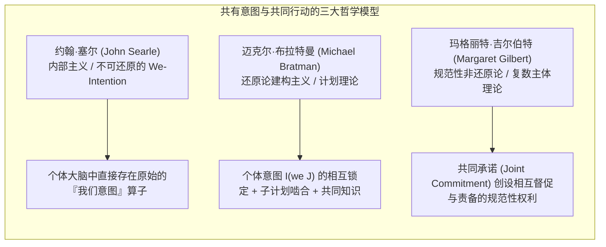
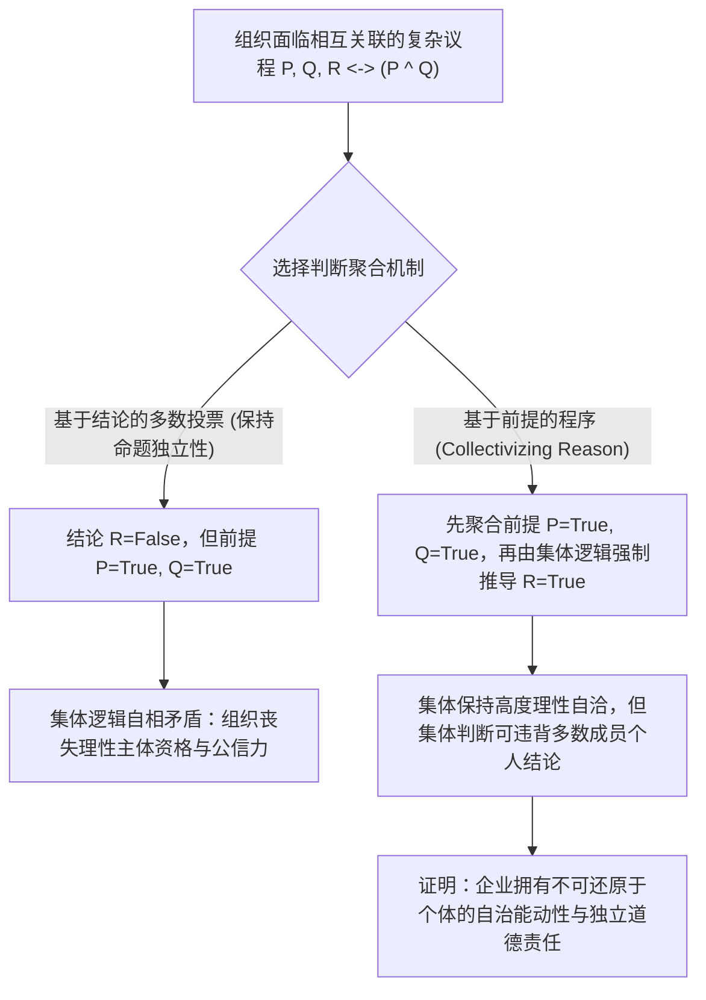
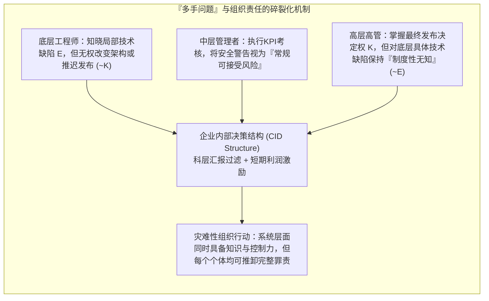

## 引言：“没有可被诅咒的灵魂，也没有可被踢打的肉体”

18世纪英国大法官爱德华·瑟洛男爵（Baron Edward Thurlow）曾留下一句名言：“你怎能指望一家公司拥有良知？它既没有可被诅咒的灵魂，也没有可被踢打的肉体（no soul to be damned, and no body to be kicked）。”几个世纪以来，这句格言一直困扰着法哲学、道德哲学与组织社会学。

当重大组织灾难发生时——例如1987年“自由企业先驱号”（Herald of Free Enterprise）渡轮因舱门未关而倾覆、波音737 MAX因MCAS系统缺陷与监管规避导致的空难、2010年英国石油公司（BP）“深水地平线”钻井平台爆炸，或是自动驾驶汽车致命事故——公众与法庭往往面临一个令人不安的悖论：<strong>造成了灾难性的道德伤害，但没有任何单一的个人完全具备传统刑法或道德归责所要求的完整的犯罪意图（mens rea）与犯罪行为（actus reus）的结合</strong>。

如果我们将责任仅仅还原为孤立个人的故意或过失，巨大的系统性恶行就会在组织分工的缝隙中蒸发；反之，如果我们声称“企业本身有罪”，怀疑论者就会追问：一个由章程、董事会决议和算法组成的抽象法律拟制物，怎么可能拥有心理状态、意图或道德能动性（moral agency）？

本文将从社会本体论（Social Ontology）、行动哲学与社会选择理论（Social Choice Theory）的交叉视角，系统剖析集体能动性（Collective Agency）与企业道德责任（Corporate Moral Responsibility）的五大核心理论支柱。

---

## 第一章：方法论个人主义与非还原论企业实在论的对决

在探讨集体如何行动之前，我们必须面对一个根本的形而上学问题：集体究竟是不是真实的行动主体？

### 1.1 方法论个人主义与消除主义（Eliminativism）
从马克斯·韦伯（Max Weber）、哈耶克（Friedrich Hayek）到分析伦理学家H.D.刘易斯（H.D. Lewis）和曼努埃尔·维拉斯奎兹（Manuel Velasquez），<strong>方法论个人主义（Methodological Individualism）</strong>坚持认为：只有血肉之躯的人类个体才拥有意识、良知与自由意志。维拉斯奎兹指出，说“某公司意图欺骗消费者”，只是一种修辞上的隐喻或缩略语，其真实含义无非是“公司内部的某些高管或员工意图欺骗”。在他们看来，向没有主观体验（qualia）的组织归属道德罪责，犯了吉尔伯特·赖尔（Gilbert Ryle）所说的<strong>范畴错误（Category Mistake）</strong>，甚至会导致集体连坐的不公。

### 1.2 非还原论的集体能动性实在论
与此相对，彼得·弗伦奇（Peter French）、玛格丽特·吉尔伯特（Margaret Gilbert）、克里斯蒂安·列表（Christian List）与菲利普·佩蒂特（Philip Pettit）等人发展了<strong>非还原论的集体能动性实在论（Non-Reductive Realism about Group Agency）</strong>。列表与佩蒂特在《群体能动性》（*Group Agency*, 2011）中论证，成为一个“行动主体（agent）”并不要求具备生物大脑或现象意识，而是取决于是否满足<strong>功能主义（Functionalism）</strong>的三个最低条件：
1. <strong>表征状态（Representational states）</strong>：对环境事实形成信念或判断的能力；
2. <strong>动机状态（Motivational states）</strong>：对目标、偏好或价值进行设定的能力；
3. <strong>理性干预能力（Capacity to intervene）</strong>：根据上述信念与目标理性地改造世界，并遵守理性一致性规范的能力。

| 比较维度 | 方法论个人主义 / 消除主义 (Weber, Velasquez) | 非还原论企业实在论 / 功能主义 (French, List & Pettit) |
| :--- | :--- | :--- |
| <strong>集体本体论地位</strong> | 法律拟制物、修辞隐喻、个体行动的加总集合 | 随附（Supervene）于个体但不可还原的自治能动系统 |
| <strong>意图与信念的归属</strong> | 仅存在于生物个体的心灵中；“企业意图”只是比喻 | 通过内部决策结构（CID）或判断聚合程序在系统层面真实实例化 |
| <strong>道德责任的核心承担者</strong> | 仅限于有直接过错的高管、工程师或操作员 | 组织实体本身承担不可还原的集体责任（同时不免除个体的共犯责任） |
| <strong>面对系统性灾难的解释力</strong> | 容易陷入“责任真空”（因为没有单一人员拥有完整恶意） | 能够精准捕捉结构性激励、企业文化与制度设计本身的道德缺陷 |

---

## 第二章：共有意图（Shared Intention）与共同行动的微观基础

两个人碰巧在雨中同时跑向同一个亭子躲雨，这只是<strong>平行个人行动的总和</strong>；而两个舞者共同跳一支探戈，或一群工程师合作建造空间站，则是<strong>共同行动（Joint Action）</strong>。路德维希·维特根斯坦曾问：“当‘我举起手臂’减去‘我的手臂升起’这一物理事实，还剩下什么？”在集体层面，平行行动加上什么，才构成真正的“我们共同行动”？当代分析哲学提出了三大经典模型：

### 2.1 约翰·塞尔（John Searle）：不可还原的“我们意图”（We-Intentions）
塞尔在《社会实在的建构》（1995）中坚决反对将“我们意图做 $J$”还原为“我意图做我的部分，且我相信你也意图做你的部分”。他指出，即便两个商业竞争对手互相知道对方在做什么并配合默契，只要缺乏真正的合作精神，就不是共同行动。因此，塞尔提出人类大脑在生物学上就具备一种原始的、不可还原的心理算子——<strong>“我们意图”（We-intention）</strong>。个体心灵内部的意图形式直接就是：

$$\text{We-intend}(J) \xrightarrow{\text{causes}} \text{Individual My-part}(A_i)$$

### 2.2 迈克尔·布拉特曼（Michael Bratman）：共有意图的计划理论（Planning Theory）
布拉特曼认为塞尔的“神秘原始算子”是不必要的。在他看来，只要在个体的日常计划意图（planning intentions）之间建立起正确的<strong>相互锁定与啮合结构（interlocking and meshing web）</strong>，就能在不引入超个体心灵的情况下解释共有意图。对于个体 $A$ 和 $B$，他们拥有共有意图 $I(\text{we } J)$ 当且仅当满足以下条件（并在共同知识 Common Knowledge 中公开）：

$$I(\text{we } J) \iff \begin{cases} \text{(1a) } A \text{ intends that we } J, \text{ and (1b) } B \text{ intends that we } J \\ \text{(2) } A \text{ and } B \text{ intend that we } J \text{ by way of each other's intentions and meshing subplans} \\ \text{(3) Conditions (1) and (2) are Common Knowledge between } A \text{ and } B \end{cases}$$

这里的“子计划啮合（meshing subplans）”意味着：即便我们在具体细节上尚未完全一致，我们也承诺通过协商避免子计划互相冲突，并在对方遇到困难时提供互助。

### 2.3 玛格丽特·吉尔伯特（Margaret Gilbert）：复数主体理论（Plural Subject Theory）与共同承诺
吉尔伯特敏锐地指出了布拉特曼模型的一个盲点：<strong>规范性义务（Normative Obligation）</strong>。如果我和你约定一起去散步，走到一半你突然一言不发地转身离开，我不仅会感到我的预测失败了，更会觉得<strong>我有权责备你（standing to rebuke）</strong>，因为你违背了对“我们”的义务。吉尔伯特认为，共有意图的核心不是心理计划的巧合，而是各方通过明示或默示的意愿表达达成的一项<strong>共同承诺（Joint Commitment）</strong>，从而将多个个体熔铸为一个<strong>复数主体（Plural Subject）</strong>。一旦进入共同承诺，任何单方面撤回都需要得到集体其他成员的许可。

---

## 第三章：推理困境（Discursive Dilemma）与判断聚合不可能性定理

如果说三人散步还可以用布拉特曼的相互计划来解释，那么拥有数万名员工的现代跨国公司或上诉法院，为什么会拥有<strong>完全独立于甚至违背所有成员个人信念</strong>的“集体判断”？

这正是刘易斯·科恩豪泽（Lewis Kornhauser）与劳伦斯·萨格（Lawrence Sager）在法学中提出的<strong>“教义悖论”（Doctrinal Paradox）</strong>，后经菲利普·佩蒂特（Philip Pettit）推广为普遍的哲学难题——<strong>“推理困境”（Discursive Dilemma）</strong>。

### 3.1 推理困境的 $3 \times 3$ 矩阵演示
假设一家航空公司的三人安全委员会（成员1、成员2、成员3）需要投票决定是否批准某型号客机立即复飞（结论 $R$）。根据公司安全章程，复飞批准当且仅当同时满足两个前提：
* <strong>前提 $P$</strong>：飞控软件已完成冗余安全验证；
* <strong>前提 $Q$</strong>：飞行员已接受完整的模拟器极端工况培训；
* <strong>逻辑规则</strong>：$R \leftrightarrow (P \land Q)$。

现在，三位理性且真诚的专家分别做出如下逻辑自洽的个人判断：

| 委员会成员 | 前提 $P$（软件验证合格） | 前提 $Q$（培训合格） | 逻辑规则 $R \leftrightarrow (P \land Q)$ | 结论 $R$（批准客机复飞） |
| :--- | :---: | :---: | :---: | :---: |
| <strong>成员 1</strong> | 是 (True) | 是 (True) | 是 (True) | <strong>是 (True)</strong> |
| <strong>成员 2</strong> | 是 (True) | 否 (False) | 是 (True) | <strong>否 (False)</strong> |
| <strong>成员 3</strong> | 否 (False) | 是 (True) | 是 (True) | <strong>否 (False)</strong> |
| <strong>多数票聚合 (Majority)</strong> | <strong>是 (2/3 True)</strong> | <strong>是 (2/3 True)</strong> | <strong>是 (3/3 True)</strong> | <strong>否 (1/3 True) / 悖论！</strong> |

请看最后一行惊人的结果：
* <strong>基于结论的程序（Conclusion-Based Procedure）</strong>：如果委员会直接对最终结论 $R$ 进行多数投票，只有成员1赞成，成员2和3反对（1票赞成，2票反对），因此集体决定是<strong>“不批准复飞”（$R = \text{False}$）</strong>。
* <strong>基于前提的程序（Premise-Based Procedure）</strong>：如果委员会先分别对前提 $P$ 和前提 $Q$ 进行多数投票，结果是：$P$ 以 2:1 通过（真），$Q$ 也以 2:1 通过（真）。然后，根据全票认可的逻辑规则 $R \leftrightarrow (P \land Q)$，委员会必然推导出集体结论：<strong>“批准复飞”（$R = \text{True}$）</strong>！

### 3.2 列表-佩蒂特判断聚合不可能性定理（List-Pettit Theorem）
克里斯蒂安·列表与菲利普·佩蒂特（2002）证明了这一困境绝非偶然，而是肯尼思·阿罗（Kenneth Arrow）不可能定理在逻辑判断领域的深刻推广。设个体集合为 $N = \{1, 2, \dots, n\}$（$n \ge 3$），逻辑相关联的命题议程为 $X$，判断聚合函数为：

$$F: \{0, 1\}^{n \times |X|} \to \{0, 1\}^{|X|}$$

列表与佩蒂特证明，<strong>不存在任何判断聚合函数 $F$ 能够同时满足以下四个看似天经地义的公理</strong>：
1. <strong>普遍定义域（Universal Domain）</strong>：接受所有逻辑一致且完备的个人判断组合作为输入；
2. <strong>集体理性（Collective Rationality）</strong>：输出的集体判断集必须在逻辑上保持一致且完备；
3. <strong>匿名性（Anonymity）</strong>：所有个体的权重相等（不存在独裁者）；
4. <strong>系统性 / 独立性（Systematicity / Independence）</strong>：集体对任意命题 $\phi$ 的判断仅取决于个体们对命题 $\phi$ 本身的投票，且所有命题采用相同的聚合规则。

### 3.3 为什么必须“使理性集体化”（Collectivizing Reason）？
佩蒂特指出，一个组织要想在社会中作为一个可信的、负责任的理性主体（conversable agent）存续，就不能在公开承认前提 $P$ 和 $Q$ 为真的同时，荒谬地否定 $P \land Q$ 的逻辑结论。因此，组织必须放弃命题逐一按多数投票的“系统性/独立性”公理，转而采用<strong>基于前提的程序</strong>——即<strong>“使理性集体化”（Collectivizing Reason）</strong>。

但这一步具有震撼性的本体论后果：一旦采用基于前提的程序（如上表中委员会最终批准客机复飞 $R=\text{True}$，尽管三分之二的成员个人反对复飞！），<strong>组织的集体意图与判断就彻底在本体论上“涌现”（emerge）并脱离了个体心理状态的简单加总</strong>。既然组织拥有了不可还原为任何个人的自治心灵（autonomous mind），它就必须作为独立的道德主体承担责任！

---

## 第四章：企业内部决策结构（CID）与“多手问题”（Problem of Many Hands）

### 4.1 彼得·弗伦奇的 CID 结构（Corporate Internal Decision Structure）
早在1979年，彼得·弗伦奇就在《作为道德主体的企业》（*The Corporation as a Moral Person*）中提出，企业之所以是真正的戴维森式意向行动者（Davidson-style intentional agent），是因为它拥有<strong>企业内部决策结构（CID Structure）</strong>。CID 结构包含两个核心要素：
1. <strong>组织责任流程图（Organizational Flow Chart）</strong>：规定不同层级、部门之间信息传递、审核与命令批准的语法结构；
2. <strong>企业政策承认规则（Corporate Decision Recognition Rules）</strong>：犹如哈特（H.L.A. Hart）法哲学中的“承认规则”，规定了哪些出于企业利益（corporate reasons）做出的决定可以被正式合成为“企业的决定”。

当不同部门的员工将各自的报告、代码和审批输入 CID 结构时，CID 结构就像一台逻辑转换器，将分散的生物个体意图<strong>从属并重构（subordinate and synthesize）</strong>为纯粹的<strong>企业意图（Corporate Intentionality）</strong>。

### 4.2 丹尼斯·汤普森的“多手问题”（Problem of Many Hands）
然而，这种精密的科层制与工程分工也制造了当代伦理学最棘手的难题——政治哲学家丹尼斯·汤普森（Dennis Thompson, 1980）所命名的<strong>“多手问题”（The Problem of Many Hands）</strong>。

在传统个人伦理与刑法中，构成完整的道德罪责（Moral Culpability $C$）要求同一个主体同时具备<strong>认知/意图条件（Mens Rea / Epistemic Condition $E$）</strong>与<strong>因果控制条件（Actus Reus / Control Condition $K$）</strong>：

$$C(x) \iff E(x) \land K(x)$$

但在大型复杂组织中，劳动分工导致了认知与因果控制的系统性割裂：
* 一线软件工程师知道某段代码在极端传感器故障下存在隐患（拥有局部 $E$），但他没有权限修改顶层架构或推迟发布（缺乏全局 $K$）；
* 顶层高管拥有签字批准发布的最高权力（拥有全局 $K$），但被层层过滤的汇报机制屏蔽了底层的技术警告（缺乏具体 $E$）。

结果，对于组织内的每一个个体 $i \in \{1, \dots, n\}$，都存在 $\neg(E(i) \land K(i))$；然而在组织整体层面，系统既知道风险又实施了危险行为！如果我们拒绝承认企业层面的集体道德责任，所有的系统性灾难都将沦为“无人负责的自然灾害”。

---

## 第五章：算法能动性、AI责任鸿沟与“道德缓冲溃缩区”

进入21世纪，当组织内部的决策节点从人类官僚替换为深度学习模型与自主算法时，“多手问题”进一步演变为两个全新的技术伦理危机：

### 5.1 安德烈亚斯·马蒂亚斯（Andreas Matthias）的“责任鸿沟”（Responsibility Gap）
马蒂亚斯（2004）指出，传统的制造商严格责任或操作员过失责任，建立在“系统行为可根据设计规则被理性预测”的前提之上。然而，现代深度强化学习与大语言模型具有<strong>运行时自主学习与权重的不可解释性（opacity）</strong>。如果一个医疗诊断AI或自动驾驶系统在训练后通过自我演化做出了连研发工程师也无法预见的致命决策，要求工程师为其承担个人道德过错是不公正的；但AI本身又没有痛苦感受与财产可供惩罚。这就造成了既无法归责于人、也无法归责于机器的<strong>“责任鸿沟”</strong>。

### 5.2 玛德琳·克莱尔·艾利什（Madeleine Clare Elish）的“道德缓冲溃缩区”（Moral Crumple Zones）
人类学家玛德琳·艾利什（2019）通过研究航空自动驾驶与特斯拉辅助驾驶事故，揭示了一种极其虚伪的制度现象——<strong>“道德缓冲溃缩区”（Moral Crumple Zones）</strong>。

在汽车工程中，“溃缩区（crumple zone）”是指车头特意设计为在撞击时变形吸能，从而保护车内乘客的机械结构。而在人机混合系统（Human-in-the-Loop）中，<strong>处于最末端的人类操作员（如安全员、值班护士、副驾驶）往往被制度性地当成了替庞大的技术企业吸收法律与道德冲击的“道德溃缩区”</strong>。企业拿走了自动化带来的全部效率与商业赞誉，却在用户协议中要求人类操作员在0.5秒内接管失控的复杂算法；一旦发生事故，企业便将全部罪责推给一线人员的“操作失误”或“注意力不集中”，从而使算法设计缺陷与企业激进的商业部署全身而退。

### 5.3 艾丽斯·马Marion·杨（Iris Marion Young）的“社会联结模型”与前瞻性制度设计
为了跨越“多手问题”与“道德溃缩区”，政治哲学家艾丽斯·马里昂·杨在《正义的责任》（*Responsibility for Justice*, 2011）中区分了两种责任模式：
1. <strong>向后看的罪责模型（Backward-Looking Liability Model）</strong>：旨在寻找过去的直接因果罪犯并加以惩罚。在结构性不公与复杂人机系统中，这种模型往往失效或沦为寻找替罪羊的工具；
2. <strong>向前看的社会联结模型（Forward-Looking Social Connection Model）</strong>：凡是通过制度、供应链、技术架构参与并从某个结构性过程获益的主体，都共同承担着<strong>面向未来的政治与道德义务</strong>——即通过集体行动去改革那个产生伤害的制度结构（CID）。

---

## 结语：重塑混合集体（Hybrid Collectives）的宪政问责

从瑟洛男爵对“无灵魂企业”的嘲讽，到塞尔、布拉特曼与吉尔伯特对“共有意图”的精微剖析，再到佩蒂特的“推理困境”与弗伦奇的“CID结构”，现代哲学已经无可辩驳地证明：<strong>企业与高度组织化的系统绝非个体的简单算术加总，而是拥有自主理性逻辑与强大因果力量的集体能动者</strong>。

在人类与自主AI交织成“混合集体（Hybrid Collectives）”的今天，承认集体层面的不可还原责任，绝不是为了替腐败的高管开脱，而是为了打破“多手问题”的免责护盾与“道德溃缩区”的替罪羊机制——迫使我们从单纯惩罚末梢个体的旧范式，走向对企业宪政结构、激励算法与技术治理架构的深度道德重构。
