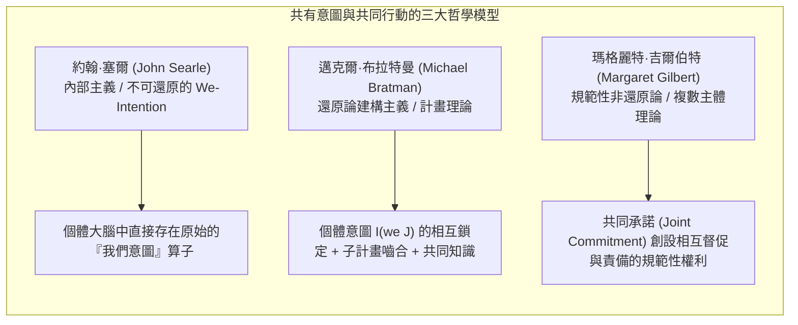
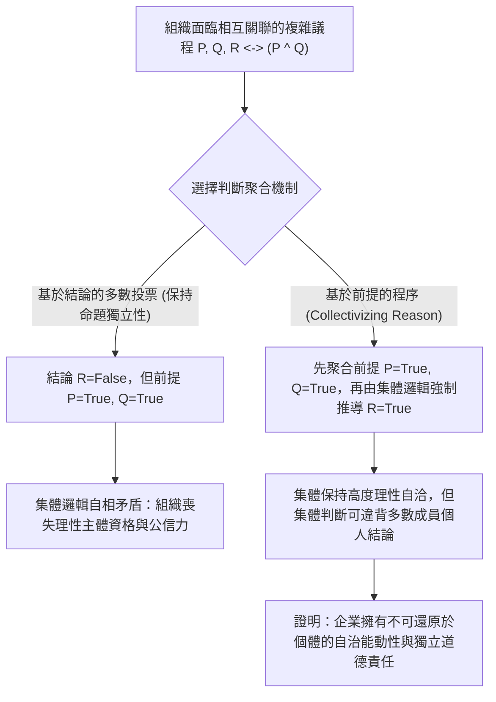
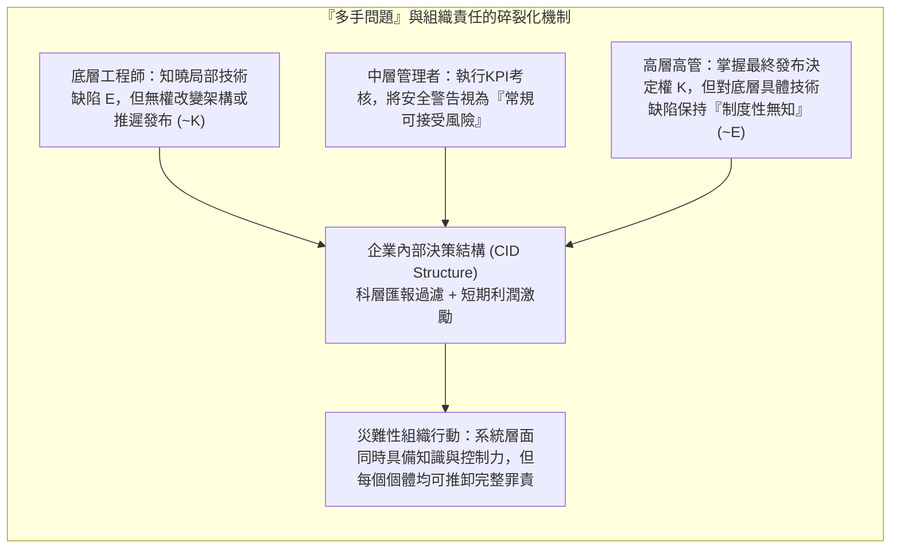

## 引言：「沒有可被詛咒的靈魂，也沒有可被踢打的肉體」

18世紀英國大法官愛德華·瑟洛男爵（Baron Edward Thurlow）曾留下一句名言：「你怎能指望一家公司擁有良知？它既沒有可被詛咒的靈魂，也沒有可被踢打的肉體（no soul to be damned, and no body to be kicked）。」幾個世紀以來，這句格言一直困擾著法哲學、道德哲學與組織社會學。

當重大組織災難發生時——例如1987年「自由企業先驅號」（Herald of Free Enterprise）渡輪因艙門未關而傾覆、波音737 MAX因MCAS系統缺陷與監管規避導致的空難、2010年英國石油公司（BP）「深水地平線」鑽井平台爆炸，或是自動駕駛汽車致命事故——公眾與法庭往往面臨一個令人不安的悖論：<strong>造成了災難性的道德傷害，但沒有任何單一的個人完全具備傳統刑法或道德歸責所要求的完整的犯罪意圖（mens rea）與犯罪行為（actus reus）的結合</strong>。

如果我們將責任僅僅還原為孤立個人的故意或過失，巨大的系統性惡行就會在組織分工的縫隙中蒸發；反之，如果我們聲稱「企業本身有罪」，懷疑論者就會追問：一個由章程、董事會決議和演算法組成的抽象法律擬制物，怎麼可能擁有心理狀態、意圖或道德能動性（moral agency）？

本文將從社會本體論（Social Ontology）、行動哲學與社會選擇理論（Social Choice Theory）的交叉視角，系統剖析集體能動性（Collective Agency）與企業道德責任（Corporate Moral Responsibility）的五大核心理論支柱。

---

## 第一章：方法論個人主義與非還原論企業實在論的對決

在探討集體如何行動之前，我們必須面對一個根本的形上學問題：集體究竟是不是真實的行動主體？

### 1.1 方法論個人主義與消除主義（Eliminativism）
從馬克斯·韋伯（Max Weber）、海耶克（Friedrich Hayek）到分析倫理學家H.D.劉易斯（H.D. Lewis）和曼努埃爾·維拉斯奎茲（Manuel Velasquez），<strong>方法論個人主義（Methodological Individualism）</strong>堅持認為：只有血肉之軀的人類個體才擁有意識、良知與自由意志。維拉斯奎茲指出，說「某公司意圖欺騙消費者」，只是一種修辭上的隱喻或縮略語，其真實含義無非是「公司內部的某些高管或員工意圖欺騙」。在他們看來，向沒有主觀體驗（qualia）的組織歸屬道德罪責，犯了吉爾伯特·賴爾（Gilbert Ryle）所說的<strong>範疇錯誤（Category Mistake）</strong>，甚至會導致集體連坐的不公。

### 1.2 非還原論的集體能動性實在論
與此相對，彼得·弗倫奇（Peter French）、瑪格麗特·吉爾伯特（Margaret Gilbert）、克里斯蒂安·列表（Christian List）與菲利普·佩蒂特（Philip Pettit）等人發展了<strong>非還原論的集體能動性實在論（Non-Reductive Realism about Group Agency）</strong>。列表與佩蒂特在《群體能動性》（*Group Agency*, 2011）中論證，成為一個「行動主體（agent）」並不要求具備生物大腦或現象意識，而是取決於是否滿足<strong>功能主義（Functionalism）</strong>的三個最低條件：
1. <strong>表徵狀態（Representational states）</strong>：對環境事實形成信念或判斷的能力；
2. <strong>動機狀態（Motivational states）</strong>：對目標、偏好或價值進行設定的能力；
3. <strong>理性干預能力（Capacity to intervene）</strong>：根據上述信念與目標理性地改造世界，並遵守理性一致性規範的能力。

| 比較維度 | 方法論個人主義 / 消除主義 (Weber, Velasquez) | 非還原論企業實在論 / 功能主義 (French, List & Pettit) |
| :--- | :--- | :--- |
| <strong>集體本體論地位</strong> | 法律擬制物、修辭隱喻、個體行動的加總集合 | 隨附（Supervene）於個體但不可還原的自治能動系統 |
| <strong>意圖與信念的歸屬</strong> | 僅存在於生物個體的心靈中；「企業意圖」只是比喻 | 透過內部決策結構（CID）或判斷聚合程序在系統層面真實實例化 |
| <strong>道德責任的核心承擔者</strong> | 僅限於有直接過錯的高管、工程師或操作員 | 組織實體本身承擔不可還原的集體責任（同時不免除個體的共犯責任） |
| <strong>面對系統性災難的解釋力</strong> | 容易陷入「責任真空」（因為沒有單一人員擁有完整惡意） | 能夠精準捕捉結構性激勵、企業文化與制度設計本身的道德缺陷 |

---

## 第二章：共有意圖（Shared Intention）與共同行動的微觀基礎

兩個人碰巧在雨中同時跑向同一個亭子躲雨，這只是<strong>平行個人行動的總和</strong>；而兩個舞者共同跳一支探戈，或一群工程師合作建造太空站，則是<strong>共同行動（Joint Action）</strong>。路德維希·維根斯坦曾問：「當『我舉起手臂』減去『我的手臂升起』這一物理事實，還剩下什麼？」在集體層面，平行行動加上什麼，才構成真正的「我們共同行動」？當代分析哲學提出了三大經典模型：

### 2.1 約翰·塞爾（John Searle）：不可還原的「我們意圖」（We-Intentions）
塞爾在《社會實在的建構》（1995）中堅決反對將「我們意圖做 $J$」還原為「我意圖做我的部分，且我相信你也意圖做你的部分」。他指出，即便兩個商業競爭對手互相知道對方在做什麼並配合默契，只要缺乏真正的合作精神，就不是共同行動。因此，塞爾提出人類大腦在生物學上就具備一種原始的、不可還原的心理算子——<strong>「我們意圖」（We-intention）</strong>。個體心靈內部的意圖形式直接就是：

$$\text{We-intend}(J) \xrightarrow{\text{causes}} \text{Individual My-part}(A_i)$$

### 2.2 邁克爾·布拉特曼（Michael Bratman）：共有意圖的計畫理論（Planning Theory）
布拉特曼認為塞爾的「神秘原始算子」是不必要的。在他看來，只要在個體的日常計畫意圖（planning intentions）之間建立起正確的<strong>相互鎖定與嚙合結構（interlocking and meshing web）</strong>，就能在不引入超個體心靈的情況下解釋共有意圖。對於個體 $A$ 和 $B$，他們擁有共有意圖 $I(\text{we } J)$ 當且僅當滿足以下條件（並在共同知識 Common Knowledge 中公開）：

$$I(\text{we } J) \iff \begin{cases} \text{(1a) } A \text{ intends that we } J, \text{ and (1b) } B \text{ intends that we } J \\ \text{(2) } A \text{ and } B \text{ intend that we } J \text{ by way of each other's intentions and meshing subplans} \\ \text{(3) Conditions (1) and (2) are Common Knowledge between } A \text{ and } B \end{cases}$$

這裡的「子計畫嚙合（meshing subplans）」意味著：即便我們在具體細節上尚未完全一致，我們也承諾透過協商避免子計畫互相衝突，並在對方遇到困難時提供互助。

### 2.3 瑪格麗特·吉爾伯特（Margaret Gilbert）：複數主體理論（Plural Subject Theory）與共同承諾
吉爾伯特敏銳地指出了布拉特曼模型的一個盲點：<strong>規範性義務（Normative Obligation）</strong>。如果我和你約定一起去散步，走到一半你突然一言不發地轉身離開，我不僅會感到我的預測失敗了，更會覺得<strong>我有權責備你（standing to rebuke）</strong>，因為你違背了對「我們」的義務。吉爾伯特認為，共有意圖的核心不是心理計畫的巧合，而是各方透過明示或默示的意願表達達成的一項<strong>共同承諾（Joint Commitment）</strong>，從而將多個個體熔鑄為一個<strong>複數主體（Plural Subject）</strong>。一旦進入共同承諾，任何單方面撤回都需要得到集體其他成員的許可。

---

## 第三章：推理困境（Discursive Dilemma）與判斷聚合不可能性定理

如果說三人散步還可以用布拉特曼的相互計畫來解釋，那麼擁有數萬名員工的現代跨國公司或上訴法院，為什麼會擁有<strong>完全獨立於甚至違背所有成員個人信念</strong>的「集體判斷」？

這正是劉易斯·科恩豪澤（Lewis Kornhauser）與勞倫斯·薩格（Lawrence Sager）在法學中提出的<strong>「教義悖論」（Doctrinal Paradox）</strong>，後經菲利普·佩蒂特（Philip Pettit）推廣為普遍的哲學難題——<strong>「推理困境」（Discursive Dilemma）</strong>。

### 3.1 推理困境的 $3 \times 3$ 矩陣演示
假設一家航空公司的三人安全委員會（成員1、成員2、成員3）需要投票決定是否批准某型號客機立即復飛（結論 $R$）。根據公司安全章程，復飛批准當且僅當同時滿足兩個前提：
* <strong>前提 $P$</strong>：飛控軟體已完成冗餘安全驗證；
* <strong>前提 $Q$</strong>：飛行員已接受完整的模擬器極端工況培訓；
* <strong>邏輯規則</strong>：$R \leftrightarrow (P \land Q)$。

現在，三位理性且真誠的專家分別做出如下邏輯自洽的個人判斷：

| 委員會成員 | 前提 $P$（軟體驗證合格） | 前提 $Q$（培訓合格） | 邏輯規則 $R \leftrightarrow (P \land Q)$ | 結論 $R$（批准客機復飛） |
| :--- | :---: | :---: | :---: | :---: |
| <strong>成員 1</strong> | 是 (True) | 是 (True) | 是 (True) | <strong>是 (True)</strong> |
| <strong>成員 2</strong> | 是 (True) | 否 (False) | 是 (True) | <strong>否 (False)</strong> |
| <strong>成員 3</strong> | 否 (False) | 是 (True) | 是 (True) | <strong>否 (False)</strong> |
| <strong>多數票聚合 (Majority)</strong> | <strong>是 (2/3 True)</strong> | <strong>是 (2/3 True)</strong> | <strong>是 (3/3 True)</strong> | <strong>否 (1/3 True) / 悖論！</strong> |

請看最後一行驚人的結果：
* <strong>基於結論的程序（Conclusion-Based Procedure）</strong>：如果委員會直接對最終結論 $R$ 進行多數投票，只有成員1贊成，成員2和3反對（1票贊成，2票反對），因此集體決定是<strong>「不批准復飛」（$R = \text{False}$）</strong>。
* <strong>基於前提的程序（Premise-Based Procedure）</strong>：如果委員會先分別對前提 $P$ 和前提 $Q$ 進行多數投票，結果是：$P$ 以 2:1 通過（真），$Q$ 也以 2:1 通過（真）。然後，根據全票認可的邏輯規則 $R \leftrightarrow (P \land Q)$，委員會必然推導出集體結論：<strong>「批准復飛」（$R = \text{True}$）</strong>！

### 3.2 列表-佩蒂特判斷聚合不可能性定理（List-Pettit Theorem）
克里斯蒂安·列表與菲利普·佩蒂特（2002）證明了這一困境絕非偶然，而是肯尼思·阿羅（Kenneth Arrow）不可能定理在邏輯判斷領域的深刻推廣。設個體集合為 $N = \{1, 2, \dots, n\}$（$n \ge 3$），邏輯相關聯的命題議程為 $X$，判斷聚合函數為：

$$F: \{0, 1\}^{n \times |X|} \to \{0, 1\}^{|X|}$$

列表與佩蒂特證明，<strong>不存在任何判斷聚合函數 $F$ 能夠同時滿足以下四個看似天經地義的公理</strong>：
1. <strong>普遍定義域（Universal Domain）</strong>：接受所有邏輯一致且完備的個人判斷組合作為輸入；
2. <strong>集體理性（Collective Rationality）</strong>：輸出的集體判斷集必須在邏輯上保持一致且完備；
3. <strong>匿名性（Anonymity）</strong>：所有個體的權重相等（不存在獨裁者）；
4. <strong>系統性 / 獨立性（Systematicity / Independence）</strong>：集體對任意命題 $\phi$ 的判斷僅取決於個體們對命題 $\phi$ 本身的投票，且所有命題採用相同的聚合規則。

### 3.3 為什麼必須「使理性集體化」（Collectivizing Reason）？
佩蒂特指出，一個組織要想在社會中作為一個可信的、負責任的理性主體（conversable agent）存續，就不能在公開承認前提 $P$ 和 $Q$ 為真的同時，荒謬地否定 $P \land Q$ 的邏輯結論。因此，組織必須放棄命題逐一按多數投票的「系統性/獨立性」公理，轉而採用<strong>基於前提的程序</strong>——即<strong>「使理性集體化」（Collectivizing Reason）</strong>。

但這一步具有震撼性的本體論後果：一旦採用基於前提的程序（如上表中委員會最終批准客機復飛 $R=\text{True}$，儘管三分之二的成員個人反對復飛！），<strong>組織的集體意圖與判斷就徹底在本體論上「湧現」（emerge）並脫離了個體心理狀態的簡單加總</strong>。既然組織擁有了不可還原為任何個人的自治心靈（autonomous mind），它就必須作為獨立的道德主體承擔責任！

---

## 第四章：企業內部決策結構（CID）與「多手問題」（Problem of Many Hands）

### 4.1 彼得·弗倫奇的 CID 結構（Corporate Internal Decision Structure）
早在1979年，彼得·弗倫奇就在《作為道德主體的企業》（*The Corporation as a Moral Person*）中提出，企業之所以是真正的戴維森式意向行動者（Davidson-style intentional agent），是因為它擁有<strong>企業內部決策結構（CID Structure）</strong>。CID 結構包含兩個核心要素：
1. <strong>組織責任流程圖（Organizational Flow Chart）</strong>：規定不同層級、部門之間資訊傳遞、審核與命令批准的語法結構；
2. <strong>企業政策承認規則（Corporate Decision Recognition Rules）</strong>：猶如哈特（H.L.A. Hart）法哲學中的「承認規則」，規定了哪些出於企業利益（corporate reasons）做出的決定可以被正式合成為「企業的決定」。

當不同部門的員工將各自的報告、程式碼和審批輸入 CID 結構時，CID 結構就像一台邏輯轉換器，將分散的生物個體意圖<strong>從屬並重構（subordinate and synthesize）</strong>為純粹的<strong>企業意圖（Corporate Intentionality）</strong>。

### 4.2 丹尼斯·湯普森的「多手問題」（Problem of Many Hands）
然而，這種精密的科層制與工程分工也製造了當代倫理學最棘手的難題——政治哲學家丹尼斯·湯普森（Dennis Thompson, 1980）所命名的<strong>「多手問題」（The Problem of Many Hands）</strong>。

在傳統個人倫理與刑法中，構成完整的道德罪責（Moral Culpability $C$）要求同一個主體同時具備<strong>認知/意圖條件（Mens Rea / Epistemic Condition $E$）</strong>與<strong>因果控制條件（Actus Reus / Control Condition $K$）</strong>：

$$C(x) \iff E(x) \land K(x)$$

但在大型複雜組織中，勞動分工導致了認知與因果控制的系統性割裂：
* 一線軟體工程師知道某段程式碼在極端感測器故障下存在隱患（擁有局部 $E$），但他沒有權限修改頂層架構或推遲發布（缺乏全局 $K$）；
* 頂層高管擁有簽字批准發布的最高權力（擁有全局 $K$），但被層層過濾的匯報機制屏蔽了底層的技術警告（缺乏具體 $E$）。

結果，對於組織內的每一個個體 $i \in \{1, \dots, n\}$，都存在 $\neg(E(i) \land K(i))$；然而在組織整體層面，系統既知道風險又實施了危險行為！如果我們拒絕承認企業層面的集體道德責任，所有的系統性災難都將淪為「無人負責的自然災害」。

---

## 第五章：演算法能動性、AI責任鴻溝與「道德緩衝潰縮區」

進入21世紀，當組織內部的決策節點從人類官僚替換為深度學習模型與自主演算法時，「多手問題」進一步演變為兩個全新的技術倫理危機：

### 5.1 安德烈亞斯·馬蒂亞斯（Andreas Matthias）的「責任鴻溝」（Responsibility Gap）
馬蒂亞斯（2004）指出，傳統的製造商嚴格責任或操作員過失責任，建立在「系統行為可根據設計規則被理性預測」的前提之上。然而，現代深度強化學習與大型語言模型具有<strong>執行時自主學習與權重的不可解釋性（opacity）</strong>。如果一個醫療診斷AI或自動駕駛系統在訓練後透過自我演化做出了連研發工程師也無法預見的致命決策，要求工程師為其承擔個人道德過錯是不公正的；但AI本身又沒有痛苦感受與財產可供懲罰。這就造成了既無法歸責於人、也無法歸責於機器的<strong>「責任鴻溝」</strong>。

### 5.2 瑪德琳·克萊爾·艾利什（Madeleine Clare Elish）的「道德緩衝潰縮區」（Moral Crumple Zones）
人類學家瑪德琳·艾利什（2019）透過研究航空自動駕駛與特斯拉輔助駕駛事故，揭示了一種極其虛偽的制度現象——<strong>「道德緩衝潰縮區」（Moral Crumple Zones）</strong>。

在汽車工程中，「潰縮區（crumple zone）」是指車頭特意設計為在撞擊時變形吸能，從而保護車內乘客的機械結構。而在人機混合系統（Human-in-the-Loop）中，<strong>處於最末端的人類操作員（如安全員、值班護士、副駕駛）往往被制度性地當成了替龐大的技術企業吸收法律與道德衝擊的「道德潰縮區」</strong>。企業拿走了自動化帶來的全部效率與商業讚譽，卻在使用者協議中要求人類操作員在0.5秒內接管失控的複雜演算法；一旦發生事故，企業便將全部罪責推給一線人員的「操作失誤」或「注意力不集中」，從而使演算法設計缺陷與企業激進的商業部署全身而退。

### 5.3 艾麗斯·馬里昂·楊（Iris Marion Young）的「社會聯結模型」與前瞻性制度設計
為了跨越「多手問題」與「道德潰縮區」，政治哲學家艾麗斯·馬里昂·楊在《正義的責任》（*Responsibility for Justice*, 2011）中區分了兩種責任模式：
1. <strong>向後看的罪責模型（Backward-Looking Liability Model）</strong>：旨在尋找過去的直接因果罪犯並加以懲罰。在結構性不公與複雜人機系統中，這種模型往往失效或淪為尋找替罪羊的工具；
2. <strong>向前看的社會聯結模型（Forward-Looking Social Connection Model）</strong>：凡是透過制度、供應鏈、技術架構參與並從某個結構性過程獲益的主體，都共同承擔著<strong>面向未來的政治與道德義務</strong>——即透過集體行動去改革那個產生傷害的制度結構（CID）。

---

## 結語：重塑混合集體（Hybrid Collectives）的憲政問責

從瑟洛男爵對「無靈魂企業」的嘲諷，到塞爾、布拉特曼與吉爾伯特對「共有意圖」的精微剖析，再到佩蒂特的「推理困境」與弗倫奇的「CID結構」，現代哲學已經無可辯駁地證明：<strong>企業與高度組織化的系統絕非個體的簡單算術加總，而是擁有自主理性邏輯與強大因果力量的集體能動者</strong>。

在人類與自主AI交織成「混合集體（Hybrid Collectives）」的今天，承認集體層面的不可還原責任，絕不是為了替腐敗的高管開脫，而是為了打破「多手問題」的免責護盾與「道德潰縮區」的替罪羊機制——迫使我們從單純懲罰末梢個體的舊範式，走向對企業憲政結構、激勵演算法與技術治理架構的深度道德重構。
