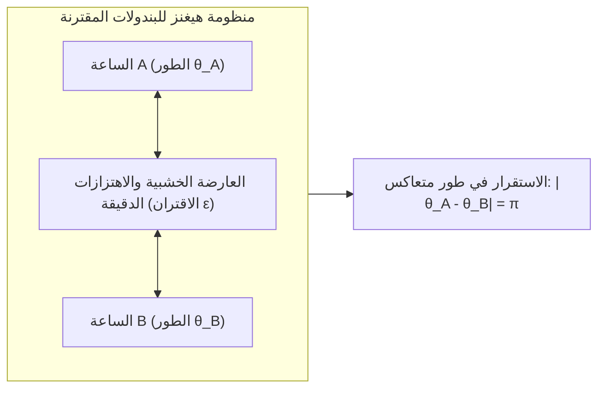
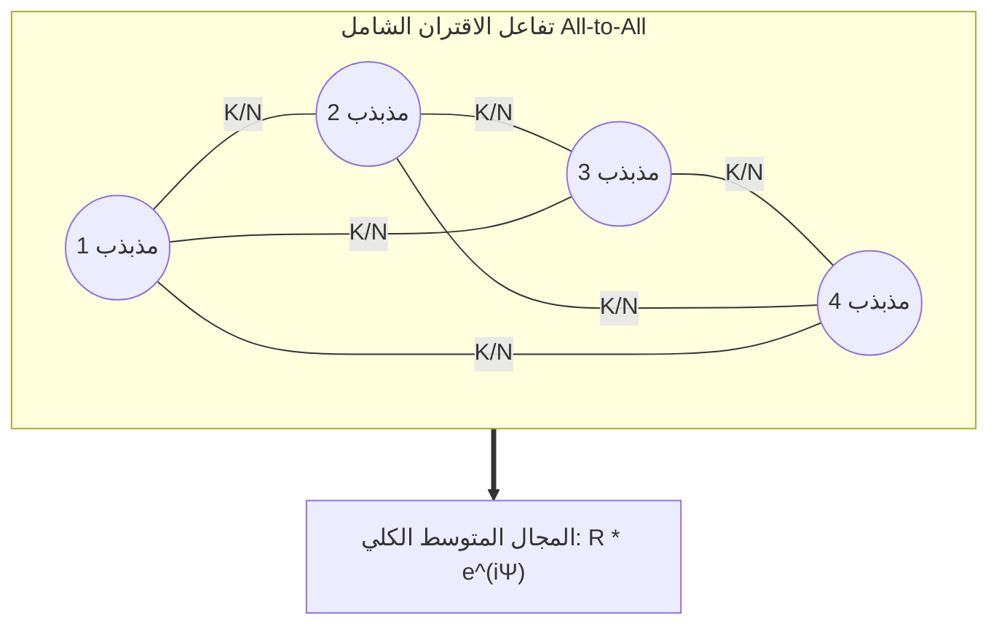

في غابات المانغروف الاستوائية بجنوب شرق آسيا، يشهد الليل واحدة من أعظم الظواهر الطبيعية إثارة للدهشة: عشرات الآلاف من حشرات اليراغ المضيئة، التي تومض كل منها في البداية وفق ساعتها البيولوجية الفردية، تبدأ تدريجياً في توحيد ومضاتها. وخلال دقائق معدودة، تشتعل قمم الأشجار الشاسعة بوميض ضوئي متزامن في نفس الجزء من الألف من الثانية، وتخبو في آن واحد. وفي لندن عام 2000، في يوم افتتاح جسر الألفية، بدأ الجسر يتأرجح أفقياً بشكل حاد تحت وطأة خطوات آلاف المشاة الذين اضطروا لا شعورياً إلى ضبط خطواتهم مع اهتزازات الجسر، مما فاقم التأرجح إلى مستويات خطيرة. وفي أعماق قلوبنا، تقوم ملايين الخلايا المنظمة لضربات القلب في العقدة الجيبية الأذينية بالتفريغ الكهربائي بتناغم تام دون الحاجة لأي أمر مباشر من الدماغ.

تُعرف هذه الظاهرة الكونية العابرة لعلم الأحياء والهندسة والفيزياء الإحصائية باسم <strong>التزامن الجماعي التلقائي (Collective Synchronization)</strong>.

كيف يمكن لمجموعة ضخمة من المكونات المستقلة ذات الترددات الطبيعية المتباينة أن تولد نظاماً كلياً موحداً دون وجود قائد مركزي، بل بالاعتماد فقط على تفاعلات تبادلية متناهية الصغر؟

يقدم هذا المقال دراسة شاملة في الديناميكا غير الخطية ونظرية الشبكات المعقدة: من ملاحظات الفيزيائي كريستيان هيغنز إلى <strong>نموذج كوراموتو (Kuramoto Model)</strong> الشهير، وفرضية <strong>أوت-أنتونسن (Ott-Antonsen)</strong>، وحالات <strong>الكيميرا (Chimera States)</strong> الغامضة.

---

## 1. اكتشاف كريستيان هيغنز: بزوغ علم التزامن

يعود أول توثيق علمي للتزامن إلى عام 1665، عندما لاحظ الفيزيائي الهولندي ومخترع الساعة البندولية كريستيان هيغنز أثناء مرضه ظاهرة عجيبة: ساعتان بندوليتان كانتا معلقتين على نفس العارضة الخشبية في غرفته بدأتا تتأرجحان بعد ساعة أو ساعتين بنفس التردد بدقة ولكن في اتجاهين متعاكسين تماماً (طور متضاد بفارق زاوية $\pi$). ووصف هيغنز ذلك بـ <strong>«تعاطف البندولين» (Sympathy of Pendulums)</strong>.

استنتج هيغنز أن حركة البندولين ترسل اهتزازات ميكانيكية دقيقة عبر العارضة الخشبية. هذا <strong>الاقتران الضعيف (Weak Coupling)</strong> كان كافياً لتنسيق حركتهما بحيث تلغي القوى الجانبية بعضها بعضاً محققة أقصى درجات الاستقرار الميكانيكي.

---

## 2. مذبذبات دورة النهاية: صلابة السعة ومرونة الطور

تتميز الأنظمة البيولوجية والميكانيكية الحقيقية بأنها <strong>مذبذبات غير خطية ذاتية الإثارة (Limit-Cycle Oscillators)</strong>. تستهلك الطاقة وتبددها باستمرار لتشكل مداراً مغلقاً مستقراً في فضاء الطور يُعرف بـ <strong>دورة النهاية (Limit Cycle)</strong>:
1. <strong>صلابة السعة (Amplitude Rigidity)</strong>: أي اضطراب عمودي على المدار يتلاشى أُسياً بسرعة ليعود المسار إلى دورة النهاية.
2. <strong>مرونة الطور (Phase Flexibility)</strong>: لا توجد أي قوة إرجاع على طول مسار المدار (إحداثي الطور $\theta$).

وبناءً عليه، فإن أي تفاعل متناهي الصغر لا يستطيع تغيير سعة الاهتزاز، لكنه يستطيع بسهولة تعديل <strong>الطور $\theta$</strong> تقديماً أو تأخيراً. وهذا هو التفسير الفيزيائي لانتشار التزامن الطوري تحت تأثير الاقتران الضعيف.

---

## 3. نموذج كوراموتو: النموذج القياسي للتزامن

### 3.1 المعادلة الأساسية

في عام 1975، صاغ الفيزيائي الياباني <strong>يوشيكي كوراموتو (Yoshiki Kuramoto)</strong> بجامعة كيوتو نموذجه الشهير لمجموعة من $N$ مذبذباً مقترنة اقتراناً شاملاً (All-to-All):

$$\frac{d\theta_i}{dt} = \omega_i + \frac{K}{N} \sum_{j=1}^N \sin(\theta_j - \theta_i) \quad (i = 1, \dots, N)$$

حيث:
- $\theta_i(t)$ هو طور المذبذب رقم $i$؛
- $\omega_i$ هو <strong>التردد الطبيعي</strong> المستمد من توزيع احتمالي متماثل $g(\omega)$؛
- $K > 0$ يمثل قوة <strong>الاقتران الشامل</strong>؛
- دالة الجيب تعمل كقوة جذب تسعى لتقليل الفارق في الطور.

### 3.2 معامل الترتيب المركب ونظرية المجال المتوسط

ابتكر كوراموتو <strong>معامل الترتيب المركب</strong>:

$$r(t) e^{i \psi(t)} = \frac{1}{N} \sum_{j=1}^N e^{i \theta_j(t)}$$

- <strong>$r(t) \in [0, 1]$</strong>: يقيس درجة التماسك والتزامن ($r \approx 0$ تمثل العشوائية التامة و $r \to 1$ تمثل التزامن الكامل).
- <strong>$\psi(t)$</strong>: الطور المتوسط الكلي للمجموعة.

بفضل هذا التحويل، تتحول معادلة $N$-جسيم المعقدة إلى معادلة مذبذب مفرد يتفاعل مع المجال المتوسط المشترك:

$$\frac{d\theta_i}{dt} = \omega_i + K r \sin(\psi - \theta_i)$$

---

## 4. تحول الطور وقوة الاقتران الحرجة $K_c$

ينقسم المذبذبون إلى فئتين:
1. <strong>المذبذبات المحتجزة في الطور ($|\omega_i| \le Kr$)</strong>: تستقر عند نقطة اتزان وتدور بالتردد الموحد للمجموعة.
2. <strong>المذبذبات المنجرفة ($|\omega_i| > Kr$)</strong>: تتباين تردداتها بدرجة تمنع احتجازها وتستمر في الانزلاق الدائري.

وفي النهاية المستمرة $N \to \infty$، اشتُق قانون <strong>قوة الاقتران الحرجة</strong>:

$$K_c = \frac{2}{\pi g(0)}$$

وعند تجاوز هذا الحد ($K > K_c$)، تنشأ حالة النظام تلقائياً وتنمو متناسبة مع $r \propto (K - K_c)^{1/2}$، وهي سمة مطابقة تماماً لـ <strong>تحولات الطور المستمرة من الدرجة الثانية</strong> في الفيزياء الإحصائية.

---

## 5. فرضية أوت-أنتونسن وحالات الكيميرا

في عام 2008، أحدث <strong>إدوارد أوت وتوماس أنتونسن</strong> ثورة علمية بإثبات إمكانية اختزال عدد لا نهائي من المذبذبات إلى معادلة تفاضلية اعتيادية منخفضة الأبعاد.

كذلك في عام 2002، اكتشف <strong>كوراموتو وشيما</strong> ظاهرة <strong>حالات الكيميرا (Chimera States)</strong>: حيث تنقسم منظومة من المذبذبات المتطابقة ذات الاقتران غير الموضعي تلقائياً إلى نصف متزامن تماماً ونصف فوضوي غير متماسك، وهو ما يفسر بيولوجياً ظاهرة نوم نصف الدماغ في الدلافين والطيور المهاجرة.

---

## 6. التطبيقات الحيوية والهندسية

| المجال | النظام | المذبذب الفردي | وسيط الاقتران | الخطر عند فقدان التزامن |
|---|---|---|---|---|
| <strong>شبكات الطاقة</strong> | الشبكات الكهربائية الذكية | المولدات التزامنية والمحولات | خطوط نقل التيار المتردد | انقطاع شامل وفوري للكهرباء (Blackout) |
| <strong>علم الأعصاب</strong> | قشرة الدماغ والحصين | جهود الفعل العصبية | المشابك العصبية والوصلات الفجوية | نوبات الصرع الحادة (تزامن مفرط) |
| <strong>طب القلب</strong> | العقدة الجيبية الأذينية | خلايا تنظيم النبض | القنوات الأيونية الغشائية | الرجفان البطيني وتوقف القلب المفاجئ |
| <strong>الهندسة المدنية</strong> | الجسور المعلقة للمشاة | إيقاع خطوات الأقدام | المرونة العرضية لهيكل الجسر | تذبذب جانبي رنيني مدمر |

## 7. الخاتمة

يُظهر نموذج كوراموتو أن النظام والانسجام في الكون لا يتطلبان بالضرورة هيمنة أو سلطة مركزية؛ فالتفاعل والتبادل التلقائي بين الأفراد قادران على خلق أعظم معزوفة متناغمة في الطبيعة.
