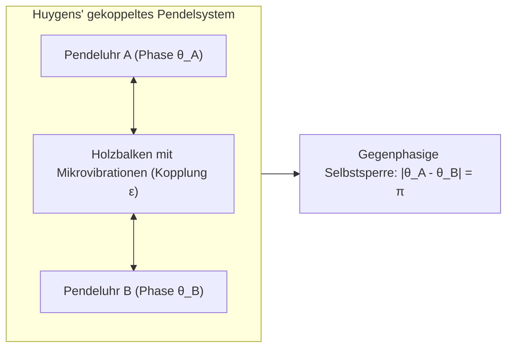
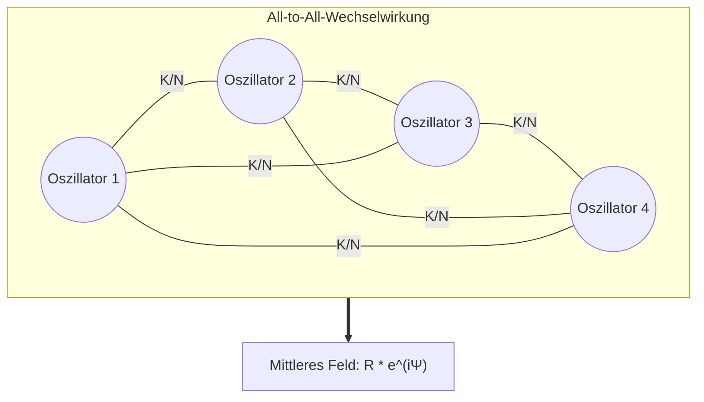

In den dichten Mangrovenwäldern Südostasiens geschieht bei Einbruch der Nacht ein faszinierendes Naturschauspiel: Zehntausende Glühwürmchen, die ursprünglich jedes nach ihrer eigenen inneren biologischen Uhr blinkten, beginnen allmählich, ihren Takt aneinander anzugleichen. Nach kurzer Zeit erstrahlen ganze Baumkronen exakt zur selben Millisekunde im hellen Glanz, um im nächsten Augenblick gemeinsam in tiefste Dunkelheit zu versinken. Im Jahr 2000, am Tag ihrer Eröffnung in London, geriet die Millennium Bridge durch die unbewussten Schritte Tausender Fußgänger in bedrohliche seitliche Schwingungen. Um nicht zu stürzen, passten die Passanten ihre Schritte dem Schwanken der Brücke an – was die Amplitude der Schwingung dramatisch verstärkte. Tief in unserem Herzen koordinieren Millionen von Schrittmacherzellen im Sinusknoten ihre elektrischen Entladungen völlig autonom und ohne zentrales Nervensignal über Jahrzehnte hinweg mit höchster Präzision.

Dieses fundamentale Phänomen, das sich quer durch Biologie, Ingenieurwesen, Himmelsmechanik und Festkörperphysik zieht, nennt man <strong>kollektive Selbstsynchronisation (Collective Synchronization)</strong>.

Wie kann es sein, dass eine riesige Menge unabhängiger Individuen mit unterschiedlichen Eigenfrequenzen, Herstellungsfehlern oder biologischen Varianzen ohne jeden externen Dirigenten (No Central Controller) allein durch extrem schwache gegenseitige Wechselwirkungen spontan eine makroskopische, perfekt geordnete Zeitstruktur hervorbringt?

In diesem umfassenden Artikel untersuchen wir die physikalischen und mathematischen Grundlagen der Synchronisation: von Christiaan Huygens' bahnbrechender Beobachtung pendelnder Uhren über Arthur Winfrees Phasenreduktion bis hin zum revolutionären <strong>Kuramoto-Modell</strong>, dem <strong>Ott-Antonsen-Ansatz</strong> und den rätselhaften <strong>Chimären-Zuständen (Chimera States)</strong>.

---

## 1. Christiaan Huygens und die Entdeckung der Schwachen Kopplung

Die moderne Wissenschaft der Synchronisation begann im Februar 1665. Der niederländische Physiker und Astronom Christiaan Huygens, der Erfinder der Pendeluhr, lag krank im Bett. An einem gemeinsamen Holzbalken an der Wand seines Zimmers hingen zwei seiner neu entwickelten Präzisions-Pendeluhren für die Seenavigation.

Huygens stellte fest, dass die Pendel der beiden Uhren, gleichgültig in welcher Ausgangsposition oder Phasenlage man sie in Gang setzte, nach ein bis zwei Stunden stets in eine vollkommen synchrone, aber exakt gegenläufige Bewegung (Antiphase, Phasenunterschied $\pi$) verfielen. In einem Brief an die Royal Society nannte Huygens dieses verblüffende Phänomen poetisch das <strong>„Mitgefühl der Pendel“ (Sympathy of Pendulums)</strong>.

Huygens schloss Zugluft und Magnetismus experimentell aus. Er erkannte messerscharf, dass die Pendelbewegungen unmerkliche mechanische Erschütterungen auf den gemeinsamen Holzbalken übertrugen. Diese mikroskopische Rückwirkung reichte aus, um die beiden autonomen Systeme gegenseitig zu beeinflussen. Wenn die Pendel gegeneinander schwingen, heben sich die seitlichen Horizontalkräfte auf den Balken gegenseitig auf – der Zustand minimaler Energiedissipation und maximaler dynamischer Stabilität ist erreicht.

---

## 2. Lineare Resonanz versus Nichtlineare Selbstoszillation

Ein klassischer harmonischer Oszillator (wie ein reibungsfreies Federpendel) ist ein konservatives System; seine Schwingungsamplitude hängt ausschließlich von den Anfangsbedingungen ab. Reale Taktgeber in der Natur und Technik sind jedoch <strong>selbsterregte nichtlineare Oszillatoren (Limit-Cycle Oscillators)</strong>. Sie nehmen kontinuierlich Energie aus ihrer Umgebung auf und dissipieren sie intern.

Im Phasenraum bildet ein solcher Oszillator einen isolierten, geschlossenen Orbit – einen <strong>Grenzzyklus (Limit Cycle)</strong>:
- <strong>Amplitudensteifigkeit (Amplitude Rigidity)</strong>: Störungen senkrecht zum Grenzzyklus klingen exponentiell schnell ab; der Oszillator kehrt rasch auf seine Bahn zurück.
- <strong>Phasenweichheit (Phase Neutrality)</strong>: Entlang der Tangente des Orbits (also in Richtung der Phase $\theta$) existiert keinerlei Rückstellkraft.

Daher kann eine winzige Kopplungskraft die Amplitude kaum verändern, aber sie kann die <strong>Phase $\theta$</strong> des Oszillators mühelos vorantreiben oder verzögern. Diese Eigenschaft ist das universelle Fundament der schwach gekoppelten Phasensynchronisation.

---

## 3. Das Kuramoto-Modell: Die mathematische Eleganz

### 3.1 Die Grundgleichung gekoppelter Phasen

Im Jahr 1975 formulierte der japanische Physiker <strong>Yoshiki Kuramoto</strong> von der Universität Kyōto ein mathematisches Modell, das zum weltweiten Standard für kollektive Synchronisation wurde. Kuramoto betrachtete ein Ensemble von $N$ Oszillatoren, von denen jeder ausschließlich durch seine Phase $\theta_i \in [0, 2\pi)$ beschrieben wird, mit allseitiger schwacher Kopplung (All-to-All) und einer sinusförmigen Wechselwirkungsfunktion:

$$\frac{d\theta_i}{dt} = \omega_i + \frac{K}{N} \sum_{j=1}^N \sin(\theta_j - \theta_i) \quad (i = 1, \dots, N)$$

Hierbei gilt:
- $\theta_i(t)$ ist die Phase des $i$-ten Oszillators;
- $\omega_i$ ist die individuelle <strong>Eigenfrequenz (Natural Frequency)</strong>, gezogen aus einer Wahrscheinlichkeitsdichte $g(\omega)$, die typischerweise unimodal und symmetrisch um eine Mittenfrequenz $\omega_0$ verteilt ist;
- $K > 0$ bezeichnet die globale <strong>Kopplungsstärke (Coupling Strength)</strong>;
- Der Term $\sin(\theta_j - \theta_i)$ wirkt als attraktive Kraft: Ist $\theta_j > \theta_i$, wird der $i$-te Oszillator beschleunigt, andernfalls abgebremst.

### 3.2 Der komplexe Ordnungsparameter und die Mittelfeldtheorie

Um das gekoppelte System zu entwirren, führte Kuramoto einen genialen Mittelfeldansatz ein. Er definierte den <strong>komplexen Ordnungsparameter</strong>:

$$r(t) e^{i \psi(t)} = \frac{1}{N} \sum_{j=1}^N e^{i \theta_j(t)}$$

Geometrisch entspricht dies dem Schwerpunkt aller Oszillatoren auf dem Einheitskreis der komplexen Zahlenebene:
- <strong>$r(t) \in [0, 1]$ (Kohärenzgrad)</strong>:
  - $r \approx 0$: Phasen sind gleichmäßig verteilt, das System ist vollkommen unkorreliert (inkohärent).
  - $r \to 1$: Alle Oszillatoren sind in einer dichten Phasenwolke synchronisiert.
- <strong>$\psi(t)$</strong>: Die makroskopische mittlere Phase der gesamten Population.

Multipliziert man beide Seiten mit $e^{-i\theta_i}$ und nimmt den Imaginärteil, vereinfacht sich die ursprüngliche $N$-Körper-Gleichung auf verblüffende Weise zu einer entkoppelten Bewegungsgleichung im kollektiven Mittelfeld:

$$\frac{d\theta_i}{dt} = \omega_i + K r \sin(\psi - \theta_i)$$

Jeder Oszillator spürt nicht mehr die einzelnen Partner, sondern interagiert ausschließlich mit dem übergeordneten makroskopischen Feld $r e^{i\psi}$.

---

## 4. Phasenübergang und die kritische Kopplung $K_c$

Im mitrotierenden Bezugssystem ($\psi = \omega_0 t = 0$) und bei stationärem Ordnungsparameter ($r = \text{const}$) spaltet sich die Population scharf in zwei Gruppen:

1. <strong>Phasengekoppelte Oszillatoren (Phase-Locked, $|\omega_i| \le Kr$)</strong>:
   Für diese existiert ein stabiler Fixpunkt $\frac{d\theta_i}{dt} = 0$. Ihre Phase wird durch das Mittelfeld eingefangen:
   $$\sin \theta_i^* = \frac{\omega_i}{K r}$$
   Sie rotieren alle exakt mit der gemeinsamen Mittenfrequenz $\omega_0$ und erzeugen das kohärente Makrosignal.

2. <strong>Driftende Oszillatoren (Drifting, $|\omega_i| > Kr$)</strong>:
   Ihre Eigenfrequenz weicht zu stark ab; sie gleiten ungleichförmig über den Kreis und mitteln sich im statistischen Mittel heraus.

Aus der Selbstkonsistenzbedingung für $N \to \infty$ leitet sich bei $r \to 0^+$ der universelle Ausdruck für die <strong>kritische Kopplungsstärke</strong> ab:

$$K_c = \frac{2}{\pi g(0)}$$

Für eine Cauchy-Lorentz-Verteilung $g(\omega) = \frac{\gamma}{\pi(\omega^2 + \gamma^2)}$ mit Skalenparameter $\gamma$ ergibt sich exakt:
$$K_c = 2\gamma$$

- Für $K < K_c$ ist der inkohärente Zustand ($r=0$) stabil.
- Für $K > K_c$ wird die Inkohärenz instabil; es findet eine überkritische Pitchfork-Bifurkation statt, und die Kohärenz wächst gemäß einem Potenzgesetz $r \propto (K - K_c)^{1/2}$. Dies entspricht exakt einem <strong>kontinuierlichen Phasenübergang zweiter Ordnung</strong>, wie man ihn aus dem Ferromagnetismus (Curie-Punkt) kennt!

---

## 5. Der Ott-Antonsen-Ansatz und Chimären-Zustände

### 5.1 Reduktion unendlicher Dimensionen

Jahrzehntelang war die exakte Dynamik des Kuramoto-Modells außerhalb des Gleichgewichts mathematisch unzugänglich, da sie die Lösung einer unendlichdimensionalen Kontinuitätsgleichung für die Dichtefunktion $f(\theta, \omega, t)$ erforderte.

2008 entdeckten <strong>Edward Ott</strong> und <strong>Thomas Antonsen</strong> an der University of Maryland den sensationellen <strong>Ott-Antonsen-Ansatz</strong>: Werden die Fourier-Koeffizienten der Oszillatorverteilung als Potenzen eines einzigen Erzeugers angesetzt ($f_n = \alpha^n$), kollabiert das unendlichdimensionale partielle Differentialgleichungssystem exakt auf eine einzige gewöhnliche Differentialgleichung für die Amplitude $\alpha(t)$:

$$\frac{d\alpha}{dt} = -i \omega_0 \alpha - \gamma \alpha + \frac{K}{2}(\alpha - \alpha^* \alpha^2)$$

Damit konnte erstmals das vollständige Bifurkations- und Stabilitätsverhalten analytisch berechnet werden.

### 5.2 Chimären-Zustände (Chimera States)

Im Jahr 2002 entdeckten <strong>Yoshiki Kuramoto und Shigeru Shima</strong>, dass in Ringen identischer Oszillatoren mit nicht-lokaler Kopplung ein spektakulärer Symmetriebruch auftreten kann: Ein Teil der Oszillatoren synchronisiert sich vollkommen, während der andere Teil vollkommen chaotisch und desynchronisiert driftet – trotz identischer Oszillatoren und symmetrischer Gesetze. Steven Strogatz taufte diese Koexistenz von Ordnung und Chaos 2004 <strong>Chimären-Zustand</strong>. Dieses Phänomen erklärt unter anderem den Halbhirnschlaf (Unihemisphärischer Schlaf) bei Delfinen und Vögeln.

---

## 6. Anwendungen in Natur und Technik

| Anwendungsbereich | System | Einzelner Oszillator | Kopplungsmechanismus | Risiko bei Desynchronisation |
|---|---|---|---|---|
| <strong>Stromnetze</strong> | Kontinentale Hochspannungsnetze | Synchrongeneratoren / Wechselrichter | Elektrische Wechselstromleitungen | Frequenzabriss und großflächiger Blackout |
| <strong>Neurowissenschaften</strong> | Gehirnrinde & Hippocampus | Neuronale Aktionspotenziale | Synaptische Botenstoffe & Gap Junctions | Epileptischer Anfall (Über-Synchronisation) |
| <strong>Kardiologie</strong> | Sinusknoten des Herzens | Herzschrittmacher-Zellen | Gap-Junction-Ionenkanäle | Kammerflimmern und plötzlicher Herztod |
| <strong>Bauingenieurwesen</strong> | Hängebrücken (z.B. Millennium Bridge) | Schrittfrequenz der Fußgänger | Elastische Querschwingung des Brückendecks | Resonanzkatastrophe durch Schrittsperrung |
| <strong>Laseroptik</strong> | Hochleistungs-Diodenlaser | Halbleiter-Resonatoren | Beugungsoptische Rückkopplung im Resonator | Verlust der Kohärenz und Intensitätseinbruch |

## 7. Fazit: Die universelle Sinfonie der Selbstorganisation

Von Huygens' tickenden Pendeln bis hin zu den Neuronen in unserem Gehirn zeigt die Theorie der kollektiven Synchronisation: Ordnung erfordert keine zentrale Herrschaft. Wenn autonome Systeme miteinander in schwachen Austausch treten, vermag die Natur selbst aus tiefster Unordnung die erhabenste zeitliche Harmonie zu weben.
