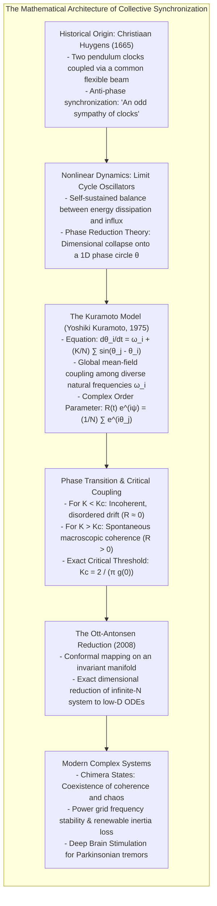
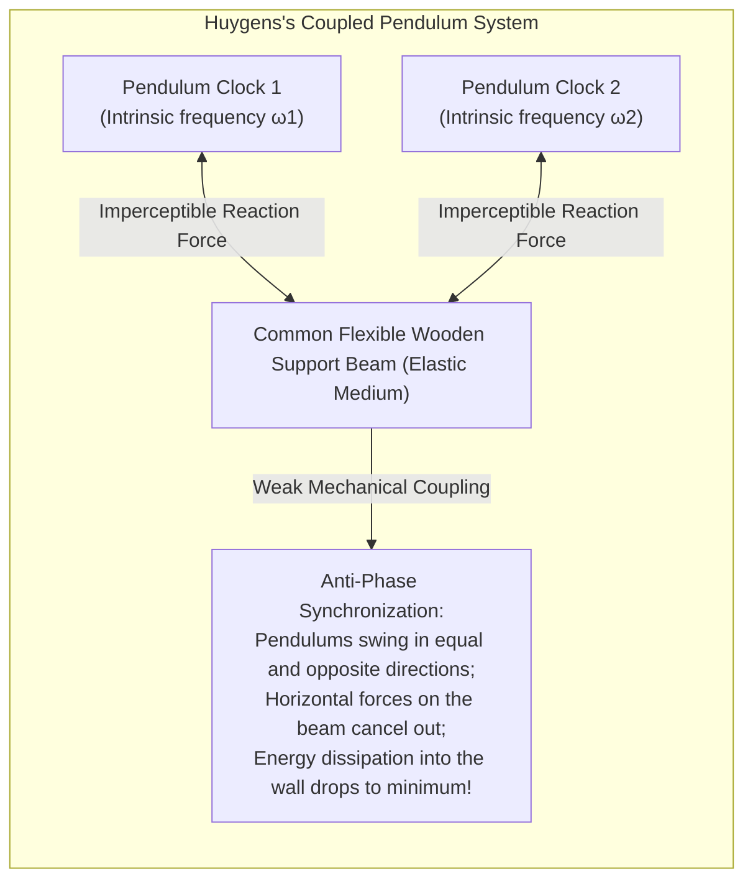
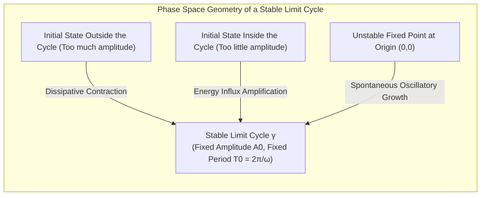
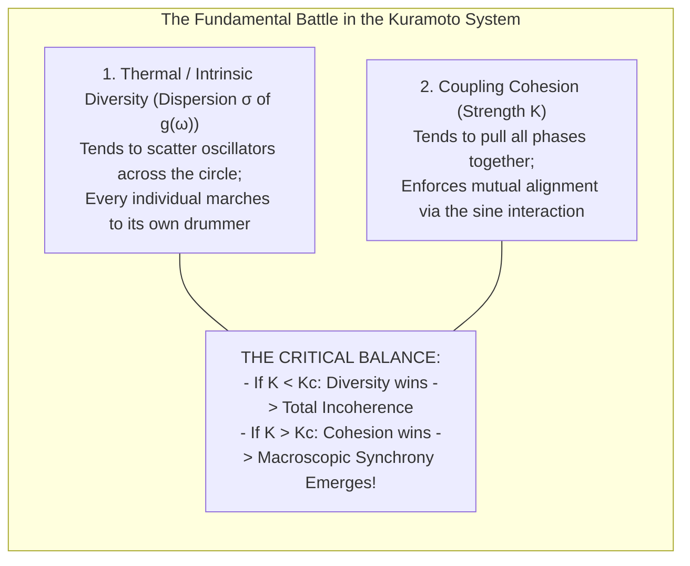
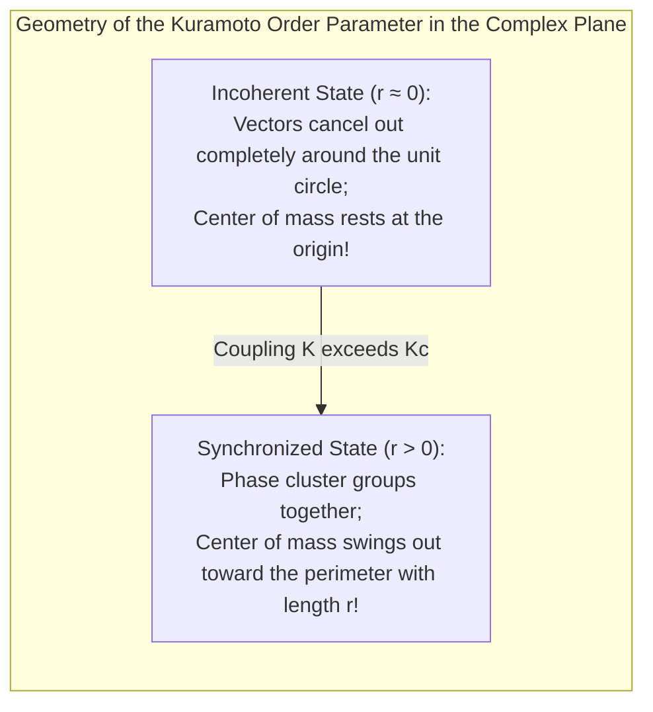
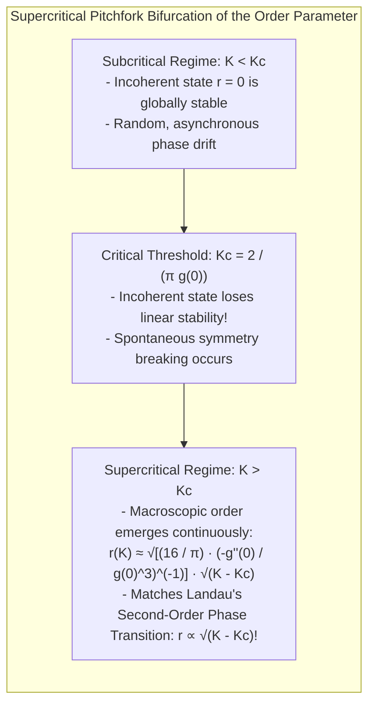
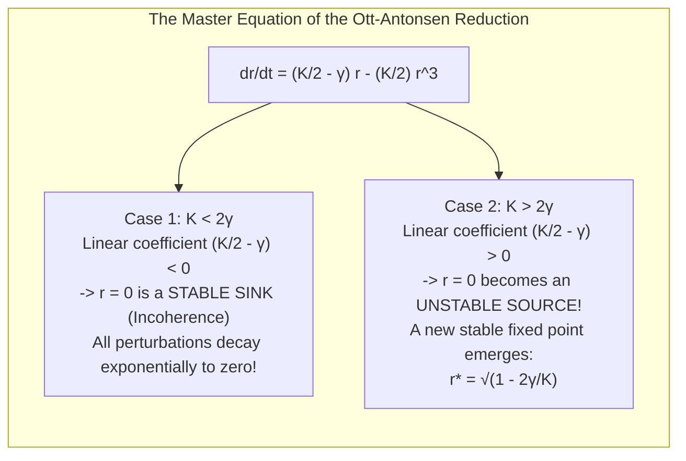
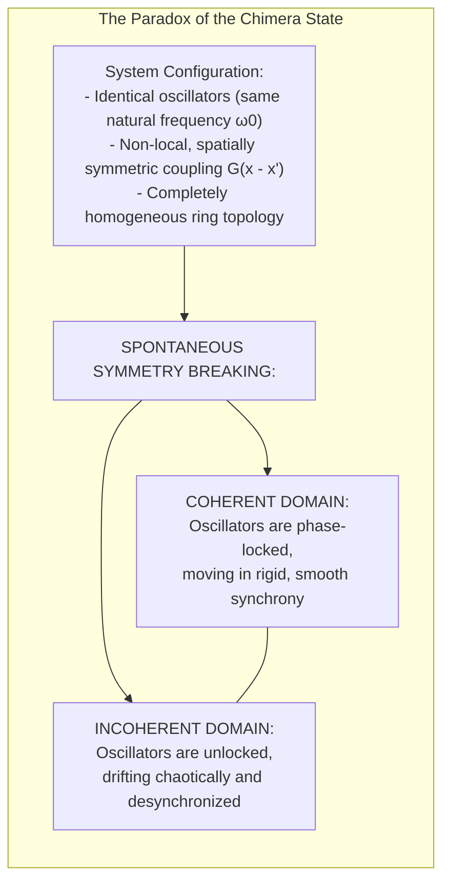
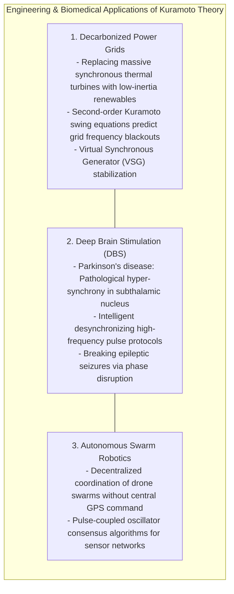

Along the winding riverbanks of Thailand and Malaysia, as dusk fades into tropical night, dense mangrove forests witness one of nature's most mesmerizing spectacles. Clustered across the branches of a single *Sonneratia* tree, thousands—sometimes tens of thousands—of male fireflies (*Pteroptyx malaccae*) begin to flash. 

At first, their bioluminescent flickers are sporadic and disordered. But within half an hour, an astonishing transformation occurs: the flashes coalesce into a single, breathtaking rhythmic pulse. Across hundreds of meters of shoreline, <strong>every firefly flashes at the exact same millisecond, and extinguishes in the exact same millisecond</strong>, transforming the dense canopy into a colossal, synchronously pulsing beacon.

Who commands this immense organic orchestra? Is there an alpha firefly delivering a tempo signal to the swarm?

Biologists have proven definitively that no leader exists. No firefly possesses a bird’s-eye view of the forest. Each individual insect sees only its nearest neighbors, adjusting its internal biological pacemaker by an imperceptible fraction of a second in response to perceived light. Yet, out of purely local, decentralized interactions among diverse individuals, <strong>global order self-organizes spontaneously</strong>.

This phenomenon—<strong>Collective Synchronization</strong>—is woven into the very fabric of reality:
- <strong>Cardiovascular Survival:</strong> In the right atrium of your heart, the <strong>sinoatrial node</strong> contains tens of thousands of pacemaker cells. Although each cell possesses an intrinsically different metabolic firing rate, gap-junction electrical coupling forces them to fire synchronously, generating the cohesive heartbeat that keeps you alive.
- <strong>Continental Power Grids:</strong> The electrical grid of North America or Europe connects thousands of massive multi-ton turbine generators across thousands of kilometers. Every generator spins at precisely the same phase and frequency (50.0 Hz or 60.0 Hz); a loss of synchrony results in cascading breaker trips and continental blackouts.
- <strong>The Millennium Bridge Oscillation:</strong> On June 10, 2000, London's Millennium Bridge opened to the public. As pedestrians crowded onto the deck, the bridge began swaying laterally. Instinctively adjusting their footing to maintain balance, the pedestrians unwittingly synchronized their footfalls with the bridge’s natural frequency, amplifying the sway to alarming proportions within minutes.

Why do separate rhythms spontaneously fall into step? Under what mathematical conditions does order emerge from chaos, and under what conditions does synchronization shatter?

This treatise explores the mathematical foundations of coupled oscillator networks: from Christiaan Huygens's seventeenth-century pendulum clocks to the geometry of limit cycles, the analytic derivation of the world-standard <strong>Kuramoto Model</strong>, the revolutionary <strong>Ott-Antonsen ansatz</strong>, the puzzling discovery of <strong>chimera states</strong>, and the frontiers of electrical grid engineering and neuroscience.



---

## 1. The "Sympathy of Clocks": Christiaan Huygens (1665)

The mathematical science of synchronization began in February 1665 with a chance observation by the Dutch mathematician, physicist, and horologist <strong>Christiaan Huygens</strong>, the inventor of the pendulum clock.

Confined to his bed in The Hague by illness, Huygens spent days watching two pendulum clocks hanging side by side from a common wooden beam affixed to his wall. The clocks had been constructed to serve as marine chronometers for determining longitude at sea. Huygens observed an unexpected dynamic:

> "It is quite worth noting that when we suspended two clocks of this design from the same wooden beam, the motions of the pendulums in each clock agreed so well with one another that they did not differ by a single beat... they continuously swung together in opposite directions, so that whenever one pendulum moved to the right, the other moved to the left."

Huygens tested the robustness of this state: he perturbed one of the pendulums with a wooden rod, forcing them out of step. Within twenty minutes, the pendulums had naturally restored their <strong>exact, identical frequency and strictly anti-phase ($180^\circ$) relationship</strong>. 

Huygens called this mutual attunement an <strong>"odd sympathy" (*sympathia insolita*)</strong>.



Huygens deduced the underlying mechanism: the pendulums transmitted imperceptible micro-vibrations through the wooden beam. When the pendulums swung in anti-phase, their horizontal forces on the beam canceled out, minimizing mechanical energy loss into the wall. The coupled system had spontaneously discovered its lowest-dissipation, dynamically stable attractor.

This was the first recorded scientific observation of <strong>mutual entrainment</strong>.

---

## 2. Nonlinear Dynamics: Limit Cycles and the Power of Phase Reduction

To model synchronization mathematically, one must distinguish between conservative harmonic oscillators and self-sustained <strong>limit cycle oscillators</strong>.

### Linear vs. Nonlinear Oscillators
The simple harmonic oscillator of linear physics (a frictionless mass on a spring) obeys $\ddot{x} + \omega_0^2 x = 0$. Its amplitude is determined entirely by initial conditions, and any friction causes its oscillations to die away exponentially.

In contrast, biological and technological oscillators—from the firing of a neuron to a radio-frequency generator—are open, dissipative systems. They consume energy from their environment (glucose, electricity) and dissipate it as entropy, actively regulating both their amplitude and frequency.

In 1881, French mathematician <strong>Henri Poincaré</strong> coined the term <strong>limit cycle</strong> to describe an isolated closed trajectory in phase space:
- Any trajectory starting inside the loop spirals outward toward the cycle.
- Any trajectory starting outside spirals inward toward the cycle.



The defining property of a limit cycle is <strong>structural asymptotic stability</strong>. If a transient perturbation kicks the system off the cycle, it naturally recovers its amplitude.

### Phase Reduction Theory: The Miracle of 1D Mapping
A living cell or an electrical alternator is an extremely high-dimensional nonlinear dynamical system described by a system of differential equations:

$$\frac{d\mathbf{x}}{dt} = \mathbf{F}(\mathbf{x}) \quad (\mathbf{x} \in \mathbb{R}^n, \, n \gg 1)$$

Solving coupled systems of thousands of such high-dimensional equations is analytically impossible.

The mathematical breakthrough that unlocked collective synchronization was <strong>Phase Reduction Theory</strong>, developed by Arthur Winfree and perfected by Japanese physicist <strong>Yoshiki Kuramoto</strong> in the 1970s and 1980s.

Because the limit cycle $\gamma$ is strongly attractive, perturbations in the directions transverse to the orbit decay rapidly. Consequently, over long timescales, the amplitude degrees of freedom are enslaved to the motion along the cycle. The entire $n$-dimensional state vector $\mathbf{x}(t)$ can be mapped onto a <strong>single scalar variable: the phase $\theta \in [0, 2\pi)$</strong>:

$$\frac{d\theta}{dt} = \omega$$

where $\omega = \frac{2\pi}{T_0}$ is the natural frequency. When an external perturbation $\mathbf{p}(t)$ acts on the oscillator, the equation becomes:

$$\frac{d\theta}{dt} = \omega + \mathbf{Z}(\theta) \cdot \mathbf{p}(t)$$

where $\mathbf{Z}(\theta) \equiv \nabla_\mathbf{x} \theta|_{\mathbf{x}=\mathbf{x}_0(\theta)}$ is the <strong>Phase Response Curve (PRC)</strong>, quantifying how an incoming impulse advances or delays the oscillator's phase depending on when it arrives in the cycle.

By reducing high-dimensional limit cycles to points moving on a unit circle, Kuramoto set the stage for a universal theory of collective synchrony.

---

## 3. The Kuramoto Model: The Paradigm of Collective Synchronization

In 1975, at the International Symposium on Mathematical Problems in Theoretical Physics in Kyoto, <strong>Yoshiki Kuramoto</strong> proposed an analytically tractable mathematical model describing the collective behavior of a population of coupled oscillators.

### The Governing Differential Equations
Consider an ensemble of $N$ weakly coupled limit cycle oscillators. Each oscillator $i$ has an intrinsic frequency $\omega_i$, randomly sampled from a symmetric, unimodal probability distribution $g(\omega)$ centered at mean frequency $\omega_0$. Assuming all-to-all (global) sinusoidal coupling, the <strong>Kuramoto Model</strong> is defined by:

$$\frac{d\theta_i}{dt} = \omega_i + \frac{K}{N} \sum_{j=1}^N \sin(\theta_j - \theta_i) \quad (i = 1, 2, \dots, N)$$

where:
- $\theta_i(t) \in [0, 2\pi)$ is the phase of the $i$-th oscillator.
- $\omega_i$ is its natural frequency.
- $K \ge 0$ is the <strong>coupling strength</strong>.
- $\frac{1}{N}$ normalizes the interaction so the dynamics remain well-defined as $N \to \infty$.
- $\sin(\theta_j - \theta_i)$ is the coupling function:
  - If oscillator $j$ is ahead of $i$ ($0 < \theta_j - \theta_i < \pi$), then $\sin > 0$, pulling oscillator $i$ forward (acceleration).
  - If oscillator $j$ is behind $i$ ($-\pi < \theta_j - \theta_i < 0$), then $\sin < 0$, dragging oscillator $i$ backward (deceleration).



### The Complex Order Parameter
To quantify the macroscopic degree of phase synchronization across the population, Kuramoto defined a complex <strong>Order Parameter</strong> $r(t) e^{i\psi(t)}$ as the centroid of all phase vectors on the unit circle in the complex plane:

$$r(t) e^{i\psi(t)} \equiv \frac{1}{N} \sum_{j=1}^N e^{i\theta_j(t)}$$

where:
- $r(t) \in [0, 1]$ measures the <strong>macroscopic phase coherence</strong> of the swarm:
  - $r(t) \approx 0$: The phases $\theta_j$ are distributed uniformly around the circle. The population is in the <strong>incoherent state</strong>.
  - $r(t) = 1$: All oscillators share the identical phase ($\theta_1 = \theta_2 = \dots = \theta_N$). The population is in <strong>complete synchronization</strong>.
- $\psi(t)$ is the <strong>mean phase</strong> of the collective cluster.



### The Mean-Field Miracle
The stroke of mathematical genius in Kuramoto's formulation emerges when one multiplies both sides of the order parameter definition by $e^{-i\theta_i}$:

$$r e^{i(\psi - \theta_i)} = \frac{1}{N} \sum_{j=1}^N e^{i(\theta_j - \theta_i)}$$

Taking the imaginary part ($\text{Im}$) of both sides yields:

$$r \sin(\psi - \theta_i) = \frac{1}{N} \sum_{j=1}^N \sin(\theta_j - \theta_i)$$

Substituting this identity directly into the original Kuramoto governing equation produces a monumental simplification:

$$\frac{d\theta_i}{dt} = \omega_i + K r \sin(\psi - \theta_i)$$

This decoupled formulation transforms a intractable $N$-body problem into a collection of <strong>single-body problems</strong>: each individual oscillator interacts not with $N-1$ separate peers, but <strong>solely with the collective mean field</strong> characterized by effective amplitude $K r$ and phase $\psi$.

---

## 4. Analytic Derivation of the Synchronization Phase Transition

How does collective synchronization arise as coupling strength $K$ increases?

### Phase-Locking vs. Phase-Drifting
Moving into a rotating reference frame matching the collective mean phase (setting $\psi = 0$ without loss of generality), the equation of motion for oscillator $i$ reduces to:

$$\frac{d\theta_i}{dt} = \omega_i - K r \sin\theta_i$$

This simple differential equation divides the population into two distinct dynamical classes:

```
   1. The Entrained (Locked) Population: |ω_i| ≤ K r
      For these oscillators, a stable fixed point exists where dθ_i/dt = 0:
      sin(θ_i^*) = ω_i / (K r)
      These oscillators are permanently captured by the collective mean field,
      freezing at fixed phase offsets θ_i^* and rotating at the exact collective frequency!
      
   2. The Drifting Population: |ω_i| > K r
      No fixed point exists. These 'stubborn' oscillators have natural frequencies
      too far from the mean to be captured. They drift continuously around the circle,
      speeding up and slowing down as they pass the cluster.
```

### Derivation of the Critical Threshold $K_c$
In the thermodynamic limit ($N \to \infty$), we describe the system using a continuum phase density function $\rho(\theta, \omega, t)$, where $\rho d\theta$ is the fraction of oscillators with natural frequency $\omega$ having phases between $\theta$ and $\theta + d\theta$.

In the stationary state ($r(t) = \text{const}$), only the locked oscillators ($|\omega| \le K r$) contribute to the real part of the order parameter, as the drifting oscillators distribute themselves symmetrically around the circle and average to zero:

$$r = \int_{-Kr}^{Kr} \cos(\theta^*(\omega)) g(\omega) d\omega$$

From the locking condition, $\sin\theta^*(\omega) = \frac{\omega}{Kr}$, which implies $\cos\theta^*(\omega) = \sqrt{1 - \left(\frac{\omega}{Kr}\right)^2}$. 

Substituting this into the integral:

$$r = \int_{-Kr}^{Kr} \sqrt{1 - \left(\frac{\omega}{Kr}\right)^2} g(\omega) d\omega$$

Making the change of variables $x = \frac{\omega}{Kr}$, so that $d\omega = Kr \, dx$:

$$r = \int_{-1}^{1} \sqrt{1 - x^2} \cdot g(Kr x) \cdot (Kr) dx$$

Assuming $r > 0$ and dividing both sides by $r$:

$$1 = K \int_{-1}^{1} \sqrt{1 - x^2} g(Kr x) dx$$

To find the critical bifurcation threshold $K_c$ where synchrony first nucleates ($r \to 0^+$), we take the limit $r \to 0$, which allows us to replace $g(Kr x)$ with $g(0)$:

$$1 = K_c \, g(0) \int_{-1}^{1} \sqrt{1 - x^2} dx$$

The definite integral $\int_{-1}^1 \sqrt{1-x^2} dx$ represents the area of a semicircle of radius 1, which evaluates to $\frac{\pi}{2}$:

$$1 = K_c \, g(0) \left( \frac{\pi}{2} \right)$$

Solving for $K_c$ yields the celebrated <strong>Kuramoto Critical Coupling Formula</strong>:

$$K_c = \frac{2}{\pi g(0)}$$



### The Physical Implications of $K_c$
This formula reveals the fundamental mechanics of synchronization:
1. <strong>The Role of Frequency Peak Density $g(0)$:</strong> The quantity $g(0)$ represents the concentration of oscillators near the median frequency. If $g(0)$ is large (a tight, cohesive distribution), then $K_c$ is tiny: <strong>even the faintest coupling will trigger spontaneous global synchronization.</strong>
2. <strong>Second-Order Continuous Phase Transition:</strong> Near criticality ($K > K_c$), the order parameter grows as:
   $$r(K) \propto \sqrt{K - K_c}$$
   This scaling behavior is mathematically identical to the spontaneous magnetization transition in the Curie-Weiss mean-field model of ferromagnetism! Synchronization is a classical thermodynamic phase transition occurring in the time domain.

---

## 5. The 21st-Century Revolution: The Ott-Antonsen Reduction (2008)

For over three decades following Kuramoto’s 1975 paper, mathematicians faced an impassable wall: while the stationary state ($r = \text{const}$) was understood, the <strong>full, non-stationary transient dynamics</strong> ($r(t)$ evolving in time) required solving an infinite-dimensional nonlinear continuity equation (the Kuramoto-Fokker-Planck equation):

$$\frac{\partial \rho}{\partial t} + \frac{\partial}{\partial \theta} (\rho v) = 0, \quad v = \omega + K r \sin(\psi - \theta)$$

In 2008, American physicists <strong>Edward Ott</strong> and <strong>Thomas M. Antonsen Jr.</strong> of the University of Maryland discovered an exact invariant manifold that cracked this problem wide open: the <strong>Ott-Antonsen (OA) Ansatz</strong>.

### The OA Invariant Manifold
Ott and Antonsen expanded the phase distribution $\rho(\theta, \omega, t)$ into a complex Fourier series in $\theta$:

$$\rho(\theta, \omega, t) = \frac{g(\omega)}{2\pi} \left[ 1 + \sum_{n=1}^\infty \left( f_n(\omega, t) e^{i n \theta} + \bar{f}_n(\omega, t) e^{-i n \theta} \right) \right]$$

They made the audacious hypothesis that the infinite set of Fourier coefficients $f_n$ is generated by powers of a <strong>single complex analytic function $\alpha(\omega, t)$</strong>:

$$f_n(\omega, t) = [\alpha(\omega, t)]^n \quad (n \ge 1, \, |\alpha| \le 1)$$

Remarkably, substituting this geometric ansatz into the infinite-dimensional continuity equation collapses all Fourier modes simultaneously, yielding a <strong>single, closed partial differential equation for $\alpha(\omega, t)$</strong>:

$$\frac{\partial \alpha}{\partial t} + i \omega \alpha + \frac{K}{2} \left( z \alpha^2 - z^* \right) = 0$$

where $z(t) = r(t) e^{-i\psi(t)} = \int \alpha(\omega, t) g(\omega) d\omega$.

### Exact Low-Dimensional ODE for a Lorentzian Distribution
If the natural frequencies follow a Lorentzian (Cauchy) distribution with half-width at half-maximum $\gamma$:

$$g(\omega) = \frac{\gamma}{\pi [(\omega - \omega_0)^2 + \gamma^2]}$$

evaluating the integral via the Cauchy residue theorem by closing the contour in the lower half complex plane ($\omega = \omega_0 - i\gamma$) evaluates $z(t) = \alpha(\omega_0 - i\gamma, t)$.

Setting the mean frequency $\omega_0 = 0$ for convenience, the infinite-dimensional Kuramoto system collapses into a <strong>single, exact, one-dimensional ordinary differential equation</strong> for the order parameter $r(t)$:

$$\frac{dr}{dt} = \left( \frac{K}{2} - \gamma \right) r - \frac{K}{2} r^3$$



The Ott-Antonsen ansatz achieved what physicists had sought for thirty-three years: a closed-form, finite-dimensional dynamical equation that predicts the exact nonlinear path by which an incoherent population self-organizes into synchronized harmony.

---

## 6. The Enigma of Chimera States: Order and Chaos Coexisting

In 2002, Yoshiki Kuramoto and his postdoctoral researcher Dorjsuren Battogtokh discovered a phenomenon that shattered another foundational intuition in physics: the <strong>Chimera State</strong>.

Named after the mythical Greek beast composed of parts from incongruous creatures (lion, goat, snake), a chimera state is a regime in which <strong>a network of identical oscillators with symmetric coupling spontaneously splits into two coexisting spatial domains: one perfectly synchronized and coherent, the other completely asynchronous and chaotic.</strong>



Prior to this discovery, physicists believed that a homogeneous network of identical elements must choose either complete order (all synchronized) or complete disorder (all desynchronized). 

Steven Strogatz and Daniel Abrams (2004) proved that non-local coupling (where oscillators interact strongly with nearby neighbors and weakly with distant ones) creates phase-lag instabilities. This spatial symmetry breaking allows localized patches of chaos to coexist stably alongside islands of laminar order.

Chimera states have since been observed in optical laser arrays, chemical Belousov-Zhabotinsky reactions, coupled mechanical metronome platforms, and are studied as models for <strong>unihemispheric slow-wave sleep</strong>—a neurological state observed in dolphins, seals, and migratory birds, where one brain hemisphere sleeps synchronously while the other remains desynchronized and awake.

---

## 7. Technological and Biomedical Frontiers

The mathematics of collective synchronization provides vital solutions across contemporary engineering and medicine.



### 1. Modern Power Grid Stability and the Loss of Rotational Inertia
Traditional power grids rely on massive coal, gas, and nuclear steam turbine rotors. When power demand spikes, the kinetic rotational energy stored in these massive steel rotors acts as an inertial shock absorber, resisting frequency drops ($\Delta f$).

The governing dynamics of a power grid network obey the <strong>Second-Order Kuramoto Equation (The Swing Equation)</strong>:

$$M_i \frac{d^2\theta_i}{dt^2} + D_i \frac{d\theta_i}{dt} = P_i - \sum_{j=1}^N K_{ij} \sin(\theta_i - \theta_j)$$

where $M_i$ is rotor inertia, $D_i$ is damping, $P_i$ is mechanical power input (or electrical load), and $K_{ij}$ is line transmission capacity.

As global energy systems transition to wind and solar photovoltaics, renewable sources connect to the grid via power electronics (inverters) with <strong>zero physical inertia ($M_i \to 0$)</strong>. As system inertia plummets, the grid becomes vulnerable to sudden frequency collapses. Electrical engineers utilize Kuramoto stability criteria to design <strong>Virtual Synchronous Generators (VSGs)</strong>—software controllers that program inverters to mimic the inertial phase dynamics of mechanical turbines.

### 2. Deep Brain Stimulation (DBS) for Parkinson's Disease
While synchronization is essential for cardiac rhythm, <strong>excessive synchronization in the brain is pathological</strong>.

In patients suffering from Parkinson's disease, neurons in the basal ganglia and subthalamic nucleus (STN) collapse into abnormal, high-amplitude hypersynchrony in the beta band (13–30 Hz), producing debilitating tremors and motor freezing.

Neurologists utilize <strong>Deep Brain Stimulation (DBS)</strong>—implanting high-frequency electrodes into the STN. Modern nonlinear control theory applies Kuramoto phase-resetting algorithms to design <strong>coordinated reset stimulation</strong>: delivering phase-shifted electrical micro-pulses that desynchronize the pathological cluster with minimal energy, restoring fluid motor function while eliminating side effects.

---

## Conclusion: The Self-Organizing Symphony of the Cosmos

From the blinding flash of fireflies along Asian mangrove shores to the steady beat of our hearts, and from Huygens's clattering wooden clocks to the continental power lines humming through the night, collective synchronization reveals one of nature's most uplifting truths.

Order does not require a tyrant.
Cohesion does not require a commander.

In populations of diverse, imperfect individuals, where every entity marches to its own rhythm, the simple presence of mutual communication creates the conditions for spontaneous harmony. When the coupling exceeds the threshold of diversity, the system transcends its parts. In the mathematics of the Kuramoto model, we witness how the cosmos self-organizes—weaving chaos and variety into the grand, unified music of existence.
