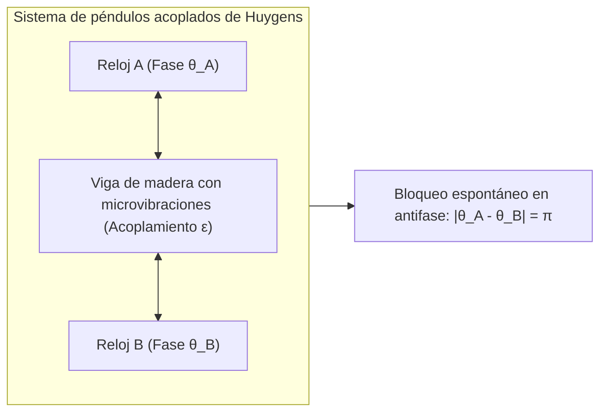
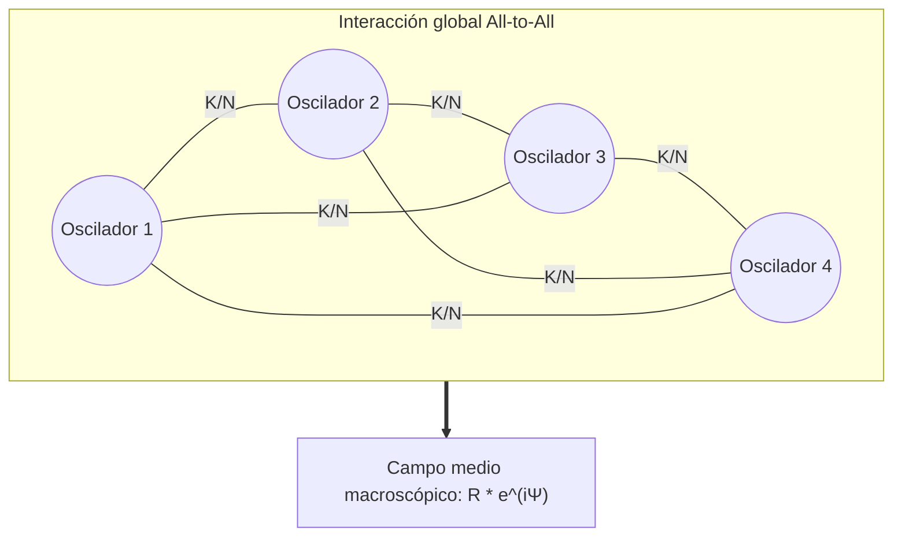

En las profundidades de los manglares del sudeste asiático ocurre cada noche un prodigio natural: decenas de miles de luciérnagas, que al principio destellan de manera independiente al compás de sus relojes biológicos internos, comienzan a sincronizar sus pulsos. En poco tiempo, árboles enteros se encienden al unísono con una precisión de milisegundos y se apagan en absoluta simultaneidad. En Londres, durante la inauguración del Millennium Bridge en el año 2000, los pasos de miles de transeúntes indujeron oscilaciones laterales que forzaron a la multitud a caminar al ritmo del puente, amplificando exponencialmente el movimiento. En nuestro propio corazón, millones de células marcapasos en el nódulo sinoauricular coordinan sus descargas eléctricas sin intermediación cerebral directa, sosteniendo el latido vital de forma ininterrumpida.

Este fenómeno universal, que abarca la biología, la física estadística, la ingeniería y la cosmología, se conoce como <strong>sincronización colectiva espontánea (Collective Synchronization)</strong>.

¿Cómo es posible que miles de osciladores disímiles, cada uno con frecuencias naturales distintas e imperfecciones individuales, logren autoorganizarse en un ritmo macroscópico sin un director central?

En este artículo desentrañaremos la física no lineal y la matemática de los sistemas complejos: desde los descubrimientos de Christiaan Huygens hasta el célebre <strong>Modelo de Kuramoto</strong>, el método de reducción de fase, el <strong>ansatz de Ott-Antonsen</strong> y los fascinantes <strong>estados quimera (Chimera States)</strong>.

---

## 1. El hallazgo de Christiaan Huygens y el acoplamiento débil

En 1665, el físico holandés Christiaan Huygens, inventor del reloj de péndulo, guardaba reposo por enfermedad cuando observó dos relojes de precisión colgados de la misma viga de madera de su dormitorio.

Notó con asombro que, independientemente del ángulo o fase inicial con que se soltaran los péndulos, al cabo de un par de horas ambos oscilaban exactamente a la misma frecuencia pero en oposición de fase rigurosa (diferencia de fase de $\pi$). Huygens denominó a esta interacción la <strong>«simpatía de los péndulos» (Sympathy of Pendulums)</strong>.

Huygens descubrió que el bamboleo de los péndulos transmitía imperceptibles vibraciones a través de la viga común. Este <strong>acoplamiento débil</strong> permitía un intercambio de momento mecánico. Al oscilar en sentidos opuestos, las fuerzas laterales se cancelaban, conduciendo al sistema a su configuración de mínima disipación energética y máxima estabilidad.

---

## 2. Osciladores de ciclo límite: Rigidez de amplitud y flexibilidad de fase

A diferencia de los osciladores armónicos conservativos, los sistemas oscilatorios vivos y mecánicos reales son <strong>osciladores no lineales autoinducidos (Limit-Cycle Oscillators)</strong>. Estos disipan y consumen energía de forma continua, formando un <strong>ciclo límite</strong> cerrado en el espacio de fases:
1. <strong>Rigidez de amplitud</strong>: Cualquier perturbación transversal al ciclo límite decae rápidamente de forma exponencial.
2. <strong>Flexibilidad de fase</strong>: A lo largo de la órbita (en la coordenada de fase $\theta$), no existe ninguna fuerza restauradora.

Por tanto, una interacción infinitesimal no altera el tamaño de la órbita, pero puede adelantar o retrasar libremente la <strong>fase $\theta$</strong>. Esta propiedad es la clave física por la cual es posible la sincronización de fases bajo acoplamiento débil.

---

## 3. El Modelo de Kuramoto: La obra maestra de la sincronización

### 3.1 La formulación fundamental

En 1975, el físico japonés <strong>Yoshiki Kuramoto</strong> propuso un modelo elegante y paradigmático para un conjunto de $N$ osciladores con acoplamiento global (All-to-All) y función de interacción sinusoidal de primer armónico:

$$\frac{d\theta_i}{dt} = \omega_i + \frac{K}{N} \sum_{j=1}^N \sin(\theta_j - \theta_i) \quad (i = 1, \dots, N)$$

Donde:
- $\theta_i(t)$ es la fase del oscilador $i$;
- $\omega_i$ es su <strong>frecuencia natural intrínseca</strong>, obtenida de una distribución de probabilidad simétrica $g(\omega)$;
- $K > 0$ es la fuerza de <strong>acoplamiento global</strong>;
- El término sinusoidal busca anular la diferencia de fase entre osciladores contiguos.

### 3.2 El parámetro de orden complejo y el campo medio

Kuramoto definió el <strong>parámetro de orden complejo</strong>:

$$r(t) e^{i \psi(t)} = \frac{1}{N} \sum_{j=1}^N e^{i \theta_j(t)}$$

- <strong>$r(t) \in [0, 1]$</strong>: Grado de coherencia colectiva ($r \approx 0$ representa incoherencia total y $r \to 1$ sincronía absoluta).
- <strong>$\psi(t)$</strong>: Fase macroscópica promedio del colectivo.

Al reescribir la interacción mediante el campo medio, cada oscilador se desacopla de sus vecinos individuales y responde únicamente a la fuerza de arrastre del campo global:

$$\frac{d\theta_i}{dt} = \omega_i + K r \sin(\psi - \theta_i)$$

---

## 4. Transición de fase y constante de acoplamiento crítico $K_c$

En el marco de referencia en rotación ($\psi = \omega_0 t = 0$), los osciladores se dividen en:
1. <strong>Osciladores bloqueados en fase ($|\omega_i| \le Kr$)</strong>: Atraídos al punto de equilibrio $\sin \theta_i^* = \frac{\omega_i}{Kr}$, marchan a la frecuencia común $\omega_0$.
2. <strong>Osciladores a la deriva ($|\omega_i| > Kr$)</strong>: Cuyas frecuencias naturales son demasiado divergentes para ser atrapadas, deslizándose por el círculo de fases.

En el límite termodinámico $N \to \infty$, se deduce la <strong>fórmula crítica de Kuramoto</strong>:

$$K_c = \frac{2}{\pi g(0)}$$

Para una distribución lorentziana con anchura $\gamma$, $K_c = 2\gamma$. Cuando $K > K_c$, el sistema experimenta una bifurcación de horquilla supercrítica y la coherencia crece siguiendo una ley de potencias $r \propto (K - K_c)^{1/2}$, idéntica a una <strong>transición de fase continua de segundo orden</strong>.

---

## 5. El Ansatz de Ott-Antonsen y Estados Quimera

En 2008, <strong>Edward Ott y Thomas Antonsen</strong> revolucionaron la disciplina al demostrar que la compleja evolución de infinitos osciladores se colapsa rigurosamente en una variedad de baja dimensión mediante una parametrización geométrica de los modos de Fourier, permitiendo resolver la dinámica transitoria con una simple ecuación diferencial ordinaria.

Asimismo, en 2002, <strong>Kuramoto y Shima</strong> descubrieron los <strong>estados quimera (Chimera States)</strong>: patrones en los que osciladores idénticos con acoplamiento no local se dividen espontáneamente en un grupo altamente sincronizado y otro completamente caótico. Este fenómeno ilustra cómo la simetría espacial puede romperse espontáneamente en la naturaleza, como sucede en el sueño unihemisférico de cetáceos y aves.

---

## 6. Aplicaciones prácticas en el mundo real

| Sector | Sistema | Oscilador individual | Vía de acoplamiento | Riesgo por desincronización |
|---|---|---|---|---|
| <strong>Redes eléctricas</strong> | Redes de distribución de alta tensión | Generadores síncronos / Inversores | Red eléctrica de corriente alterna | Pérdida de sincronismo y apagón a gran escala |
| <strong>Neurociencia</strong> | Red neuronal en el córtex | Potenciales de acción neuronal | Sinapsis químicas y eléctricas | Crisis epilépticas (hipersincronización) |
| <strong>Cardiología</strong> | Nódulo sinusal cardíaco | Células musculares marcapasos | Canales de unión gap (Gap Junctions) | Fibrilación ventricular y muerte súbita |
| <strong>Ingeniería civil</strong> | Puentes peatonales colgantes | Paso rítmico de peatones | Deformación elástica de la estructura | Oscilación lateral descontrolada |

## 7. Conclusión

El modelo de Kuramoto revela que la sincronización colectiva es un principio organizador de la naturaleza: la armonía macroscópica florece espontáneamente a partir del diálogo local y recíproco de elementos individuales, demostrando la prodigiosa capacidad del universo para generar orden en medio del caos.
