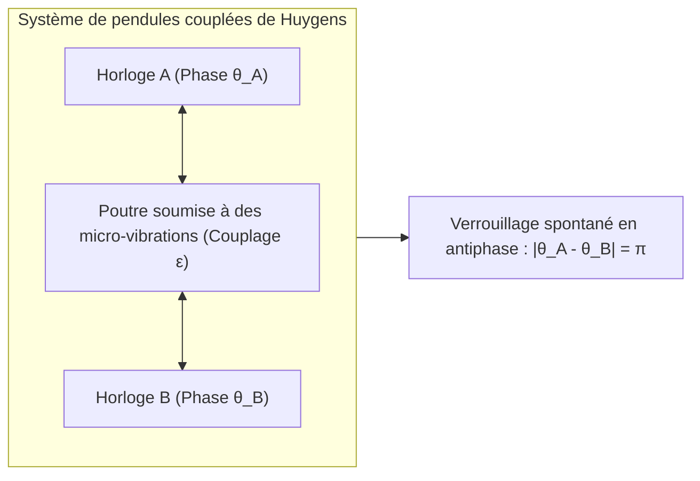
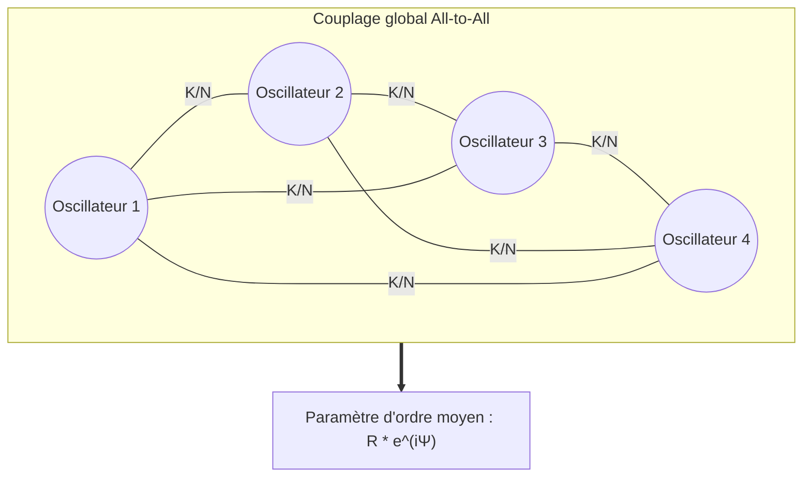

Dans les forêts de mangroves d'Asie du Sud-Est, la nuit tombée offre un spectacle grandiose : des dizaines de milliers de lucioles, clignotant initialement de façon dispersée au gré de leur horloge biologique individuelle, s'accordent progressivement. Bientôt, la canopée tout entière s'illumine à la même milliseconde, avant de replonger d'un seul bloc dans l'obscurité. À Londres en 2000, le jour de son inauguration, le Millennium Bridge commença à tanguer latéralement sous les pas de milliers de piétons, obligeant la foule à caler inconsciemment son pas sur le balancement du tablier, amplifiant dramatiquement l'oscillation. Au cœur de notre poitrine, des millions de cellules du nœud sinusal déchargent leurs potentiels d'action à l'unisson plusieurs dizaines de fois par minute, sans chef d'orchestre cérébral, préservant le rythme vital depuis notre naissance.

Ce phénomène universel traversant la biologie, la physique statistique, l'astronomie et l'ingénierie moderne est désigné sous le nom de <strong>synchronisation collective spontanée (Collective Synchronization)</strong>.

Comment des milliers d'oscillateurs dotés de fréquences propres différentes et d'imperfections microscopiques parviennent-ils, sans autorité centrale, à faire émerger un ordre temporel macroscopique parfait par le seul biais d'interactions locales infinitésimales ?

Cet article propose une exploration rigoureuse de la dynamique non linéaire et de la théorie des réseaux complexes : depuis les observations de Christiaan Huygens jusqu'au modèle universel de <strong>Yoshiki Kuramoto</strong>, l'ansatz d'<strong>Ott-Antonsen</strong> et les mystérieux <strong>états chimères (Chimera States)</strong>.

---

## 1. La découverte de Christiaan Huygens : L'aube de la synchronisation

En février 1665, le mathématicien et physicien néerlandais Christiaan Huygens, cloué au lit par la maladie, observa deux horloges à pendule de sa conception suspendues à une même poutre en bois.

Quelle que soit la phase initiale dans laquelle les balanciers étaient relâchés, ils finissaient inéluctablement, au bout d'une heure ou deux, par osciller à la même fréquence dans une opposition de phase rigoureuse (déphasage de $\pi$). Huygens nomma ce phénomène poétiquement la <strong>« sympathie des horloges » (Sympathy of Pendulums)</strong>.

Huygens comprit que les oscillations imprimaient de micro-secousses mécaniques à la poutre commune. Cette infime rétroaction constituait le <strong>couplage faible</strong>. Lorsque les pendules oscillent en sens opposé, les forces latérales exercées sur la poutre s'annulent mutuellement, réalisant l'état d'énergie minimale et de stabilité maximale.

---

## 2. Oscillateur harmonique vs Oscillateur auto-entretenu

Un oscillateur harmonique linéaire dépend strictement de ses conditions initiales. En revanche, les systèmes réels (cœur, pendule, laser) sont des <strong>oscillateurs non linéaires auto-entretenus (Limit-Cycle Oscillators)</strong> qui absorbent et dissipent continuellement de l'énergie.

Dans l'espace des phases, ils convergent vers un <strong>cycle limite</strong> isolé :
- <strong>Rigidité de l'amplitude</strong> : toute perturbation perpendiculaire au cycle limite s'atténue exponentiellement.
- <strong>Souplesse de la phase</strong> : le long de la trajectoire (la phase $\theta$), aucune force de rappel ne s'exerce.

Par conséquent, une interaction infinitésimale ne modifie pas l'amplitude mais ajuste très facilement la <strong>phase $\theta$</strong>. Cette dissociation fondamentale explique pourquoi la synchronisation de phase est si répandue dans la nature sous un couplage faible.

---

## 3. Le modèle de Kuramoto : La référence universelle

### 3.1 Formulation mathématique

En 1975, le physicien théoricien <strong>Yoshiki Kuramoto</strong> formula le modèle canonique de la synchronisation collective pour $N$ oscillateurs de phase faiblement couplés en interaction globale (All-to-All) :

$$\frac{d\theta_i}{dt} = \omega_i + \frac{K}{N} \sum_{j=1}^N \sin(\theta_j - \theta_i) \quad (i = 1, \dots, N)$$

Où :
- $\theta_i(t)$ représente la phase du $i$-ème oscillateur ;
- $\omega_i$ est sa <strong>fréquence propre naturelle</strong>, tirée d'une distribution symétrique $g(\omega)$ ;
- $K > 0$ mesure la force de <strong>couplage global</strong> ;
- La fonction sinus tend à réduire l'écart de phase entre les oscillateurs.

### 3.2 Paramètre d'ordre complexe et simplification de champ moyen

Kuramoto introduisit le <strong>paramètre d'ordre complexe</strong> :

$$r(t) e^{i \psi(t)} = \frac{1}{N} \sum_{j=1}^N e^{i \theta_j(t)}$$

- <strong>$r(t) \in [0, 1]$</strong> : mesure le degré de cohérence du système ($r \approx 0$ pour le chaos désordonné, $r \to 1$ pour la synchronisation parfaite).
- <strong>$\psi(t)$</strong> : phase macroscopique moyenne du groupe.

En substituant ce paramètre dans l'équation initiale, le problème à $N$ corps se réduit à une dynamique à un corps couplé au champ moyen :

$$\frac{d\theta_i}{dt} = \omega_i + K r \sin(\psi - \theta_i)$$

---

## 4. Transition de phase et couplage critique $K_c$

Dans le repère en rotation ($\psi = \omega_0 t = 0$), les oscillateurs se scindent en deux populations :
1. <strong>Oscillateurs synchronisés ($|\omega_i| \le Kr$)</strong> : capturés par le champ moyen, ils se verrouillent sur une phase stable $\sin \theta_i^* = \frac{\omega_i}{Kr}$.
2. <strong>Oscillateurs dérivants ($|\omega_i| > Kr$)</strong> : dont la fréquence propre est trop éloignée, glissant indéfiniment le long du cercle.

À la limite thermodynamique $N \to \infty$, la condition d'auto-cohérence livre la formule classique de la <strong>valeur critique de couplage</strong> :

$$K_c = \frac{2}{\pi g(0)}$$

Pour une distribution lorentzienne de largeur $\gamma$, $K_c = 2\gamma$. Lorsque $K > K_c$, l'état désordonné perd sa stabilité et une bifurcation fourche supercritique fait croître la cohérence selon la loi de puissance $r \propto (K - K_c)^{1/2}$, caractérisant une <strong>transition de phase continue du second ordre</strong>.

---

## 5. L'ansatz d'Ott-Antonsen et les états chimères

En 2008, <strong>Edward Ott et Thomas Antonsen</strong> démontrèrent que les solutions de l'équation de continuité pour la distribution d'oscillateurs se réduisent rigoureusement à une variété invariante de basse dimension, réduisant une équation aux dérivées partielles infinie à une simple équation différentielle ordinaire pour l'amplitude macroscopique.

Par ailleurs, en 2002, <strong>Kuramoto et Shima</strong> révélèrent l'existence des <strong>états chimères (Chimera States)</strong> : dans un anneau d'oscillateurs strictement identiques couplés de manière non locale, une moitié du système se synchronise parfaitement tandis que l'autre moitié oscille de manière totalement incohérente. Cet état brise spontanément la symétrie spatiale et fournit une explication élégante au sommeil uni-hémisphérique des mammifères marins.

---

## 6. Applications technologiques et vitales

| Domaine | Système | Oscillateur élémentaire | Milieu de couplage | Risque en cas de désynchronisation |
|---|---|---|---|---|
| <strong>Réseaux électriques</strong> | Smart Grid haute tension | Générateurs synchrones / Onduleurs | Lignes de transmission AC | Perte de synchronisme et blackout total |
| <strong>Neurosciences</strong> | Cortex & Hippocampe | Neurones et potentiels d'action | Synapses & jonctions communicantes | Crises d'épilepsie (hyper-synchronisation) |
| <strong>Cardiologie</strong> | Nœud sinusal cardiaque | Cellules myocardiques | Canaux ioniques membranaires | Fibrillation ventriculaire (arrêt cardiaque) |
| <strong>Génie civil</strong> | Ponts suspendus piétonniers | Rythme du pas des passants | Déformation latérale du tablier | Balancement latéral incontrôlable |

## 7. Conclusion

De l'infiniment petit cellulaire aux réseaux énergétiques continentaux, le modèle de Kuramoto démontre la beauté de l'auto-organisation spontanée : la matière et le vivant s'harmonisent sans contrainte centrale dès lors qu'un échange d'information réciproque s'établit.
