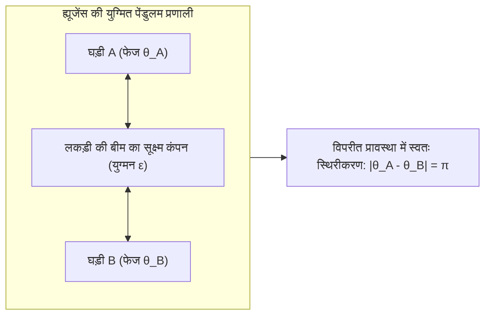
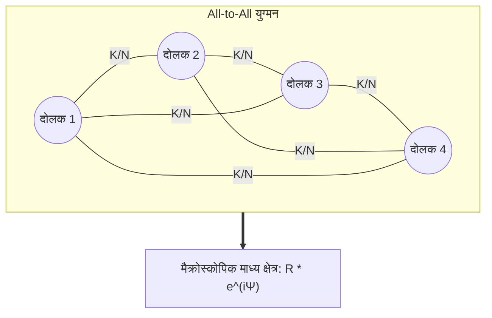

दक्षिण-पूर्व एशिया के मैंग्रोव जंगलों में शाम ढलते ही प्रकृति का एक विस्मयकारी दृश्य उभरता है: हजारों जुगनू, जो शुरुआत में अपनी आंतरिक जैविक घड़ी के अनुसार बेतरतीब ढंग से चमकते हैं, धीरे-धीरे अपनी चमक की लय को एक दूसरे से मिलाने लगते हैं। कुछ ही देर में पूरा का पूरा घना जंगल एक ही मिलीसेकंड में एक साथ जगमगा उठता है और अगले ही पल घने अंधेरे में समा जाता है। लंदन में वर्ष 2000 में जब मिलेनियम ब्रिज खोला गया, तो हजारों पैदल यात्रियों के कदमों की सूक्ष्म लय के कारण पुल खतरनाक रूप से दाएं-बाएं झूलने लगा; लोग गिरने से बचने के लिए पुल के झूलने की गति के साथ तालमेल बैठाकर कदम रखने लगे, जिससे कंपन और प्रचंड हो गया। हमारे दिल के भीतर सिनोएट्रियल नोड की लाखों पेसमेकर कोशिकाएं बिना किसी केंद्रीय तंत्रिका आदेश के, केवल सूक्ष्म आयन चैनलों के माध्यम से दशकों तक हर मिनट पूरी सटीकता के साथ एक साथ धड़कती हैं।

प्रकृति, जीव विज्ञान, सांख्यिकीय भौतिकी और इंजीनियरिंग में सर्वव्यापी इस परिघटना को <strong>सामूहिक स्वतःस्फूर्त समकालन (Collective Synchronization)</strong> कहा जाता है।

हजारों ऐसी स्वतंत्र इकाइयां, जिनकी प्राकृतिक आवृत्तियां अलग-अलग हैं, बिना किसी केंद्रीय नियंत्रक के केवल अत्यंत दुर्बल पारस्परिक अंतःक्रियाओं के माध्यम से एक समकालिक महालय कैसे रच लेती हैं?

इस लेख में हम अरेखीय गतिकी (Nonlinear Dynamics) और जटिल नेटवर्क सिद्धांत की गहराइयों में उतरेंगे: क्रिस्टियान ह्यूजेंस के पेंडुलम प्रयोगों से लेकर आर्थर विनफ्री के फेज रिडक्शन, <strong>योशिकी कुरामोतो (Yoshiki Kuramoto)</strong> के क्रांतिकारी <strong>कुरामोतो मॉडल</strong>, <strong>ओट-एंटोनसेन परिकल्पना (Ott-Antonsen Ansatz)</strong> और रहस्यमयी <strong>काइमेरा अवस्थाओं (Chimera States)</strong> का संपूर्ण विश्लेषण।

---

## 1. क्रिस्टियान ह्यूजेंस की खोज: समकालन विज्ञान का आरंभ

समकालन का पहला वैज्ञानिक उल्लेख 1665 का है। पेंडुलम घड़ी के आविष्कारक डच भौतिक विज्ञानी क्रिस्टियान ह्यूजेंस बीमारी के कारण बिस्तर पर विश्राम कर रहे थे। उनके कमरे की एक ही लकड़ी की बीम पर समुद्री नौवहन के लिए बनाई गई दो पेंडुलम घड़ियां लटकी हुई थीं।

ह्यूजेंस ने देखा कि दोनों घड़ियों के पेंडुलम को चाहे जिस कोण या चरण (Phase) में शुरू किया जाए, एक या दो घंटे के भीतर वे अनिवार्य रूप से एक ही सटीक आवृत्ति पर लेकिन एक-दूसरे के ठीक विपरीत दिशा (विपरीत प्रावस्था, $\pi$ का अंतर) में दोलन करने लगते हैं। ह्यूजेंस ने रॉयल सोसाइटी को लिखे पत्र में इसे <strong>"पेंडुलम की सहानुभूति" (Sympathy of Pendulums)</strong> कहा।

ह्यूजेंस ने साबित किया कि पेंडुलम के दोलन से लकड़ी की बीम में अत्यंत सूक्ष्म यांत्रिक कंपन पैदा होते हैं। यह <strong>दुर्बल युग्मन (Weak Coupling)</strong> दोनों घड़ियों के बीच बल का आदान-प्रदान करता है, जिससे विपरीत दिशा में दोलन करते समय बीम पर पार्श्व बल समाप्त हो जाते हैं और न्यूनतम ऊर्जा क्षय की स्थिर स्थिति प्राप्त होती है।

---

## 2. सीमा चक्र दोलक: आयाम की दृढ़ता और प्रावस्था का लचीलापन

सरल आवर्त दोलक ऊर्जा संरक्षण पर काम करते हैं, जबकि वास्तविक जैविक और यांत्रिक प्रणालियां <strong>अरेखीय स्व-पोषित दोलक (Limit-Cycle Oscillators)</strong> होती हैं। ये ऊर्जा ग्रहण और क्षय करके प्रावस्था अंतरिक्ष में एक बंद स्थिर कक्षा बनाते हैं, जिसे <strong>सीमा चक्र (Limit Cycle)</strong> कहा जाता है:
1. <strong>आयाम दृढ़ता (Amplitude Rigidity)</strong>: कक्षा के लंबवत किसी भी विक्षोभ का प्रभाव तेजी से समाप्त हो जाता है और दोलक अपनी मूल कक्षा में लौट आता है।
2. <strong>प्रावस्था लचीलापन (Phase Flexibility)</strong>: कक्षा की स्पर्शरेखीय दिशा (प्रावस्था $\theta$) में कोई प्रत्यानयन बल नहीं होता।

इसलिए, अत्यंत दुर्बल बाह्य बल आयाम को बदले बिना केवल <strong>प्रावस्था $\theta$</strong> को आसानी से आगे या पीछे खिसका सकता है। दुर्बल युग्मन में समकालन संभव होने का यही मूल रहस्य है।

---

## 3. कुरामोतो मॉडल: समकालन का सार्वभौमिक सिद्धांत

### 3.1 मूल गणितीय समीकरण

1975 में क्योटो विश्वविद्यालय के <strong>योशिकी कुरामोतो</strong> ने दुर्बल रूप से जुड़े $N$ प्रावस्था दोलकों के लिए एक अत्यंत सुरुचिपूर्ण मॉडल प्रतिपादित किया, जिसमें सभी दोलक एक-दूसरे से समान रूप से जुड़े (All-to-All) होते हैं:

$$\frac{d\theta_i}{dt} = \omega_i + \frac{K}{N} \sum_{j=1}^N \sin(\theta_j - \theta_i) \quad (i = 1, \dots, N)$$

यहाँ:
- $\theta_i(t)$ $i$-वें दोलक की प्रावस्था है;
- $\omega_i$ उसकी <strong>स्वाभाविक आवृत्ति</strong> है, जो सममित प्रायिकता बंटन $g(\omega)$ से प्राप्त होती है;
- $K > 0$ वैश्विक <strong>युग्मन क्षमता (Coupling Strength)</strong> है;
- साइन फलन दोलकों के प्रावस्था अंतर को कम करने वाला आकर्षण बल उत्पन्न करता है।

### 3.2 सम्मिश्र क्रम प्राचल और माध्य क्षेत्र सिद्धांत

कुरामोतो ने <strong>सम्मिश्र क्रम प्राचल (Complex Order Parameter)</strong> की अवधारणा प्रस्तुत की:

$$r(t) e^{i \psi(t)} = \frac{1}{N} \sum_{j=1}^N e^{i \theta_j(t)}$$

- <strong>$r(t) \in [0, 1]$</strong>: समकालन की समग्र कोटि को दर्शाता है ($r \approx 0$ पूर्ण अव्यवस्था; $r \to 1$ संपूर्ण समकालन)।
- <strong>$\psi(t)$</strong>: पूरे समूह की औसत मैक्रोस्कोपिक प्रावस्था।

इस परिवर्तन से परस्पर उलझे $N$-पिंडीय समीकरण एकल दोलक के उस समीकरण में बदल जाते हैं, जो केवल सामूहिक माध्य क्षेत्र से अंतःक्रिया करता है:

$$\frac{d\theta_i}{dt} = \omega_i + K r \sin(\psi - \theta_i)$$

---

## 4. प्रावस्था संक्रमण और क्रांतिक युग्मन $K_c$

माध्य क्षेत्र के साथ घूमने वाले तंत्र में दोलक दो समूहों में बंट जाते हैं:
1. <strong>प्रावस्था-बद्ध दोलक ($|\omega_i| \le Kr$)</strong>: माध्य क्षेत्र द्वारा पकड़ लिए जाते हैं और समूह की औसत आवृत्ति पर स्थिर हो जाते हैं।
2. <strong>अपवाही दोलक ($|\omega_i| > Kr$)</strong>: जिनकी स्वाभाविक आवृत्ति बहुत दूर होती है, वे लगातार प्रावस्था वृत्त पर फिसलते रहते हैं।

सतत सीमा $N \to \infty$ में, <strong>क्रांतिक युग्मन सामर्थ्य</strong> का प्रसिद्ध सूत्र प्राप्त होता है:

$$K_c = \frac{2}{\pi g(0)}$$

यदि लोरेंत्ज बंटन हो तो $K_c = 2\gamma$। जब युग्मन क्रांतिक मान से अधिक ($K > K_c$) हो जाता है, तो अव्यवस्थित अवस्था अस्थिर हो जाती है और समकालन $r \propto (K - K_c)^{1/2}$ के नियम से बढ़ता है। यह सांख्यिकीय यांत्रिकी में <strong>द्वितीय-क्रम सतत प्रावस्था संक्रमण (Second-order Continuous Phase Transition)</strong> का सटीक उदाहरण है।

---

## 5. ओट-एंटोनसेन परिकल्पना और काइमेरा अवस्थाएं

2008 में <strong>एडवर्ड ओट और थॉमस एंटोनसेन</strong> ने साबित किया कि अनंत दोलकों के वितरण को एक निम्न-आयामी मैनिफोल्ड पर ठीक से समेटा जा सकता है, जिससे आंशिक अवकल समीकरण केवल एक साधारण अवकल समीकरण में बदल जाता है।

इसके अलावा 2002 में <strong>कुरामोतो और शीमा</strong> ने <strong>काइमेरा अवस्थाओं (Chimera States)</strong> की खोज की: समरूप दोलकों के समूह में एक हिस्सा पूरी तरह से समकालिक (क्रमबद्ध) रहता है जबकि दूसरा हिस्सा पूरी तरह से अव्यवस्थित (अराजक) घूमता है। यह घटना डॉल्फ़िन और प्रवासी पक्षियों में एक-गोलार्ध नींद (Unihemispheric Sleep) को समझने में महत्वपूर्ण साबित हुई है।

---

## 6. व्यावहारिक अनुप्रयोग

| क्षेत्र | प्रणाली | व्यक्तिगत दोलक | युग्मन का माध्यम | असमकालन पर जोखिम |
|---|---|---|---|---|
| <strong>विद्युत ग्रिड</strong> | स्मार्ट पावर ग्रिड | तुल्यकालिक जनरेटर / इन्वर्टर | उच्च वोल्टेज एसी ट्रांसमिशन लाइन | ग्रिड विफलता और देशव्यापी ब्लैकआउट |
| <strong>तंत्रिका विज्ञान</strong> | सेरेब्रल कॉर्टेक्स | न्यूरॉन एक्शन पोटेंशियल | सिनेप्स और गैप जंक्शन | मिर्गी के दौरे (अति-समकालन) |
| <strong>हृदय रोग विज्ञान</strong> | सिनोएट्रियल नोड | पेसमेकर मांसपेशी कोशिकाएं | गैप जंक्शन आयन चैनल | वेंट्रिकुलर फाइब्रिलेशन और कार्डियक अरेस्ट |
| <strong>सिविल इंजीनियरिंग</strong> | पैदल यात्री निलंबन पुल | मनुष्यों के चलने की लय | पुल डेक का पार्श्व लचीलापन | पुल का अनियंत्रित कंपन |

## 7. निष्कर्ष

कुरामोतो मॉडल हमें सिखाता है कि जटिल दुनिया में व्यवस्था के लिए किसी तानाशाही केंद्रीय नियंत्रण की आवश्यकता नहीं होती। सूक्ष्म अंतःक्रियाओं के आपसी संवाद से प्रकृति स्वतः ही सबसे अद्भुत और सुरीली लय पैदा कर लेती है।
