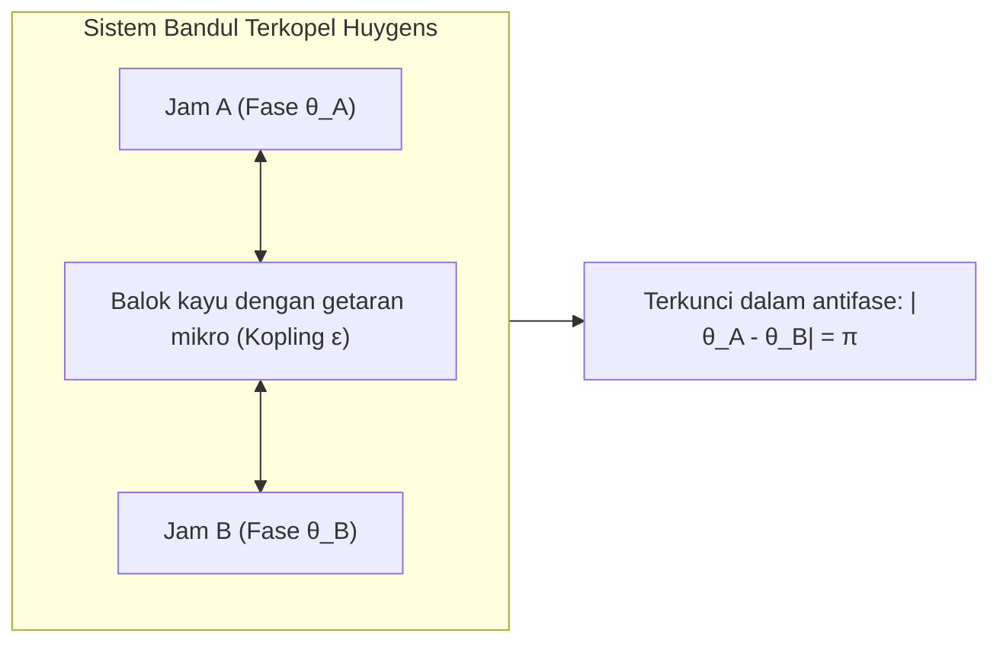
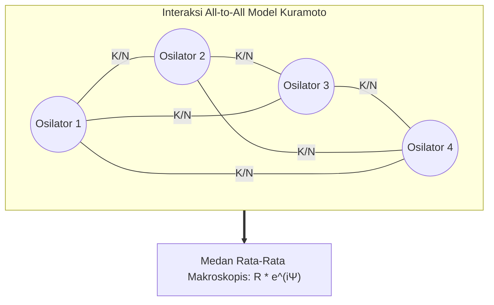

Di hutan bakau Asia Tenggara yang sunyi, malam hari menyuguhkan keajaiban alam yang memukau: puluhan ribu kunang-kunang yang awalnya berkedip sendiri-sendiri secara acak, perlahan-lahan menyelaraskan kedipannya. Dalam waktu singkat, seluruh dahan pohon menyala serentak dalam milidetik yang sama dan padam bersamaan dalam kegelapan total. Di London pada tahun 2000, jembatan Millennium Bridge bergoyang hebat akibat langkah kaki ribuan pejalan kaki yang tanpa sadar menyelaraskan ritme langkah mereka dengan ayunan jembatan. Di dalam dada manusia, jutaan sel pemacu jantung di nodus sinoatrial berdetak serentak puluhan kali per menit selama puluhan tahun tanpa perintah langsung dari otak.

Fenomena luar biasa yang merentang dari biologi, fisika statistik, teknik mesin, hingga astronomi ini dikenal sebagai <strong>sinkronisasi kolektif spontan (Collective Synchronization)</strong>.

Bagaimana ribuan osilator yang memiliki frekuensi alami berbeda dan ketidaksempurnaan mekanis atau biologis dapat menghasilkan keteraturan makroskopis yang sempurna tanpa adanya dirigen pengendali pusat?

Artikel ini mengupas tuntas dinamika non-linear dan matematika sistem kompleks: mulai dari observasi Christiaan Huygens terhadap jam bandul, reduksi fase Arthur Winfree, hingga <strong>Model Kuramoto</strong>, <strong>ansatz Ott-Antonsen</strong>, dan <strong>keadaan chimera (Chimera States)</strong>.

---

## 1. Penemuan Christiaan Huygens: Awal Mula Sains Sinkronisasi

Sains sinkronisasi bermula pada Februari 1665 ketika fisikawan Belanda penemu jam bandul, Christiaan Huygens, terbaring sakit. Di dinding kamarnya tergantung dua jam bandul presisi yang dipasang pada balok kayu yang sama.

Huygens terkejut mendapati bahwa bagaimana pun posisi awal kedua bandul dilepaskan, dalam satu atau dua jam kedua bandul tersebut selalu bergerak serempak dengan ritme yang sama namun berlawanan arah secara sempurna (antifase, perbedaan fase $\pi$). Huygens menyebut fenomena ini sebagai <strong>"simpati antarbandul" (Sympathy of Pendulums)</strong>.

Huygens menyadari bahwa ayunan bandul mengirimkan getaran mekanis mikroskopis melalui balok kayu penyangga. <strong>Kopling lemah (Weak Coupling)</strong> ini memungkinkan kedua jam saling bertukar gaya, hingga mencapai kondisi disipasi energi minimum dan stabilitas maksimum.

---

## 2. Osilator Siklus Batas: Kekakuan Amplitudo dan Kelenturan Fase

Berbeda dengan osilator harmonik sederhana, osilator nyata di alam adalah <strong>osilator non-linear mandiri (Limit-Cycle Oscillators)</strong> yang secara konstan menyerap dan membuang energi.

Dalam ruang fase, osilator ini membentuk lintasan tertutup yang stabil yang disebut <strong>siklus batas (Limit Cycle)</strong>:
1. <strong>Kekakuan amplitudo (Amplitude Rigidity)</strong>: Gangguan tegak lurus terhadap orbit akan meluruh secara eksponensial kembali ke siklus batas.
2. <strong>Kelenturan fase (Phase Flexibility)</strong>: Sepanjang lintasan orbit (arah fase $\theta$), tidak ada gaya pemulih.

Oleh karena itu, interaksi yang sangat lemah tidak dapat mengubah amplitudo getaran, tetapi dapat dengan sangat mudah mempercepat atau memperlambat <strong>fase $\theta$</strong>. Sifat inilah yang menjadi dasar fisik terciptanya sinkronisasi fase.

---

## 3. Model Kuramoto: Standar Emas Sinkronisasi Kolektif

### 3.1 Persamaan Dasar

Pada tahun 1975, fisikawan teoretis Universitas Kyoto, <strong>Yoshiki Kuramoto</strong>, merumuskan model matematis yang sangat elegan untuk mendeskripsikan $N$ osilator fase dengan kopling global (All-to-All):

$$\frac{d\theta_i}{dt} = \omega_i + \frac{K}{N} \sum_{j=1}^N \sin(\theta_j - \theta_i) \quad (i = 1, \dots, N)$$

Keterangan:
- $\theta_i(t)$ adalah fase osilator ke-$i$;
- $\omega_i$ adalah <strong>frekuensi alami</strong> osilator yang diambil dari distribusi simetris $g(\omega)$;
- $K > 0$ menyatakan kekuatan <strong>kopling global</strong>;
- Fungsi sinus bertindak sebagai gaya tarik yang merapatkan selisih fase.

### 3.2 Parameter Ordo Kompleks dan Medan Rata-Rata

Kuramoto mendefinisikan <strong>parameter ordo kompleks</strong>:

$$r(t) e^{i \psi(t)} = \frac{1}{N} \sum_{j=1}^N e^{i \theta_j(t)}$$

- <strong>$r(t) \in [0, 1]$</strong>: Mengukur tingkat koherensi sistem ($r \approx 0$ kondisi acak tanpa sinkronisasi; $r \to 1$ sinkronisasi penuh).
- <strong>$\psi(t)$</strong>: Fase rata-rata makroskopis dari seluruh populasi.

Persamaan $N$-benda yang rumit tersebut terurai menjadi persamaan osilator tunggal yang ditarik oleh medan rata-rata bersama:

$$\frac{d\theta_i}{dt} = \omega_i + K r \sin(\psi - \theta_i)$$

---

## 4. Transisi Fase dan Kekuatan Kopling Kritis $K_c$

Dalam koordinat berputar, populasi terbagi menjadi dua fraksi:
1. <strong>Osilator terkunci fase ($|\omega_i| \le Kr$)</strong>: Terperangkap dalam medan makroskopis pada posisi $\sin \theta_i^* = \frac{\omega_i}{Kr}$.
2. <strong>Osilator hanyut ($|\omega_i| > Kr$)</strong>: Frekuensi alaminya terlalu jauh sehingga terus berputar tanpa terkunci.

Pada batas kontinu $N \to \infty$, diperoleh nilai <strong>kekuatan kopling kritis</strong>:

$$K_c = \frac{2}{\pi g(0)}$$

Jika distribusi frekuensi berupa kurva Lorentz dengan lebar $\gamma$, maka $K_c = 2\gamma$. Di atas ambang batas $K > K_c$, koherensi tumbuh menurut hukum pangkat $r \propto (K - K_c)^{1/2}$, persis seperti <strong>transisi fase kontinu orde kedua</strong> pada material feromagnetik.

---

## 5. Ansatz Ott-Antonsen dan Keadaan Chimera

Pada tahun 2008, <strong>Edward Ott dan Thomas Antonsen</strong> menemukan metode analitik spektakuler: distribusi osilator dalam jumlah tak hingga dapat direduksi secara eksak menjadi satu persamaan diferensial biasa berdimensi rendah.

Selain itu, pada tahun 2002, <strong>Kuramoto dan Shima</strong> menemukan <strong>keadaan chimera (Chimera States)</strong>: pada cincin osilator identik dengan kopling non-lokal, sebagian osilator bersinkronisasi secara sempurna sementara sebagian lainnya bergerak acak dan kacau (chaos). Penemuan ini menjelaskan fenomena tidur unihemisferik pada lumba-lumba dan burung migran.

---

## 6. Penerapan di Dunia Nyata

| Sektor | Sistem | Osilator Satuan | Media Kopling | Dampak jika Desinkronisasi |
|---|---|---|---|---|
| <strong>Jaringan Listrik</strong> | Smart Grid Antarwilayah | Generator Sinkron / Inverter | Saluran transmisi AC | Pemadaman massal (Blackout) |
| <strong>Neurosains</strong> | Korteks Otak & Hipokampus | Potensial aksi saraf | Sinapsis & Gap Junctions | Kejang epilepsi (hipersinkronisasi) |
| <strong>Kardiologi</strong> | Nodus Sinoatrial Jantung | Sel pemacu miokardium | Saluran ion gap junction | Fibrilasi ventrikel & henti jantung |
| <strong>Teknik Sipil</strong> | Jembatan gantung pejalan kaki | Ritme langkah kaki manusia | Ayunan elastis geladak jembatan | Resonansi goyangan jembatan ekstrem |

## 7. Kesimpulan

Model Kuramoto memperlihatkan keindahan mendalam dari keteraturan spontan di alam semesta: tanpa otoritas terpusat, interaksi timbal balik sederhana mampu melahirkan harmoni waktu yang luar biasa agung.
