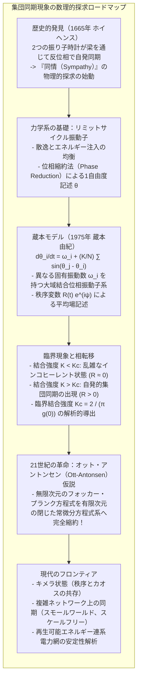
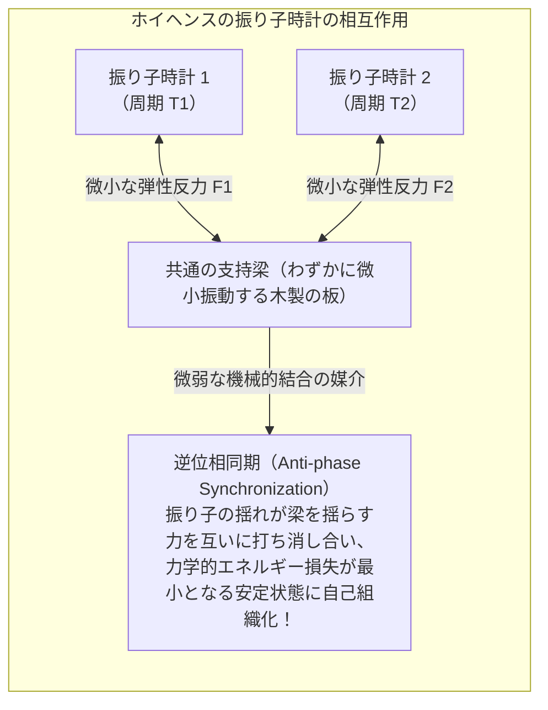
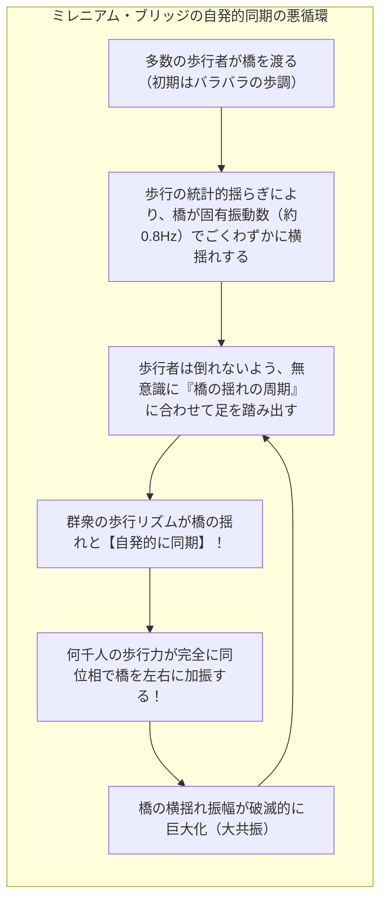
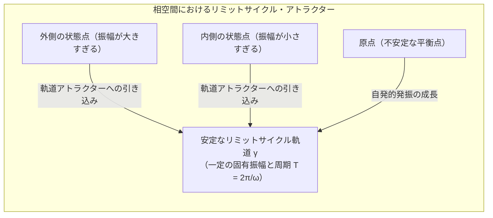
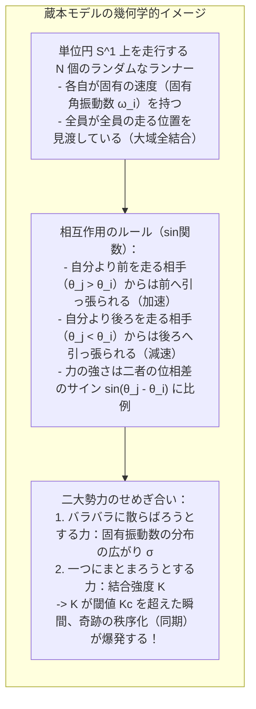
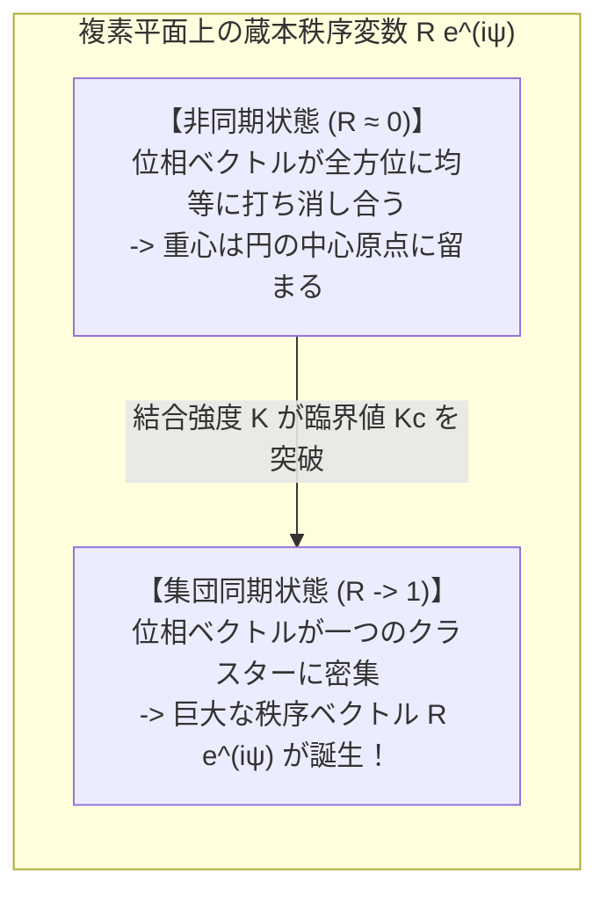
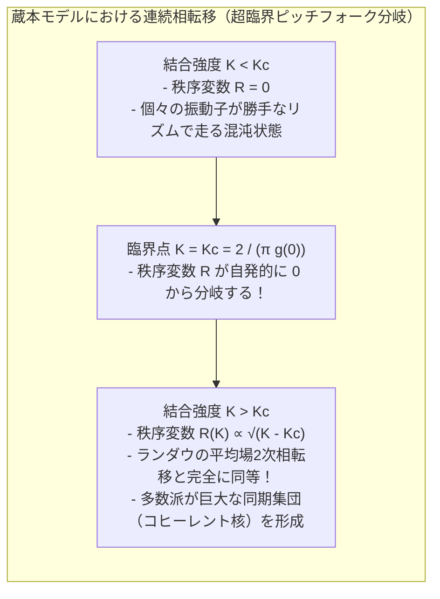
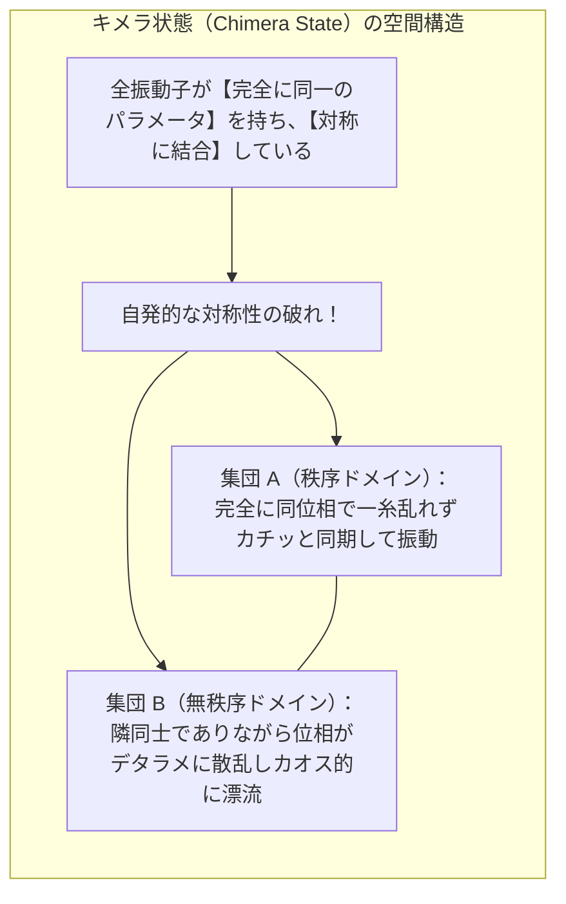

東南アジアのマレーシアやタイの河口付近に広がる夜のマングローブ林。そこに足を踏み入れた旅行者は、息をのむほど幻想的で不可思議な光景を目撃します。一本の巨大なマングローブの木に群がる数千匹、ときに数万匹ものホタル（*Pteroptyx malaccae*）が、あたかも一本の目に見えない電線で繋がれたクリスマスツリーのイルミネーションのように、<strong>完全に同じタイミングで一斉に光り、一斉に消える</strong>のです。

誰が合図を出しているのでしょうか？ 「指揮者」となるリーダーのホタルが存在するのでしょうか？
いいえ、生物学的な観察と実験によって、群れの中に号令をかける特別なリーダーは一匹もいないことが証明されています。一匹一匹のホタルは、ただ隣のホタルの光を見つめ、それに合わせて自分の発光タイミングをほんの少し微調整しているだけです。それにもかかわらず、局所的な相互作用の積み重ねが森全体へと波及し、最終的に星空を圧する完璧な秩序が自発的に立ち現れます。

この現象は、生物界の特殊な例外ではありません：
- 私たちの胸の中で休むことなく脈打つ<strong>心臓のペースメーカー細胞（洞結節）</strong>は、数万個の細胞が互いに電気信号をやり取りし、一糸乱れず同期して拍動することで命を維持しています。
- 全国の工場や家庭を結ぶ<strong>巨大電力網（パワークリッド）</strong>は、全国の発電機が50Hz（または60Hz）という極めて精緻な同一周波数・同一位相で同期して回転し続けることでブラックアウトを防いでいます。
- 2000年にロンドンで開通した<strong>ミレニアム・ブリッジ</strong>は、橋の上を歩く群衆の左右の歩調が橋のわずかな横揺れと自発的に同期してしまい、猛烈な大共振を引き起こして開通わずか2日で閉鎖に追い込まれました。

なぜ、ばらばらの固有周期を持った無数の個体が集まると、全体のリズムがひとりでにそろってしまうのでしょうか？
そして、どのような条件が満たされたときに同期が起こり、どのようなときに秩序が崩壊してカオスへと転落するのでしょうか？

本稿では、1665年のホイヘンスによる振り子の発見から、非線形力学のリミットサイクルの概念、日本の物理学者・蔵本由紀が打ち立て世界標準の方程式となった<strong>「蔵本モデル（Kuramoto Model）」</strong>の数学的構造と相転移の厳密な導出、21世紀最大のブレークスルーであるオット・アントンセン（Ott-Antonsen）縮約理論、秩序と混沌が同居する謎の「キメラ状態」、そして現代社会を支える電力網や脳科学への応用まで、集団同期の神秘と数理を徹底的に解き明かします。



---

## 1. 時計の「同情」：クリスティアーン・ホイヘンスの発見（1665年）

集団同期の科学的な探求は、1665年2月、オランダの偉大な物理学者・天文学者である<strong>クリスティアーン・ホイヘンス（Christiaan Huygens）</strong>の偶然の観察から始まりました。

振り子時計を発明したホイヘンスは、外洋航海における経度測定の精度を高めるため、共通の頑丈な木製の梁（ビーム）から2台の振り子時計を並べて吊り下げる実験を行っていました。重い病気でベッドに臥せっていたホイヘンスは、壁に掛けられた2台の時計をじっと観察しているうちに、驚くべき事実に気づきました：

> 「2台の時計の振り子は、どれほど初期状態をずらして動かし始めても、半時間も経つと寸分の狂いもなく<strong>完全に同じ周期で、かつ互いに正確に180度反対向き（逆位相）に揺れる状態</strong>へと落ち着いてしまう。」

ホイヘンスが一方の振り子を手で止めて意図的に乱しても、しばらくすると2台の時計は再び吸い寄せられるように逆位相の完全な同期状態へと戻りました。ホイヘンスはこの驚くべき現象を、まるで時計同士が心を通わせているかのようだとして<strong>「時計の同情（an odd sympathy of clocks）」</strong>と呼びました。



ホイヘンスは鋭い洞察により、2台の時計が直接触れ合っていなくても、それらを吊り下げている<strong>「木製の梁」を通じて伝わるごくわずかな振動</strong>が、互いの運動に干渉し合っていることを見抜きました。2台の振り子が互いに逆向きに揺れるとき、梁にかかる左右の力は相殺され、土台の揺れによるエネルギー散逸が最小化されます。システム全体が最も安定な力学的アトラクターへと自律的に落ち込んでいたのです。

これは人類が記録した最初の<strong>「結合振動子の引き込み（Entrainment / Synchronization）」</strong>の実験的観察でした。

---

## 2. 自然界とテクノロジーにおける同期のスペクトラム

ホイヘンスの発見から300年以上の時を経て、物理学、生物学、工学、天文学の境界を越えて、同期があらゆる階層の普遍現象であることが明らかになりました。

### ① 生体システムの同期：生命の脈動
- <strong>心臓のペースメーカー細胞：</strong> 右心房にある洞房結節には、電気パルスを自発的に生成するペースメーカー細胞が密集しています。個々の細胞のパルス生成周期には数ミリ秒から数十ミリ秒のばらつきがありますが、ギャップ結合を通じたイオン電流の相互作用によって同期し、心臓全体を一つのポンプとして力強く収縮させます。
- <strong>概日リズム（体内時計）：</strong> 脳の視交叉上核（SCN）にある約2万個の神経細胞は、遺伝子発現のフィードバックループによって約24時間の周期を刻んでいます。個々の細胞は23時間から25時間までバラバラの周期を持ちますが、神経伝達物質を介して互いに同期し、狂いのない正確な24時間のリズムを体に提供しています。

### ② 巨大インフラの同期：電力網の安定性
現代の電力網は、人類が構築した最大の同期ネットワークです。火力発電所や水力発電所のタービン（同期発電機）は、何千キロメートルも離れた場所にあっても、<strong>送電線網を介して互いに電磁気的なトルクを及ぼし合い、完全に同一の位相角</strong>で回転しています。
もしある発電機が負荷の変動などで加速すると、送電線を通じて他の発電機からブレーキとなる電力が流れ込み、元の回転速度へと引き戻されます。この同期力が失われると（脱調）、電力系統が崩壊し、大陸規模の大停電（ブラックアウト）が発生します。

### ③ 群衆と構造物の相互作用：ロンドン・ミレニアム・ブリッジの教訓
2000年6月10日、ロンドンのテムズ川にかかる歩道橋「ミレニアム・ブリッジ」が開通しました。数千人の歩行者が橋の上に足を踏み入れた瞬間、橋は左右に激しく揺れ始めました。



歩行者は橋を揺らそうとしたわけではありません。橋のわずかな横揺れに対して倒れないように足を踏ん張ろうとした結果、<strong>無意識のうちに橋の揺れのタイミングに合わせて歩調をそろえてしまった</strong>のです。歩行者が同期すればするほど橋に加わる横方向の加振力は強まり、振幅がさらに増大するという正のフィードバックループが形成されました。この現象は非線形同期理論によって完璧に解明され、制振ダンパーを設置することで解決されました。

---

## 3. 力学系の基礎：リミットサイクルと位相縮約法

同期現象を数学的に扱うためには、まず「振動子（Oscillator）」とは何かを厳密に定義する必要があります。

### 線形振動子とリミットサイクル振動子の決定的違い
高校物理で習う単振り子やバネ振り子（調和振動子）は、摩擦がない理想的な状況では振動を続けますが、少しでも摩擦（減衰）があるとエネルギーを失って最終的に静止してしまいます。また、振幅は初期の引っ張り具合によって無限に変化します。

これに対し、心臓の鼓動やホタルの発光、電子回路の発振器などは、摩擦のある現実世界において、<strong>外部からエネルギーを取り込み、内部で散逸させることで、一定の周期と振幅を自律的に維持</strong>します。このような自励振動系を、アンリ・ポアンカレは相平面上の孤立した閉軌道として<strong>「リミットサイクル（Limit Cycle）」</strong>と名付けました。



リミットサイクルの最大の特徴は<strong>「構造的安定性」</strong>です。外部から一時的なノイズや摂動が加わって軌道がずれても、系は自律的に元の閉軌道へと戻っていきます。この軌道への復元力があるからこそ、自然界の振動子は多少の環境の揺らぎがあっても安定したリズムを刻み続けることができるのです。

### 位相縮約法（Phase Reduction Theory）の魔法
生体細胞や発電機などの実世界の振動子は、数十個から数千個の非線形常微分方程式で記述される超高次元の複雑な力学系です：

$$\frac{d\mathbf{x}}{dt} = \mathbf{F}(\mathbf{x}) \quad (\mathbf{x} \in \mathbb{R}^n)$$

このままでは、何千個もの振動子が相互作用する系を解くことは絶望的です。
この問題を劇的に単純化したのが、日本の非線形物理学者・蔵本由紀らが発展させた<strong>「位相縮約法（Phase Reduction Method）」</strong>です。

リミットサイクル軌道 $\gamma$ が安定であるならば、軌道から外れた状態は急速に軌道上へと引き戻されます。したがって、長時間のダイナミクスにおいて本質的に重要なのは、「振幅の大きさ」ではなく、<strong>「閉軌道上のどの位置にいるか」という1次元の変数、すなわち「位相（Phase） $\theta \in [0, 2\pi)$」だけ</strong>になります。

振動子の状態空間 $\mathbb{R}^n$ を、たった1つのスカラー変数 $\theta$ へと射影することで、高次元の複雑な方程式は、驚くほどシンプルな単一の位相方程式へと縮約されます：

$$\frac{d\theta}{dt} = \omega$$

ここで $\omega = \frac{2\pi}{T}$ は振動子の固有角振動数です。この強力な数学的手法により、同期現象の数理は「位相の幾何学」としてエレガントに扱えるようになったのです。

---

## 4. 蔵本モデル（Kuramoto Model）：大域結合位相振動子の金字塔

1975年、京都大学の<strong>蔵本由紀（Yoshiki Kuramoto）</strong>は、国際理論物理学会議で集団同期を記述する極めて美しく、かつ厳密に解析可能なモデルを発表しました。これが今日、物理学、数学、神経科学、工学などのあらゆる分野で引用され続けている<strong>「蔵本モデル（Kuramoto Model）」</strong>です。



### 蔵本モデルの基本方程式
$N$ 個の結合した位相振動子を考えます。各振動子 $i \in \{1, 2, \dots, N\}$ は固有角振動数 $\omega_i$ を持ち、他のすべての振動子と等しい強さ $K$ で結合（全結合・平均場結合）していると仮定します。

蔵本モデルを支配する微分方程式系は、次式で与えられます：

$$\frac{d\theta_i}{dt} = \omega_i + \frac{K}{N} \sum_{j=1}^N \sin(\theta_j - \theta_i) \quad (i = 1, 2, \dots, N)$$

各記号の意味は以下の通りです：
- $\theta_i(t)$：振動子 $i$ の時刻 $t$ における位相（単位円上の角度 $[0, 2\pi)$）。
- $\omega_i$：振動子 $i$ が単独で存在するときのリズム（固有振動数）。通常、平均値 $\omega_0$、分散を持つ対称な確率密度関数 $g(\omega)$（例えばガウス分布やローレンツ分布）からランダムにサンプリングされます。
- $K \ge 0$：振動子間の<strong>結合強度（Coupling Strength）</strong>。
- $\frac{1}{N}$：振動子の数が増えても系が発散しないための正規化係数。
- $\sin(\theta_j - \theta_i)$：最も単純で自然な非線形相互作用関数。
  - もし相手 $j$ が自分より少し進んでいれば（$0 < \theta_j - \theta_i < \pi$）、$\sin > 0$ となり、自分 $i$ は加速されて相手に追いつこうとします。
  - もし相手 $j$ が自分より遅れていれば（$-\pi < \theta_j - \theta_i < 0$）、$\sin < 0$ となり、自分 $i$ は減速して相手を待ちます。

### 蔵本秩序変数（Order Parameter）の導入
蔵本モデルの天才的なブレークスルーは、統計力学の相転移理論に着想を得て、集団全体の同期度合いを一目で表す複素数<strong>「蔵本秩序変数（Order Parameter）」</strong>を定義した点にあります。

単位円上の点 $e^{i\theta_j}$ の重心（平均ベクトル）を計算します：

$$R(t) e^{i\psi(t)} \equiv \frac{1}{N} \sum_{j=1}^N e^{i\theta_j(t)}$$

ここで：
- $R(t) \in [0, 1]$ は<strong>巨視的同期度（秩序度）</strong>を表す実数です。
  - $R \approx 0$：位相 $\theta_j$ が単位円全体にバラバラに散らばった<strong>完全非同期（インコヒーレント）状態</strong>。
  - $R = 1$：すべての振動子の位相が完全に一致した<strong>完全同期状態</strong>。
- $\psi(t)$ は集団全体の平均位相（重心の角度）です。



### 平均場表示：複雑な多体問題から「個と全体」の対話へ
この秩序変数の定義の両辺に $e^{-i\theta_i}$ を掛けて虚部を取るという、驚くほど鮮やかな数学的変形を行います：

$$R e^{i(\psi - \theta_i)} = \frac{1}{N} \sum_{j=1}^N e^{i(\theta_j - \theta_i)}$$

虚部（$\text{Im}$）を取ると：

$$R \sin(\psi - \theta_i) = \frac{1}{N} \sum_{j=1}^N \sin(\theta_j - \theta_i)$$

この関係式を蔵本モデルの方程式の右辺に代入すると、衝撃的な簡約が起こります：

$$\frac{d\theta_i}{dt} = \omega_i + K R \sin(\psi - \theta_i)$$

見てください！ もともと「自分以外の $N-1$ 個のすべての振動子の位置を見なければならない」という複雑な多体問題が、<strong>「各振動子は、集団全体が作り出す単一の平均場（振幅 $KR$、位相 $\psi$）とのみ相互作用する」</strong>という、極めてエレガントな独立した方程式へと完全に分離されたのです。

---

## 5. 同期の条件と相転移の厳密な数学的導出

結合強度 $K$ を徐々に強めていくと、システムには何が起きるでしょうか？

### 引き込み（Entrainment）の条件
平均位相の回転座標系に移り、平均角振動数を基準にとると（一般性を失わずに $\psi = 0$ と置く）、各振動子の方程式は：

$$\frac{d\theta_i}{dt} = \omega_i - K R \sin\theta_i$$

この方程式は、振動子が平均場に「引き込まれる（ロックされる）」かどうかの運命を明確に二分します：

```
   1. 同期（引き込み）振動子群： |ω_i| ≤ K R の場合
      dθ_i/dt = 0 となる安定な固定点が存在する：
      sin(θ_i^*) = ω_i / (K R)
      固有振動数 ω_i が平均場に近い素直な振動子は、
      集団の平均位相にガッチリと捕獲され、全員が同一速度で回転する！
      
   2. 非同期（漂流）振動子群： |ω_i| > K R の場合
      固定点は存在しない。
      固有振動数が極端に速すぎる、または遅すぎる「頑固な」振動子は、
      平均場に完全に捕まることなく、位相空間をひとり漂流（Drift）し続ける。
```

### 臨界結合強度 $K_c$ の自己無撞着な導出
振動子数が無限大の極限（$N \to \infty$）において、系がいつ自発的な同期を開始するか、すなわち秩序変数 $R$ がゼロから立ち上がる<strong>臨界結合強度 $K_c$</strong> を求めてみましょう。

固有振動数分布 $g(\omega)$ が $\omega = 0$ に関して対称で、単峰型（ウニモーダル）の滑らかな関数であるとします。
定常状態において、秩序変数 $R$ の自己無撞着方程式（Self-Consistency Equation）を立てます。同期している振動子の集団平均への寄与を足し合わせると：

$$R = \int_{-KR}^{KR} \cos(\theta^*(\omega)) g(\omega) d\omega$$

ここで $\sin\theta^*(\omega) = \frac{\omega}{KR}$ であるため、$\cos\theta^*(\omega) = \sqrt{1 - \left(\frac{\omega}{KR}\right)^2}$ となります。
これを代入すると：

$$R = R \int_{-1}^{1} K \sqrt{1 - x^2} \cdot g(K R x) dx \quad \left(\text{変数変換 } x = \frac{\omega}{KR}\right)$$

$R > 0$ で両辺を割ると：

$$1 = K \int_{-1}^{1} \sqrt{1 - x^2} \cdot g(K R x) dx$$

同期がまさに始まろうとする臨界点（$K \to K_c$、すなわち $R \to 0^+$）において、$g(K R x) \to g(0)$ と近似できます。したがって：

$$1 = K_c \cdot g(0) \int_{-1}^{1} \sqrt{1 - x^2} dx$$

この定積分は半円の面積を表しており、厳密に $\frac{\pi}{2}$ です：

$$\int_{-1}^{1} \sqrt{1 - x^2} dx = \frac{\pi}{2}$$

したがって：

$$1 = K_c \cdot g(0) \cdot \frac{\pi}{2}$$

これを $K_c$ について解くことで、理論物理学史に輝く<strong>蔵本の臨界結合強度公式</strong>が得られます：

$$K_c = \frac{2}{\pi g(0)}$$



この公式が意味する物理的直観は驚くほど明快です：
- $g(0)$ は、集団の平均的なリズムの近傍に「どれだけ多くの振動子が密集しているか」というピークの高さです。
- 平均付近の素直な振動子が多ければ多いほど（$g(0)$ が大きいほど）、臨界結合強度 $K_c$ は小さくなり、<strong>ほんのわずかな相互作用があるだけで、瞬く間に全体が同期へとなだれ込みます</strong>。
- 逆に、個々の振動子の好みがバラバラで分布が広く平坦であるほど（$g(0)$ が小さいほど）、同期を引き起こすためには強力な結合 $K$ が必要になります。

臨界点 $K > K_c$ を超えた直後、秩序変数 $R$ は<strong>超臨界ピッチフォーク分岐</strong>に従い、次のように増大します：

$$R(K) \propto \sqrt{K - K_c}$$

これは、水蒸気が凝縮して水滴になる現象や、常磁性体が冷えて強磁性体（磁石）に相転移する現象と、<strong>数学的に完全に同一の「2次相転移」</strong>です。マングローブのホタルが一斉に光り出す現象は、まさに熱力学的な相転移が生命のリズムにおいて自発的に起きている瞬間だったのです。

---

## 6. 21世紀の数学的革命：オット・アントンセン（Ott-Antonsen）仮説

蔵本モデルは長年、熱力学極限（$N \to \infty$）における「定常状態」の解析に限られていました。しかし、「系が非同期から同期へと至る過渡的な時間発展のダイナミクス」を厳密に解くことは、無限次元の非線形偏微分方程式（フォッカー・プランク方程式）を扱う必要があり、数学者たちを30年以上にわたり悩ませ続けてきました。

この膠着状態を打ち破ったのが、2008年にメリーランド大学のエドワード・オット（Edward Ott）とトーマス・アントンセン（Thomas Antonsen）が発見した<strong>「オット・アントンセン（Ott-Antonsen / OA）仮説」</strong>です。

### OA多様体による次元縮約
オットとアントンセンは、位相分布関数 $f(\theta, \omega, t)$ をフーリエ級数展開した際、フーリエ係数 $f_n(\omega, t)$ がある単一の複素解析関数 $\alpha(\omega, t)$ のべき乗で厳密に表されるという、驚くべき不変多様体（OA多様体）を発見しました：

$$f_n(\omega, t) = [\alpha(\omega, t)]^n \quad (n \ge 1)$$

この幾何学的拘束条件を課すと、無限個の自由度を持つ偏微分方程式が、複素関数 $\alpha$ に関する<strong>たった1つの低次元常微分方程式</strong>へと完全に縮約されます。さらに固有振動数分布 $g(\omega)$ がローレンツ分布（コーシー分布、半値幅 $\gamma$）：

$$g(\omega) = \frac{\gamma}{\pi [(\omega - \omega_0)^2 + \gamma^2]}$$

に従う場合、留数定理を用いることで、秩序変数 $R(t)$ そのものの時間発展が、次のような<strong>極めて単純な1次元微分方程式</strong>に完全に帰着することが証明されたのです：

$$\frac{dR}{dt} = \left( \frac{K}{2} - \gamma \right) R - \frac{K}{2} R^3$$

この方程式の驚愕すべき明快さを見てください：
- もし $K < 2\gamma$ ならば、線形項の係数は負となり、自明な解 $R = 0$ のみが唯一の安定な固定点となります（非同期）。
- もし $K > 2\gamma$（すなわち $K > K_c = 2\gamma$）となると、$R = 0$ は不安定化し、安定な固定点：
  $$R^* = \sqrt{1 - \frac{2\gamma}{K}}$$
  が自発的に誕生します！

オット・アントンセン理論の登場により、任意の非定常外力や時間遅延、マルチレイヤーネットワークが絡み合う複雑な同期ダイナミクスが、紙とペンで完全に解析可能な対象へと変貌を遂げたのです。

---

## 7. 秩序と混沌の同居：「キメラ状態（Chimera State）」の衝撃

蔵本モデルの発見から四半世紀が過ぎた2002年、蔵本由紀とバトゴーグ（Dorjsuren Battogtokh）は、非線形科学界に激震を走らせる新たな現象を発見しました。それが<strong>「キメラ状態（Chimera State）」</strong>です。

ギリシャ神話に登場する、ライオンの頭、ヤギの胴体、ヘビの尾を持つ合成獣「キマイラ（キメラ）」にちなんで名付けられたこの状態は、<strong>「完全に同一の性質を持つ振動子を、完全に対称に配置したネットワークにおいて、系の一部が完璧に同期している一方で、残りの一部が完全にバラバラなカオス的非同期状態に陥る」</strong>という、常識を根底から覆す現象です。



従来の物理学の常識では、構成要素が同一で結合も対称であれば、系全体が「一様に同期する」か「一様に非同期になる」かの二者択一しかないと考えられていました。しかし、非線形力学の深淵では、<strong>均一な系の中から「秩序」と「混沌」が空間的に同居する特異なパッチワーク構造が自発的に生じる</strong>ことが証明されたのです。

キメラ状態の発見は、鳥類や海洋哺乳類（イルカやクジラ）が眠る際、大脳の片方の半球だけが眠り、もう片方の半球が目覚めて警戒を続ける「半球睡眠（Unihemispheric Sleep）」の数理モデルとしても注目を集めています。

---

## 8. 現代工学と生命科学への最前線応用

集団同期の数理は、現代社会が直面する最先端の課題を解決するための強力な武器となっています。

### ① 再生可能エネルギーと次世代マイクログリッド
太陽光発電や風力発電などの再生可能エネルギーは、従来の巨大火力・原子力発電所のような「重い回転子の慣性力（Inertia）」を持たず、インバータ（電子回路）を通じて系統に接続されます。
慣性が極端に小さい再生可能エネルギーの比率が高まると、電力網の蔵本モデルにおける実効的なダンピングが低下し、局所的な周波数擾乱が波及してグリッド全体の同期が破断しやすくなります。

世界中の電力工学者は現在、蔵本モデルを拡張した<strong>「2次蔵本方程式（スイング方程式）」</strong>を用いて、どの送電線を補強すれば同期の安定性が最大化されるか、またインバータに仮想的な慣性（仮想同期発電機：VSG）をどうプログラミングすべきかを数学的に解析しています。

### ② 脳神経科学とパーキンソン病の脱同期治療
人間の脳内では、数十億個のニューロンがシナプス結合を介して同期と非同期をダイナミックに切り替えています。適度な同期は記憶の固定や意識の形成に不可欠ですが、<strong>「過剰な異常同期」</strong>は深刻な神経疾患を引き起こします。

代表例が<strong>パーキンソン病</strong>です。パーキンソン病患者の脳の視床下核や淡蒼球では、神経細胞群が病的な高コヒーレンスで異常同期してしまい、それが手足の激しい震え（振戦）となって現れます。

現在実用化されている<strong>脳深部刺激療法（DBS：Deep Brain Stimulation）</strong>では、電極を脳深部に埋め込み、高周波パルス電流を流すことで治療を行いますが、最新の数理研究では、蔵本モデルの知見を応用して<strong>「最少の電力で、病的な同期だけを選択的にバラバラに解きほぐす（脱同期化する）インテリジェントな刺激パルス」</strong>の設計が進められています。

---

## 結語：自己組織化する宇宙の調べ

満点の星空の下で一斉に瞬く無数のホタルから、胸の中で休むことなく拍動を刻む細胞たち、そして大陸を跨いで手を取り合う巨大発電機まで。

そこには、全体を統率する絶対的な支配者は存在しません。
個々の存在は不完全で、それぞれが独自の癖とリズムを持ちながら、ただ互いに微弱な影響を及ぼし合っているだけです。それにもかかわらず、相互作用の強さが臨界の閾値を超えたとき、まるで奇跡のように、全体としての美しく調和に満ちたリズムが立ち現れます。

蔵本モデルが私たちに教えてくれるのは、<strong>「混沌の中から秩序が自発的に生まれることは、決して偶然の奇跡ではなく、非線形力学が必然として描き出す普遍の物理法則である」</strong>という、深遠で希望に満ちた真理なのです。
