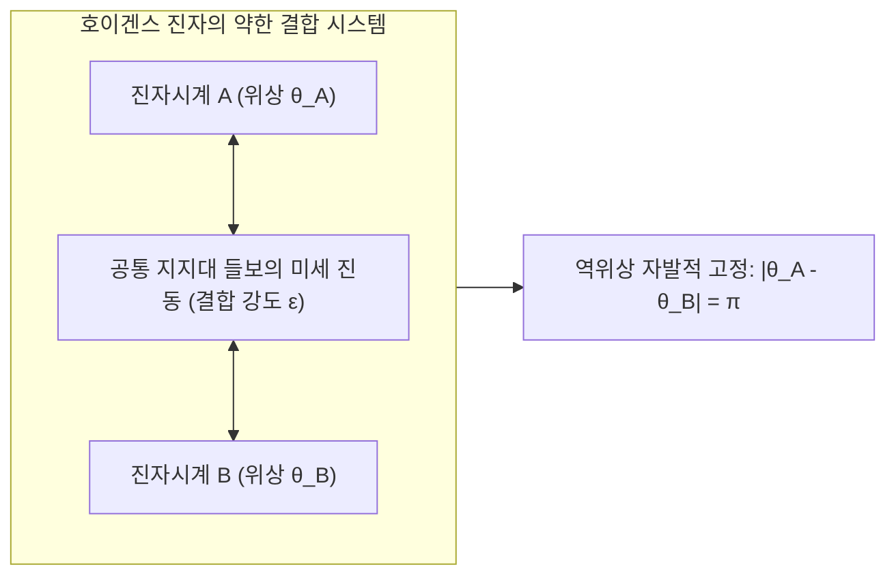
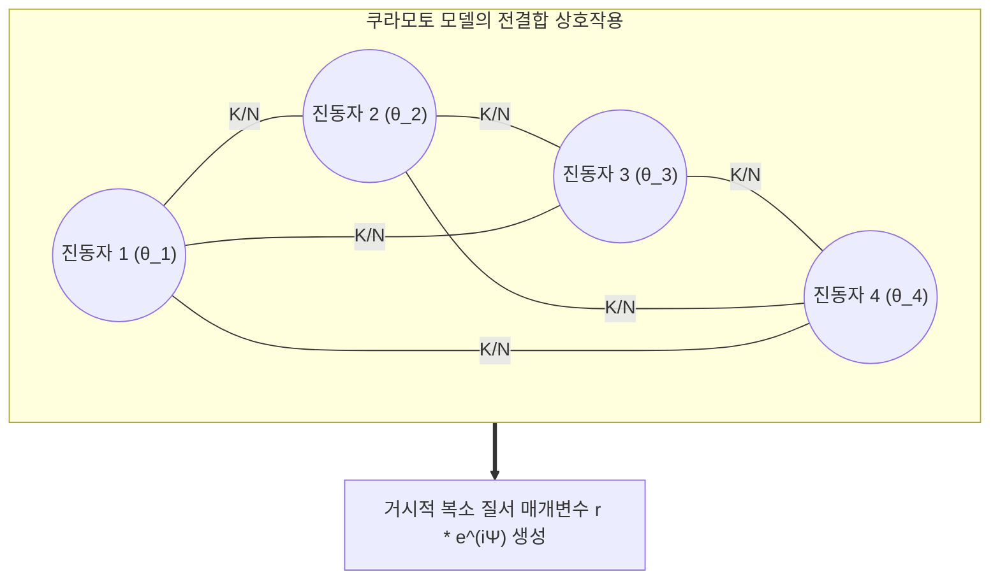
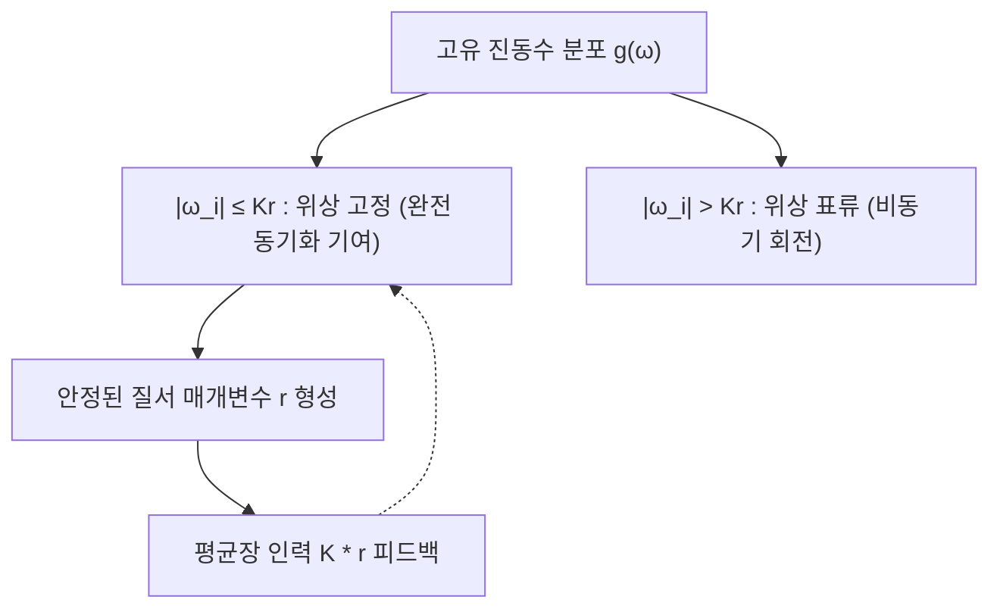

동남아시아 맹그로브 숲의 깊은 밤, 각자의 체내 시계에 따라 제멋대로 깜빡이던 수만 마리의 반딧불이들이 어느 순간 숲 전체를 뒤덮으며 1밀리초의 오차도 없이 일제히 빛을 발하고 동시에 암흑 속으로 사라지는 장관을 연출합니다. 2000년 런던 템스강 위에 개통된 밀레니엄 브리지는 수천 명의 보행자들이 걷는 발걸음의 미세한 리듬과 공명하며 좌우로 거세게 요동쳤고, 사람들은 다리의 흔들림에 맞춰 발을 맞추어 걸음으로써 다리의 진동을 더욱 증폭시켰습니다. 우리의 심장 속에서는 수백만 개의 동방결절 박동 세포들이 중앙 뇌 신경계의 지휘 없이도, 미세한 이온 통로의 전기적 결합만으로 수십 년 동안 매분 수십 번씩 완벽하게 동기화되어 박동을 유지합니다.

이처럼 생물학, 공학, 천문학, 응집물질물리학 등 자연계와 기술 전반에서 보편적으로 관찰되는 현상을 <strong>집단 자발적 동기화(Collective Synchronization)</strong>라고 부릅니다.

각기 다른 고유 주파수를 가지고 유전적·물리적 결함을 지닌 수천, 수만 개의 독립된 개체들이 어떻게 외부 지휘자(Central Controller)도 없이 오직 극도로 미약한 국소적 상호작용만으로 임계점을 넘어 거대한 질서를 형성하는 것일까요?

본 글에서는 비선형 동역학, 통계물리학, 복잡계 네트워크 이론을 바탕으로 1665년 크리스티안 호이겐스(Christiaan Huygens)의 진자시계 관찰부터 아서 윈프리(Arthur Winfree)의 위상 축약법, 일본의 이론물리학자 <strong>쿠라모토 요시키(Yoshiki Kuramoto)</strong>의 혁명적인 <strong>쿠라모토 모델(Kuramoto Model)</strong>, 그리고 현대 비선형 과학의 정점인 <strong>오트-안톤센(Ott-Antonsen) 가설</strong>과 <strong>키메라 상태(Chimera States)</strong>까지 그 심오한 수학적 구조와 물리를 철저하게 파헤칩니다.

---

## 1. 호이겐스의 우연한 발견: 동기화 과학의 서막

### 1.1 병상에서의 관찰: 진자의 교감

동기화 현상에 관한 최초의 과학적 기록은 1665년으로 거슬러 올라갑니다. 네덜란드의 물리학자이자 진자시계의 발명자인 크리스티안 호이겐스는 병으로 침대에 누워 요양하던 중, 침실 들보에 나란히 매달아 둔 두 개의 항해용 진자시계를 관찰했습니다.

호이겐스는 기이한 현상을 발견했습니다. 두 시계의 진자를 처음에 서로 다른 각도와 위상으로 흔들어 놓아도, 한두 시간이 지나면 두 진자가 정확히 반대 방향(위상차 $\pi$)으로 완벽하게 일치된 리듬으로 흔들리는 상태에 도달하는 것이었습니다. 호이겐스는 왕립학회에 보낸 편지에서 이를 <strong>'진자들의 교감(Sympathy of Pendulums)'</strong>이라고 표현했습니다.

호이겐스는 바람이나 자석의 영향을 배제한 뒤, 두 시계가 매달린 나무 들보를 통해 진자의 흔들림에 의한 극히 미세한 기계적 진동이 전달되고 있음을 간파했습니다. 이것이 바로 두 독립된 진동자 사이의 <strong>약한 결합(Weak Coupling)</strong>이었습니다.

### 1.2 선형 공진과 비선형 자율 진동자의 본질적 차이

고전 역학의 단순 조화 진동자(Simple Harmonic Oscillator)는 에너지 보존계이며 외부 충격에 취약합니다. 반면, 생명체와 시계 같은 실제 진동체는 외부에서 에너지를 섭취하고 내부 마찰로 소산시키는 <strong>비선형 자율 진동자(Self-sustained Oscillator)</strong>입니다.

이러한 진동자는 위상 공간(Phase Space)에서 고립된 닫힌 궤도인 <strong>한계 순환 궤도(Limit Cycle)</strong>를 형성합니다.
한계 순환 궤도의 핵심적 성질은 다음과 같습니다:
1. <strong>진폭의 견고성(Amplitude Rigidity)</strong>: 궤도를 벗어나는 미세한 섭동은 시간에 따라 지수함수적으로 감쇠되어 원래 궤도로 빠르게 복귀합니다.
2. <strong>위상의 유연성(Phase Flexibility)</strong>: 궤도의 접선 방향(위상 $\theta$)으로는 복원력이 작용하지 않습니다.

따라서 아주 미약한 외부 힘이나 상호작용은 진동자의 진폭을 거의 바꾸지 못하지만, 위상을 손쉽게 앞당기거나 늦출 수 있습니다. 이 '진폭의 강인함'과 '위상의 유연함'의 결합이 약한 결합 하에서 위상 동기화가 성립하는 근본적인 물리적 메커니즘입니다.

---

## 2. 윈프리와 위상 축약법: 고차원에서 1차원 원주로

1960년대 이론생물학자 아서 윈프리(Arthur Winfree)는 수만 마리의 반딧불이가 어떻게 동기화되는지 수학적으로 규명하고자 했습니다. 실제 생체 세포의 이온 농도와 막전위 등은 수십 수백 차원의 복잡한 비선형 미분방정식으로 기술됩니다:
$$\frac{d\mathbf{x}}{dt} = \mathbf{F}(\mathbf{x})$$

윈프리는 안정된 한계 순환 궤도를 갖는 시스템에서 모든 상태 변수를 단 하나의 스칼라 변수인 <strong>위상 $\theta \in [0, 2\pi)$</strong>으로 축약할 수 있는 <strong>등시선(Isochrons)</strong> 이론과 <strong>위상 축약법(Phase Reduction)</strong>을 정립했습니다.

외부에서 약한 자극을 받을 때 위상이 어떻게 변하는지를 나타내는 함수를 <strong>위상 반응 곡선(Phase Response Curve, PRC)</strong> $Z(\theta)$라고 부릅니다. 윈프리는 수많은 진동자가 상호작용할 때 개별 세부 역학 대신 위상 응답의 집단적 상호작용으로 모델링할 수 있는 길을 열었습니다.

---

## 3. 쿠라모토 모델: 집단 동기화의 수학적 표준

### 3.1 쿠라모토 미분방정식의 단순성과 아름다움

1975년 교토 대학교의 <strong>쿠라모토 요시키</strong> 교수는 윈프리의 복잡한 모델을 획기적으로 단순화하면서도 본질을 완벽히 보존한 보편적 모델을 제안했습니다.

서로 다른 고유 진동수를 가진 $N$개의 위상 진동자가 모든 진동자와 동등하게 약하게 연결된(All-to-All) 계를 고려합니다. 상호작용 함수를 가장 단순한 1차 조화함수 $\sin$으로 둔 방정식이 바로 <strong>쿠라모토 모델(Kuramoto Model)</strong>입니다:

$$\frac{d\theta_i}{dt} = \omega_i + \frac{K}{N} \sum_{j=1}^N \sin(\theta_j - \theta_i) \quad (i = 1, 2, \dots, N)$$

여기서:
- $\theta_i(t)$는 $i$번째 진동자의 위상입니다.
- $\omega_i$는 $i$번째 진동자의 <strong>고유 자연 진동수(Natural Frequency)</strong>이며, 대칭적인 확률밀도함수 $g(\omega)$에서 무작위로 추출됩니다.
- $K > 0$는 전체 진동자 사이의 <strong>결합 강도(Coupling Strength)</strong>입니다.
- 사인 함수는 위상차를 좁히려는 인력(Attraction)으로 작용합니다.

### 3.2 거시적 복소 질서 매개변수와 평균장 이론

$N$개의 진동자가 복잡하게 얽힌 방정식을 풀기 위해 쿠라모토는 통계물리학의 평균장(Mean-Field) 기법을 도입했습니다. <strong>복소 질서 매개변수(Complex Order Parameter)</strong>를 다음과 같이 정의합니다:

$$r(t) e^{i \psi(t)} = \frac{1}{N} \sum_{j=1}^N e^{i \theta_j(t)}$$

이 정의의 기하학적 의미는 단위 원 위의 질량점들의 무게중심(Center of Mass)입니다:
- <strong>$r(t) \in [0, 1]$ (결맞음도/동기화 척도)</strong>:
  - $r \approx 0$: 위상들이 원주 위에 무작위로 흩어져 있는 완전 무질서 비동기 상태.
  - $r \to 1$: 모든 진동자가 하나의 집단 위상 근처에 빽빽하게 뭉친 완전 동기화 상태.
- <strong>$\psi(t)$</strong>: 진동자 집단의 거시적 평균 위상.

오일러 공식을 활용하여 양변에 $e^{-i\theta_i}$를 곱하고 허수부를 취하면, 원래의 $N$체 상호작용 미분방정식은 각 진동자가 오직 거시적 평균장하고만 상호작용하는 독립적인 방정식으로 변환됩니다:

$$\frac{d\theta_i}{dt} = \omega_i + K r \sin(\psi - \theta_i)$$

개별 진동자는 다른 진동자들을 직접 알 필요 없이, 전체가 만들어내는 거시적 장 $r e^{i\psi}$의 인력에 이끌려 회전하게 됩니다.

---

## 4. 상전이와 임계 결합 강도 $K_c$의 유도

### 4.1 위상 고정 진동자와 표류 진동자

평균 위상의 회전 좌표계($\psi = \omega_0 t = 0$)에서 정적인 질서 상태($r = \text{const}$)를 가정하면:
$$\frac{d\theta_i}{dt} = \omega_i - K r \sin \theta_i$$

진동자의 고유 주파수에 따라 두 그룹으로 분리됩니다:

1. <strong>위상 고정 진동자(Phase-Locked Oscillators, $|\omega_i| \le Kr$)</strong>:
   $\frac{d\theta_i}{dt} = 0$인 안정한 고정점이 존재합니다. 이들은 거시적 장에 포획되어 모두 동일한 평균 속도로 회전하며 질서 매개변수 $r$에 직접적으로 기여합니다.
   $$\sin \theta_i^* = \frac{\omega_i}{K r}$$

2. <strong>표류 진동자(Drifting Oscillators, $|\omega_i| > Kr$)</strong>:
   고유 진동수가 너무 멀어 위상이 고정되지 못하고 원주를 계속 미끄러지듯 공전합니다. 평균적으로 질서 매개변수에 기여하지 못하고 상쇄됩니다.

### 4.2 자기무모순 방정식과 임계 결합 강도

연속체 극한($N \to \infty$)에서 자기무모순(Self-Consistent) 적분 방정식을 세우고, 동기화가 막 시작되는 임계점 $r \to 0^+$에서 극한을 취하면 다음의 유명한 <strong>임계 결합 강도 공식</strong>이 유도됩니다:

$$K_c = \frac{2}{\pi g(0)}$$

예를 들어 고유 진동수 분포가 폭이 $\gamma$인 로렌츠 분포 $g(\omega) = \frac{\gamma}{\pi(\omega^2 + \gamma^2)}$를 따를 경우, $g(0) = \frac{1}{\pi \gamma}$이므로:
$$K_c = 2\gamma$$

- $K < K_c$일 때: 무질서 상태($r=0$)만 안정하며, 계는 무작위 비동기 상태를 유지합니다.
- $K > K_c$일 때: 무질서 상태가 불안정해지며 초임계 피치포크 분기(Supercritical Pitchfork Bifurcation)가 일어나고, $r \propto (K - K_c)^{1/2}$의 거듭제곱 법칙으로 동기화가 급격히 성장합니다. 이는 강자성체의 퀴리 온도 상전이나 초전도 전이와 완벽히 동일한 <strong>2차 연속 상전이(Second-order Phase Transition)</strong>의 전형입니다.

---

## 5. 오트-안톤센 가설: 무한 차원의 기적적 축약

쿠라모토 모델은 평균장 상태를 넘어서는 과도 역학이나 복잡한 시변 외력이 작용할 때 해석이 극도로 어려웠습니다. 무한 개의 진동자 분포 함수 $f(\theta, \omega, t)$를 다루어야 하기 때문이었습니다.

2008년 메릴랜드 대학교의 <strong>에드워드 오트(Edward Ott)</strong>와 <strong>토마스 안톤센(Thomas Antonsen)</strong>은 비선형 물리학계를 뒤흔든 혁명적인 가설인 <strong>오트-안톤센 가설(Ott-Antonsen Ansatz)</strong>을 발표했습니다.

분포 함수의 푸리에 급수 전개에서 모든 고차 모드가 1차 모드의 거듭제곱으로 표현된다는 대담한 가정을 도입했습니다:
$$f_n(\omega, t) = [\alpha(\omega, t)]^n$$

놀랍게도 이 가설을 연속 방정식에 대입하면 모든 고차 푸리에 모드가 오차 없이 정확히 소거되며, 계의 거시적 동역학이 단 하나의 복소수 상미분방정식(ODE)으로 완벽하게 축약됩니다:

$$\frac{d\alpha}{dt} = -i \omega_0 \alpha - \gamma \alpha + \frac{K}{2}(\alpha - \alpha^* \alpha^2)$$

이로 인해 무한 차원의 편미분방정식이었던 거대 결합 진동자 집단이 단 2차원의 저차원 매니폴드 위에서 엄밀하게 해석될 수 있게 되었습니다.

---

## 6. 키메라 상태: 대칭성 깨짐의 신비

2002년 쿠라모토 요시키와 시마 시게루(Shigeru Shima)는 원형으로 배치된 동일한 진동자들이 비국소적(Non-local) 결합을 이룰 때, 상식을 뒤엎는 현상을 발견했습니다. 모든 진동자의 고유 진동수가 완벽하게 동일함에도 불구하고, 계의 절반은 완전한 동기화(질서)를 이루고 나머지 절반은 완전히 무작위로 표류(혼돈)하는 상태가 안정적으로 유지되는 것이었습니다.

2004년 스티븐 스트로가츠(Steven Strogatz)는 그리스 신화 속 괴수에서 이름을 따와 이를 <strong>키메라 상태(Chimera States)</strong>라고 명명했습니다.

동일한 구성 요소와 대칭적인 상호작용 속에서도 질서와 혼돈이 공존할 수 있다는 발견은 전 세계 물리학자들에게 큰 충격을 주었으며, 돌고래나 철새가 한쪽 뇌는 수면(동기화)에 들고 다른 쪽 뇌는 깨어(비동기) 항해를 지속하는 <strong>단일 반구 수면(Unihemispheric Sleep)</strong>의 메커니즘을 설명하는 강력한 이론적 틀로 인정받고 있습니다.

---

## 7. 실제 세계의 응용: 전력망에서 뇌 신경망까지

| 응용 분야 | 물리적/생물학적 대상 | 개별 진동자 | 결합 방식 | 탈동기화 시의 위험 |
|---|---|---|---|---|
| <strong>전력망 (Smart Grid)</strong> | 대규모 광역 전력 계통 | 교류 발전기/인버터 회전자 | 고압 송전선망 | 주파수 탈락으로 인한 국가적 대정전(Blackout) |
| <strong>신경과학</strong> | 대뇌 피질 및 해마 | 신경세포(뉴런) 발화 | 시냅스 전위 및 갭 결합 | 과도 동기화(뇌전증 발작) 또는 인지 기능 마비 |
| <strong>심장의학</strong> | 심장 동방결절 | 심근 박동 세포 | 이온 통로 갭 정션 | 심실세동(Ventricular Fibrillation) 및 급성 심정지 |
| <strong>토목공학</strong> | 대형 현수교 및 보행교 | 보행자의 좌우 보폭 리듬 | 교량 상판의 횡방향 탄성력 | 보행자-다리 간 공명 횡진동 증폭 |
| <strong>광학 및 레이저</strong> | 레이저 다이오드 어레이 | 반도체 발광 캐비티 | 광학적 회절 피드백 | 고출력 단일 모드 결맞음 레이저 빔 달성 |

특히 재생에너지(태양광, 풍력)가 대거 유입되는 현대 전력망은 물리적 관성이 부족하여 불안정성이 커지고 있습니다. 각 발전기의 동기화를 지배하는 스윙 방정식(Swing Equation)은 쿠라모토 모델의 2계 미분방정식 확장형과 정확히 일치하며, 차세대 전력망의 블랙아웃 방지 설계에 핵심적으로 활용되고 있습니다.

---

## 8. 결론: 자연이 빚어낸 경이로운 조화의 수학

동기화 과학은 우리에게 깊은 통찰을 선사합니다. 복잡하고 거대한 질서는 전지전능한 외부 지휘자의 강제적인 통제 없이도, 개체들 사이의 아주 미약한 상호작용과 상호 피드백만으로 스스로 피어날 수 있습니다.

작은 반딧불이의 깜빡임부터 거대한 전력망의 고동, 그리고 우주 천체의 주기적 운동에 이르기까지, 쿠라모토 모델과 비선형 동기화 이론은 복잡계 속에서 조화를 찾아내는 인류 과학의 가장 아름다운 지적 성취 중 하나입니다.
