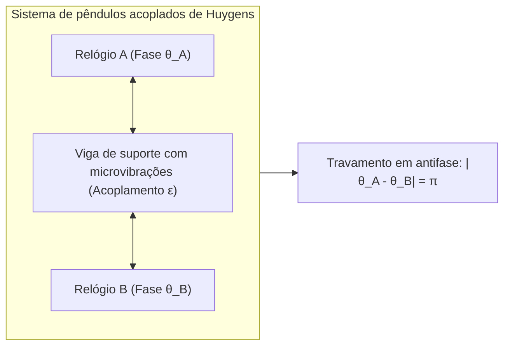
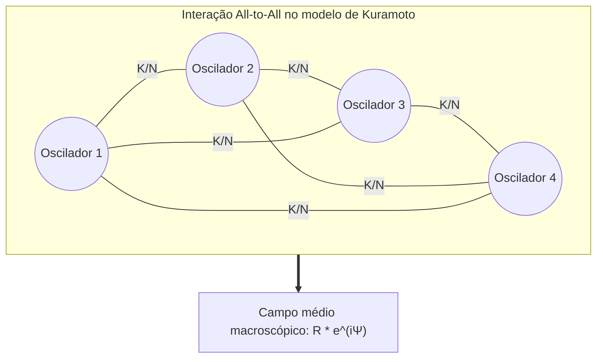

Nas profundezas dos manguezais do sudeste asiático ocorre um dos espetáculos mais deslumbrantes do mundo natural: dezenas de milhares de vagalumes, piscando incialmente de forma desordenada segundo seus próprios relógios biológicos, alinham gradualmente seus lampejos. Em pouco tempo, copas inteiras de árvores iluminam-se na mesma fração de segundo e apagam-se em uníssono absoluto. Em Londres, na inauguração da Millennium Bridge em 2000, os passos de milhares de pedestres geraram vibrações laterais que forçaram a multidão a marchar sincronizada ao balanço da ponte, intensificando assustadoramente a oscilação. Em nosso coração, milhões de células no nó sinoatrial disparam impulsos elétricos com sincronia imutável, sustentando a vida sem qualquer intervenção consciente do cérebro.

Esse fenômeno universal em biologia, física estatística, engenharia e astronomia é conhecido como <strong>sincronização coletiva espontânea (Collective Synchronization)</strong>.

Como sistemas formados por milhares de elementos heterogêneos, dotados de frequências próprias distintas, conseguem criar ordem espontânea sem a presença de um maestro central?

Neste artigo, investigamos os fundamentos matemáticos e físicos desse fenômeno: desde os experimentos pioneiros de Christiaan Huygens até o célebre <strong>Modelo de Kuramoto</strong>, o método de redução de fase, o <strong>ansatz de Ott-Antonsen</strong> e os misteriosos <strong>estados quimera (Chimera States)</strong>.

---

## 1. A descoberta de Christiaan Huygens: A simpatia dos relógios

Em 1665, o célebre físico holandês Christiaan Huygens, inventor do relógio de pêndulo, encontrava-se acamado por motivo de doença. Na parede do seu quarto, dois de seus relógios estavam suspensos na mesma trave de madeira.

Huygens observou que, independentemente da fase inicial dos pêndulos, após uma ou duas horas de funcionamento eles invariavelmente passavam a oscilar na mesma frequência e em exata oposição de fase (defasagem de $\pi$). Huygens descreveu o fenômeno como uma fascinante <strong>«simpatia dos pêndulos» (Sympathy of Pendulums)</strong>.

Huygens compreendeu que o movimento dos pêndulos transferia vibrações quase imperceptíveis através da trave de madeira comum. Esse <strong>acoplamento fraco</strong> fazia com que as forças horizontais opostas se cancelassem mutuamente, alcançando o estado de menor perda de energia e estabilidade ideal.

---

## 2. Osciladores de ciclo limite: Rigidez de amplitude e flexibilidade de fase

Diferente de um oscilador harmônico ideal, os sistemas biológicos e mecânicos reais são <strong>osciladores não lineares auto-sustentados (Limit-Cycle Oscillators)</strong>. Eles extraem energia do meio ambiente e a dissipam continuamente, estabelecendo no espaço de fases uma trajetória fechada denominada <strong>ciclo limite</strong>:
1. <strong>Rigidez de amplitude</strong>: Desvios perpendiculares ao ciclo limite decaem exponencialmente no tempo.
2. <strong>Flexibilidade de fase</strong>: Ao longo da órbita fechada (na direção da fase $\theta$), inexiste qualquer força restauradora.

Dessa forma, interações extremamente débeis são incapazes de alterar a amplitude da oscilação, mas podem acelerar ou atrasar livremente a sua <strong>fase $\theta$</strong>, viabilizando a sincronização coletiva.

---

## 3. O Modelo de Kuramoto: O cânone da sincronização

### 3.1 A equação fundamental

Em 1975, o físico japonês <strong>Yoshiki Kuramoto</strong> formulou uma equação revolucionária para descrever $N$ osciladores fracamente acoplados com interação global (All-to-All):

$$\frac{d\theta_i}{dt} = \omega_i + \frac{K}{N} \sum_{j=1}^N \sin(\theta_j - \theta_i) \quad (i = 1, \dots, N)$$

Onde:
- $\theta_i(t)$ é a fase do $i$-ésimo oscilador;
- $\omega_i$ é a <strong>frequência natural</strong>, distribuída conforme uma densidade $g(\omega)$;
- $K > 0$ é a intensidade do <strong>acoplamento global</strong>;
- A função seno induz uma atração que minimiza as defasagens mútuas.

### 3.2 O parâmetro de ordem complexo e campo médio

Kuramoto definiu o <strong>parâmetro de ordem complexo</strong>:

$$r(t) e^{i \psi(t)} = \frac{1}{N} \sum_{j=1}^N e^{i \theta_j(t)}$$

- <strong>$r(t) \in [0, 1]$</strong>: Mede a coerência macroscópica ($r \approx 0$ estado desordenado; $r \to 1$ sincronia total).
- <strong>$\psi(t)$</strong>: Fase média coletiva.

Com essa transformação, a equação de $N$ corpos é desacoplada em equações independentes guiadas pelo campo médio:

$$\frac{d\theta_i}{dt} = \omega_i + K r \sin(\psi - \theta_i)$$

---

## 4. Transição de fase e acoplamento crítico $K_c$

Os osciladores dividem-se naturalmente em dois grupos:
1. <strong>Osciladores sincronizados ($|\omega_i| \le Kr$)</strong>: Capturados pelo campo médio, operam na frequência coletiva $\omega_0$.
2. <strong>Osciladores em deriva ($|\omega_i| > Kr$)</strong>: Com frequências discrepantes, circulam continuamente fora de fase.

No limite contínuo $N \to \infty$, a intensidade crítica de acoplamento para o surgimento da ordem é dada por:

$$K_c = \frac{2}{\pi g(0)}$$

Para uma distribuição lorentziana com parâmetro de escala $\gamma$, $K_c = 2\gamma$. Acima do limiar $K > K_c$, a coerência cresce como $r \propto (K - K_c)^{1/2}$, caracterizando uma <strong>transição de fase contínua de segunda ordem</strong>.

---

## 5. Ansatz de Ott-Antonsen e Estados Quimera

Em 2008, <strong>Edward Ott e Thomas Antonsen</strong> provaram que o comportamento de um número infinito de osciladores pode ser reduzido a uma variedade de baixa dimensão através de uma parametrização dos coeficientes de Fourier, transformando equações diferenciais parciais em uma única equação diferencial ordinária.

Ademais, em 2002, <strong>Kuramoto e Shima</strong> revelaram os surpreendentes <strong>estados quimera (Chimera States)</strong>: em redes com acoplamento não local, osciladores rigorosamente idênticos podem se dividir simultaneamente entre um grupo totalmente sincronizado e outro caótico. Esse fenômeno fundamenta o sono uni-hemisférico observado em baleias e aves migratórias.

---

## 6. Aplicações no mundo prático

| Área | Sistema | Oscilador elementar | Mecanismo de acoplamento | Risco de desincronização |
|---|---|---|---|---|
| <strong>Sistemas Elétricos</strong> | Redes de transmissão de energia | Geradores síncronos / Inversores | Linhas de alta tensão AC | Queda de frequência e apagão geral |
| <strong>Neurociência</strong> | Córtex cerebral e hipocampo | Potenciais de ação neuronal | Sinapses químicas e elétricas | Crises epilépticas (hipersincronia) |
| <strong>Cardiologia</strong> | Nódulo sinusal cardíaco | Células miocárdicas | Junções comunicantes (Gap Junctions) | Fibrilação ventricular e parada cardíaca |
| <strong>Engenharia Civil</strong> | Pontes pênseis | Passos de pedestres | Deformação elástica da estrutura | Oscilação lateral desmedida |

## 7. Conclusão

O Modelo de Kuramoto exemplifica com perfeição como a auto-organização espontânea opera: a harmonia coletiva emerge naturalmente das interações recíprocas entre os indivíduos, desenhando uma das leis mais elegantes da física não linear.
