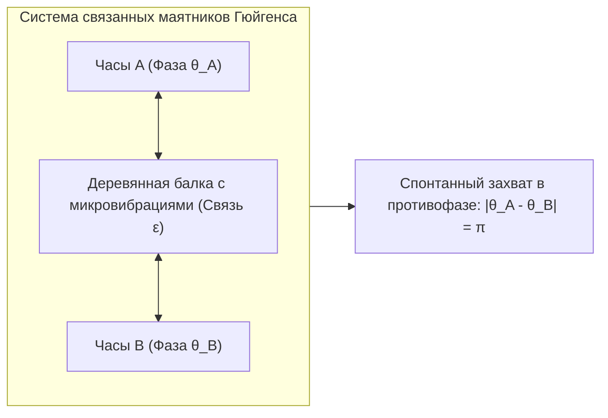
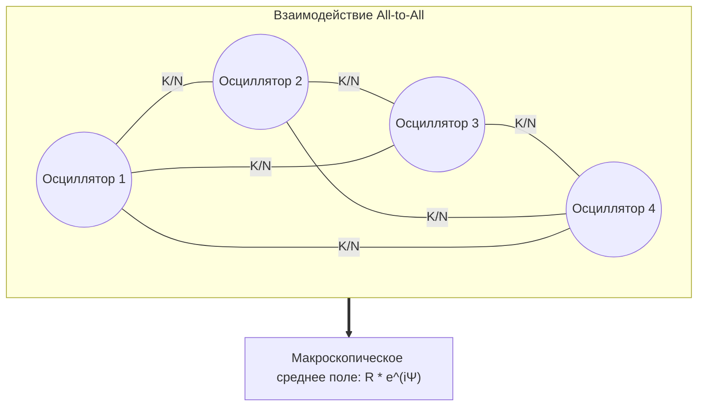

В глубине мангровых лесов Юго-Восточной Азии с наступлением сумерек разворачивается поразительное природное зрелище: десятки тысяч светлячков, каждый из которых изначально вспыхивал по своим собственным внутренним биоритмам, постепенно согласовывают свои импульсы. Вскоре целые кроны деревьев вспыхивают в одну и ту же миллисекунду и одновременно погружаются в темноту. В Лондоне в 2000 году в день открытия мост Миллениум под шагами тысяч пешеходов начал угрожающе раскачиваться из стороны в сторону: люди непроизвольно подстраивали шаг под колебания моста, что лавинообразно увеличивало амплитуду. В глубине человеческого сердца миллионы клеток синоатриального узла без какого-либо командного сигнала из мозга координируют свои электрические разряды с точностью до долей секунды на протяжении всей жизни.

Это фундаментальное явление, объединяющее биологию, статистическую физику, инженерию и космологию, называется <strong>спонтанной коллективной синхронизацией (Collective Synchronization)</strong>.

Как огромная популяция независимых элементов с различными собственными частотами способна без единого центрального дирижера спонтанно порождать макроскопический порядок исключительно благодаря слабейшим локальным взаимодействиям?

В этой статье мы подробно рассмотрим нелинейную динамику и теорию сложных сетей: от наблюдений Христиана Гюйгенса до знаменитой <strong>модели Курамото</strong>, метода фазовой редукции, <strong>анзаца Отта-Антонсена</strong> и загадочных <strong>химерных состояний (Chimera States)</strong>.

---

## 1. Открытие Христиана Гюйгенса и слабая связь

Научная история синхронизации началась в 1665 году. Голландский физик Христиан Гюйгенс, изобретатель маятниковых часов, лежа в постели из-за болезни, наблюдал за двумя изготовленными им морскими хронометрами, висевшими на общей деревянной балке.

Гюйгенс заметил, что независимо от начальных фаз маятников, через час или два они неизменно переходили в строго синхронное движение в противофазе (с разностью фаз $\pi$). Гюйгенс назвал это явление <strong>«симпатией маятников» (Sympathy of Pendulums)</strong>.

Гюйгенс доказал, что колебания маятников передавали едва уловимые вибрации через общую балку. Эта <strong>слабая связь</strong> приводила к взаимному гашению поперечных сил при колебании в противоположные стороны, переводя систему в состояние с минимальной диссипацией энергии.

---

## 2. Автоколебания и предельные циклы

В отличие от линейных гармонических осцилляторов, реальные колебательные системы в живой природе и технике являются <strong>нелинейными автоколебательными системами (Limit-Cycle Oscillators)</strong>. В фазовом пространстве они формируют устойчивый <strong>предельный цикл</strong>:
1. <strong>Жесткость амплитуды</strong>: любые отклонения по нормали к траектории экспоненциально затухают со временем.
2. <strong>Нейтральность фазы</strong>: вдоль самой траектории (координаты фазы $\theta$) возвращающая сила отсутствует.

Поэтому даже бесконечно слабое воздействие не может изменить форму или амплитуду цикла, но способно легко сдвигать <strong>фазу $\theta$</strong>. Это фундаментальное свойство лежит в основе фазовой синхронизации при слабой связи.

---

## 3. Модель Курамото: Канон нелинейной синхронизации

### 3.1 Основное уравнение

В 1975 году японский физик-теоретик <strong>Ёсики Курамото</strong> из Киотского университета предложил элегантную модель для ансамбля $N$ слабосвязанных осцилляторов с глобальным взаимодействием (All-to-All):

$$\frac{d\theta_i}{dt} = \omega_i + \frac{K}{N} \sum_{j=1}^N \sin(\theta_j - \theta_i) \quad (i = 1, \dots, N)$$

Где:
- $\theta_i(t)$ — фаза $i$-го осциллятора;
- $\omega_i$ — его <strong>собственная частота</strong>, выбранная из симметричного распределения $g(\omega)$;
- $K > 0$ — глобальная <strong>сила связи</strong>;
- Синусоидальная функция притягивает фазы друг к другу.

### 3.2 Комплексный параметр порядка и среднее поле

Курамото ввел <strong>комплексный параметр порядка</strong>:

$$r(t) e^{i \psi(t)} = \frac{1}{N} \sum_{j=1}^N e^{i \theta_j(t)}$$

- <strong>$r(t) \in [0, 1]$</strong> выражает степень когерентности ансамбля ($r \approx 0$ соответствует полному хаосу, $r \to 1$ — идеальной синхронизации).
- <strong>$\psi(t)$</strong> — макроскопическая средняя фаза.

Подставив это выражение, уравнение системы распадается на независимые уравнения движения в общем среднем поле:

$$\frac{d\theta_i}{dt} = \omega_i + K r \sin(\psi - \theta_i)$$

---

## 4. Фазовый переход и критическая сила связи $K_c$

В системе отсчета, вращающейся с частотой среднего поля, осцилляторы делятся на две категории:
1. <strong>Захваченные по фазе ($|\omega_i| \le Kr$)</strong>: фиксируются в устойчивой точке $\sin \theta_i^* = \frac{\omega_i}{Kr}$ и вращаются со средней частотой.
2. <strong>Дрейфующие ($|\omega_i| > Kr$)</strong>: свободно скользят по окружности фаз.

В термодинамическом пределе $N \to \infty$ условие самосогласования при $r \to 0^+$ дает формулу критической связи:

$$K_c = \frac{2}{\pi g(0)}$$

При $K > K_c$ некогерентное состояние теряет устойчивость, и порядок возрастает по закону $r \propto (K - K_c)^{1/2}$, что в точности соответствует непрерывному <strong>фазовому переходу второго рода</strong>.

---

## 5. Анзац Отта-Антонсена и химерные состояния

В 2008 году <strong>Эдвард Отт и Томас Антонсен</strong> показали, что динамика бесконечного числа осцилляторов строго коллапсирует на низкоразмерное инвариантное многообразие, сведя нелинейное интегро-дифференциальное уравнение к единственному обыкновенному дифференциальному уравнению.

В 2002 году <strong>Курамото и Сима</strong> открыли феномен <strong>химерных состояний (Chimera States)</strong>: в кольце одинаковых осцилляторов с нелокальной связью одна группа осцилляторов идеально синхронизируется, а вторая остается совершенно хаотичной. Это открытие объяснило природу однополушарного сна у морских млекопитающих и перелетных птиц.

---

## 6. Прикладные аспекты синхронизации

| Область | Система | Элементарный осциллятор | Механизм связи | Последствия десинхронизации |
|---|---|---|---|---|
| <strong>Энергосети</strong> | Континентальные энергосистемы | Синхронные генераторы / Инверторы | Высоковольтные ЛЭП | Каскадное отключение и полный блэкаут |
| <strong>Нейронаука</strong> | Кора головного мозга | Нейронные потенциалы действия | Синапсы и щелевые контакты | Эпилептические припадки (гиперсинхрония) |
| <strong>Кардиология</strong> | Синусовый узел сердца | Клетки-пейсмейкеры | Ионные каналы миокарда | Фибрилляция желудочков и остановка сердца |
| <strong>Мостостроение</strong> | Вантовые пешеходные мосты | Шаг пешеходов | Поперечные упругие колебания | Резонансное раскачивание конструкции |

## 7. Заключение

Теория коллективной синхронизации доказывает, что порядок во Вселенной способен рождаться спонтанно без внешнего принуждения. Взаимный отклик автономных систем превращает разрозненный шум в гармоничную симфонию природы.
