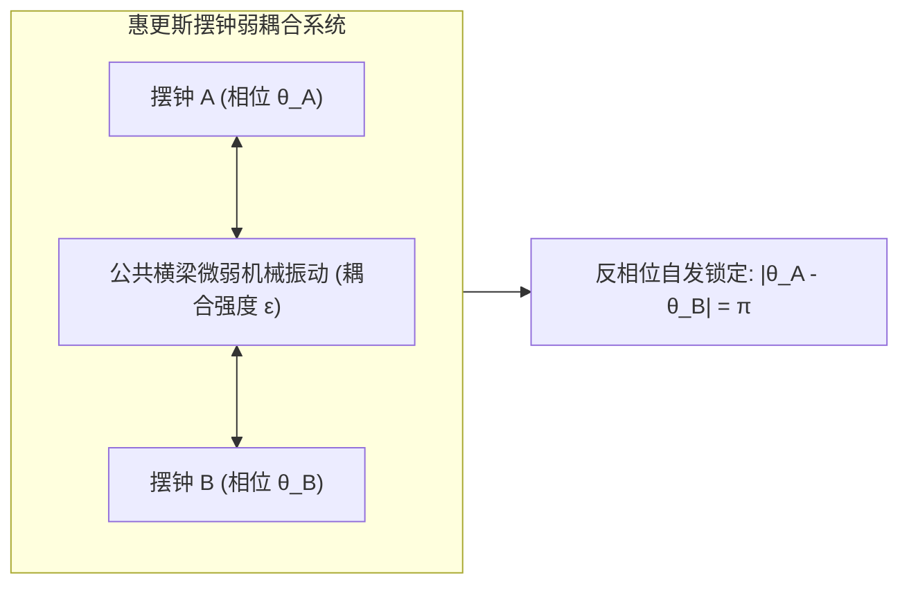
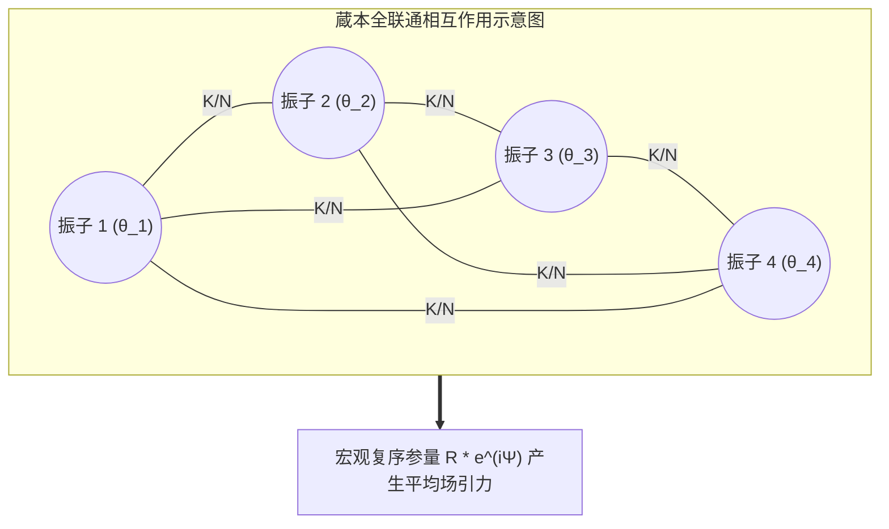
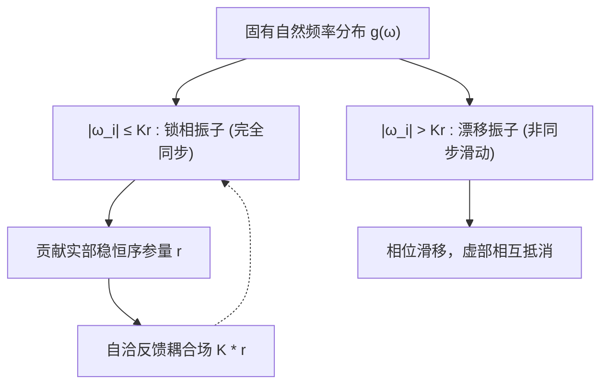
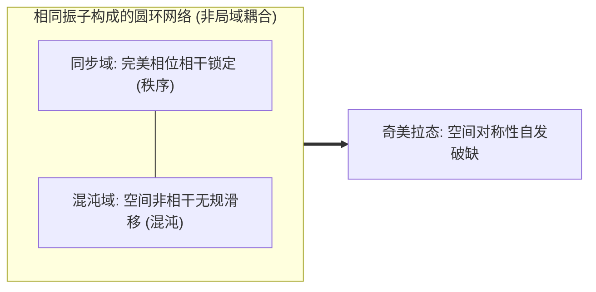

东南亚红树林深处，数万只原本各按自身内部生物钟闪烁的红树林萤火虫，在夜幕降临后逐渐汇聚成一道令全世界旅行家叹为观止的奇观——整座森林的树冠在同一毫秒内齐刷刷亮起，又在同一瞬间归于漆黑。在伦敦泰晤士河上，2000年开放的第一天，千禧桥在成千上万行人的无意识步伐中开始产生不可阻挡的左右剧烈晃动，迫使人们不得不顺应桥梁的摆动同步踏步，进一步放大了桥梁的振动。在人类的心脏深处，数以百万计的窦房结起搏细胞无需任何中央神经命令，凭借微弱的离子通道耦合，数十年来每分钟精准同步放电数十次，维系着生命不可中断的脉动。

这种跨越生物学、工程学、天文学与凝聚态物理学的普适现象，被称为<strong>集体自发同步（Collective Synchronization）</strong>。

为什么由成千上万个固有频率各不相同、存在制造缺陷或基因差异的个体组成的群体，在没有绝对外部指挥者（No Central Conductor）的情况下，仅仅依赖彼此间极其微弱的局部相互作用，就能跨越临界点，自发涌现出惊人一致的宏观宏伟节奏？

本文将带领读者深入非线性动力学、统计物理与网络科学的核心，系统剖析从克里斯蒂安·惠更斯（Christiaan Huygens）的钟摆观察，到阿瑟·温弗里（Arthur Winfree）的生物相响应，再到日本物理学家<strong>蔵本由纪（Yoshiki Kuramoto）</strong>提出的革命性<strong>蔵本模型（Kuramoto Model）</strong>，以及现代非线性物理中令人惊叹的<strong>奥特-安东森（Ott-Antonsen）拟设</strong>与<strong>奇美拉态（Chimera States）</strong>。

---

## 一、 惠更斯的偶然发现：同步科学的黎明

### 1.1 病榻上的奇迹：同情摆钟的共鸣

科学史上关于同步的最早严谨文字记录，可追溯至1665年。荷兰物理学家、摆钟的发明者克里斯蒂安·惠更斯因患病卧床休养。在卧室的墙壁横梁上，悬挂着两架他精心制作的海上导航用摆钟。在连续数天的观察中，惠更斯注意到一个极为奇特的现象：无论最初将两架摆钟的时钟摆锤以何种角度和相位释放，只要经过一两个小时的运转，两个摆锤总会奇迹般地进入一种完全反向（反相位）、频率绝对一致的稳定振动状态。惠更斯在给皇家学会的信件中，将这一现象动情地称为<strong>“钟摆的同情”（Sympathy of Pendulums）</strong>。

惠更斯很快通过实验排除了空气流动或磁力吸引的假说。他敏锐地推断，悬挂两架钟的共同木质横梁在摆锤摇晃时承受了微不可察的微小机械振颤。正是这种通过支架传递的微弱反作用力，构成了两个独立振子之间的“弱耦合”。当两个摆锤反向摆动时，它们对横梁产生的水平侧推力相互抵消，系统进入了能量耗散最小、动力学最稳定的吸引子状态。

### 1.2 线性共振与非线性自持振动的本质鸿沟

长期以来，经典物理学将周期运动等同于简谐振子。然而，简谐振子并不具备产生集体同步的能力：
1. <strong>外力驱动的线性共振</strong>：当受迫外力的频率等于固有频率时振幅无限增大，但系统完全被动，缺乏内在自调节机制。
2. <strong>极限环振子（Limit-Cycle Oscillator）</strong>：生命体、摆钟、激光器与电力网的核心动力学机制是非线性的。这类系统内部持续摄取能量并耗散能量，在相空间中形成一个孤立的闭合轨道——<strong>极限环（Limit Cycle）</strong>。

极限环的伟大特性在于：即使外界施加微小的速度或位置扰动，轨迹也会随着时间指数衰减并迅速回到原闭合轨道上。在垂直于极限环的振幅方向上，动力学是强耗散且高度稳定的；但在沿极限环切线方向（即<strong>相位 $\theta$</strong>），系统没有任何恢复力。

这意味着：<strong>微弱的相互作用力无法轻易改变振子的振幅，却能够轻松推动或拖慢振子的相位</strong>。正是这种“振幅刚性”与“相位柔性”的完美结合，为弱耦合下的相位同步（Phase Synchronization）奠定了普遍的物理基础。

---

## 二、 温弗里与相位重构：从多维状态到一维圆周

20世纪60年代，理论生物学家阿瑟·温弗里（Arthur Winfree）试图用数学方法解释数万只雌雄萤火虫如何同步闪烁以及昼夜节律生物钟的同步机理。

一个真实的生物细胞或生化反应系统（如心肌细胞膜电位、钙离子浓度、糖酵解振荡），其微观状态变量可能多达数十甚至数百个：
$$\frac{d\mathbf{x}}{dt} = \mathbf{F}(\mathbf{x})$$

如果直接求解耦合的高维非线性微分方程组，数学上几乎是不可能的。温弗里的突破性直觉在于引入了<strong>等时线（Isochrons）</strong>与<strong>相位重构（Phase Reduction）</strong>。对于任何稳定的极限环吸引子，在相空间吸引盆内的每一个点，都可以映射为极限环上的一个单调递增标量相位 $\theta \in [0, 2\pi)$。

当振子受到微弱外界刺激（如临近萤火虫闪烁发出的一缕微光）时，其相位会发生微小的跃迁 $\Delta \theta$。这一响应仅取决于受刺激瞬间振子所处的状态，即<strong>相位响应曲线（Phase Response Curve, PRC）</strong>：
$$Z(\theta) = \lim_{\Delta x \to 0} \frac{\Delta \theta}{\Delta x}$$

温弗里证明，大量振子的弱相互作用可以通过其平均影响加以近似。然而，温弗里的平均场方程在数学上极其复杂，直到1975年，一位年轻的日本物理学家提出了更为优美而深邃的模型。

---

## 三、 蔵本模型：非线性同步的经典规范

### 3.1 极简之美：蔵本微分方程

1975年，京都大学的<strong>蔵本由纪（Yoshiki Kuramoto）</strong>在国际理论物理会议上发表了一个具有划时代意义的模型。蔵本假设由 $N$ 个极限环振子组成的群体，每个振子仅由其相位 $\theta_i \in [0, 2\pi)$ 描述，振子之间的相互作用为全联通（All-to-All）弱耦合，且相互作用函数为最基础的一阶谐波 $\sin(\theta_j - \theta_i)$：

$$\frac{d\theta_i}{dt} = \omega_i + \frac{K}{N} \sum_{j=1}^N \sin(\theta_j - \theta_i) \quad (i = 1, 2, \dots, N)$$

这里：
- $\theta_i(t)$ 是第 $i$ 个振子的瞬时相位；
- $\omega_i$ 是第 $i$ 个振子的<strong>固有自然频率（Natural Frequency）</strong>，从某种连续概率分布 $g(\omega)$ 中独立随机抽取；通常假设 $g(\omega)$ 关于中心频率 $\omega_0$ 对称且单峰（例如高斯分布或柯西-洛伦兹分布）；
- $K > 0$ 代表群体之间的全局<strong>耦合强度（Coupling Strength）</strong>；
- 正弦函数 $\sin(\theta_j - \theta_i)$ 展现了引力性质：若 $\theta_j > \theta_i$，则第 $j$ 个振子会加速拉扯第 $i$ 个振子；反之则减速，促使二者相位趋近一致。

### 3.2 宏观复序参量与平均场简化

直接分析 $N$ 个相互纠缠的正弦方程难度巨大。蔵本施展了统计物理中极为高超的“平均场技巧”（Mean-Field Trick）。定义<strong>复序参量（Complex Order Parameter）</strong>：

$$r(t) e^{i \psi(t)} = \frac{1}{N} \sum_{j=1}^N e^{i \theta_j(t)}$$

几何意义极其直观：将每个振子视为单位圆上的一个质量点 $e^{i\theta_j}$，那么 $r(t) e^{i\psi(t)}$ 正是所有振子的质心位置！
- <strong>$r(t) \in [0, 1]$（相干度/同步程度）</strong>：
  - 当 $r \approx 0$ 时，振子相位均匀散布在圆周上，系统处于完全无序的非同步态；
  - 当 $r \to 1$ 时，所有振子紧密团聚在均值相位 $\psi(t)$ 附近，系统展现出宏观一致的周期波动。
- <strong>$\psi(t)$</strong>：群体的平均宏观相位。

利用欧拉公式展开，将复序参量两端乘以 $e^{-i \theta_i}$：
$$r e^{i(\psi - \theta_i)} = \frac{1}{N} \sum_{j=1}^N e^{i(\theta_j - \theta_i)}$$

取虚部：
$$r \sin(\psi - \theta_i) = \frac{1}{N} \sum_{j=1}^N \sin(\theta_j - \theta_i)$$

将此恒等式代回原方程，原本复杂的 $N$ 体相互作用方程奇迹般地解耦为<strong>单个振子与群体平均场相互作用的独立方程</strong>：

$$\frac{d\theta_i}{dt} = \omega_i + K r \sin(\psi - \theta_i)$$

每个振子仿佛不再感知具体其他振子的存在，它只需仰望“宏观平均场” $r e^{i\psi}$，并受到大小为 $K r$ 的向心引力牵引！

---

## 四、 同步相变与临界耦合强度 $K_c$ 的严格求解

### 4.1 振子的分化：锁相群与漂移群

考察旋转坐标系（令 $\psi = \omega_0 t = 0$）。若系统进入统计稳态，序参量振幅 $r$ 保持恒定。振子运动方程化为：
$$\frac{d\theta_i}{dt} = \omega_i - K r \sin \theta_i$$

根据振子自然频率偏离中心频率的程度，振子被截然划分为两派：

1. <strong>锁相振子（Phase-Locked Oscillators）</strong>：
   若 $|\omega_i| \le K r$，方程存在稳定的固定点 $\frac{d\theta_i}{dt} = 0$。
   振子被宏观场俘获，其相位固定在：
   $$\sin \theta_i^* = \frac{\omega_i}{K r}, \quad \cos \theta_i^* = \sqrt{1 - \left(\frac{\omega_i}{K r}\right)^2}$$
   它们的有效运转频率完全被迫调整为相同的宏观频率 $\Omega = \omega_0$。

2. <strong>漂移振子（Drifting Oscillators）</strong>：
   若 $|\omega_i| > K r$，固有频率差异过大，宏观场的引力无法彻底锁住其相位。振子在圆周上不均匀地滑移旋转，但在靠近平均相位时由于阻力变慢，依然在统计上对平均场有所贡献。

### 4.2 自洽方程与临界阈值推导

在连续极限 $N \to \infty$ 下，锁相振子对序参量的贡献可以通过概率密度积分表达。漂移振子由于周期对称性，其虚部平均抵消。根据自洽条件：
$$r = \int_{-Kr}^{Kr} \cos \theta(\omega) g(\omega) d\omega = \int_{-Kr}^{Kr} \sqrt{1 - \left(\frac{\omega}{K r}\right)^2} g(\omega) d\omega$$

做变量代换 $\omega = K r \sin \theta$：
$$r = K r \int_{-\pi/2}^{\pi/2} \cos^2 \theta \cdot g(K r \sin \theta) d\theta$$

除去平凡解 $r = 0$（无序态始终存在），非零同步相的边界由 $r \to 0^+$ 时的极限确定。在 $r \to 0$ 处展开 $g(K r \sin \theta) \approx g(0)$：
$$1 = K g(0) \int_{-\pi/2}^{\pi/2} \cos^2 \theta d\theta = K g(0) \left[ \frac{\theta}{2} + \frac{\sin 2\theta}{4} \right]_{-\pi/2}^{\pi/2} = K g(0) \cdot \frac{\pi}{2}$$

由此，蔵本导出了凝聚态物理与非线性科学中最著名的<strong>临界耦合强度公式</strong>：

$$K_c = \frac{2}{\pi g(0)}$$

当固有频率分布服从标准洛伦兹分布 $g(\omega) = \frac{\gamma}{\pi (\omega^2 + \gamma^2)}$ 时，$g(0) = \frac{1}{\pi \gamma}$，代入可得极简洁的临界值：
$$K_c = 2\gamma$$

- 当 $K < K_c$ 时，$r(t) = 0$ 是唯一稳定的定态，系统呈现各行其是的混沌热运动般非相干态；
- 当 $K > K_c$ 时，无序态失稳，系统经历超临界叉氏分岔（Supercritical Pitchfork Bifurcation），自发打破连续旋转对称性，$r(t)$ 随 $(K - K_c)^{1/2}$ 幂律增长。这在统计力学上与铁磁相变（Ferromagnetic Phase Transition）或超导玻色-爱因斯坦凝聚具有完全一致的二级连续相变特征！

---

## 五、 奥特-安东森拟设：无限自由度的降维奇迹

蔵本模型虽然形式优美，但在非稳态、含时外驱动或复杂网络拓扑下，系统是一个无限维的偏微分方程（连续性方程结合福克-普朗克方程）。在长达三十多年的时间里，全球应用数学界对蔵本系统的瞬态动力学束手无策。

直到2008年，马里兰大学的<strong>爱德华·奥特（Edward Ott）</strong>与<strong>托马斯·安东森（Thomas Antonsen）</strong>发现了震撼学界的降维解析方法——<strong>奥特-安东森拟设（Ott-Antonsen Ansatz）</strong>。

振子在相空间中的连续分布函数 $f(\theta, \omega, t)$ 可以进行傅里叶级数展开：
$$f(\theta, \omega, t) = \frac{g(\omega)}{2\pi} \left[ 1 + \sum_{n=1}^\infty \left( f_n(\omega, t) e^{i n \theta} + f_n^*(\omega, t) e^{-i n \theta} \right) \right]$$

奥特与安东森大胆假设：高阶傅里叶系数并非相互独立，而是完全由基波系数的几何级数幂次所决定，即：
$$f_n(\omega, t) = [\alpha(\omega, t)]^n$$

将这一极度严苛的特殊拟设代入连续性流动方程 $\frac{\partial f}{\partial t} + \frac{\partial}{\partial \theta}(f v) = 0$ 后，不可思议的奇迹发生了：<strong>所有无穷多个高阶傅里叶谐波方程全部自然满足，且处处精确恒等！</strong>

通过留数定理对复数下半平面进行围道积分，原本描述无穷多振子微观分布的非线性偏微分方程，被精确坍缩为描述宏观序参量演化的<strong>单一常微分方程（ODE）</strong>：

$$\frac{d\alpha}{dt} = -i \omega_0 \alpha - \gamma \alpha + \frac{K}{2} (\alpha - \alpha^* \alpha^2)$$

奥特-安东森理论证明了：在全联通均匀振子系统中，宏观动力学完全被约束在一个极低维度的平滑子流形（Poisson Kernel 泊松核子空间）上。这使得科学家终于能够像分析两三个简单方程一样，精确预测具有数百万振子系统的分岔、混沌与调制行为。

---

## 六、 奇美拉态：对称破缺的终极谜题

在蔵本模型的经典认知中，只要耦合强度足够大且连接完全对称，系统必然走向全面一致的同步。

然而，2002年，<strong>蔵本由纪与神保秀一（Shigeru Shima）</strong>在研究具有非局域弱耦合（Non-local Coupling）的振子环时，发现了违背一切对称性直觉的惊异现象：系统自发裂解为两半——一部分振子保持着绝对整齐划一的同步锁定运动，而另一部分在几何与动力学参数完全相同的振子，却在相邻区域中表现出完全随机、剧烈漂移的非相干状态！

2004年，理论物理学家史蒂文·斯特罗加茨（Steven Strogatz）将这种“一半是秩序、一半是混沌，如同希腊神话中狮头、羊身、蛇尾神兽”的共存奇异状态命名为<strong>奇美拉态（Chimera States）</strong>。

奇美拉态彻底颠覆了传统观点，它证明：<strong>即使用来构建系统的基石完全相同、空间分布完全对称，混沌与秩序依然可以永久共存。</strong> 现代神经科学研究表明，海豚和许多鸟类的“单半球慢波睡眠”（Unihemispheric Slow-Wave Sleep，即一半大脑睡眠脑电波高度同步、另一半大脑清醒警觉以防天敌）正是奇美拉态在生命进化中的精妙体现。

---

## 七、 从理论到现实：集体同步的广泛工程与生命应用

集体自发同步绝非象牙塔里的纯数学玩具，它是贯穿现代科技与自然界运作的基石物理定律：

| 领域 | 物理/生物系统 | 振子个体 | 耦合媒介 | 失步带来的灾难/功能 |
|---|---|---|---|---|
| <strong>电力系统</strong> | 现代智能电网 | 交流发电机/逆变器转子 | 高压交流输电线路网络 | 频率失步引发大面积跨国大停电 |
| <strong>神经科学</strong> | 大脑皮层与海马体 | 神经元动作电位脉冲 | 突触电位与神经递质通道 | 过度同步引发癫痫发作；失步导致记忆衰退 |
| <strong>心脏病学</strong> | 窦房结与心室肌 | 起搏细胞膜动作电位 | 缝隙连接（Gap Junctions） | 异常相位滞后诱发心室颤动（致命骤停） |
| <strong>土木工程</strong> | 千禧桥等大跨度桥梁 | 行人横向左右摆动步频 | 悬索桥人行横梁弹性侧向应力 | 行人踩踏频率与桥梁固有晃动共振锁相 |
| <strong>光电子学</strong> | 高功率激光二极管阵列 | 半导体量子阱发光单元 | 衍射光栅外部腔体光学反馈 | 从多模式杂散光跃迁至高强度单色相干激光束 |

### 7.1 电力网络：巨型旋转电机的物理同步

在覆盖全洲的超高压交变电网中，数百台重达数百吨的同步发电机必须严格保持在 50Hz（或 60Hz）的绝对一致转速。若一台发电机的转子相位超前，其输出电功率剧增，电磁阻尼扭矩反过来强行拖慢其转速；若相位滞后，电网输入功率将其向前牵引。这一著名的摆动方程（Swing Equation）在小振幅近似下与蔵本模型同构。当前全球大规模并入风能、光伏等缺乏机械转动惯量的逆变器，使得现代电力系统的等效 $K$ 急剧变化，蔵本模型的网络拓扑理论成为了国家级电网稳定性设计的核心数学工具。

---

## 八、 总结：涌现、秩序与宇宙的节奏

从惠更斯床前的两架木制钟摆，到东南亚丛林中漫天飞舞的萤火虫；从亿万神经元在冥想时迸发的同步伽马波，到宇宙深处脉冲星与双星系统的潮汐锁定。

蔵本模型与集体同步理论向人类揭示了一个至为深刻的宇宙真理：
<strong>秩序并不总是依赖自上而下的独裁指挥。</strong> 即使每一个微观个体是充满异质性、有缺陷、甚至充满热涨落噪声的弱小存在，只要存在哪怕极其微弱的互惠相互作用，整个体系便能自发跨越临界的奇点，在宏观尺度上谱写出气势磅礴的交响乐章。这正是非线性科学、数学与大自然交织出的最震撼人心的唯美诗篇。
