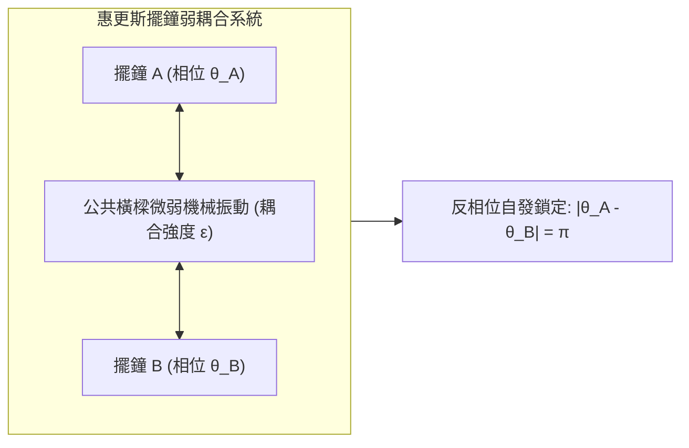
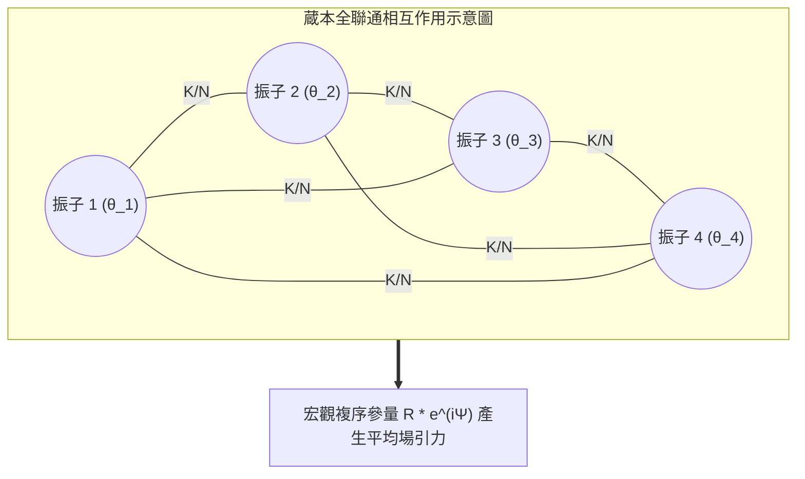
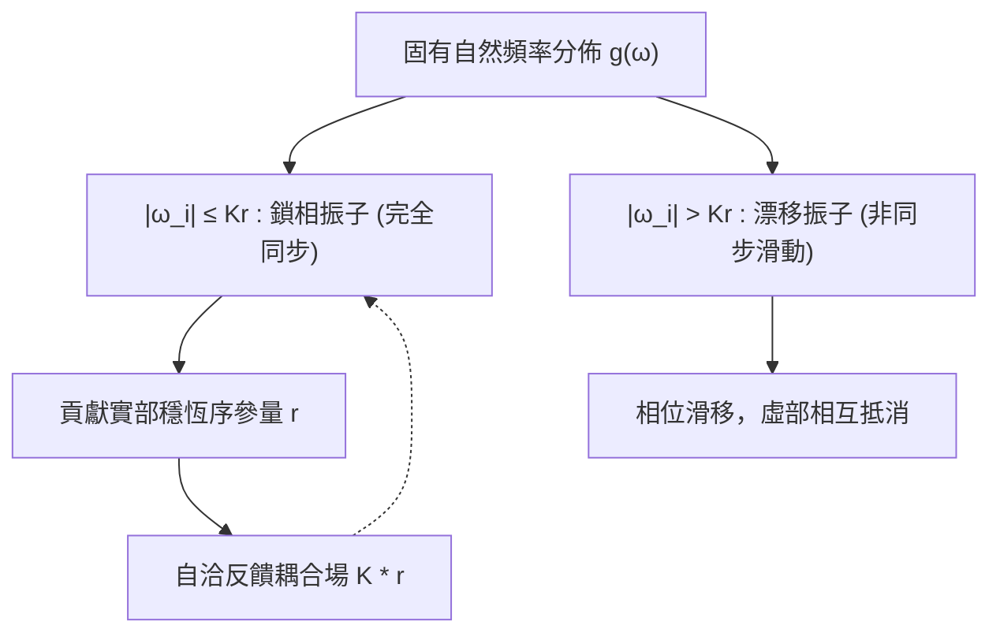
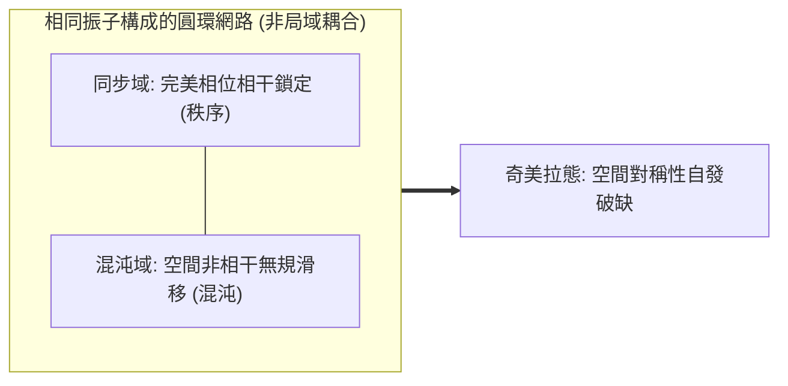

東南亞紅樹林深處，數萬隻原本各按自身內部生物鐘閃爍的紅樹林螢火蟲，在夜幕降臨後逐漸匯聚成一道令全世界旅行家嘆為觀止的奇觀——整座森林的樹冠在同一毫秒內齊刷刷亮起，又在同一瞬間歸於漆黑。在倫敦泰晤士河上，2000年開放的第一天，千禧橋在成千上萬行人的無意識步伐中開始產生不可阻擋的左右劇烈晃動，迫使人們不得不順應橋樑的擺動同步踏步，進一步放大了橋樑的振動。在人類的心臟深處，數以百萬計的竇房結起搏細胞無需任何中央神經命令，憑藉微弱的離子通道耦合，數十年來每分鐘精準同步放電數十次，維繫著生命不可中斷的脈動。

這種跨越生物學、工程學、天文學與凝聚態物理學的普適現象，被稱為<strong>集體自發同步（Collective Synchronization）</strong>。

為什麼由成千上萬個固有頻率各不相同、存在製造缺陷或基因差異的個體組成的群體，在沒有絕對外部指揮者（No Central Conductor）的情況下，僅僅依賴彼此間極其微弱的局部相互作用，就能跨越臨界點，自發湧現出驚人一致的宏觀宏偉節奏？

本文將帶領讀者深入非線性動力學、統計物理與網路科學的核心，系統剖析從克里斯蒂安·惠更斯（Christiaan Huygens）的鐘擺觀察，到阿瑟·溫弗里（Arthur Winfree）的生物相響應，再到日本物理學家<strong>蔵本由紀（Yoshiki Kuramoto）</strong>提出的革命性<strong>蔵本模型（Kuramoto Model）</strong>，以及現代非線性物理中令人驚嘆的<strong>奧特-安東森（Ott-Antonsen）擬設</strong>與<strong>奇美拉態（Chimera States）</strong>。

---

## 一、 惠更斯的偶然發現：同步科學的黎明

### 1.1 病榻上的奇蹟：同情擺鐘的共鳴

科學史上關於同步的最早嚴謹文字記錄，可追溯至1665年。荷蘭物理學家、擺鐘的發明者克里斯蒂安·惠更斯因患病臥床休養。在臥室的牆壁橫樑上，懸掛著兩架他精心製作的海上導航用擺鐘。在連續數天的觀察中，惠更斯注意到一個極為奇特的現象：無論最初將兩架擺鐘的時鐘擺錘以何種角度和相位釋放，只要經過一兩個小時的運轉，兩個擺錘總會奇蹟般地進入一種完全反向（反相位）、頻率絕對一致的穩定振動狀態。惠更斯在給皇家學會的信件中，將這一現象動情地稱為<strong>「鐘擺的同情」（Sympathy of Pendulums）</strong>。

惠更斯很快通過實驗排除了空氣流動或磁力吸引的假說。他敏銳地推斷，懸掛兩架鐘的共同木質橫樑在擺錘搖晃時承受了微不可察的微小機械振顫。正是這種通過支架傳遞的微弱反作用力，構成了兩個獨立振子之間的「弱耦合」。當兩個擺錘反向擺動時，它們對橫樑產生的水平側推力相互抵消，系統進入了能量耗散最小、動力學最穩定的吸引子狀態。

### 1.2 線性共振與非線性自持振動的本質鴻溝

長期以來，經典物理學將週期運動等同於簡諧振子。然而，簡諧振子並不具備產生集體同步的能力：
1. <strong>外力驅動的線性共振</strong>：當受迫外力的頻率等於固有頻率時振幅無限增大，但系統完全被動，缺乏內在自調節機制。
2. <strong>極限環振子（Limit-Cycle Oscillator）</strong>：生命體、擺鐘、激光器與電力網的核心動力學機制是非線性的。這類系統內部持續攝取能量並耗散能量，在相空間中形成一個孤立的閉合軌道——<strong>極限環（Limit Cycle）</strong>。

極限環的偉大特性在於：即使外界施加微小的速度或位置擾動，軌跡也會隨著時間指數衰減並迅速回到原閉合軌道上。在垂直於極限環的振幅方向上，動力學是強耗散且高度穩定的；但在沿極限環切線方向（即<strong>相位 $\theta$</strong>），系統沒有任何恢復力。

這意味著：<strong>微弱的相互作用力無法輕易改變振子的振幅，卻能夠輕鬆推動或拖慢振子的相位</strong>。正是這種「振幅剛性」與「相位柔性」的完美結合，為弱耦合下的相位同步（Phase Synchronization）奠定了普遍的物理基礎。

---

## 二、 溫弗里與相位重構：從多維狀態到一維圓周

20世紀60年代，理論生物學家阿瑟·溫弗里（Arthur Winfree）試圖用數學方法解釋數萬隻雌雄螢火蟲如何同步閃爍以及晝夜節律生物鐘的同步機理。

一個真實的生物細胞或生化反應系統（如心肌細胞膜電位、鈣離子濃度、糖酵解振盪），其微觀狀態變數可能多達數十甚至數百個：
$$\frac{d\mathbf{x}}{dt} = \mathbf{F}(\mathbf{x})$$

如果直接求解耦合的高維非線性微分方程組，數學上幾乎是不可能的。溫弗里的突破性直覺在於引入了<strong>等時線（Isochrons）</strong>與<strong>相位重構（Phase Reduction）</strong>。對於任何穩定的極限環吸引子，在相空間吸引盆內的每一個點，都可以映射為極限環上的一個單調遞增標量相位 $\theta \in [0, 2\pi)$。

當振子受到微弱外界刺激（如臨近螢火蟲閃爍發出的一縷微光）時，其相位會發生微小的躍遷 $\Delta \theta$。這一響應僅取決於受刺激瞬間振子所處的狀態，即<strong>相位響應曲線（Phase Response Curve, PRC）</strong>：
$$Z(\theta) = \lim_{\Delta x \to 0} \frac{\Delta \theta}{\Delta x}$$

溫弗里證明，大量振子的弱相互作用可以通過其平均影響加以近似。然而，溫弗里的平均場方程在數學上極其複雜，直到1975年，一位年輕的日本物理學家提出了更為優美而深邃的模型。

---

## 三、 蔵本模型：非線性同步的經典規範

### 3.1 極簡之美：蔵本微分方程

1975年，京都大學的<strong>蔵本由紀（Yoshiki Kuramoto）</strong>在國際理論物理會議上發表了一個具有劃時代意義的模型。蔵本假設由 $N$ 個極限環振子組成的群體，每個振子僅由其相位 $\theta_i \in [0, 2\pi)$ 描述，振子之間的相互作用為全聯通（All-to-All）弱耦合，且相互作用函數為最基礎的一階諧波 $\sin(\theta_j - \theta_i)$：

$$\frac{d\theta_i}{dt} = \omega_i + \frac{K}{N} \sum_{j=1}^N \sin(\theta_j - \theta_i) \quad (i = 1, 2, \dots, N)$$

這裡：
- $\theta_i(t)$ 是第 $i$ 個振子的瞬時相位；
- $\omega_i$ 是第 $i$ 個振子的<strong>固有自然頻率（Natural Frequency）</strong>，從某種連續概率分佈 $g(\omega)$ 中獨立隨機抽取；通常假設 $g(\omega)$ 關於中心頻率 $\omega_0$ 對稱且單峰（例如高斯分佈或柯西-洛倫茲分佈）；
- $K > 0$ 代表群體之間的全局<strong>耦合強度（Coupling Strength）</strong>；
- 正弦函數 $\sin(\theta_j - \theta_i)$ 展現了引力性質：若 $\theta_j > \theta_i$，則第 $j$ 個振子會加速拉扯第 $i$ 個振子；反之則減速，促使二者相位趨近一致。

### 3.2 宏觀複序參量與平均場簡化

直接分析 $N$ 個相互糾纏的正弦方程難度巨大。蔵本施展了統計物理中極為高超的「平均場技巧」（Mean-Field Trick）。定義<strong>複序參量（Complex Order Parameter）</strong>：

$$r(t) e^{i \psi(t)} = \frac{1}{N} \sum_{j=1}^N e^{i \theta_j(t)}$$

幾何意義極其直觀：將每個振子視為單位圓上的一個質量點 $e^{i\theta_j}$，那麼 $r(t) e^{i\psi(t)}$ 正是所有振子的質心位置！
- <strong>$r(t) \in [0, 1]$（相干度/同步程度）</strong>：
  - 當 $r \approx 0$ 時，振子相位均勻散布在圓周上，系統處於完全無序的非同步態；
  - 當 $r \to 1$ 時，所有振子緊密團聚在均值相位 $\psi(t)$ 附近，系統展現出宏觀一致的週期波動。
- <strong>$\psi(t)$</strong>：群體的平均宏觀相位。

利用歐拉公式展開，將複序參量兩端乘以 $e^{-i \theta_i}$：
$$r e^{i(\psi - \theta_i)} = \frac{1}{N} \sum_{j=1}^N e^{i(\theta_j - \theta_i)}$$

取虛部：
$$r \sin(\psi - \theta_i) = \frac{1}{N} \sum_{j=1}^N \sin(\theta_j - \theta_i)$$

將此恆等式代回原方程，原本複雜的 $N$ 體相互作用方程奇蹟般地解耦為<strong>單個振子與群體平均場相互作用的獨立方程</strong>：

$$\frac{d\theta_i}{dt} = \omega_i + K r \sin(\psi - \theta_i)$$

每個振子彷彿不再感知具體其他振子的存在，它只需仰望「宏觀平均場」 $r e^{i\psi}$，並受到大小為 $K r$ 的向心引力牽引！

---

## 四、 同步相變與臨界耦合強度 $K_c$ 的嚴格求解

### 4.1 振子的分化：鎖相群與漂移群

考察旋轉座標系（令 $\psi = \omega_0 t = 0$）。若系統進入統計穩態，序參量振幅 $r$ 保持恆定。振子運動方程化為：
$$\frac{d\theta_i}{dt} = \omega_i - K r \sin \theta_i$$

根據振子自然頻率偏離中心頻率的程度，振子被截然劃分為兩派：

1. <strong>鎖相振子（Phase-Locked Oscillators）</strong>：
   若 $|\omega_i| \le K r$，方程存在穩定的固定點 $\frac{d\theta_i}{dt} = 0$。
   振子被宏觀場俘獲，其相位固定在：
   $$\sin \theta_i^* = \frac{\omega_i}{K r}, \quad \cos \theta_i^* = \sqrt{1 - \left(\frac{\omega_i}{K r}\right)^2}$$
   它們的有效運轉頻率完全被迫調整為相同的宏觀頻率 $\Omega = \omega_0$。

2. <strong>漂移振子（Drifting Oscillators）</strong>：
   若 $|\omega_i| > K r$，固有頻率差異過大，宏觀場的引力無法徹底鎖住其相位。振子在圓周上不均勻地滑移旋轉，但在靠近平均相位時由於阻力變慢，依然在統計上對平均場有所貢獻。

### 4.2 自洽方程與臨界閾值推導

在連續極限 $N \to \infty$ 下，鎖相振子對序參量的貢獻可以通過概率密度積分表達。漂移振子由於週期對稱性，其虛部平均抵消。根據自洽條件：
$$r = \int_{-Kr}^{Kr} \cos \theta(\omega) g(\omega) d\omega = \int_{-Kr}^{Kr} \sqrt{1 - \left(\frac{\omega}{K r}\right)^2} g(\omega) d\omega$$

做變數代換 $\omega = K r \sin \theta$：
$$r = K r \int_{-\pi/2}^{\pi/2} \cos^2 \theta \cdot g(K r \sin \theta) d\theta$$

除去平凡解 $r = 0$（無序態始終存在），非零同步相的邊界由 $r \to 0^+$ 時的極限確定。在 $r \to 0$ 處展開 $g(K r \sin \theta) \approx g(0)$：
$$1 = K g(0) \int_{-\pi/2}^{\pi/2} \cos^2 \theta d\theta = K g(0) \left[ \frac{\theta}{2} + \frac{\sin 2\theta}{4} \right]_{-\pi/2}^{\pi/2} = K g(0) \cdot \frac{\pi}{2}$$

由此，蔵本導出了凝聚態物理與非線性科學中最著名的<strong>臨界耦合強度公式</strong>：

$$K_c = \frac{2}{\pi g(0)}$$

當固有頻率分佈服從標準洛倫茲分佈 $g(\omega) = \frac{\gamma}{\pi (\omega^2 + \gamma^2)}$ 時，$g(0) = \frac{1}{\pi \gamma}$，代入可得極簡潔的臨界值：
$$K_c = 2\gamma$$

- 當 $K < K_c$ 時，$r(t) = 0$ 是唯一穩定的定態，系統呈現各行其是的混沌熱運動般非相干態；
- 當 $K > K_c$ 時，無序態失穩，系統經歷超臨界叉氏分岔（Supercritical Pitchfork Bifurcation），自發打破連續旋轉對稱性，$r(t)$ 隨 $(K - K_c)^{1/2}$ 冪律增長。這在統計力學上與鐵磁相變（Ferromagnetic Phase Transition）或超導玻色-愛因斯坦凝聚具有完全一致的二級連續相變特徵！

---

## 五、 奧特-安東森擬設：無限自由度的降維奇蹟

蔵本模型雖然形式優美，但在非穩態、含時外驅動或複雜網路拓撲下，系統是一個無限維的偏微分方程（連續性方程結合福克-普朗克方程）。在長達三十多年的時間裡，全球應用數學界對蔵本系統的瞬態動力學束手無策。

直到2008年，馬里蘭大學的<strong>愛德華·奧特（Edward Ott）</strong>與<strong>托馬斯·安東森（Thomas Antonsen）</strong>發現了震撼學界的降維解析方法——<strong>奧特-安東森擬設（Ott-Antonsen Ansatz）</strong>。

振子在相空間中的連續分佈函數 $f(\theta, \omega, t)$ 可以進行傅里葉級數展開：
$$f(\theta, \omega, t) = \frac{g(\omega)}{2\pi} \left[ 1 + \sum_{n=1}^\infty \left( f_n(\omega, t) e^{i n \theta} + f_n^*(\omega, t) e^{-i n \theta} \right) \right]$$

奧特與安東森大膽假設：高階傅里葉係數並非相互獨立，而是完全由基波係數的幾何級數冪次所決定，即：
$$f_n(\omega, t) = [\alpha(\omega, t)]^n$$

將這一極度嚴苛的特殊擬設代入連續性流動方程 $\frac{\partial f}{\partial t} + \frac{\partial}{\partial \theta}(f v) = 0$ 後，不可思議的奇蹟發生了：<strong>所有無窮多個高階傅里葉諧波方程全部自然滿足，且處處精確恆等！</strong>

通過留數定理對複數下半平面進行圍道積分，原本描述無窮多振子微觀分佈的非線性偏微分方程，被精確坍縮為描述宏觀序參量演化的<strong>單一常微分方程（ODE）</strong>：

$$\frac{d\alpha}{dt} = -i \omega_0 \alpha - \gamma \alpha + \frac{K}{2} (\alpha - \alpha^* \alpha^2)$$

奧特-安東森理論證明了：在全聯通均勻振子系統中，宏觀動力學完全被約束在一個極低維度的平滑子流形（Poisson Kernel 泊松核子空間）上。這使得科學家終於能夠像分析兩三個簡單方程一樣，精確預測具有數百萬振子系統的分岔、混沌與調制行為。

---

## 六、 奇美拉態：對稱破缺的終極謎題

在蔵本模型的經典認知中，只要耦合強度足夠大且連接完全對稱，系統必然走向全面一致的同步。

然而，2002年，<strong>蔵本由紀與神保秀一（Shigeru Shima）</strong>在研究具有非局域弱耦合（Non-local Coupling）的振子環時，發現了違背一切對稱性直覺的驚異現象：系統自發裂解為兩半——一部分振子保持著絕對整齊劃一的同步鎖定運動，而另一部分在幾何與動力學參數完全相同的振子，卻在相鄰區域中表現出完全隨機、劇烈漂移的非相干狀態！

2004年，理論物理學家史蒂文·斯特羅加茨（Steven Strogatz）將這種「一半是秩序、一半是混沌，如同希臘神話中獅頭、羊身、蛇尾神獸」的共存奇異狀態命名為<strong>奇美拉態（Chimera States）</strong>。

奇美拉態徹底顛覆了傳統觀點，它證明：<strong>即使用來構建系統的基石完全相同、空間分佈完全對稱，混沌與秩序依然可以永久共存。</strong> 現代神經科學研究表明，海豚和許多鳥類的「單半球慢波睡眠」（Unihemispheric Slow-Wave Sleep，即一半大腦睡眠腦電波高度同步、另一半大腦清醒警覺以防天敵）正是奇美拉態在生命進化中的精妙體現。

---

## 七、 從理論到現實：集體同步的廣泛工程與生命應用

集體自發同步絕非象牙塔裡的純數學玩具，它是貫穿現代科技與自然界運作的基石物理定律：

| 領域 | 物理/生物系統 | 振子個體 | 耦合媒介 | 失步帶來的災難/功能 |
|---|---|---|---|---|
| <strong>電力系統</strong> | 現代智能電網 | 交流發電機/逆變器轉子 | 高壓交流輸電線路網路 | 頻率失步引發大面積跨國大停電 |
| <strong>神經科學</strong> | 大腦皮層與海馬體 | 神經元動作電位脈衝 | 突觸電位與神經遞質通道 | 過度同步引發癲癇發作；失步導致記憶衰退 |
| <strong>心臟病學</strong> | 竇房結與心室肌 | 起搏細胞膜動作電位 | 縫隙連接（Gap Junctions） | 異常相位滯後誘發心室顫動（致命驟停） |
| <strong>土木工程</strong> | 千禧橋等大跨度橋樑 | 行人橫向左右擺動步頻 | 懸索橋人行橫梁彈性側向應力 | 行人踩踏頻率與橋樑固有晃動共振鎖相 |
| <strong>光電子學</strong> | 高功率激光二極管陣列 | 半導體量子阱發光單元 | 衍射光柵外部腔體光學反饋 | 從多模式雜散光躍遷至高強度單色相干激光束 |

### 7.1 電力網路：巨型旋轉電機的物理同步

在覆蓋全洲的超高壓交變電網中，數百台重達數百噸的同步發電機必須嚴格保持在 50Hz（或 60Hz）的絕對一致轉速。若一台發電機的轉子相位超前，其輸出電功率劇增，電磁阻尼扭矩反過來強行拖慢其轉速；若相位滯後，電網輸入功率將其向前牽引。這一著名的擺動方程（Swing Equation）在小振幅近似下與蔵本模型同構。當前全球大規模併入風能、光伏等缺乏機械轉動慣量的逆變器，使得現代電力系統的等效 $K$ 急劇變化，蔵本模型的網路拓撲理論成為了國家級電網穩定性設計的核心數學工具。

---

## 八、 總結：湧現、秩序與宇宙的節奏

從惠更斯床前的兩架木製鐘擺，到東南亞叢林中漫天飛舞的螢火蟲；從億萬神經元在冥想時迸發的同步伽馬波，到宇宙深處脈衝星與雙星系統的潮汐鎖定。

蔵本模型與集體同步理論向人類揭示了一個至為深刻的宇宙真理：
<strong>秩序並不總是依賴自上而下的獨裁指揮。</strong> 即使每一個微觀個體是充滿異質性、有缺陷、甚至充滿熱漲落噪聲的弱小存在，只要存在哪怕極其微弱的互惠相互作用，整個體系便能自發跨越臨界的奇點，在宏觀尺度上譜寫出氣勢磅礴的交響樂章。這正是非線性科學、數學與大自然交織出的最震撼人心的唯美詩篇。
