## مقدمة: من العتمة التامة إلى توهج البكسلات في أجزاء من الثانية

في كل صباح، نضغط على زر التشغيل في حواسيبنا، وفي غضون ثوانٍ معدودة، تضيء الشاشة وتظهر واجهة تسجيل الدخول المألوفة لنظام التشغيل.
ولكن من منظور الهندسة الإلكترونية ومعمارية الحواسيب، فإن تلك الثواني القليلة تشهد <strong>واحدة من أعقد وأدق سلاسل التفاعلات التقنية في تاريخ البشرية</strong>.

في الميكروثانية الأولى التي تلي الضغط على الزر، يكون الحاسوب في حالة شلل تام:
سجلات المعالج لا تحتوي على تعليمات صالحة؛ وذاكرة الوصول العشوائي (DRAM) خالية تماماً وغير معايرة؛ وبطاقة الرسوميات عاجزة عن إضاءة بكسل واحد؛ وعلى الرغم من وجود مئات الجيجابايت من التعليمات البرمجية داخل قرص SSD، فإن المعالج لا يملك حتى برامج التشغيل الأساسية لقراءة وسائط التخزين.

```mermaid
flowchart TD
    subgraph BootPhases ["المراحل الست الكبرى لإقلاع الحاسوب"]
        P1["1. الاستيقاظ الكهربائي (Hardware & Power)\nاستقرار جهود مزود الطاقة → إشارة POWER_GOOD → تحرير خط RESET# للمعالج"]
        P2["2. أول تعليمة برمجية (Reset Vector)\nالعنوان الفيزيائي 0xFFFF_FFF0 → قراءة تعليمة JMP من شريحة SPI Flash ROM"]
        P3["3. تهيئة البرمجيات الثابتة (UEFI Framework)\nSEC (Cache-as-RAM) ← PEI (معايرة الذاكرة) ← DXE (برامج التشغيل) ← BDS"]
        P4["4. تسليم الراية لمحمل الإقلاع (Bootloader)\nتحميل bootmgfw.efi / grubx64.efi من قسم ESP ← نقل النواة إلى الذاكرة"]
        P5["5. يقظة نواة نظام التشغيل (Kernel Startup)\nالانتقال إلى نمط 64-بت ← تفعيل الذاكرة الافتراضية (CR3) ← إيقاظ كافة الأنوية SMP"]
        P6["6. فضاء المستخدم وسطح المكتب (Userspace)\nتشغيل العملية PID 1 (systemd) ← تفعيل خدمات النظام ← إضاءة الشاشة عبر Framebuffer"]
    end

    P1 --> P2 --> P3 --> P4 --> P5 --> P6
    style BootPhases fill:#f9f9f9,stroke:#333,stroke-width:2px
    style P1 fill:#ffe6e6,stroke:#d9534f,stroke-width:2px
    style P2 fill:#fff0b3,stroke:#e6b800,stroke-width:2px
    style P3 fill:#e6f3ff,stroke:#0066cc,stroke-width:2px
    style P4 fill:#e6ffe6,stroke:#009900,stroke-width:2px
    style P5 fill:#f4f0ff,stroke:#6f42c1,stroke-width:2px
    style P6 fill:#e8f4f8,stroke:#2b7a78,stroke-width:2px
```

يتحتم على الحاسوب أن يبني نظامه بالكامل اعتماداً على ذاته فقط؛ وتعرف هذه العملية باسم <strong>الاستنهاض الذاتي (Bootstrapping / Booting)</strong>.

---

## 1. المرحلة 1: الصحوة الكهربائية وإشارة POWER_GOOD

لا يقوم زر التشغيل بتوصيل التيار العالي بالمعالج مباشرة، بل يرسل نبضة كهربائية خفيفة إلى المتحكم المدمج (EC) في اللوحة الأم.
يقوم مزود الطاقة (PSU) بتحويل التيار المتردد إلى جهود مستمرة ($+12\text{V}, +5\text{V}, +3.3\text{V}$). وعندما تستقر كافة الفولتيات ضمن هامش خطأ لا يتجاوز $\pm 5\%$، يطلق مزود الطاقة إشارة <strong>`PWR_OK` (Power Good)</strong>. حينئذٍ تشغل اللوحة الأم مولد النبضات وتفك إشارة التجميد عن خط <strong>`RESET#`</strong> الخاص بالمعالج.

---

## 2. المرحلة 2: أول أنفاس المعالج ومتجه إعادة الضبط (Reset Vector)

لضمان التوافقية التاريخية العكسية مع معالج Intel 8086 لعام 1978، يستيقظ أحدث معالج 64-بت في <strong>النمط الحقيقي (Real Mode) ذي 16-بت</strong>، محصوراً في ذاكرة لا تتعدى 1 ميجابايت.
تتحدد أول نقطة قراءة في الذاكرة عبر <strong>متجه إعادة الضبط</strong>:
$$\text{العنوان} = \mathbf{0xFFFF\_FFF0}$$
يقع هذا العنوان على بعد 16 بايتاً فقط من حد 4 جيجابايت، وتقوم اللوحة الأم بتوجيهه عتادياً نحو شريحة <strong>SPI Flash ROM</strong> الحاملة للبرمجيات الثابتة، حيث توجد تعليمة قفز (`JMP`) نحو كود UEFI.

---

## 3. المرحلة 3: تطور البرمجيات الثابتة من BIOS إلى UEFI

كان نظام BIOS القديم مقيداً بـ 1 ميجابايت من الذاكرة وأقراص 2 تيرابايت. أما معيار <strong>UEFI</strong> فهو نظام تشغيل تمهيدي متكامل مصمم بلغة C ويعمل بنمط 64-بت عبر أربع مراحل:
1. <strong>SEC (Security):</strong> تستغل ذاكرة الكاش في المعالج كذاكرة عشوائية مؤقتة (<strong>Cache-as-RAM, CAR</strong>) لغياب DRAM.
2. <strong>PEI (Pre-EFI Initialization):</strong> تجري عملية تدريب الذاكرة لمعايرة إشارات رقاقات DRAM على مقياس البيكو ثانية.
3. <strong>DXE (Driver Execution Environment):</strong> تنتقل لنمط 64-بت وتشغل مئات التعريفات (PCIe, NVMe, USB, GOP الرسومي).
4. <strong>BDS (Boot Device Selection):</strong> تقرأ متغيرات الإقلاع وتتحقق من التوقيع الرقمي في <strong>الإقلاع الآمن (Secure Boot)</strong>.

---

## 4. المرحلة 4: راية محمل الإقلاع (ESP و GRUB)

يقوم UEFI بتشغيل محمل الإقلاع من قسم نظام EFI الخاص (ESP بتنسيق FAT32):
- ويندوز: `\EFI\Microsoft\Boot\bootmgfw.efi`
- لينكس: `\EFI\ubuntu\grubx64.efi`

يقوم محمل الإقلاع بتحميل النواة (`vmlinuz`) والقرص المبدئي (`initramfs`) إلى الذاكرة، ثم يستدعي الدالة `ExitBootServices()`. تختفي البرمجيات الثابتة وتنتقل السلطة المطلقة لنواة نظام التشغيل.

---

## 5. المرحلة 5: يقظة النواة وتفعيل المعالجة متعددة الأنوية (SMP)

تبني النواة جداول الصفحات الافتراضية في المسجل <strong>CR3</strong>.
ثم يرسل المعالج الأساسي (BSP) تسلسل مقاطعات <strong>INIT-SIPI-SIPI</strong> عبر وحدة APIC لإيقاظ كافة الأنوية الخاملة، لتتضاعف القدرة الحسابية في أجزاء من الثانية.

---

## 6. المرحلة 6: فضاء المستخدم وسطوع الشاشة

تتحول النواة إلى مستوى المستخدم العادي غير المميز (Ring 3) وتطلق أول عملية <strong>PID 1 (systemd)</strong>. يتولى هذا النظام إطلاق الخدمات بالتوازي ومدير العرض.
يكتب خادم العرض بكسلات الواجهة داخل <strong>صوان الإطارات (Framebuffer)</strong> في ذاكرة الفيديو (VRAM). ترسل البطاقة الرسومية إشاراتها للشاشة عبر منفذ HDMI/DisplayPort فتتوهج الشاشة وتظهر واجهة المستخدم.

---

## 7. خاتمة: ملحمة الهندسة الرقمية

خلال <strong>5 إلى 8 ثوانٍ</strong> فقط، تتبادل مليارات الترانزستورات وملايين الأسطر البرمجية راية التحكم بدقة بالغة. إن فهم عملية الإقلاع هو النافذة الأعمق لتقدير عبقرية التكنولوجيا الرقمية الحديثة.

