## Einleitung: Aus der Finsternis zum strahlenden Desktop

Jeden Morgen drücken wir beiläufig auf den Netzschalter unseres Computers. Innerhalb weniger Sekunden leuchtet der Bildschirm auf, das Herstellerlogo erscheint, und die vertraute Anmeldeoberfläche des Betriebssystems steht bereit.
Aus der Perspektive der Elektrotechnik und der Computerarchitektur ereignet sich in diesen wenigen Sekunden jedoch <strong>eine der komplexesten und faszinierendsten Kettenreaktionen der Menschheitsgeschichte</strong>.

In der ersten Mikrosekunde nach dem Tastendruck befindet sich der Computer im Zustand absoluter Bewusstlosigkeit:
Die CPU-Register enthalten keine sinnvollen Daten; der Hauptspeicher (DRAM) ist elektrisch unkalibriert und leer; die Grafikkarte kann keinen einzigen Pixel ansteuern; und obwohl auf der NVMe-SSD hunderte Gigabyte Betriebssystemcode liegen, besitzt der frisch bestromte Prozessor noch nicht einmal die Treiber, um Daten von einer Festplatte zu lesen.

```mermaid
flowchart TD
    subgraph BootPhases ["Die sechs Phasen des Computer-Starts"]
        P1["1. Elektrische Initialisierung (Hardware & Power)\nSpannungsstabilisierung → POWER_GOOD-Signal → CPU-Reset freigegeben"]
        P2["2. Der allererste Befehl (Reset-Vektor)\nPhysische Adresse 0xFFFF_FFF0 → Erster JMP-Befehl aus dem SPI-Flash-ROM"]
        P3["3. Firmware-Phasen (UEFI-Architektur)\nSEC (Cache-as-RAM) → PEI (DRAM-Training) → DXE (Treiber-Laden) → BDS"]
        P4["4. Die Bootloader-Stafette (ESP & GRUB)\nLaden von bootmgfw.efi / grubx64.efi → Kernel und initramfs in den RAM"]
        P5["5. Erwachen des Betriebssystem-Kernels\nWechsel in den 64-Bit-Long-Mode → Paging (CR3) → SMP-Multicore-Aufwecken"]
        P6["6. Userspace & Grafische Oberfläche\nStart von PID 1 (systemd) → Systemdienste → GPU-Framebuffer erleuchtet Display"]
    end

    P1 --> P2 --> P3 --> P4 --> P5 --> P6
    style BootPhases fill:#f9f9f9,stroke:#333,stroke-width:2px
    style P1 fill:#ffe6e6,stroke:#d9534f,stroke-width:2px
    style P2 fill:#fff0b3,stroke:#e6b800,stroke-width:2px
    style P3 fill:#e6f3ff,stroke:#0066cc,stroke-width:2px
    style P4 fill:#e6ffe6,stroke:#009900,stroke-width:2px
    style P5 fill:#f4f0ff,stroke:#6f42c1,stroke-width:2px
    style P6 fill:#e8f4f8,stroke:#2b7a78,stroke-width:2px
```

Das System muss sich aus eigener Kraft, wie der legendäre Baron Münchhausen am eigenen Schopf (engl. *Bootstrapping*), aus dem Nichts emporheben.

---

## 1. Phase 1: Die elektrische Genesis und das POWER_GOOD-Signal

Der Einschaltknopf schaltet nicht direkt den Netzstrom ein. Er sendet lediglich einen kurzen Niederspannungsimpuls an den Embedded Controller des Mainboards.
Das Netzteil (PSU) wandelt Netzspannung in stabile Gleichspannungen ($+12\text{V}, +5\text{V}, +3.3\text{V}$) um. Da Spulen und Glättungskondensatoren einige Millisekunden zum Laden benötigen, schwankt die Spannung anfangs stark.
Erst wenn interne Komparatoren feststellen, dass alle Spannungen stabil innerhalb von $\pm 5\%$ liegen, zieht das Netzteil die Leitung <strong>`PWR_OK` (Power Good)</strong> auf HIGH ($+5\text{V}$). Daraufhin startet der Mainboard-Taktgeber, und der physische <strong>`RESET#`</strong>-Pin der CPU wird freigegeben.

---

## 2. Phase 2: Der erste Atemzug der CPU und der Reset-Vektor

Beim Aufheben des Resets erwacht selbst ein hochmoderner 64-Bit-Prozessor aus Gründen der Abwärtskompatibilität im <strong>16-Bit Real Mode des Intel 8086 aus dem Jahr 1978</strong>.
Die Register werden hardwareseitig auf feste Werte gesetzt:
- Code Segment (CS): Basis `0xFFFF_0000`
- Instruction Pointer (EIP): `0x0000_FFF0`

Daraus resultiert der universelle <strong>Reset-Vektor</strong>:
$$\text{Adresse} = \mathbf{0xFFFF\_FFF0}$$
Dieser Punkt liegt exakt 16 Bytes unterhalb der 4-GB-Grenze. Der Chipsatz leitet Anfragen an diese Adresse zum <strong>SPI-Flash-ROM-Chip</strong> des Mainboards um, wo ein unbedingter Sprungbefehl (`JMP`) zur eigentlichen UEFI-Firmware führt.

---

## 3. Phase 3: Die Firmware-Evolution—Vom BIOS zum modernen UEFI

Das veraltete BIOS war auf 1 MB Speicher und 2-TB-MBR-Festplatten beschränkt. <strong>UEFI (Unified Extensible Firmware Interface)</strong> hingegen ist ein modulares, in C geschriebenes 64-Bit-Vorab-Betriebssystem.

UEFI durchläuft vier Phasen:
1. <strong>SEC (Security):</strong> Nutzt CPU-Caches als Behelfsspeicher (<strong>Cache-as-RAM, CAR</strong>), da der DRAM noch inaktiv ist.
2. <strong>PEI (Pre-EFI Initialization):</strong> Führt das hochpräzise <strong>DRAM-Training</strong> durch, um Taktphasen und Signalreflexionen der DDR-Speicherriegel abzustimmen.
3. <strong>DXE (Driver Execution Environment):</strong> Schaltet in den 64-Bit-Modus, lädt hunderte modulare Treiber (PCIe, NVMe, USB) und initialisiert via GOP die Grafikausgabe.
4. <strong>BDS (Boot Device Selection):</strong> Prüft die NVRAM-Boot-Reihenfolge und validiert kryptografische Signaturen mittels <strong>Secure Boot</strong>.

---

## 4. Phase 4: Übergabe an den Bootloader (ESP und GRUB)

UEFI startet Betriebssystem-Lader aus der <strong>EFI System Partition (ESP)</strong>, einer FAT32-Partition auf der GPT-Festplatte:
- Windows: `\EFI\Microsoft\Boot\bootmgfw.efi`
- Linux: `\EFI\ubuntu\grubx64.efi`

Der Bootloader lädt den komprimierten Kernel (`vmlinuz`) und die Ramdisk (`initramfs`) in den Hauptspeicher und ruft schließlich die UEFI-Funktion `ExitBootServices()` auf. Damit beendet sich die Firmware selbst, und der Betriebssystem-Kernel übernimmt die uneingeschränkte Kontrolle über die Hardware.

---

## 5. Phase 5: Kernel-Initialisierung und Erwachen der Multicore-CPU

Der Linux-Kernel initialisiert die mehrstufige Seitentabelle (PML4/PML5 im Register <strong>CR3</strong>) und aktiviert die virtuelle Speicherverwaltung.
Anschließend weckt der Hauptprozessorkern (BSP) über den lokalen APIC mittels der Sequenz <strong>INIT-SIPI-SIPI</strong> alle schlafenden Sekundärkerne (APs) auf. Binnen Millisekunden vervielfacht sich die Rechenleistung des Systems.

---

## 6. Phase 6: Userspace, systemd und der Desktop

Der Kernel startet als ersten unprivilegierten Prozess <strong>PID 1 (systemd)</strong>. Dieser initialisiert parallel Netzwerkdienste, Audiotreiber und schließlich den Display Manager (z. B. GDM).
Der Display-Server schreibt die gerenderten Pixel in den <strong>Framebuffer</strong> im Grafikspeicher (VRAM). Die GPU überträgt das Bildsignal über DisplayPort/HDMI an den Monitor – und der Anmeldebildschirm erstrahlt.

---

## 7. Fazit: Ein Meisterwerk menschlicher Ingenieurskunst

Vom ersten Klick bis zum Desktop vergehen auf modernen Systemen nur <strong>5 bis 8 Sekunden</strong>. Doch in dieser Spanne greifen hunderttausende Zeilen Code und Milliarden Transistoren fehlerfrei ineinander. Der Bootvorgang ist das faszinierende Fundament, auf dem die gesamte moderne Informationstechnik ruht.

