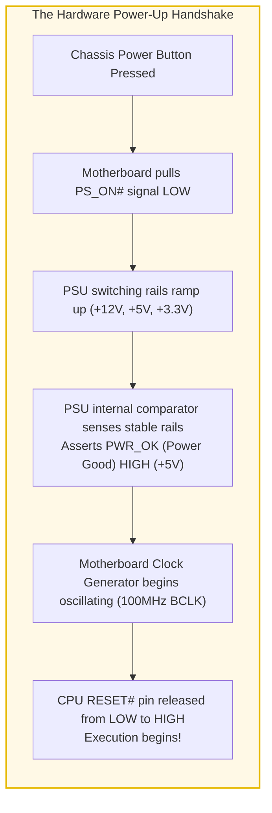
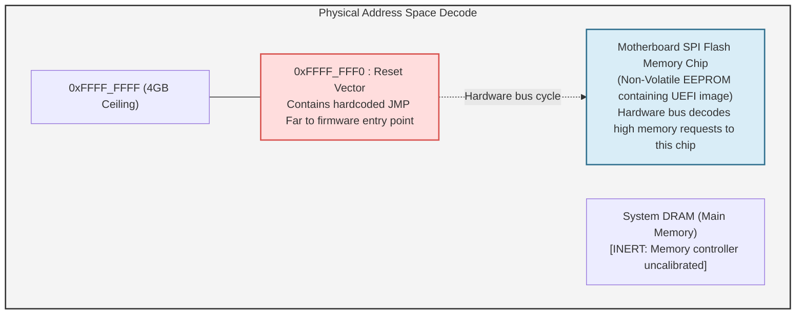
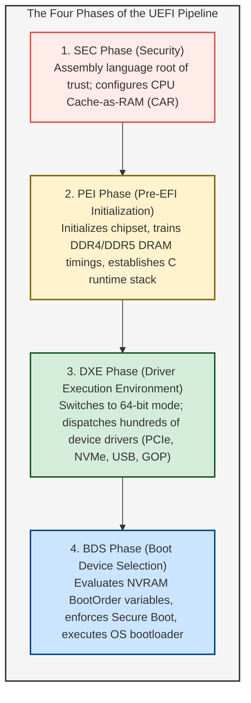
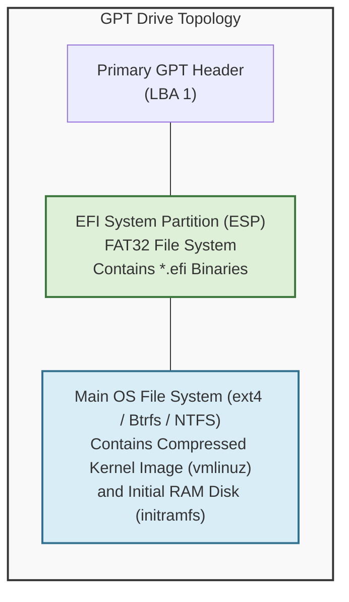
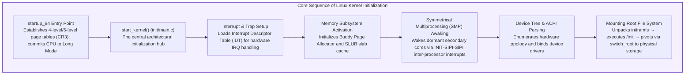
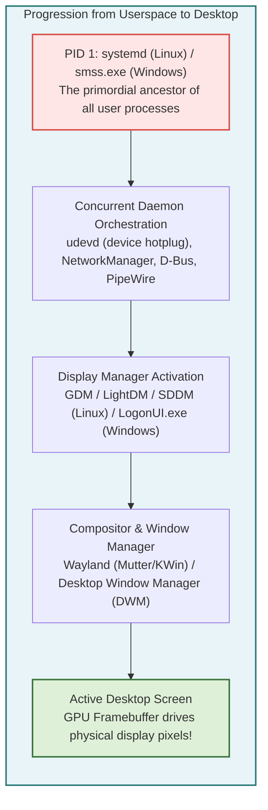

## Introduction: From Darkness to Light—The Microsecond Genesis

Every morning, millions of people worldwide sit at their desks and press the power button on their laptops or desktop computers. Within a few seconds, the dark LCD panel illuminates, an elegant manufacturer logo appears, and the operating system login screen greets the user with pristine graphics, awaiting a password or facial recognition scan.

To the user, this feels like an ordinary, trivial appliance waking up. 
Yet from the vantage point of physics, electrical engineering, and computer systems architecture, those few seconds encompass <strong>one of the most breathtaking, complex, and tightly choreographed chain reactions in the history of human technology</strong>.

At the exact microsecond when the mechanical power switch closes, the computer exists in a state of absolute, helpless paralysis.
The central processing unit's (CPU) internal registers contain no meaningful state; the gigabytes of high-speed system memory (DRAM) hold zero valid instructions; the graphics processing unit (GPU) cannot drive a single pixel on the display; and although hundreds of gigabytes of sophisticated operating system code reside inside the solid-state drive (NVMe SSD), the nascent processor possesses neither the drivers nor the virtual memory structures required to read a single byte from secondary storage.

```mermaid
flowchart TD
    subgraph BootPhases ["The Six Epochs of Computer Initialization"]
        P1["1. Electrical Awakening (Hardware Power)\nPSU voltage stabilization → POWER_GOOD assertion → CPU RESET# released"]
        P2["2. The First Instruction (Reset Vector)\nPhysical address 0xFFFF_FFF0 fetched from SPI Flash ROM via chipset hardware decode"]
        P3["3. Firmware Phases (UEFI Framework)\nSEC (Cache-as-RAM) → PEI (DRAM training) → DXE (Driver execution) → BDS"]
        P4["4. The Bootloader Relay (ESP & GRUB)\nUEFI loads bootmgfw.efi / grubx64.efi → Unpacks vmlinuz & initramfs into memory"]
        P5["5. Kernel Genesis (OS Initialization)\nTransition to 64-bit Long Mode → Page table activation → SMP multi-core wake-up"]
        P6["6. Userspace & Desktop (GUI Presentation)\nLaunch PID 1 (systemd) → Daemon orchestration → Display Manager & GPU Framebuffer"]
    end

    P1 --> P2 --> P3 --> P4 --> P5 --> P6
    style BootPhases fill:#f9f9f9,stroke:#333,stroke-width:2px
    style P1 fill:#ffe6e6,stroke:#d9534f,stroke-width:2px
    style P2 fill:#fff0b3,stroke:#e6b800,stroke-width:2px
    style P3 fill:#e6f3ff,stroke:#0066cc,stroke-width:2px
    style P4 fill:#e6ffe6,stroke:#009900,stroke-width:2px
    style P5 fill:#f4f0ff,stroke:#6f42c1,stroke-width:2px
    style P6 fill:#e8f4f8,stroke:#2b7a78,stroke-width:2px
```



Out of absolute chaos and inert silicon, the machine must construct its own towering architecture of execution entirely from scratch. This profound self-referential problem—how an entity pulls itself up by its own bootstraps without external assistance—inspired the computer science term <strong>"bootstrapping"</strong> (shortened simply to <strong>"booting"</strong>).

This exhaustive exploration traces the complete lifecycle of a computer's awakening: from raw electrical transients and the legacy shadows of 16-bit real mode, through the intricate layered architecture of modern UEFI firmware and cryptographic Secure Boot verification, to kernel memory mapping, multi-core symmetrical multiprocessing synchronization, and the final rendering of the graphical desktop.

---

## 1. Epoch 1: Electrical Genesis and the POWER_GOOD Handshake

### 1.1 The Mechanical Illusion of the Power Switch
In modern desktop computers and laptops, pressing the chassis power button does not physically route mains AC electricity into the microprocessor. The button is merely a momentary contact switch connected to the motherboard's <strong>Embedded Controller (EC)</strong> or the Platform Controller Hub (PCH).

The computer's Power Supply Unit (PSU) is responsible for converting fluctuating household alternating current ($100\text{V}–240\text{V}$ AC) into tightly regulated direct current voltages: $+12\text{V}$, $+5\text{V}$, and $+3.3\text{V}$. When the power button is depressed, the motherboard asserts the <strong>`PS_ON#`</strong> line, commanding the PSU's internal switching transistors to begin energizing coils and capacitors.

Crucially, electromagnetic physics dictates that inductors and large filter capacitors require tens to hundreds of milliseconds to charge. During this brief ramp-up interval, output voltages oscillate erratically. If the CPU attempted to clock logic gates under dirty, sagging voltage rails, silicon transistors would misfire, corrupting internal registers or causing irreversible latch-up damage.



### 1.2 The PWR_OK Signal and Reset De-assertion
Inside the PSU, an internal analog comparator circuit continuously monitors the output rails. Once all voltages remain within $\pm 5\%$ of their nominal values for approximately 100 to 500 milliseconds, the PSU asserts the <strong>`PWR_OK` (Power Good)</strong> signal across Pin 8 of the ATX main power connector, pulling it up to $+5\text{V}$.

Only upon receiving the `PWR_OK` signal does the motherboard's reset logic allow the system clock generator to feed stable clock pulses (such as the 100 MHz base clock, BCLK) into the processor.
Finally, the chip pulls the CPU's <strong>`RESET#`</strong> line from LOW to HIGH (de-asserting hardware reset). The electrical shackle is broken; the digital heart begins its very first beat.

---

## 2. Epoch 2: The First Breath and the Reset Vector

### 2.1 The Ghost of 1978: 16-Bit Real Address Mode
Modern x86-64 microprocessors from Intel and AMD are computational titans containing dozens of billions of transistors, capable of addressing hundreds of terabytes of memory and executing complex vector instructions. Yet, at the exact instant hardware reset is lifted, the CPU awakes in an astonishing, primitive state:

<strong>The processor boots in 16-bit "Real Mode," operating in strict binary compatibility with the venerable Intel 8086 microprocessor released in 1978.</strong>

This design constraint reflects the semiconductor industry's legendary obsession with backward compatibility. In Real Mode:
- Address lines are restricted to 20 bits (capping accessible physical memory at a meager <strong>1 Megabyte</strong>).
- Hardware memory protection (Ring 0 through Ring 3) and virtual memory paging are completely disabled.
- Memory addressing relies on the vintage segmented calculation: $\text{Physical Address} = (\text{Segment} \times 16) + \text{Offset}$.

### 2.2 The Geometry of the Reset Vector (`0xFFFF_FFF0`)
Upon reset de-assertion, the CPU's hardwired internal logic initializes core architectural registers to predetermined baseline values:

- <strong>Code Segment (CS):</strong> Selector `0xF000`, with a hidden internal base address forced to `0xFFFF_0000`.
- <strong>Instruction Pointer (EIP):</strong> `0x0000_FFF0`.

Combining the hidden descriptor base and the instruction pointer yields the legendary physical memory address known as the <strong>Reset Vector</strong>:

$$\text{Reset Vector Address} = \text{CS.Base} + \text{EIP} = 0xFFFF\_0000 + 0x0000\_FFF0 = \mathbf{0xFFFF\_FFF0}$$

This address sits precisely <strong>16 bytes below the 4 Gigabyte physical address ceiling</strong> ($2^{32} - 1$).



What can a CPU accomplish in a 16-byte window? 
Obviously, sixteen bytes cannot hold an operating system, let alone a hardware driver. Therefore, motherboard manufacturers hardcode an unconditional jump instruction (<strong>`JMP`</strong>) at this exact location:

```assembly
JMP 0xF000:E05B   ; Far jump to the primary firmware initialization code
```

When the processor issues a memory read cycle for `0xFFFF_FFF0`, the chipset's internal address decoder intercepts the transaction and routes it away from the uninitialized DRAM bus, redirecting the request across the Serial Peripheral Interface (SPI) bus to the motherboard's physical firmware flash ROM chip.

---

## 3. Epoch 3: Firmware Evolution—From Legacy BIOS to UEFI

### 3.1 The Collapse of Legacy BIOS
For over twenty-five years following the 1981 IBM PC, system firmware was known as the <strong>BIOS (Basic Input/Output System)</strong>. By the dawn of the twenty-first century, the architectural limitations of legacy BIOS had become an acute crisis:
- Confined to 16-bit real mode and the 1 MB conventional memory boundary.
- Bound to the <strong>Master Boot Record (MBR)</strong> partition scheme, capping storage capacity at <strong>2.2 Terabytes</strong> due to 32-bit logical block addressing.
- Synchronous, unbuffered hardware interrupt calls (`INT 10h` for video, `INT 13h` for disk) crippled boot speed.
- Inability to support rich graphical interfaces, mouse interaction, pre-boot network stacks, or cryptographic verification.

To shatter these bottlenecks, an industry consortium established the <strong>Unified Extensible Firmware Interface (UEFI)</strong>. Modern UEFI is not a simple monolithic boot script; it is effectively an independent, highly modular, 64-bit pre-boot operating system written in C.

### 3.2 The Four Phases of the UEFI Pipeline
UEFI executes across four rigorously defined architectural stages governed by the Platform Initialization (PI) specification:



1. <strong>SEC (Security) Phase:</strong>
   Executing directly from the SPI flash ROM, this assembly-level phase establishes the hardware Root of Trust. Because system DRAM is not yet functional, standard C stacks cannot exist. SEC employs <strong>Cache-as-RAM (CAR)</strong>: it configures the CPU's internal L2/L3 cache lines into temporary SRAM mode, providing stack space for execution.
2. <strong>PEI (Pre-EFI Initialization) Phase:</strong>
   PEI modules initialize basic platform building blocks. Most critically, it executes <strong>memory training</strong>: sending calibrated electrical signals to DDR4/DDR5 DIMMs, measuring signal reflections, and adjusting sub-nanosecond clock phases across trace lengths. System DRAM is finally born.
3. <strong>DXE (Driver Execution Environment) Phase:</strong>
   The powerhouse of UEFI. The CPU transitions into full 64-bit mode with memory paging enabled. DXE dispatches a software dispatcher that loads and executes hundreds of modular UEFI drivers in parallel: enumerating the PCI Express bus, mounting NVMe solid-state storage, configuring USB human interface devices, and initializing the Graphics Output Protocol (GOP) to render visual firmware interfaces.
4. <strong>BDS (Boot Device Selection) Phase:</strong>
   BDS reads non-volatile configuration variables stored in NVRAM (such as `BootOrder` and `Boot0001`), identifies the target boot partition, and launches the designated operating system loader.

### 3.3 Cryptographic Integrity: The Secure Boot Chain
Modern UEFI incorporates <strong>Secure Boot</strong>, a cryptographic mechanism preventing low-level bootkits and unauthorized operating systems from executing.

Secure Boot relies on an asymmetric public-key infrastructure burned into firmware:
- <strong>Platform Key (PK):</strong> Held by the motherboard manufacturer, establishing ownership of the platform.
- <strong>Key Exchange Key (KEK):</strong> Authorizes updates to the signature database (typically issued by Microsoft and OS consortiums).
- <strong>Authorized Database (`db`):</strong> An allowlist containing cryptographic hashes and public certificates of approved bootloader binaries.
- <strong>Forbidden Database (`dbx`):</strong> A revocation list containing hashes of compromised, vulnerable, or revoked boot components.

Before executing any binary (`.efi` executable), the firmware computes its cryptographic hash and verifies the Authenticode signature against `db` while ensuring it is not present in `dbx`. If validation fails, execution halts instantly.

---

## 4. Epoch 4: The Bootloader Relay (ESP, GRUB, and Windows Boot Manager)

### 4.1 GPT and the EFI System Partition (ESP)
In modern UEFI environments, legacy Master Boot Record sectors are obsolete. Disks are formatted using the <strong>GUID Partition Table (GPT)</strong> standard, supporting up to 128 primary partitions and volume sizes up to 9.4 zettabytes.

Within GPT resides a specialized FAT32-formatted volume known as the <strong>EFI System Partition (ESP)</strong>. Because UEFI contains a native FAT32 file system driver, it does not rely on obscure disk sector offsets; it navigates standard directory hierarchies:

$$\text{Fallback Default Loader:} \quad \texttt{\\EFI\\BOOT\\BOOTX64.EFI}$$
$$\text{Windows Boot Manager:} \quad \texttt{\\EFI\\Microsoft\\Boot\\bootmgfw.efi}$$
$$\text{Linux GRUB 2 Loader:} \quad \texttt{\\EFI\\ubuntu\\grubx64.efi}$$



### 4.2 The Responsibilities of the Bootloader
The operating system bootloader (such as GRUB 2 on Linux or `bootmgfw.efi` on Windows) performs several critical duties:

1. <strong>User Interaction & Kernel Selection:</strong> Displays boot menus for multi-boot environments or fallback rescue kernels.
2. <strong>Transferring Kernel and Initramfs into Memory:</strong> Locates the compressed Linux kernel image (`vmlinuz`) and the initial RAM disk image (`initramfs`) on complex storage filesystems (ext4, XFS, Btrfs) and streams them into system RAM.
3. <strong>Preparing Boot Parameters:</strong> Constructs the command-line argument string (e.g., `root=UUID=... ro quiet splash`).
4. <strong>Exiting Boot Services:</strong> 
   Just prior to transferring control, the bootloader calls the UEFI runtime API:
   ```c
   gBS->ExitBootServices(ImageHandle, MapKey);
   ```
   This momentous call instructs UEFI to release all memory allocated for firmware drivers and execution engines. <strong>The firmware steps down; the operating system kernel inherits absolute, unconstrained dominion over the hardware.</strong>

---

## 5. Epoch 5: Kernel Genesis—Architecting Order from Chaos

At this milestone, execution transfers to the kernel's 64-bit entry point (in Linux: `startup_64` inside `arch/x86/kernel/head_64.S`). The compressed binary uncompresses itself into high memory, and the definitive kernel initialization function—`start_kernel()`—begins.



### 5.1 Establishing Virtual Memory and Paging
The kernel's first act is constructing its own multi-level page table hierarchy (PML4 or PML5), loading the base physical address into control register <strong>CR3</strong>. 

This action severs CPU execution from raw physical memory. Every memory reference is henceforth translated dynamically through hardware Memory Management Units (MMU), granting the kernel and future user processes distinct, protected 48-bit or 57-bit virtual address spaces.

### 5.2 Symmetrical Multiprocessing: Waking the Sleeping Giants
Up to this point in the boot sequence, every instruction has been executed by a single processor core: the <strong>Bootstrap Processor (BSP)</strong>. Modern CPUs possess 8, 16, 64, or more cores; all secondary cores (termed <strong>Application Processors, APs</strong>) remain halted in an ultra-low-power sleep state known as *Wait-for-SIPI*.

The BSP awakens these sleeping cores using the <strong>Local APIC (Advanced Programmable Interrupt Controller)</strong> via an exact inter-processor interrupt sequence:

1. <strong>INIT IPI:</strong> Resets the target AP and prepares its internal registers.
2. <strong>Startup IPI (SIPI) #1:</strong> Broadcasts the physical address vector of the kernel's secondary startup trampoline code.
3. <strong>Startup IPI (SIPI) #2:</strong> A redundant follow-up ensuring the target core awakens.

As each secondary core receives the SIPI, it initializes its own local memory management structures, enables paging, enters 64-bit long mode, and registers itself with the kernel scheduler. Within milliseconds, the computational power of the system multiplies exponentially.

---

## 6. Epoch 6: The Birth of Userspace and the Graphical Desktop

Having initialized hardware drivers, timers, and storage controllers, the kernel's scheduler is operational. It now performs its final duty: transitioning execution from privileged supervisor mode (<strong>Ring 0</strong>) to unprivileged user mode (<strong>Ring 3</strong>).



### 6.1 Process ID 1: The Primordial Ancestor
The kernel invokes the `kernel_execve()` system call to spawn the very first userspace process: <strong>PID 1</strong>.
- On modern Linux distributions: `/sbin/init` (a symlink to `systemd`).
- On Windows NT: `smss.exe` (Session Manager Subsystem).

`systemd` serves as the root of the entire userspace process tree. Leveraging socket activation and dependency graphs, it spawns background services in parallel: mounting remaining disk partitions, initializing network interfaces, loading sound servers, and starting security frameworks.

### 6.2 The Framebuffer and the Illumination of the Display
Reaching its target runlevel (`graphical.target`), `systemd` launches the <strong>Display Manager</strong> (such as GDM, LightDM, or SDDM).

The Display Manager opens a direct communication channel with the kernel's Direct Rendering Manager (DRM) and Kernel Mode Setting (KMS) subsystems. It maps a dedicated memory block in the GPU's high-speed video RAM (VRAM) designated as the <strong>Framebuffer</strong>.

The window compositor (Wayland or X11) renders the visual elements of the login interface into this buffer. Finally, the GPU's display controller streams these pixel color values over high-speed differential pairs (via DisplayPort or HDMI) directly into the timing controller of the physical monitor.

<strong>The screen glows. The cursor blinks. The machine is fully awake.</strong>

---

## 7. Conclusion: The Symphony of the Unbroken Chain

From the physical click of the power switch to the appearance of the operating system desktop, an average modern PC requires merely <strong>five to ten seconds</strong>.

Yet inside those brief seconds lies a dizzying technological triumph:
1. Physical voltage stabilizing across switching capacitors (PSU).
2. Backward-compatible execution from a 1978 16-bit register state (Reset Vector).
3. The cryptographic verification of hardware trust and Cache-as-RAM initialization (UEFI).
4. The parallel enumeration of complex PCI Express and NVMe buses (DXE).
5. The execution of a filesystem-aware OS bootloader (ESP / GRUB).
6. The mathematical construction of multi-level virtual memory page tables (Kernel MMU).
7. The synchronized awakening of dozens of multi-core processors via inter-processor interrupts (SMP).
8. The spawning of Process ID 1 and the rendering of millions of pixels via hardware framebuffers.

Hundreds of millions of lines of code—authored across five decades by hundreds of thousands of engineers across the globe—cooperate with billions of microscopic silicon transistors in an unbroken, deterministic relay. 

The next time you press the power button on your machine, listen closely to the quiet hum of the cooling fan: it is the sound of an entire digital universe speaking itself into existence out of the void.

