## Introducción: De la oscuridad al escritorio en microsegundos

Cada día pulsamos el botón de encendido de nuestro ordenador y, en cuestión de pocos segundos, la pantalla se ilumina mostrando la interfaz del sistema operativo.
Sin embargo, desde la perspectiva de la arquitectura de sistemas, esos instantes encierran <strong>una de las coreografías tecnológicas más asombrosas y complejas jamás concebidas</strong>.

Durante el primer microsegundo tras el encendido, la máquina se encuentra en un estado de parálisis total:
Los registros de la CPU carecen de datos útiles; la memoria RAM (DRAM) no está calibrada ni contiene instrucciones; la tarjeta gráfica no puede proyectar imagen alguna; y aunque el SSD albergue gigabytes de código, el procesador recién energizado ni siquiera cuenta con los controladores para comunicarse con el almacenamiento.

```mermaid
flowchart TD
    subgraph BootPhases ["Las seis fases del arranque de un ordenador"]
        P1["1. Despertar eléctrico (Hardware & Power)\nEstabilización de voltajes → Señal POWER_GOOD → Desactivación de RESET#"]
        P2["2. La primera instrucción (Vector de Reset)\nDirección física 0xFFFF_FFF0 → Salto JMP desde la ROM SPI Flash"]
        P3["3. Inicialización del firmware (UEFI)\nSEC (Cache-as-RAM) → PEI (Entrenamiento DRAM) → DXE (Controladores) → BDS"]
        P4["4. Relevo del cargador de arranque (Bootloader)\nCarga de bootmgfw.efi / grubx64.efi en la partición ESP → Kernel e initramfs en RAM"]
        P5["5. Inicialización del kernel del SO\nTransición a Modo Largo de 64 bits → Paginación (CR3) → Despertar SMP multinúcleo"]
        P6["6. Espacio de usuario y entorno gráfico (Userspace)\nEjecución de PID 1 (systemd) → Servicios del sistema → El Framebuffer ilumina la pantalla"]
    end

    P1 --> P2 --> P3 --> P4 --> P5 --> P6
    style BootPhases fill:#f9f9f9,stroke:#333,stroke-width:2px
    style P1 fill:#ffe6e6,stroke:#d9534f,stroke-width:2px
    style P2 fill:#fff0b3,stroke:#e6b800,stroke-width:2px
    style P3 fill:#e6f3ff,stroke:#0066cc,stroke-width:2px
    style P4 fill:#e6ffe6,stroke:#009900,stroke-width:2px
    style P5 fill:#f4f0ff,stroke:#6f42c1,stroke-width:2px
    style P6 fill:#e8f4f8,stroke:#2b7a78,stroke-width:2px
```

El ordenador debe erigirse a sí mismo desde la nada más absoluta: un proceso autodirigido conocido como <strong>bootstrapping</strong> (o simplemente <strong>boot</strong>).

---

## 1. Fase 1: La génesis eléctrica y la señal POWER_GOOD

El botón de la torre no suministra corriente alterna directa a los chips; es un pulsador conectado al controlador embebido de la placa base.
La fuente de alimentación (PSU) convierte la corriente alterna en voltajes continuos ($+12\text{V}, +5\text{V}, +3.3\text{V}$). Dado que los condensadores tardan milisegundos en cargarse, la tensión fluctúa al inicio.
Cuando la fuente comprueba que las líneas son estables al $\pm 5\%$, emite la señal <strong>`PWR_OK` (Power Good)</strong> en alto ($+5\text{V}$). La placa base activa entonces su generador de reloj y libera el pin de reinicio <strong>`RESET#`</strong> de la CPU.

---

## 2. Fase 2: El primer aliento de la CPU y el vector de reset

Por motivos de compatibilidad histórica con el chip Intel 8086 de 1978, la CPU moderna arranca en <strong>Modo Real de 16 bits</strong>, con acceso limitado a solo 1 MB de memoria.
El hardware fuerza los registros iniciales:
- Segmento de código (CS): Base `0xFFFF_0000`
- Puntero de instrucciones (EIP): `0x0000_FFF0`

La primera dirección leída es el <strong>Vector de Reset</strong>:
$$\text{Dirección} = \mathbf{0xFFFF\_FFF0}$$
Ubicada a solo 16 bytes del techo de 4 GB, esta petición es redirigida al chip <strong>SPI Flash ROM</strong> de la placa base, donde reside una instrucción de salto (`JMP`) hacia el firmware UEFI.

---

## 3. Fase 3: Del BIOS clásico al estándar UEFI

El antiguo BIOS limitaba la memoria a 1 MB y el disco a 2 TB con MBR. <strong>UEFI</strong> es un entorno prearranque modular en C de 64 bits con cuatro etapas:
1. <strong>SEC (Security):</strong> Configura la caché del procesador como memoria temporal (<strong>Cache-as-RAM, CAR</strong>) antes de que la RAM esté lista.
2. <strong>PEI (Pre-EFI Initialization):</strong> Calibra la memoria DRAM en picosegundos mediante el entrenamiento de memoria.
3. <strong>DXE (Driver Execution Environment):</strong> Pasa a 64 bits y ejecuta cientos de controladores (PCIe, NVMe, USB, gráficos GOP).
4. <strong>BDS (Boot Device Selection):</strong> Lee el orden de arranque de la NVRAM y verifica las firmas de <strong>Secure Boot</strong>.

---

## 4. Fase 4: El relevo del cargador de arranque (ESP y GRUB)

UEFI carga el ejecutable desde la <strong>Partición de Sistema EFI (ESP)</strong> en formato FAT32:
- Windows: `\EFI\Microsoft\Boot\bootmgfw.efi`
- Linux: `\EFI\ubuntu\grubx64.efi`

El gestor de arranque sitúa el kernel (`vmlinuz`) y el disco inicial (`initramfs`) en memoria y llama a `ExitBootServices()`, cediendo el control total al sistema operativo.

---

## 5. Fase 5: Inicialización del kernel y activación multinúcleo (SMP)

El kernel configura las tablas de páginas virtuales en el registro <strong>CR3</strong>.
A continuación, el procesador principal (BSP) envía la secuencia de interrupciones <strong>INIT-SIPI-SIPI</strong> a través del APIC para despertar a todos los núcleos secundarios dormidos. En milisegundos, el procesador despliega toda su potencia paralela.

---

## 6. Fase 6: Espacio de usuario y la señal en pantalla

El kernel desciende al nivel sin privilegios (Ring 3) e inicia <strong>PID 1 (systemd)</strong>, que lanza los servicios del sistema y el gestor de sesiones gráficas.
El servidor gráfico compone la pantalla en el <strong>Framebuffer</strong> de la memoria de vídeo (VRAM). La tarjeta gráfica envía la señal digital al monitor y la pantalla cobra vida.

---

## 7. Conclusión: Una obra maestra de la ingeniería digital

En apenas <strong>5 a 8 segundos</strong>, miles de millones de transistores y millones de líneas de código ejecutan un relevo milimétrico. El proceso de arranque de un ordenador es el cimiento silencioso sobre el que descansa toda la tecnología moderna.

