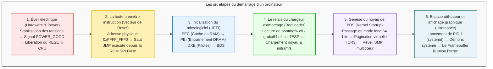

## Introduction : De l'obscurité totale à l'illumination des pixels

Chaque matin, lorsque nous appuyons sur le bouton d'alimentation de notre ordinateur portable, quelques secondes suffisent pour que l'écran s'illumine et affiche notre environnement de travail.
Pourtant, sous l'angle du génie électrique et de l'architecture informatique, ces quelques secondes constituent <strong>l'une des réactions en chaîne les plus complexes et spectaculaires jamais conçues par l'humanité</strong>.

Durant la toute première microseconde, la machine est dans un état de mort apparente :
Les registres du processeur sont vides ; les gigaoctets de mémoire vive (DRAM) ne contiennent aucune donnée valide ; la carte graphique ignore comment afficher quoi que ce soit ; et bien que des centaines de gigaoctets de code système reposent sur le SSD NVMe, le processeur ne possède même pas les pilotes nécessaires pour y accéder.

L'ordinateur doit s'élever par ses propres moyens, sans assistance extérieure : c'est le principe du <strong>bootstrapping</strong> (ou <strong>boot</strong>), inspiré des aventures du baron de Münchhausen se tirant d'un marécage par ses propres bottes.

---

## 1. Étape 1 : Genèse électrique et signal POWER_GOOD

Le bouton de mise sous tension ne connecte pas directement le secteur au processeur. Il envoie une impulsion au contrôleur embarqué (EC) de la carte mère.
Le bloc d'alimentation (PSU) convertit le courant alternatif en tensions continues ($+12\text{V}, +5\text{V}, +3.3\text{V}$). Dès que ses circuits internes confirment que toutes les tensions sont stables à $\pm 5\%$, le bloc émet le signal <strong>`PWR_OK` (Power Good)</strong>. La carte mère active alors son générateur d'horloge et libère la broche de réinitialisation <strong>`RESET#`</strong> du processeur.

---

## 2. Étape 2 : Le premier souffle du CPU et le vecteur de réinitialisation

Lors de la levée du reset, un processeur 64 bits moderne démarre en <strong>mode réel 16 bits</strong>, identique à l'Intel 8086 de 1978 pour garantir la rétrocompatibilité.
Les registres sont initialisés sur des valeurs codées en dur :
- Segment de code (CS) : Base `0xFFFF_0000`
- Pointeur d'instruction (EIP) : `0x0000_FFF0`

La première adresse mémoire sollicitée est le <strong>vecteur de réinitialisation</strong> :
$$\text{Adresse} = \mathbf{0xFFFF\_FFF0}$$
Située 16 octets sous la limite des 4 Go, cette adresse est redirigée par le chipset vers la puce <strong>SPI Flash ROM</strong> hébergeant l'UEFI, où se trouve une instruction de saut (`JMP`) vers le micrologiciel.

---

## 3. Étape 3 : Du BIOS au standard UEFI moderne

Remplaçant le BIOS historique limité à 1 Mo de RAM et aux disques MBR de 2 To, l'<strong>UEFI</strong> est un véritable mini-système d'exploitation pré-démarrage 64 bits écrit en C.

Il s'exécute en quatre phases :
1. <strong>SEC (Security) :</strong> Utilise la mémoire cache du CPU comme RAM temporaire (<strong>Cache-as-RAM, CAR</strong>) car la DRAM n'est pas encore initialisée.
2. <strong>PEI (Pre-EFI Initialization) :</strong> Réalise l'entraînement de la mémoire DRAM pour ajuster les impédances et les timings au picoseconde près.
3. <strong>DXE (Driver Execution Environment) :</strong> Bascule en 64 bits et charge des centaines de pilotes matériels (PCIe, NVMe, USB, affichage GOP).
4. <strong>BDS (Boot Device Selection) :</strong> Détermine le support de démarrage et applique les vérifications cryptographiques du <strong>Secure Boot</strong>.

---

## 4. Étape 4 : Le relais du chargeur d'amorçage (ESP et GRUB)

L'UEFI accède à la partition système EFI (ESP, formatée en FAT32 sur disque GPT) pour lancer le chargeur d'amorçage :
- Windows : `\EFI\Microsoft\Boot\bootmgfw.efi`
- Linux : `\EFI\ubuntu\grubx64.efi`

Le chargeur charge l'image compressée du noyau (`vmlinuz`) et le disque mémoire initial (`initramfs`), puis appelle la fonction `ExitBootServices()`. L'UEFI s'efface, confiant les pleins pouvoirs au noyau de l'OS.

---

## 5. Étape 5 : Initialisation du noyau et réveil multicœur (SMP)

Le noyau configure les tables de pagination (registre <strong>CR3</strong>) pour isoler la mémoire virtuelle.
Puis, le processeur principal (BSP) réveille les cœurs secondaires assoupis via des interruptions inter-processeurs selon la séquence <strong>INIT-SIPI-SIPI</strong>. En quelques millisecondes, toute la puissance multicœur devient opérationnelle.

---

## 6. Étape 6 : Espace utilisateur et affichage du bureau

Le noyau passe en Ring 3 et exécute <strong>PID 1 (systemd)</strong>. Ce dernier orchestre les démons système et lance le gestionnaire d'affichage (GDM, LightDM).
Le serveur d'affichage génère les pixels de l'interface dans le <strong>Framebuffer</strong> de la mémoire vidéo (VRAM). La carte graphique transmet ces signaux au moniteur : l'écran s'allume enfin, prêt à l'emploi.

---

## 7. Conclusion : Une symphonie d'ingénierie invisible

En seulement <strong>5 à 8 secondes</strong>, des milliards de transistors et des millions de lignes de code se transmettent le relais avec une perfection absolue. Comprendre le boot d'un ordinateur, c'est contempler le chef-d'œuvre fondateur de toute l'informatique moderne.

