## प्रस्तावना: घने अंधकार से पिक्सल के प्रकाश तक का सफर

प्रतिदिन जब हम अपने लैपटॉप या डेस्कटॉप का पावर बटन दबाते हैं, तो कुछ ही सेकंडों में सुंदर लॉगिन स्क्रीन हमारे सामने आ जाती है।
परंतु इलेक्ट्रिकल इंजीनियरिंग और कंप्यूटर सिस्टम्स आर्किटेक्चर की दृष्टि से यह संक्षिप्त समय <strong>मानव इतिहास की सबसे जटिल, परिष्कृत और रोमांचक वैज्ञानिक प्रतिक्रियाओं में से एक</strong> है।

पावर बटन दबने के पहले माइक्रोसेकंड में कंप्यूटर पूरी तरह से निष्क्रिय अवस्था में होता है:
सीपीयू के रजिस्टरों में कोई उपयोगी निर्देश नहीं होते; मुख्य मेमोरी (DRAM) पूरी तरह खाली होती है; ग्राफिक्स कार्ड स्क्रीन पर एक भी पिक्सल रोशन करने में असमर्थ होता है; और यद्यपि एसएसडी में ऑपरेटिंग सिस्टम का अथाह कोड मौजूद होता है, किंतु नए-नए चालू हुए प्रोसेसर के पास स्टोरेज से डेटा पढ़ने का कोई ड्राइवर तक नहीं होता।

```mermaid
flowchart TD
    subgraph BootPhases ["कंप्यूटर बूटिंग के छह महाकाव्य चरण"]
        P1["1. विद्युत जागरण (Hardware & Power)\nPSU वोल्टेज स्थिरीकरण → POWER_GOOD संकेत → CPU RESET# मुक्त"]
        P2["2. प्रथम निर्देश (Reset Vector)\nभौतिक पता 0xFFFF_FFF0 → SPI Flash ROM से पहला JMP निर्देश पढ़ना"]
        P3["3. फर्मवेयर आरंभीकरण (UEFI)\nSEC (Cache-as-RAM) → PEI (DRAM ट्रेनिंग) → DXE (ड्राइवर्स) → BDS"]
        P4["4. बूटलोडर को कमान सौंपना (ESP & GRUB)\nESP से bootmgfw.efi / grubx64.efi लोड करना → कर्नेल व initramfs रैम में"]
        P5["5. ओएस कर्नेल का जागरण (Kernel Startup)\n64-बिट लॉन्ग मोड → पेजिंग वर्चुअल मेमोरी (CR3) → मल्टीकोर SMP जागरण"]
        P6["6. यूजरस्पेस और डेस्कटॉप (Userspace & GUI)\nPID 1 (systemd) प्रारंभ → सिस्टम सेवाएं → फ्रेमबफर द्वारा स्क्रीन रोशन"]
    end

    P1 --> P2 --> P3 --> P4 --> P5 --> P6
    style BootPhases fill:#f9f9f9,stroke:#333,stroke-width:2px
    style P1 fill:#ffe6e6,stroke:#d9534f,stroke-width:2px
    style P2 fill:#fff0b3,stroke:#e6b800,stroke-width:2px
    style P3 fill:#e6f3ff,stroke:#0066cc,stroke-width:2px
    style P4 fill:#e6ffe6,stroke:#009900,stroke-width:2px
    style P5 fill:#f4f0ff,stroke:#6f42c1,stroke-width:2px
    style P6 fill:#e8f4f8,stroke:#2b7a78,stroke-width:2px
```

कंप्यूटर को शून्य से स्वयं को खड़ा करना पड़ता है, जिसे कंप्यूटर विज्ञान में <strong>'बूटस्ट्रैपिंग' (Bootstrapping)</strong> या संक्षेप में <strong>'बूटिंग'</strong> कहा जाता है।

---

## 1. चरण 1: विद्युत संचार और POWER_GOOD संकेत

कंप्यूटर का पावर बटन सीधे बिजली का मुख्य स्विच नहीं होता, बल्कि यह मदरबोर्ड के नियंत्रक को एक क्षणिक संकेत भेजता है।
पावर सप्लाई (PSU) प्रत्यावर्ती धारा (AC) को स्थिर दिष्ट धारा ($+12\text{V}, +5\text{V}, +3.3\text{V}$) में परिवर्तित करती है। जब आंतरिक वोल्टेज $\pm 5\%$ के भीतर स्थिर हो जाता है, तो PSU <strong>`PWR_OK` (Power Good)</strong> संकेत भेजता है। इसके बाद मदरबोर्ड क्लॉक चालू करता है और सीपीयू के <strong>`RESET#`</strong> पिन को मुक्त करता है।

---

## 2. चरण 2: सीपीयू का पहला निर्देश और रीसेट वेक्टर (Reset Vector)

ऐतिहासिक संगतता बनाए रखने के लिए आधुनिक 64-बिट सीपीयू 1978 के इंटेल 8086 प्रोसेसर के <strong>16-बिट रियल मोड</strong> में जागता है, जिसमें केवल 1 एमबी मेमोरी तक पहुंच होती है।
हार्डवेयर सीपीयू को डिफ़ॉल्ट पते पर भेजता है जिसे <strong>रीसेट वेक्टर</strong> कहते हैं:
$$\text{पता} = \mathbf{0xFFFF\_FFF0}$$
4 जीबी सीमा से मात्र 16 बाइट नीचे स्थित यह पता मदरबोर्ड की <strong>SPI Flash ROM</strong> चिप से जुड़ा होता है, जहां एक जंप (`JMP`) निर्देश होता है जो मुख्य UEFI कोड की ओर ले जाता है।

---

## 3. चरण 3: लेगेसी BIOS से आधुनिक UEFI फर्मवेयर तक

पुराने BIOS में 1 एमबी मेमोरी और 2 टीबी डिस्क की सीमा थी। आधुनिक <strong>UEFI</strong> सी-भाषा में लिखा गया एक 64-बिट पूर्व-ऑपरेटिंग सिस्टम है:
1. <strong>SEC (Security):</strong> जब तक DRAM सक्रिय नहीं होती, यह सीपीयू की कैश मेमोरी को अस्थायी रैम (<strong>Cache-as-RAM, CAR</strong>) की तरह उपयोग करता है।
2. <strong>PEI (Pre-EFI Initialization):</strong> यह मेमोरी ट्रेनिंग द्वारा पिकोसेकंड स्तर पर डीडीआर रैम को कैलिब्रेट और सक्रिय करता है।
3. <strong>DXE (Driver Execution Environment):</strong> 64-बिट मोड में आकर सैकड़ों हार्डवेयर ड्राइवर्स (PCIe, NVMe, USB, डिस्प्ले) लोड करता है।
4. <strong>BDS (Boot Device Selection):</strong> बूट प्राथमिकता तय करता है और <strong>सिक्योर बूट (Secure Boot)</strong> के डिजिटल हस्ताक्षरों की पुष्टि करता है।

---

## 4. चरण 4: बूटलोडर को कमान सौंपना (ESP और GRUB)

UEFI हार्ड ड्राइव के एफएटी32-आधारित <strong>ईएफआई सिस्टम पार्टीशन (ESP)</strong> से बूटलोडर निष्पादित करता है:
- विंडोज: `\EFI\Microsoft\Boot\bootmgfw.efi`
- लिनक्स: `\EFI\ubuntu\grubx64.efi`

बूटलोडर कर्नेल (`vmlinuz`) और प्रारंभिक रैमडिस्क (`initramfs`) को मेमोरी में रखकर `ExitBootServices()` कॉल करता है, जिससे फर्मवेयर समाप्त हो जाता है और ओएस कर्नेल का एकछत्र अधिकार स्थापित हो जाता है।

---

## 5. चरण 5: कर्नेल जागरण और मल्टीकोर एसएमपी (SMP)

कर्नेल <strong>CR3</strong> रजिस्टर में बहुस्तरीय पेज टेबल स्थापित कर वर्चुअल मेमोरी को सक्रिय करता है।
तत्पश्चात मुख्य कोर (BSP) एपीआईसी के माध्यम से <strong>INIT-SIPI-SIPI</strong> इंटरप्ट भेजकर सभी निष्क्रिय सहायक सीपीयू कोरों को जगा देता है। पलक झपकते ही सिस्टम की समानांतर गणना क्षमता प्रस्फुटित हो जाती है।

---

## 6. चरण 6: यूजरस्पेस और स्क्रीन का रोशन होना

कर्नेल सुरक्षित यूजर मोड (Ring 3) में जाकर प्रथम प्रक्रिया <strong>PID 1 (systemd)</strong> प्रारंभ करता है। यह बैकग्राउंड सेवाओं को चलाकर डिस्प्ले मैनेजर को आमंत्रित करता है।
डिस्प्ले सर्वर ग्राफिक्स कार्ड की वीडियो मेमोरी के <strong>फ्रेमबफर (Framebuffer)</strong> में पिक्सल का डेटा लिखता है। जीपीयू इस डिजिटल सिग्नल को मॉनिटर पर भेजता है और स्क्रीन रोशनी से जगमगा उठती है।

---

## 7. निष्कर्ष: सिलिकॉन चिप पर मानवीय इंजीनियरिंग का महाकाव्य

पावर बटन दबाने से लेकर स्क्रीन रोशन होने में मात्र <strong>5 से 8 सेकंड</strong> का समय लगता है। किंतु इस अल्प समय में अरबों ट्रांजिस्टर और करोड़ों कोड पंक्तियां बिना एक भी त्रुटि के एक-दूसरे को नियंत्रण सौंपती हैं। कंप्यूटर बूटिंग आधुनिक सभ्यता का एक अप्रतिम तकनीकी चमत्कार है।

