## Pendahuluan: Dari Kegelapan Menuju Terangnya Piksel

Setiap hari saat kita menyalakan komputer jinjing atau desktop, hanya dalam hitungan detik layar menyala menampilkan antarmuka sistem operasi.
Namun dari sudut pandang arsitektur komputer dan teknik elektro, beberapa detik tersebut memuat <strong>salah satu rangkaian peristiwa paling rumit dan menakjubkan dalam sejarah peradaban teknologi</strong>.

Pada mikrodetik pertama setelah tombol daya ditekan, komputer berada dalam kondisi mati suri total:
Register prosesor tidak memiliki instruksi bermakna; memori utama (DRAM) belum terkalibrasi dan kosong; kartu grafis belum mampu menampilkan gambar; dan meskipun SSD menyimpan ratusan gigabita kode sistem operasi, CPU yang baru saja dialiri listrik bahkan belum memiliki driver dasar untuk membaca data penyimpanan.

```mermaid
flowchart TD
    subgraph BootPhases ["Enam Tahap Inisialisasi Booting Komputer"]
        P1["1. Kebangkitan Elektrik (Hardware & Power)\nStabilisasi voltase PSU → Sinyal POWER_GOOD → Pin RESET# CPU dilepas"]
        P2["2. Instruksi Pertama (Vektor Reset)\nAlamat fisik 0xFFFF_FFF0 → Lompatan JMP dari chip SPI Flash ROM"]
        P3["3. Inisialisasi Firmware (Arsitektur UEFI)\nSEC (Cache-as-RAM) → PEI (Pelatihan DRAM) → DXE (Driver) → BDS"]
        P4["4. Estafet Bootloader (ESP & GRUB)\nMemuat bootmgfw.efi / grubx64.efi dari ESP → Kernel & initramfs ke RAM"]
        P5["5. Kebangkitan Kernel OS (Inisialisasi Kernel)\nTransisi ke Mode Long 64-bit → Paging virtual (CR3) → Membangunkan multi-core SMP"]
        P6["6. Userspace dan Tampilan Desktop\nMenjalankan PID 1 (systemd) → Daemon sistem → Framebuffer GPU menyalakan layar"]
    end

    P1 --> P2 --> P3 --> P4 --> P5 --> P6
    style BootPhases fill:#f9f9f9,stroke:#333,stroke-width:2px
    style P1 fill:#ffe6e6,stroke:#d9534f,stroke-width:2px
    style P2 fill:#fff0b3,stroke:#e6b800,stroke-width:2px
    style P3 fill:#e6f3ff,stroke:#0066cc,stroke-width:2px
    style P4 fill:#e6ffe6,stroke:#009900,stroke-width:2px
    style P5 fill:#f4f0ff,stroke:#6f42c1,stroke-width:2px
    style P6 fill:#e8f4f8,stroke:#2b7a78,stroke-width:2px
```

Komputer harus membangun kembali tatanan eksekusinya sendiri dari kekosongan—proses yang dikenal dengan istilah <strong>bootstrapping</strong> (atau <strong>booting</strong>).

---

## 1. Tahap 1: Inisialisasi Elektrik dan Sinyal POWER_GOOD

Tombol daya pada casing komputer bukanlah sakelar arus listrik utama, melainkan pemicu sinyal pulsa menuju kontroler motherboard.
Power Supply Unit (PSU) bertugas mengubah arus AC menjadi voltase DC yang stabil ($+12\text{V}, +5\text{V}, +3.3\text{V}$). Komponen kapasitor membutuhkan waktu untuk terisi penuh sehingga tegangan awal berfluktuasi.
Saat rangkaian komparator memastikan semua jalur voltase stabil pada deviasi $\pm 5\%$, PSU menaikkan sinyal <strong>`PWR_OK` (Power Good)</strong> menjadi HIGH ($+5\text{V}$). Motherboard kemudian mengaktifkan generator clock dan melepaskan pin <strong>`RESET#`</strong> pada soket CPU.

---

## 2. Tahap 2: Nafas Pertama CPU dan Vektor Reset

Demi mempertahankan kompatibilitas mundur dengan prosesor Intel 8086 buatan tahun 1978, CPU modern bangun dalam <strong>Real Mode 16-bit</strong> dengan ruang alamat memori terbatas hanya 1 MB.
Register disetel ke nilai tetap:
- Code Segment (CS): Base `0xFFFF_0000`
- Instruction Pointer (EIP): `0x0000_FFF0`

Hasil penggabungannya menunjuk ke <strong>Vektor Reset</strong>:
$$\text{Alamat} = \mathbf{0xFFFF\_FFF0}$$
Terletak tepat 16 bita di bawah batas 4 GB, permintaan memori ini dialihkan oleh chipset ke chip <strong>SPI Flash ROM</strong> pada motherboard, di mana terdapat instruksi lompat (`JMP`) menuju kode firmware UEFI.

---

## 3. Tahap 3: Evolusi Firmware dari BIOS Lama ke UEFI Modern

BIOS lama dibatasi memori 1 MB dan batas disk 2 TB. <strong>UEFI</strong> adalah lingkungan pra-boot 64-bit yang ditulis dalam bahasa C dengan empat tahap:
1. <strong>SEC (Security):</strong> Memanfaatkan cache CPU sebagai RAM sementara (<strong>Cache-as-RAM, CAR</strong>) karena DRAM belum aktif.
2. <strong>PEI (Pre-EFI Initialization):</strong> Menjalankan *memory training* untuk mengalibrasi sinyal DRAM DDR hingga skala pikodetik.
3. <strong>DXE (Driver Execution Environment):</strong> Beralih ke 64-bit dan memuat ratusan driver perangkat (PCIe, NVMe, USB, GOP grafis).
4. <strong>BDS (Boot Device Selection):</strong> Menentukan urutan boot dan memverifikasi tanda tangan digital <strong>Secure Boot</strong>.

---

## 4. Tahap 4: Estafet Bootloader (ESP dan GRUB)

UEFI mengeksekusi bootloader dari <strong>EFI System Partition (ESP)</strong> berformat FAT32:
- Windows: `\EFI\Microsoft\Boot\bootmgfw.efi`
- Linux: `\EFI\ubuntu\grubx64.efi`

Bootloader memuat kernel (`vmlinuz`) dan ramdisk awal (`initramfs`) ke memori, kemudian memanggil `ExitBootServices()`. Firmware resmi berhenti dan kendali penuh diserahkan ke kernel sistem operasi.

---

## 5. Tahap 5: Inisialisasi Kernel dan Kebangkitan Multi-Core (SMP)

Kernel membangun tabel memori virtual bertingkat pada register <strong>CR3</strong>.
Selanjutnya, prosesor utama (BSP) menyiarkan urutan interupsi <strong>INIT-SIPI-SIPI</strong> ke inti prosesor sekunder melalui APIC untuk membangunkan seluruh core. Dalam hitungan milidetik, kemampuan komputasi paralel aktif sepenuhnya.

---

## 6. Tahap 6: Userspace dan Tampilan Layar

Kernel beralih ke Ring 3 tanpa hak istimewa dan menjalankan <strong>PID 1 (systemd)</strong>. Systemd memicu berbagai daemon sistem secara paralel dan memanggil manajer tampilan.
Server tampilan merender antarmuka ke dalam <strong>Framebuffer</strong> di memori video (VRAM). Kartu grafis mengirimkan sinyal digital ke monitor, menyalakan layar desktop secara utuh.

---

## 7. Kesimpulan: Keajaiban Rekayasa Perangkat Keras dan Perangkat Lunak

Hanya dalam <strong>5 hingga 8 detik</strong>, miliaran transistor dan jutaan baris kode berhasil melakukan estafet tanpa cacat. Memahami proses boot komputer adalah cara terbaik menghargai kecerdasan teknik yang menopang era informasi modern.

