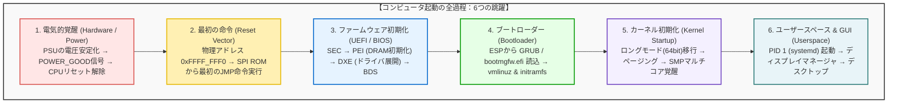
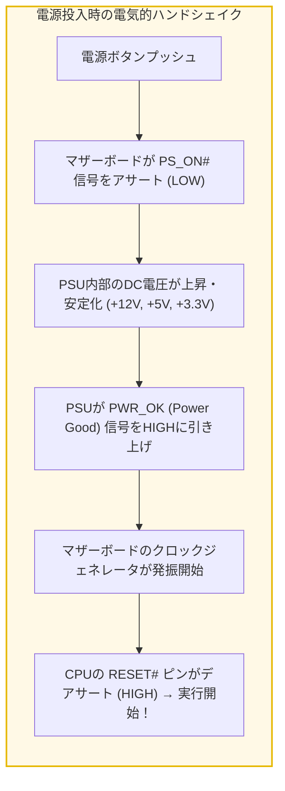
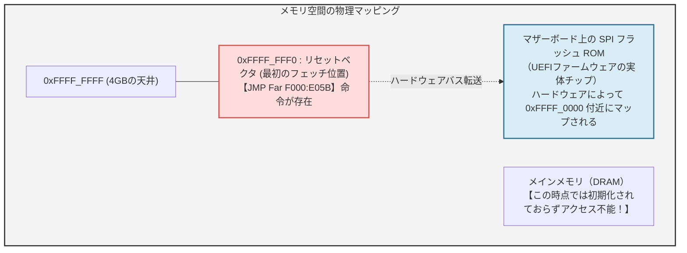
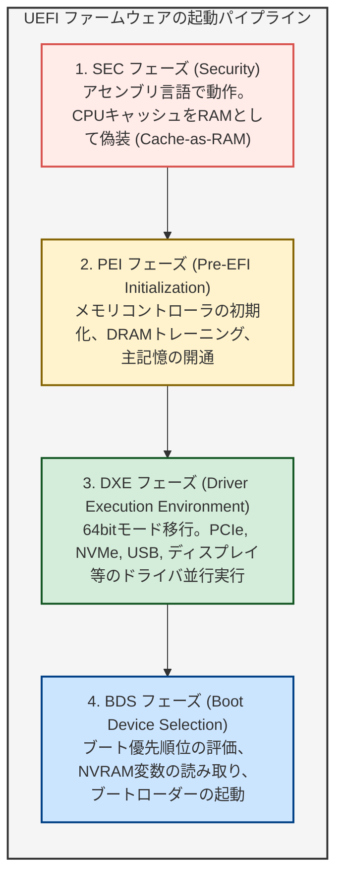
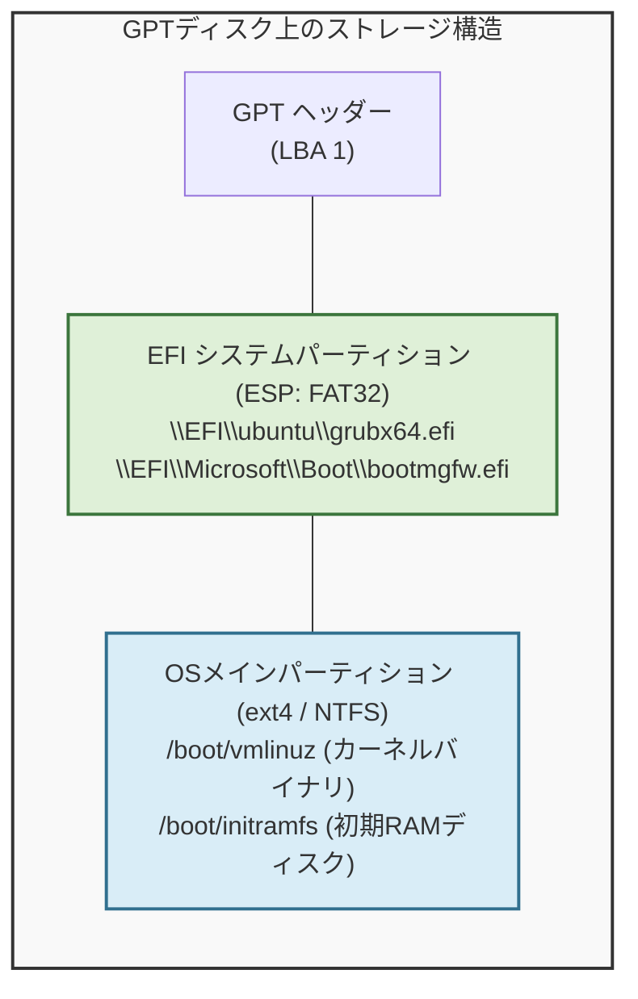
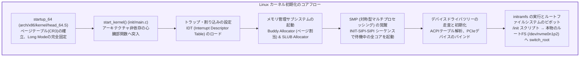
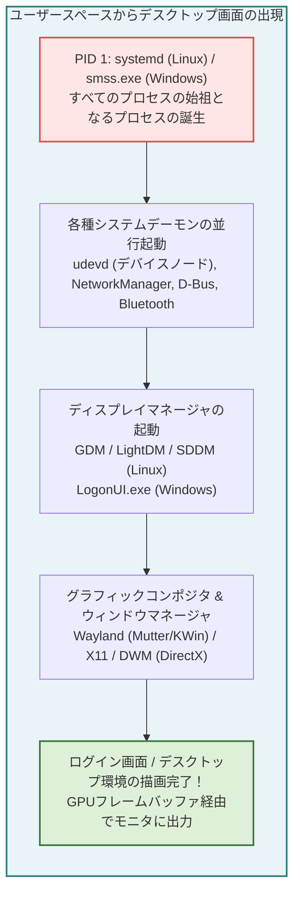
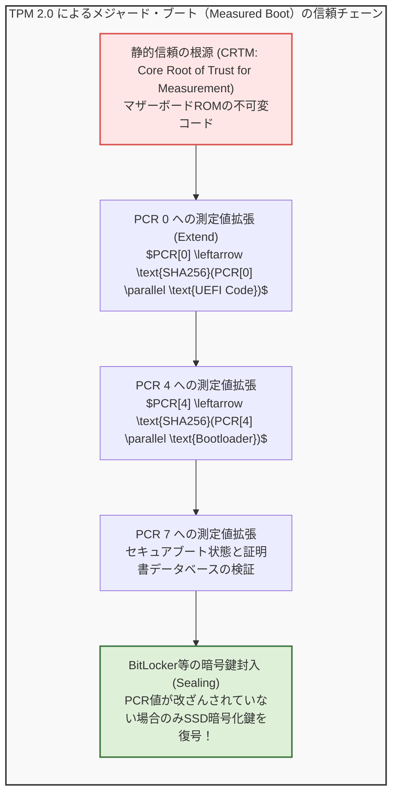
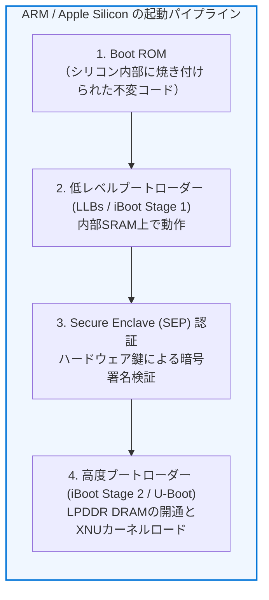

## 序論：暗闇から光へ――指先ひとつのタップが呼び覚ますマイクロ秒の奇跡

毎朝、私たちが何気なくノートパソコンの電源ボタンを押すとき、あるいはスマートフォンのサイドキーを長押しするとき、そこには何の変哲もない日常の風景が広がっています。数秒から十数秒待てば、液晶画面に鮮やかなログイン画面が浮かび上がり、デスクトップのアイコンが整然と並びます。

しかし、物理工学と計算機科学の視点からその瞬間を観察したとき、そこでは<strong>人類の科学史において最も精緻でドラマチックな連鎖反応</strong>が繰り広げられています。

電源ボタンが押された最初の1ミリ秒、コンピュータは完全な「仮死状態」にあります。CPUのレジスタには意味のある値は一切入っておらず、ギガバイト単位のメインメモリ（DRAM）には1バイトのデータすら存在せず、グラフィックボードは画面に黒以外の色を映し出す方法を知りません。ハードディスクや超高速NVMe SSDの中に数千億行のOSコードが眠っていようとも、電源投入直後のCPUには、ストレージからデータを読み出すドライバすら存在しないのです。



コンピュータは、自分自身の力だけで、無秩序なシリコン基板の上から高度なオペレーティングシステム（OS）の秩序を立ち上げなければなりません。この自己言及的な立ち上げプロセスは、<strong>「自らの靴紐（Bootstrap）を引っ張り上げて宙に浮く」</strong>という18世紀の冒険小説『ほら吹き男爵』の逸話にちなんで、<strong>「ブートストラップ（Bootstrapping / ブート）」</strong>と呼ばれます。

電源が入ってから画面が出るまでのわずか数秒のあいだに、CPU内部では何が起きているのか？
16ビットの遺物から64ビットの最新モードへの変態、UEFIの隠された多層アーキテクチャ、暗号署名によるセキュアブートの防壁、カーネルがマルチコアCPUを叩き起こす瞬間まで、現代の計算機が目覚める全軌跡を解明します。

---

## 1. 第1段階：電気的覚醒――PSUとPOWER_GOOD信号の神秘

### 1.1 電源ボタンは直接CPUを動かさない
多くの人は、PCの電源ボタンを押すとコンセントからの電力が直接CPUに流れ込み、即座に計算が始まると想像します。しかし、実際には電源ボタンは単なる「モーメンタリ・スイッチ」であり、マザーボード上の<strong>組み込みコントローラ（EC: Embedded Controller）</strong>やサウスブリッジ（PCH: Platform Controller Hub）に微小な電気信号を送るトリガーに過ぎません。

PCの電源ユニット（PSU: Power Supply Unit）は、家庭用コンセントの交流100V〜240Vを、電子回路が必要とする直流の $+12\text{V}$, $+5\text{V}$, $+3.3\text{V}$ などに変換します。しかし、コンデンサやコイルに電気が充填され、規定の電圧に達して安定するまでには、数十ミリ秒の物理的な時間を要します。

もし電圧が不安定でノイズに満ちた状態でCPUを動かせば、内部トランジスタが誤作動を起こし、予期せぬ暴走やシリコンの物理的破壊を招きます。



### 1.2 POWER_GOOD信号とリセット解除
PSU内部の監視回路がすべての出力電圧が定格の $\pm 5\%$ 以内で安定したことを検知すると、PSUはマザーボードの24ピンコネクタの8番ピンを通じて<strong>`PWR_OK`（Power Good信号）</strong>をHIGH（$+5\text{V}$）に引き上げます。

この信号を受け取って初めて、マザーボードのチップセットは水晶振動子を用いたクロックジェネレータを起動し、ベースクロック（100MHz等）の供給を開始します。
そして最後に、CPUソケットの<strong>`RESET#`ピン</strong>の電圧をアサート（LOW）からデアサート（HIGH）へと切り替えます。

この瞬間、CPUの内部論理回路にかけられていた電気的な首輪が解かれ、中央演算処理装置の心臓が初めて拍動を始めるのです。

---

## 2. 第2段階：CPUの最初の息吹――リセットベクタ（Reset Vector）

### 2.1 1978年の亡霊：16ビット「リアルモード」での起動
現代のIntel CoreやAMD Ryzenプロセッサは、64ビットの広大なメモリ空間と何十テラフロップスもの演算能力を誇る超近代的なモンスターチップです。しかし、電源が入った最初のクロックサイクルにおいて、CPUは驚くべき姿で目覚めます。

<strong>最新の64ビットCPUは、1978年に発売された16ビットプロセッサ「Intel 8086」と完全に互換性のある「リアルモード（Real Address Mode）」で起動するのです。</strong>

これは半導体業界における後方互換性（Backward Compatibility）への狂気的な執念の結果です。40年以上前に書かれたDOSプログラムであっても、最新のコンピュータのハードウェア上でそのまま動作させられるように設計されているのです。
リアルモードでは：
- アドレスバスはわずか20ビット（最大アクセス可能メモリは <strong>1MB</strong> のみ）
- ページング機能やメモリ保護（リング保護）は無効
- セグメント方式によるアドレス指定：$\text{物理アドレス} = (\text{セグメント} \times 16) + \text{オフセット}$

### 2.2 リセットベクタのアドレス：`0xFFFF_FFF0`
リセットが解除された瞬間、CPU内部のハードウェアワイヤード回路によって、主要なレジスタが固定値で強制初期化されます：

- コードセグメントレジスタ（CS）：`0xF000`
- セグメントベースアドレス：`0xFFFF_0000`（※特殊な隠しベース）
- インストラクションポインタ（IP / EIP）：`0x0000_FFF0`

これにより、CPUがメモリ空間上で最初に命令をフェッチ（読み出し）しにいく物理アドレスが決定されます：

$$\text{Reset Vector Address} = 0xFFFF\_0000 + 0x0000\_FFF0 = \mathbf{0xFFFF\_FFF0}$$

このアドレスは、4GBメモリ空間（32ビットアドレス空間）の天井である `0xFFFF_FFFF` のわずか<strong>16バイト手前</strong>に位置しています。



「わずか16バイトの空間で何ができるのか？」
当然、16バイトの中に複雑な起動プログラムを収めることは不可能です。そのため、マザーボードメーカーはここに<strong>たった1つのジャンプ命令（JMP）</strong>を焼き付けておきます：

```assembly
JMP 0xF000:E05B   ; より広いファームウェアのコード領域へジャンプせよ！
```

このジャンプ命令が実行された瞬間、CPUはマザーボードの基板上に実装された8ピンの<strong>SPIフラッシュメモリチップ（EEPROM）</strong>へとアクセスし、そこに格納された現代の巨大ファームウェア――<strong>UEFI（Unified Extensible Firmware Interface）</strong>の世界へと足を踏み入れます。

---

## 3. 第3段階：ファームウェアの進化史――レガシーBIOSからUEFIへ

### 3.1 レガシーBIOSの限界と終焉
1981年のIBM PC以来、コンピュータのファームウェアは<strong>BIOS（Basic Input/Output System）</strong>と呼ばれていました。しかし2000年代に入ると、BIOSの根本的な設計限界がコンピュータの進化の足を引っ張るようになりました：
- 16ビットリアルモードで動作するため、1MB以上のメモリを活用できない
- ハードディスクのパーティション方式が<strong>MBR（Master Boot Record）</strong>に縛られ、最大ディスク容量が <strong>2TB</strong> に制限される
- BIOS割り込みコール（`INT 10h`、`INT 13h` など）が同期型で極めて低速
- GUI画面やマウス操作、多言語表示、ネットワーク経由の起動が困難

これを打破するため、Intelが提唱したEFI（Extensible Firmware Interface）をベースに、主要ハードウェア・OSメーカーが共同策定した新世代ファームウェア規格が<strong>UEFI</strong>です。現代のUEFIは単なる起動プログラムではなく、<strong>それ自体がC言語で書かれた一種の独立した小規模OS</strong>として動作します。

### 3.2 UEFIの4段階パイプライン（PIアーキテクチャ）
UEFIのブートシーケンスは、Intel Platform Innovation Frameworkに準拠した厳格なフェーズ構造を持っています。



1. <strong>SEC（Security）フェーズ：</strong>
   リセット直後のフェーズ。この時点ではメインメモリ（DRAM）がまだ電気的に初期化されていないため、普通のC言語のスタック変数が使えません。そこで、CPU内部の<strong>L2/L3キャッシュメモリを一時的なRAMとして利用する「Cache-as-RAM（CAR）」技術</strong>を用いてスタックを構築し、信頼の根源（Root of Trust）を確立します。
2. <strong>PEI（Pre-EFI Initialization）フェーズ：</strong>
   マザーボード上のチップセットを探索し、DDR4/DDR5メモリコントローラにクロックやタイミング信号を送り、信号の反射や位相差を補正する<strong>DRAMトレーニング</strong>を実行します。数ギガバイト以上のメインメモリがここで初めて開通します。
3. <strong>DXE（Driver Execution Environment）フェーズ：</strong>
   UEFIの心臓部。CPUをフル機能の64ビットモードへ切り替え、DRAM上で数百個のUEFIドライバを並行してロード・実行します。PCIeバスの走査、NVMe SSDの認識、グラフィックカードの初期化（GOP: Graphics Output Protocolによる画面表示）、USBキーボードの認識などがすべてここで行われます。
4. <strong>BDS（Boot Device Selection）フェーズ：</strong>
   マザーボードのNVRAM（不揮発性メモリ）に記録されたブートエントリ（`BootOrder`）を読み取り、起動すべきデバイスを特定して制御を引き渡します。

### 3.3 セキュアブート（Secure Boot）：改ざんを防ぐ暗号署名の連鎖
現代のUEFIにおいて不可欠なセキュリティ機能が<strong>セキュアブート（Secure Boot）</strong>です。
OSが起動する前に不正なルートキットやマルウェアがファームウェアやブートローダーを書き換える攻撃を防ぐため、公開鍵暗号に基づく厳密な<strong>信頼の連鎖（Chain of Trust）</strong>を構築します。

- <strong>PK（Platform Key）：</strong> ハードウェアベンダーが保持する最上位の鍵。
- <strong>KEK（Key Exchange Key）：</strong> OSベンダー（Microsoft等）の鍵を登録・更新するための鍵。
- <strong>db（Signature Database）：</strong> 正当なブートローダーのデジタル署名やSHA-256ハッシュのホワイトリスト。
- <strong>dbx（Forbidden Database）：</strong> 脆弱性が発見され失効した署名のブラックリスト。

UEFIは、ストレージからブートローダー（`.efi`ファイル）をメモリに読み込んだ際、その電子署名を検証します。署名が `db` に適合し、かつ `dbx` に含まれていないことが確認されて初めて、実行権限を与えます。

---

## 4. 第4段階：ブートローダーへのバトンタッチ（ESPとGRUB）

### 4.1 GPTとEFIシステムパーティション（ESP）
従来のBIOSは、ディスクの先頭セクター（セクター0、わずか512バイト）にある<strong>MBR（Master Boot Record）</strong>から機械語を読み出して実行していました。

一方、UEFIではパーティション規格として<strong>GPT（GUID Partition Table）</strong>を採用しています。GPTディスクには、FAT32ファイルシステムでフォーマットされた<strong>EFIシステムパーティション（ESP: EFI System Partition）</strong>という専用領域が存在します。

UEFIはファイルシステムをネイティブに解釈できるため、ディスクの特定セクターを盲目的に読み出すのではなく、ファイルパスを指定して実行ファイルを起動します：

$$\text{デフォルトのフォールバックパス: } \quad \texttt{\\EFI\\BOOT\\BOOTX64.EFI}$$

Windowsの場合：
$$\texttt{\\EFI\\Microsoft\\Boot\\bootmgfw.efi} \quad (\text{Windows Boot Manager})$$

Linux（Ubuntu/Fedora等）の場合：
$$\texttt{\\EFI\\ubuntu\\grubx64.efi} \quad (\text{GRUB 2})$$



### 4.2 ブートローダー（GRUB / Windows Boot Manager）の任務
ブートローダーは、UEFIファームウェアと本番OSカーネルのあいだを取り持つ特使です。その主な役割は以下の通りです：

1. <strong>ブートメニューの提示：</strong> 複数のOS（WindowsとLinuxのデュアルブートなど）や過去のカーネルバージョンの選択肢をユーザーに表示します。
2. <strong>カーネルのメモリロード：</strong> ストレージ上の複雑なファイルシステム（ext4, Btrfs, XFS, NTFS等）を解釈し、圧縮されたカーネルバイナリ（Linuxなら `vmlinuz`）をメインメモリの指定アドレスに配置します。
3. <strong>初期RAMディスク（initramfs）の配置：</strong> ルートファイルシステムをマウントするために必要な最小限のドライバを含む一時的なインメモリファイルシステム（`initramfs`）をメモリに展開します。
4. <strong>カーネルパラメータの伝達：</strong> コマンドライン引数（`root=UUID=... ro quiet splash` など）を用意します。
5. <strong>UEFIブートサービスの終了（ExitBootServices）：</strong>
   ブートローダーがカーネルへ制御を渡す直前、UEFIに対して `ExitBootServices()` というAPIを呼び出します。これにより、UEFIが管理していた一時的なメモリ領域が解放され、<strong>ハードウェアの全制御権がOSカーネルへと完全に委譲されます。</strong>

---

## 5. 第5段階：OSカーネルの初期化――無秩序から秩序へ

ここから先は、真の支配者であるオペレーティングシステム（Linuxカーネル）の独壇場です。
メモリにロードされた `vmlinuz` は、自己解凍ルーチンを実行した後、64ビットのカーネルエントリポイントへと突入します。



### 5.1 仮想記憶の確立とページングの有効化
カーネルが最初に行う最重要タスクは、<strong>仮想記憶（Virtual Memory）</strong>の構築です。
x86-64プロセッサの4段階ページング（PML4）または5段階ページング（PML5）テーブルを作成し、制御レジスタ <strong>CR3</strong> にページテーブルの物理アドレスをロードします。

これにより、物理メモリの断片化が隠蔽され、すべてのプロセスが「自分専用の広大な連続したメモリ空間（48ビットまたは57ビット空間）」を安全に利用できるようになります。

### 5.2 SMP（対称型マルチプロセッシング）：眠れる巨人の叩き起こし
現代のCPUには、8コア、16コア、あるいは128コアものプロセッサコアが搭載されています。
しかし、これまでの全プロセス（PSU起動からUEFI、ブートローダー、カーネルの最初期まで）は、たった1つのコア――<strong>BSP（Bootstrap Processor）</strong>だけで実行されていました。残りのすべてのコア（<strong>AP: Application Processor</strong>）は、省電力の深い眠り（Wait-for-SIPI状態）についています。

カーネルは、<strong>ローカルAPIC（Advanced Programmable Interrupt Controller）</strong>を通じて、以下の特別なプロセッサ間割り込み（IPI）シーケンスを発行します：

1. <strong>INIT IPI：</strong> APのリセットと内部状態の初期化。
2. <strong>SIPI（Startup IPI）1回目：</strong> APに対して、起動用のトラムポリンコードが配置された物理アドレスを指定して起床命令を送る。
3. <strong>SIPI 2回目：</strong> 確実に起床させるための再送。

この「INIT-SIPI-SIPI」シーケンスを受け取った瞬間、休眠していたすべてのコアが一斉に目を覚まし、カーネルのスケジューラに登録されます。PCの演算能力が一挙に数十倍に跳ね上がる瞬間です。

---

## 6. 第6段階：ユーザースペースの誕生とGUI画面の出現

すべてのハードウェアが初期化され、マルチタスクスケジューラが動き出した後、カーネルは自らの権限を一段落とし、<strong>ユーザースペース（Ring 3: 最も権限の低い安全な階層）</strong>へと移行します。



### 6.1 PID 1の誕生：すべてのプロセスの父
カーネルは、`kernel_execve` システムコールを用いて、ユーザースペースの最初のプロセスを起動します。これがプロセスID 1（<strong>PID 1</strong>）を持つプロセスです：
- Linuxの場合：`/sbin/init`（現代ではほぼすべて `systemd` へのシンボリックリンク）
- Windowsの場合：`smss.exe`（セッションマネージャーサブシステム）

PID 1は、Linuxにおけるすべてのプロセスツリーの根（Root）であり、システム内のあらゆるサービスを起動・監視する絶対的な親プロセスです。`systemd` はソケットアクティベーション機能などを駆使して、ネットワーク管理（NetworkManager）、オーディオ管理（PipeWire）、デバイス検知（systemd-udevd）などを猛烈な並行度で起動していきます。

### 6.2 画面が光る瞬間：ディスプレイマネージャとGPUフレームバッファ
いよいよ最後の瞬間です。
バックグラウンドのサービスが立ち上がると、`systemd` はグラフィカルターゲット（`graphical.target`）に到達し、<strong>ディスプレイマネージャ（GDMやLightDMなど）</strong>を起動します。

ディスプレイマネージャは、カーネルのダイレクト・レンダリング・マネージャー（DRM/KMS: Kernel Mode Setting）ドライバと通信し、GPUのビデオメモリ（VRAM）内に確保された<strong>フレームバッファ（Framebuffer）</strong>へとアクセスします。

ディスプレイサーバ（WaylandコンポジタやX11、WindowsのDWM）がログインウィンドウのベクターデータや壁紙のビットマップをレンダリングし、GPUのディスプレイスキャンアウト回路がDisplayPortやHDMIの差動信号を通じて液晶パネルの各ピクセルへと送信します。

<strong>ここで初めて、モニタのバックライトが鮮やかに輝き、ログイン画面が私たちの目の前に現れるのです。</strong>

---


---

## 7. 発展的深層分析：TPM 2.0、メジャードブート、そしてARMアーキテクチャの起動

現代のブートプロセスは、単にOSを立ち上げるだけでなく、<strong>「システムが何者にも改ざんされていないことを数学的に証明する」</strong>という高度なセキュリティ要件を満たす必要があります。さらに、スマートフォンやApple Silicon Macの普及により、x86以外のアーキテクチャにおけるブートシーケンスの理解も不可欠となっています。



### 7.1 TPM 2.0とメジャード・ブート（Measured Boot）
セキュアブートが「不正なコードの実行をブロックする」仕組みであるのに対し、<strong>メジャード・ブート（Measured Boot）</strong>は<strong>「実行されたすべてのコードのハッシュ値を改ざん不能なハードウェアチップに記録し、後から検証可能にする」</strong>仕組みです。

その中核を担うのが、マザーボード上に搭載された<strong>TPM（Trusted Platform Module）2.0</strong>チップです。
TPM内部には、<strong>PCR（Platform Configuration Register）</strong>と呼ばれる特殊なレジスタ群が存在します。PCRは通常のメモリのように上書き（Write）することができず、<strong>「拡張（Extend）」</strong>という数学的暗号操作によってのみ更新されます：

$$PCR_{\text{new}} = \text{SHA-256}(PCR_{\text{old}} \parallel \text{Measurement Data})$$

1. <strong>静的信頼の根源（CRTM）：</strong> 電源投入直後、決して改ざんできないハードウェアROM内の最小コードが、次のステージ（SEC/PEI）のコードをハッシュ測定し、PCR 0にExtendします。
2. <strong>UEFIとドライバの測定：</strong> DXEフェーズで読み込まれるすべてのファームウェアボリュームやUEFIドライバのハッシュがPCR 2にExtendされます。
3. <strong>ブートローダーの測定：</strong> 実行される `grubx64.efi` や `bootmgfw.efi` のハッシュがPCR 4にExtendされます。
4. <strong>暗号鍵の封入（Sealing）：</strong>
   WindowsのBitLockerやLinuxのLUKSは、ストレージのフルディスク暗号化解除キーをTPM内部に<strong>「封入（Seal）」</strong>します。「PCR 0, 2, 4, 7 の値が、OSインストール時と1ビットの狂いもなく完全一致しているときだけ、暗号鍵をメモリに払い出す（Unseal）」というポリシーを設定します。
   もし攻撃者がファームウェアを書き換えたり、悪意あるUSBからPCを起動しようとしても、PCR値が変化するためTPMは暗号鍵の開示を拒否し、データへのアクセスは完全に遮断されます。

### 7.2 高速スタートアップと休止状態（ACPI S4）のトリック
最新のWindows PCでは、コールドブート（完全シャットダウンからの起動）であっても、わずか数秒でデスクトップが表示されます。この高速性の裏には、<strong>「高速スタートアップ（Fast Startup）」</strong>と呼ばれる高度なアーキテクチャ上のトリックが存在します。

ユーザーが「シャットダウン」をクリックしたとき、OSは実は完全な終了を行っていません：
1. <strong>ユーザーセッションの完全ログオフ：</strong> 開いているアプリケーションやユーザープロセスはすべて通常通り終了されます。
2. <strong>カーネル空間のハイバネーション（ACPI S4）：</strong> デバイスドライバ、ファイルシステムキャッシュ、カーネルモジュールが配置されたカーネルメモリ空間（Ring 0）の状態をそのままディスク上の `hiberfil.sys` ファイルに一括ダンプします。
3. <strong>次回起動時のショートカット：</strong> 次に電源ボタンが押されたとき、カーネルはハードウェアやドライバをゼロから初期化する膨大な処理（数千のレジスタ設定やバス走査）をすべてスキップし、`hiberfil.sys` からカーネルメモリイメージを一気にRAMへ直列DMA転送します。

これにより、コールドブートの安全性を保ちながら、休止状態復帰並みの超高速起動を実現しているのです。

### 7.3 ARMアーキテクチャ（Apple Silicon / Android）の起動シーケンス
x86が1978年のレガシーなリアルモードを引きずっているのに対し、スマートフォンやApple Silicon（M1/M2/M3/M4）に代表されるARMアーキテクチャは、はるかに近代的でクリーンな多層ブート構造を持っています。



- <strong>Boot ROM：</strong> プロセッサのダイ内に物理的にエッチングされたマスクROMであり、後からの改ざんは物理的に不可能です。電源投入直後に実行され、Appleのルート公開鍵を用いて次段のブートローダーを暗号検証します。
- <strong>例外レベル（Exception Levels）：</strong>
  ARMv8/v9では、特権レベルが明確に分離されています：
  - <strong>EL3（Secure Monitor）：</strong> 最も高い特権。ARM Trusted Firmware（ATF）が動作し、セキュアワールドとノーマルワールドを調停。
  - <strong>EL2（Hypervisor）：</strong> 仮想化支援。
  - <strong>EL1（Kernel）：</strong> OSカーネル（XNUやLinux）が動作。
  - <strong>EL0（User）：</strong> 一般アプリケーション。

ARMのブートシーケンスは、最高特権のEL3から始まり、ハードウェアの信頼性を一段ずつ確認しながら、安全に権限を降格してEL1（カーネル）へと着陸します。x86のような過去のしがらみ（16ビットモードやMBR）が一切存在しないため、起動速度とエネルギー効率が極めて高いのが特徴です。

## 8. 結論：数億行のコードと半導体が織りなす「信頼の連鎖」

電源ボタンを押してからログイン画面が出るまでの時間は、最新のNVMe SSDを搭載したPCであれば、わずか<strong>5秒から10秒</strong>程度です。

しかし、そのわずかな時間のあいだに、コンピュータは：
1. 物理的な電圧の安定を待ち（PSU）、
2. 40年前の16ビットリアルモードから目覚め（Reset Vector）、
3. キャッシュをRAMに偽装して暗号署名を検証し（UEFI）、
4. 数千のデバイスドライバを並行して初期化し（DXE）、
5. ディスクのFAT32パーティションからブートローダーを呼び出し（ESP/GRUB）、
6. 64ビットの仮想記憶空間を設計してマルチコアCPUを叩き起こし（Kernel）、
7. そして数千のユーザースペースプロセスを協調動作させてGUIを描画しました。

ハードウェア、ファームウェア、オペレーティングシステム、グラフィックスドライバ――人類が半世紀以上にわたって積み重ねてきた数千万行、数億行に及ぶプログラミングコードと超微細半導体テクノロジーが、<strong>1ミリ秒の隙もなく完璧なバトンリレー</strong>を成功させた結果として、あの美しいデスクトップ画面が存在しています。

次にPCの電源ボタンを押すとき、指先に伝わるわずかなクリック感の奥底で、何千億個もの電子が秩序の迷宮を駆け抜け、暗闇から世界を構築していくその壮大な叙事詩に、ぜひ思いを馳せてみてください。

