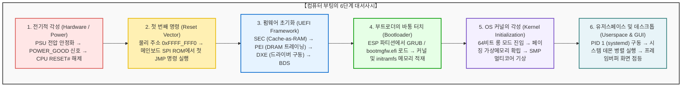

## 서론: 칠흑 같은 암흑에서 픽셀의 광채로

매일 아침 노트북의 전원 버튼을 누르거나 스마트폰 화면을 켤 때, 우리는 몇 초 만에 깔끔한 로그인 화면과 마주합니다.
그러나 전기공학과 컴퓨터 시스템 아키텍처의 미시적 관점에서 보면, 이 수 초의 시간 동안 <strong>인류 공학 역사상 가장 정밀하고 숨 막히는 연쇄 반응</strong>이 펼쳐집니다.

전원 버튼이 눌린 첫 1마이크로초 동안 컴퓨터는 완벽한 ‘가사(假死) 상태’입니다.
CPU 레지스터에는 아무런 의미 있는 값이 없고, 수십 GB의 메인 메모리(DRAM)는 완전히 비어 있으며, 그래픽카드는 화면에 신호를 보낼 줄 모릅니다. NVMe SSD에 수천만 줄의 정교한 운영체제(OS) 코드가 잠들어 있을지라도, 갓 전원이 켜진 CPU는 저장장치에서 데이터를 읽어올 드라이버조차 없습니다.

컴퓨터는 외부의 도움 없이 오직 스스로의 힘으로 무질서한 실리콘 위에서 운영체제의 장엄한 질서를 구축해야 합니다. 이 자기참조적인 시동 과정을 <strong>“자신의 장화 끈(Bootstrap)을 잡고 공중으로 솟구친다”</strong>는 전설에서 따와 <strong>‘부트스트래핑(Bootstrapping)’</strong>, 줄여서 <strong>‘부팅(Booting)’</strong>이라고 부릅니다.

---

## 1. 1단계: 전기적 각성과 POWER_GOOD 신호

전원 버튼은 220V 교류 전원을 직접 켜는 스위치가 아닙니다. 메인보드의 임베디드 컨트롤러(EC)에 미세한 전기 펄스를 전달하는 트리거일 뿐입니다.
파워서플라이(PSU)는 교류 전기를 직류 $+12\text{V}, +5\text{V}, +3.3\text{V}$로 변환하지만, 커패시터와 인덕터가 충전되어 정격 전압에 도달하기까지는 수십 밀리초의 시간이 걸립니다. 전압이 요동치는 상태에서 CPU가 작동하면 트랜지스터 오작동으로 실리콘이 파괴될 수 있습니다.

PSU 내부 감시 회로가 모든 출력 전압이 정상 범위($\pm 5\%$)에 안착했음을 확인하면, 메인보드 8번 핀을 통해 <strong>`PWR_OK` (Power Good)</strong> 신호를 HIGH($+5\text{V}$)로 올립니다. 이 신호를 받은 메인보드는 비로소 클록 발생기를 켜고, CPU의 <strong>`RESET#`</strong> 핀을 해제합니다. 이 순간 CPU가 첫 박동을 시작합니다.

---

## 2. 2단계: CPU의 첫 호흡과 리셋 벡터 (Reset Vector)

놀랍게도 현대의 최첨단 64비트 x86 CPU는 전원이 켜지는 순간, <strong>1978년에 출시된 16비트 인텔 8086 프로세서와 완벽히 호환되는 ‘리얼 모드(Real Mode)’로 깨어납니다.</strong>
이는 반도체 역사상 전설적인 하위 호환성 보장의 결과입니다. 최대 메모리 접근은 1MB로 제한되며 가상 메모리 보호 기능도 꺼져 있습니다.

리셋 직후 CPU의 레지스터는 고정값으로 설정됩니다:
- 코드 세그먼트(CS): 베이스 주소 `0xFFFF_0000`
- 인스트럭션 포인터(EIP): `0x0000_FFF0`

이 둘이 결합하여 CPU가 최초로 메모리를 읽으러 가는 주소인 <strong>리셋 벡터(Reset Vector)</strong>가 결정됩니다:
$$\text{Reset Vector} = \mathbf{0xFFFF\_FFF0}$$

이 주소는 4GB 경계 바로 16바이트 아래에 있습니다. 메인보드 칩셋은 이 주소의 접근을 아직 켜지지 않은 DRAM 대신 메인보드의 <strong>SPI 플래시 ROM(UEFI 칩)</strong>으로 하드웨어 라우팅합니다. 그곳에 적힌 유일한 명령은 더 넓은 펌웨어 코드로 이동하라는 `JMP` 명령입니다.

---

## 3. 3단계: 펌웨어의 진화—레거시 BIOS에서 현대 UEFI로

1981년 IBM PC 이래 사용되던 레거시 BIOS는 1MB 메모리 장벽, 2TB MBR 디스크 제한 등 한계에 직면했습니다. 이를 대체한 <strong>UEFI(Unified Extensible Firmware Interface)</strong>는 C언어로 작성된 일종의 독립적인 미니 64비트 운영체제입니다.

UEFI는 4단계를 거쳐 실행됩니다:
1. <strong>SEC (Security):</strong> 캐시를 임시 RAM으로 쓰는 Cache-as-RAM(CAR) 기술로 스택을 구성하고 보안 루트를 확립합니다.
2. <strong>PEI (Pre-EFI Initialization):</strong> DRAM 신호 위상을 미세 조정하는 메모리 트레이닝을 수행하여 수십 GB의 메인 메모리를 활성화합니다.
3. <strong>DXE (Driver Execution Environment):</strong> 64비트 모드로 전환하고 PCIe, NVMe, USB, 그래픽(GOP) 드라이버 수백 개를 병렬 실행하여 제조사 로고를 띄웁니다.
4. <strong>BDS (Boot Device Selection):</strong> NVRAM 설정을 읽어 부팅 장치를 결정하고 보안 부팅(Secure Boot) 서명을 검증합니다.

---

## 4. 4단계: 부트로더의 인수와 커널 실행 (ESP와 GRUB)

UEFI는 GPT 디스크의 FAT32 형식인 <strong>EFI 시스템 파티션(ESP)</strong>에서 부트로더를 직접 실행합니다:
- Windows: `\EFI\Microsoft\Boot\bootmgfw.efi`
- Linux: `\EFI\ubuntu\grubx64.efi`

부트로더(GRUB 등)는 저장장치에서 압축된 리눅스 커널(`vmlinuz`)과 초기 램디스크(`initramfs`)를 메모리에 올린 뒤, UEFI의 `ExitBootServices()` 함수를 호출합니다. 이로써 펌웨어는 메모리에서 퇴장하고 <strong>하드웨어의 절대 권한이 OS 커널로 완전히 이양됩니다.</strong>

---

## 5. 5단계: OS 커널의 각성과 멀티코어 기상

커널은 `startup_64`로 진입하여 다단계 페이지 테이블(CR3 레지스터)을 구축함으로써 가상 메모리 보호막을 형성합니다.
이어 주 코어(BSP)는 APIC 인터럽트를 통해 깊은 잠에 빠져 있던 수십 개의 보조 코어(AP)에 <strong>INIT-SIPI-SIPI</strong> 시퀀스를 보내 일제히 깨웁니다. 단일 코어의 조용한 부팅이 수십 개 코어의 병렬 연산으로 폭발하는 순간입니다.

---

## 6. 6단계: 유저스페이스 탄생과 디스플레이 점등

커널은 최고 권한(Ring 0)에서 일반 권한(Ring 3)으로 전환하여 첫 유저 프로세스인 <strong>PID 1(systemd)</strong>을 실행합니다.
`systemd`는 수많은 백그라운드 서비스를 병렬로 구동하고 디스플레이 매니저(GDM 등)를 호출합니다.

디스플레이 서버는 GPU의 VRAM 내에 할당된 <strong>프레임버퍼(Framebuffer)</strong>에 로그인 화면의 수백만 픽셀 데이터를 씁니다. 그래픽카드가 이 신호를 HDMI/DisplayPort로 모니터에 전송하는 순간, 마침내 화면의 백라이트가 켜지며 화려한 데스크톱이 우리 눈앞에 나타납니다.

---

## 7. 결론: 실리콘 위에서 펼쳐지는 인류 공학의 교향곡

전원 버튼을 누르고 화면이 뜨기까지 걸리는 시간은 최신 PC에서 단 <strong>5~8초</strong>에 불과합니다.
하지만 그 짧은 찰나에 40여 년의 역사를 품은 16비트 리얼 모드부터 최첨단 64비트 다중 코어 병렬 연산까지, 수억 줄의 코드와 수백억 개의 트랜지스터가 단 1마이크로초의 오차도 없이 질서의 바통을 넘겨받았습니다. 이것이야말로 현대 인류가 이룩한 가장 위대한 공학적 기적입니다.

