## Introdução: Da escuridão aos pixels em microssegundos

Todas as manhãs, ao pressionar o botão de ligar do computador, esperamos apenas alguns segundos até que a tela se ilumine e a interface do sistema operacional apareça.
Sob a ótica da engenharia elétrica e da ciência da computação, contudo, esse curto intervalo abriga <strong>uma das mais complexas e sofisticadas reações em cadeia da história tecnológica</strong>.

No primeiro microssegundo em que o botão é pressionado, a máquina está em estado de paralisia total:
Os registradores da CPU não contêm instruções úteis; os gigabytes de memória RAM (DRAM) estão inertes; a placa de vídeo não consegue emitir sinal; e embora o SSD guarde gigabytes de código, o processador recém-energizado sequer possui drivers para acessá-lo.

```mermaid
flowchart TD
    subgraph BootPhases ["As seis etapas de inicialização do computador"]
        P1["1. Despertar elétrico (Hardware & Power)\nEstabilização de tensão → Sinal POWER_GOOD → Liberação do RESET# da CPU"]
        P2["2. A primeira instrução (Vetor de Reset)\nEndereço físico 0xFFFF_FFF0 → Salto JMP lido do chip SPI Flash ROM"]
        P3["3. Inicialização do firmware (UEFI)\nSEC (Cache-as-RAM) → PEI (Treinamento DRAM) → DXE (Drivers) → BDS"]
        P4["4. O bastão do carregador de boot (Bootloader)\nCarga de bootmgfw.efi / grubx64.efi na ESP → Kernel e initramfs na RAM"]
        P5["5. Inicialização do kernel do SO\nTransição para Long Mode 64 bits → Paginação (CR3) → Despertar multicore SMP"]
        P6["6. Espaço do usuário e desktop gráfico (Userspace)\nInício do PID 1 (systemd) → Daemons de sistema → Framebuffer ilumina a tela"]
    end

    P1 --> P2 --> P3 --> P4 --> P5 --> P6
    style BootPhases fill:#f9f9f9,stroke:#333,stroke-width:2px
    style P1 fill:#ffe6e6,stroke:#d9534f,stroke-width:2px
    style P2 fill:#fff0b3,stroke:#e6b800,stroke-width:2px
    style P3 fill:#e6f3ff,stroke:#0066cc,stroke-width:2px
    style P4 fill:#e6ffe6,stroke:#009900,stroke-width:2px
    style P5 fill:#f4f0ff,stroke:#6f42c1,stroke-width:2px
    style P6 fill:#e8f4f8,stroke:#2b7a78,stroke-width:2px
```

O computador precisa erguer sua própria estrutura a partir do nada, processo historicamente denominado <strong>bootstrapping</strong> (ou simplesmente <strong>boot</strong>).

---

## 1. Etapa 1: Despertar elétrico e o sinal POWER_GOOD

O botão de energia não conecta a rede elétrica diretamente ao processador; ele envia um pulso ao controlador embarcado da placa-mãe.
A fonte de alimentação (PSU) converte a corrente alternada em tensões contínuas ($+12\text{V}, +5\text{V}, +3.3\text{V}$). Quando os circuitos confirmam a estabilização das linhas com tolerância de $\pm 5\%$, a fonte emite o sinal <strong>`PWR_OK` (Power Good)</strong> em nível alto. A placa-mãe ativa o gerador de clock e desativa o pino <strong>`RESET#`</strong> da CPU.

---

## 2. Etapa 2: A primeira instrução e o vetor de reset

Para manter compatibilidade com o Intel 8086 de 1978, a CPU moderna acorda em <strong>Modo Real de 16 bits</strong>, com barramento de endereços limitado a 1 MB.
Os registradores são configurados para o endereço fixo conhecido como <strong>Vetor de Reset</strong>:
$$\text{Endereço} = \mathbf{0xFFFF\_FFF0}$$
A apenas 16 bytes do limite de 4 GB, essa solicitação é interceptada e enviada ao chip <strong>SPI Flash ROM</strong> da placa-mãe, onde reside uma instrução de salto (`JMP`) para o firmware UEFI.

---

## 3. Etapa 3: Do BIOS legado ao padrão UEFI moderno

O BIOS tradicional possuía limites rígidos de 1 MB de memória e discos MBR de 2 TB. O <strong>UEFI</strong> é um minissistema operacional modular pré-boot de 64 bits que opera em quatro fases:
1. <strong>SEC (Security):</strong> Usa o cache da CPU como memória temporária (<strong>Cache-as-RAM, CAR</strong>) antes da ativação da RAM.
2. <strong>PEI (Pre-EFI Initialization):</strong> Executa o treinamento da memória DRAM, ajustando parâmetros de sinal em escala de picossegundos.
3. <strong>DXE (Driver Execution Environment):</strong> Entra em 64 bits e carrega centenas de drivers modulares (PCIe, NVMe, USB, GOP de vídeo).
4. <strong>BDS (Boot Device Selection):</strong> Lê variáveis NVRAM e valida assinaturas de <strong>Secure Boot</strong>.

---

## 4. Etapa 4: O carregador de inicialização (ESP e GRUB)

O UEFI carrega o executável a partir da <strong>Partição de Sistema EFI (ESP)</strong> em FAT32:
- Windows: `\EFI\Microsoft\Boot\bootmgfw.efi`
- Linux: `\EFI\ubuntu\grubx64.efi`

O bootloader posiciona o kernel (`vmlinuz`) e o disco inicial (`initramfs`) na memória e invoca `ExitBootServices()`, transferindo a custódia do hardware para o kernel do sistema operacional.

---

## 5. Etapa 5: Inicialização do kernel e ativação multicore (SMP)

O kernel estabelece tabelas de paginação virtual no registrador <strong>CR3</strong>.
Em seguida, o núcleo principal (BSP) transmite a sequência <strong>INIT-SIPI-SIPI</strong> aos núcleos secundários dormentes através do APIC, ativando toda a capacidade paralela da CPU em milissegundos.

---

## 6. Etapa 6: Espaço do usuário e a imagem na tela

O kernel inicia o processo primordial <strong>PID 1 (systemd)</strong> no anel de usuário (Ring 3), que orquestra daemons e ativa o gerenciador de exibição.
O servidor de vídeo grava a imagem no <strong>Framebuffer</strong> da VRAM da GPU, que por sua vez transmite o fluxo de pixels ao monitor. A tela brilha e o desktop fica pronto para uso.

---

## 7. Conclusão: Uma obra-prima da engenharia moderna

Em apenas <strong>5 a 8 segundos</strong>, bilhões de transistores e milhões de linhas de código concluem uma passagem de bastão sem falhas. O boot de um computador é o alicerce silencioso que sustenta toda a tecnologia contemporânea.

