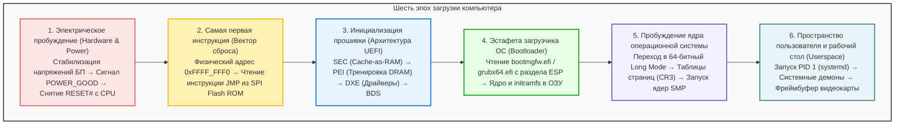

## Введение: Из абсолютной тьмы к сиянию пикселей за микросекунды

Каждое утро, нажимая кнопку включения на корпусе компьютера или ноутбука, мы привыкли видеть экран входа в систему уже через несколько секунд.
Однако с точки зрения физики и компьютерной архитектуры за эти мгновения разворачивается <strong>одна из самых сложных и драматичных цепных реакций в истории инженерии</strong>.

В первую микросекунду после нажатия кнопки компьютер пребывает в состоянии полного анабиоза:
В регистрах процессора нет полезных данных; оперативная память (DRAM) электрически не инициализирована; видеокарта не знает, как вывести даже простейший символ; и хотя на быстром SSD покоятся гигабайты кода операционной системы, у процессора нет драйверов, чтобы прочитать хотя бы один байт.

Компьютер обязан восстановить свою колоссальную программную структуру буквально из ничего. Этот процесс называют <strong>«самозагрузкой» (Bootstrapping)</strong> — по аналогии с бароном Мюнхгаузеном, вытащившим себя за волосы из болота.

---

## 1. Этап 1: Электрическое пробуждение и сигнал POWER_GOOD

Кнопка питания на корпусе не подает сетевой ток прямо на плату; она посылает управляющий импульс на мультиконтроллер (EC).
Блок питания (БП) преобразует сетевой ток в постоянные напряжения ($+12\text{В}, +5\text{В}, +3.3\text{В}$). Поскольку сглаживающим конденсаторам требуется время на зарядку, напряжения нарастают с пульсациями.
Когда внутренний компаратор БП убеждается, что линии стабильны в пределах $\pm 5\%$, он выставляет высокий уровень на линии <strong>`PWR_OK` (Power Good)</strong>. Материнская плата включает генератор тактовой частоты и снимает сигнал сброса с контакта <strong>`RESET#`</strong> процессора.

---

## 2. Этап 2: Первый вздох процессора и вектор сброса (Reset Vector)

Ради абсолютной обратной совместимости с чипом Intel 8086 1978 года современный 64-битный процессор просыпается в архаичном <strong>16-битном реальном режиме (Real Mode)</strong> с ограничением памяти в 1 МБ.
Аппаратно регистры инициализируются фиксированными значениями:
- Сегмент кода (CS): База `0xFFFF_0000`
- Указатель команд (EIP): `0x0000_FFF0`

Первой точкой выборки инструкций становится знаменитый <strong>вектор сброса</strong>:
$$\text{Адрес} = \mathbf{0xFFFF\_FFF0}$$
Находясь всего в 16 байтах от границы 4 ГБ, это обращение перенаправляется чипсетом к микросхеме <strong>SPI Flash ROM</strong> материнской платы, где записана команда перехода (`JMP`) в основной код прошивки UEFI.

---

## 3. Этап 3: От устаревшего BIOS к стандарту UEFI

Устаревший BIOS был ограничен 1 МБ памяти и 2 ТБ дисками формата MBR. Современный <strong>UEFI</strong> — это модульная 64-битная операционная система предзагрузки, написанная на Си:
1. <strong>SEC (Security):</strong> Использует процессорный кэш как временную оперативную память (<strong>Cache-as-RAM, CAR</strong>), пока не работает DRAM.
2. <strong>PEI (Pre-EFI Initialization):</strong> Проводит прецизионную <strong>тренировку памяти</strong>, калибруя фазы сигналов DDR-модулей с точностью до пикосекунд.
3. <strong>DXE (Driver Execution Environment):</strong> Переходит в 64-битный режим, загружая сотни драйверов (PCIe, NVMe, USB, видео GOP).
4. <strong>BDS (Boot Device Selection):</strong> Определяет загрузочный диск из энергонезависимой памяти NVRAM и проверяет цифровые подписи <strong>Secure Boot</strong>.

---

## 4. Этап 4: Эстафета загрузчика ОС (ESP и GRUB)

UEFI находит на системном разделе <strong>ESP</strong> (формат FAT32 на GPT-диске) исполняемый файл:
- Windows: `\EFI\Microsoft\Boot\bootmgfw.efi`
- Linux: `\EFI\ubuntu\grubx64.efi`

Загрузчик помещает в ОЗУ сжатое ядро (`vmlinuz`) и образ диска начальной загрузки (`initramfs`), после чего вызывает функцию `ExitBootServices()`. Прошивка очищается из памяти, передавая ядру ОС абсолютный контроль над аппаратурой.

---

## 5. Этап 5: Инициализация ядра и пробуждение ядер SMP

Ядро настраивает таблицы виртуальной памяти в регистре <strong>CR3</strong>.
Затем главное процессорное ядро (BSP) посылает спящим вторичным ядрам (APs) последовательность прерываний <strong>INIT-SIPI-SIPI</strong> через локальный контроллер APIC. За доли секунды вычислительная мощность системы возрастает в десятки раз.

---

## 6. Этап 6: Пространство пользователя и рабочий стол

Ядро понижает привилегии до пользовательского уровня (Ring 3) и запускает корневой процесс <strong>PID 1 (systemd)</strong>. Он параллельно активирует службы, монтирует диски и запускает дисплейный менеджер.
Сервер отрисовки формирует изображение в видеобфере (<strong>Framebuffer</strong>) в памяти видеокарты. Видеочип передает цифровой поток на монитор — экран озаряется светом, приглашая пользователя к работе.

---

## 7. Заключение: Триумф цифровой инженерии

На современном компьютере весь этот путь занимает от силы <strong>5–8 секунд</strong>. Но за это краткое мгновение миллиарды транзисторов и миллионы строк кода безошибочно передают эстафету управления сквозь полвека технологической эволюции.

