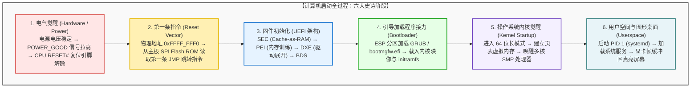
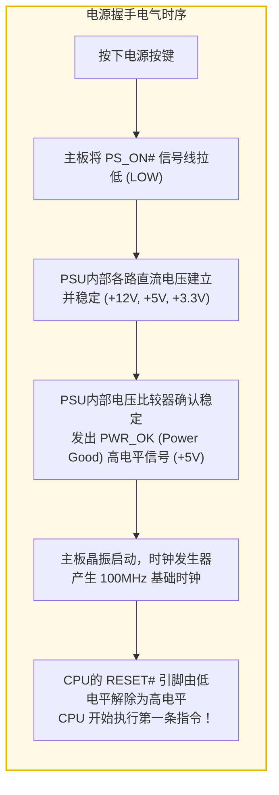
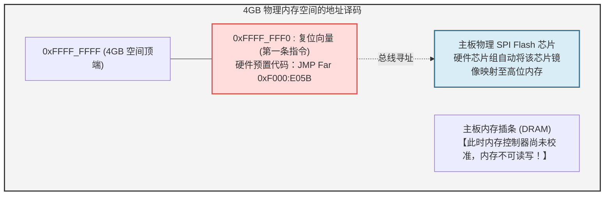
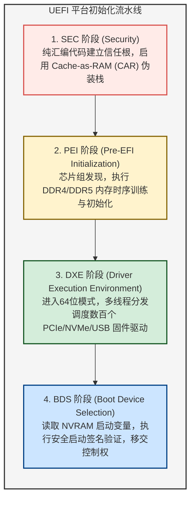
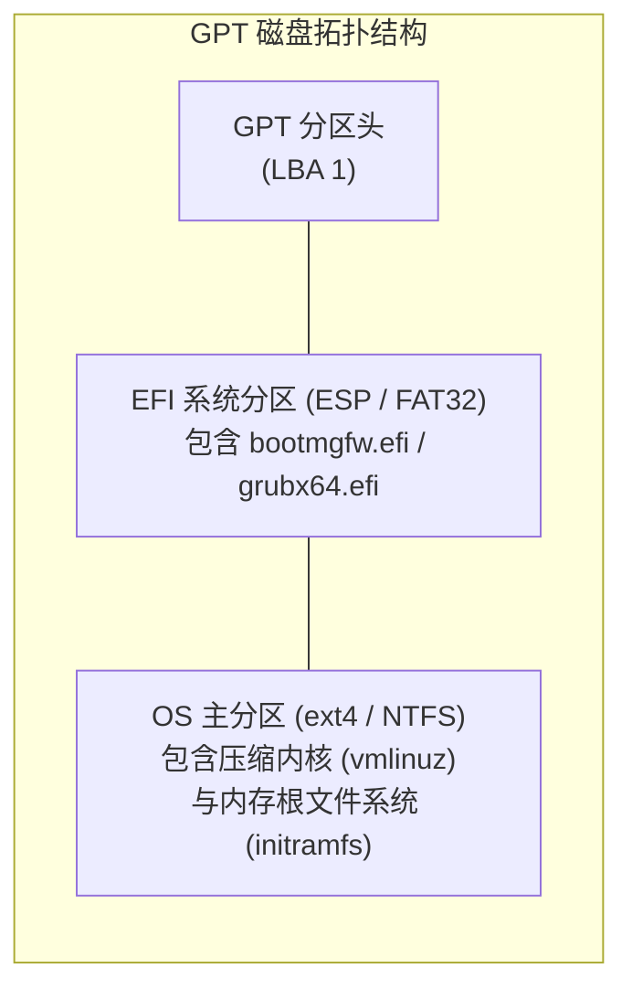
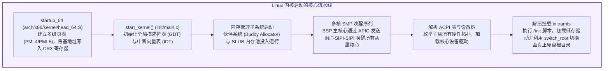
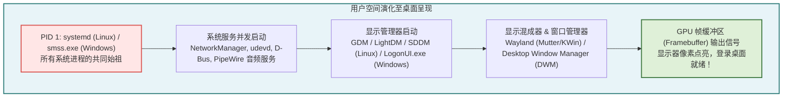

## 引言：从漆黑沉寂到像素闪耀的微秒级创世纪

每天清晨，当我们按下笔记本电脑的电源键，或是轻触手机的侧边唤醒按钮时，往往觉得这只是稀松平常的一刻。几秒钟后，屏幕点亮，优雅的操作系统图标与登录界面映入眼帘。

然而，如果从电气工程与计算机系统架构的微观视角来观察，这短短几秒钟内所上演的，是<strong>人类科技史上最精密、最跌宕起伏的连锁反应</strong>。

在电源按下的最初一微秒，整台电脑处于彻底的“假死”与混沌状态：
CPU的寄存器中没有任何有效指令；几十GB的高速动态随机存取内存（DRAM）中空无一物；独立显卡无法在显示器上绘制出黑色以外的任何颜色；固态硬盘（NVMe SSD）中即便沉睡着数千万行庞大的操作系统代码，刚刚通电的处理器甚至连读取存储设备的底层驱动程序都不具备。



计算机必须凭借自身极其微小的初始硬件逻辑，在荒芜的硅片上凭空建立起现代化操作系统的巍峨秩序。这种自我指涉、自力更生的启动机制，源自18世纪德国文学中“抓着自己的靴带把自己从泥潭里拔出来”的奇幻典故，因此在计算机科学中被称为<strong>“引导 / 自举（Bootstrapping / Booting）”</strong>。

---

## 1. 第一阶段：电气觉醒与电源握手（POWER_GOOD）

### 1.1 电源按键并非简单的通电开关
现代电脑机箱上的电源按钮并不是直接连通交流电的物理开关。它本质上只是一个连接到主板<strong>嵌入式控制器（EC）</strong>或芯片组的瞬时脉冲触发器。

电源供应器（PSU）需要将家用 $220\text{V}$ 交流电降压并整流为数字电路所需的 $+12\text{V}$、$+5\text{V}$、$+3.3\text{V}$ 等多路直流电压。由于电容和电感充放电的物理特性，在通电初期的几十毫秒内，输出电压会剧烈抖动。如果此时立刻运行CPU，极其微小的电压畸变就会导致内部逻辑门逻辑翻转，造成系统崩溃甚至击穿晶体管。



### 1.2 PWR_OK 信号与硬件复位解除
当PSU内部的检测电路确认所有供电轨的电压波动均收敛在额定值的 $\pm 5\%$ 以内后，它会通过主板主供电接口的第8引脚输出 <strong>`PWR_OK`（Power Good）</strong>高电平信号。
主板芯片组接收到此信号后，才会开启主板上的时钟发生器，向CPU供给稳定的时钟脉冲，并最终释放CPU的 <strong>`RESET#`</strong> 硬件复位引脚。直到这一瞬间，CPU内部被物理冻结的时钟网络才开始流动。

---

## 2. 第二阶段：CPU的第一缕呼吸——复位向量（Reset Vector）

### 2.1 穿越时光：64位巨兽在16位实模式下醒来
当今顶级的英特尔酷睿与AMD锐龙处理器，拥有数十个物理核心和上百亿个晶体管。然而，当复位信号解除的第一拍时钟周期，CPU所呈现的姿态令人瞠目结舌：

<strong>现代64位CPU必须在完全兼容1978年英特尔8086芯片的16位“实模式（Real Mode）”下启动。</strong>

这是为了保障PC产业跨越近半个世纪的终极后向兼容性。在实模式下：
- 地址总线被限制在20位，最大物理内存寻址仅有可怜的 <strong>1 MB</strong>；
- 没有任何硬件内存分页或保护机制；
- 地址计算遵循古老的“段基址 $\times 16$ + 偏移量”公式。

### 2.2 复位向量地址：`0xFFFF_FFF0`
复位解除瞬间，CPU硬件逻辑强制将段寄存器和指令指针设定为固定初值：
- 代码段寄存器（CS）：选择子为 `0xF000`，但内部隐藏基址被强制挂钩在 `0xFFFF_0000`；
- 指令指针（EIP）：`0x0000_FFF0`。

两者相加，便得到了全球计算机通用的第一条指令物理地址——<strong>复位向量（Reset Vector）</strong>：

$$\text{地址} = 0xFFFF\_0000 + 0x0000\_FFF0 = \mathbf{0xFFFF\_FFF0}$$

该物理地址紧贴着4GB（32位地址上限）空间顶部仅 <strong>16个字节</strong> 的地方。



16字节显然无法容纳任何有意义的程序。因此，主板厂商在这一地址硬编码了一条长跳转指令：
```assembly
JMP 0xF000:E05B   ; 跳转至 SPI Flash ROM 中真正的固件入口
```
芯片组自动将对该地址的内存访问请求拦截，通过SPI总线路由至焊在主板上的固件芯片——现代电脑的大脑由此步入 <strong>UEFI</strong> 的世界。

---

## 3. 第三阶段：固件的革命——从传统BIOS到现代化UEFI

### 3.1 传统BIOS的黄昏
自1981年IBM PC确立以来的<strong>传统BIOS（Basic Input/Output System）</strong>在现代硬件面前暴露出无法逾越的技术缺陷：
- 局限在实模式和1MB内存屏障，启动极为缓慢；
- 依赖MBR（主引导记录）分区表，无法支持大于 <strong>2.2 TB</strong> 的大容量硬盘；
- 中断调用（如 `INT 10h`, `INT 13h`）全是单线程阻塞式的。

2000年代由英特尔主导确立的<strong>UEFI（统一可扩展固件接口）</strong>彻底重构了固件体系。UEFI不再是一个简单的BIOS小程序，它本质上是一个<strong>由C语言编写的、具备完整驱动模型和文件系统解析能力的独立小型预启动操作系统</strong>。

### 3.2 UEFI 的四大核心执行阶段
根据平台初始化（PI）标准规范，UEFI按照四个严格的阶段推进：



1. <strong>SEC（Security）阶段：</strong>
   此阶段主内存（DRAM）尚未通电，无法建立C语言所需的函数调用栈。SEC阶段利用CPU内部的高速二级/三级缓存（L2/L3 Cache）伪装成临时内存，即<strong>Cache-as-RAM（CAR）</strong>技术，搭建起最初的栈帧环境。
2. <strong>PEI（Pre-EFI Initialization）阶段：</strong>
   执行极其精密复杂的<strong>内存训练（Memory Training）</strong>。向DRAM插条发送高频探针信号，测定皮秒级别的信号反射与相位偏移，校准阻抗与时序参数。经过此阶段，数十GB的系统物理内存正式开通。
3. <strong>DXE（Driver Execution Environment）阶段：</strong>
   UEFI的核心引擎。CPU完全切换至64位模式并启用分页。DXE调度器并发加载主板各外设的驱动程序：枚举PCIe总线、初始化NVMe固态硬盘控制器、启动USB主机控制器、并通过GOP（图形输出协议）初始化显卡，屏幕上首次出现厂商LOGO。
4. <strong>BDS（Boot Device Selection）阶段：</strong>
   读取主板NVRAM（非易失性存储器）中的 `BootOrder` 变量，寻找预设的引导分区并加载操作系统的引导加载程序。

### 3.3 安全启动（Secure Boot）：防御恶意Rootkit的加密信任链
UEFI中最为关键的防护层当属<strong>安全启动（Secure Boot）</strong>。它依托非对称公钥密码学，在引导加载程序执行前对其进行严格验证：
- <strong>PK（平台密钥）：</strong> 主板厂商掌控的最高授权公钥；
- <strong>KEK（密钥交换密钥）：</strong> 用于认证操作系统厂商颁布的更新证书；
- <strong>db（允许签名数据库）：</strong> 合法签名的证书与二进制哈希白名单；
- <strong>dbx（吊销签名数据库）：</strong> 存在安全漏洞的恶意或废弃引导程序黑名单。

只有通过验证且未在黑名单中的操作系统引导文件（如 `bootmgfw.efi` 或 `grubx64.efi`），才被允许加载执行。

---

## 4. 第四阶段：引导加载程序的接力棒（ESP、GRUB与Windows Boot Manager）

### 4.1 GPT 与 EFI 系统分区（ESP）
UEFI放弃了古老的MBR软盘分区结构，全面采用<strong>GUID分区表（GPT）</strong>。
在GPT磁盘上，存在一个格式化为标准FAT32文件系统的特殊隐藏分区——<strong>EFI系统分区（ESP: EFI System Partition）</strong>。

UEFI原生内置FAT32文件系统驱动，因此它无需通过磁头寻道直接读取物理扇区，而是能像常规软件一样直接通过标准路径读取可执行文件：

$$\text{Windows 引导程序:} \quad \texttt{\\EFI\\Microsoft\\Boot\\bootmgfw.efi}$$
$$\text{Linux GRUB 引导程序:} \quad \texttt{\\EFI\\ubuntu\\grubx64.efi}$$



### 4.2 退出固件服务（ExitBootServices）
引导加载程序（GRUB或Windows Boot Manager）的主要职责是：
1. 显示引导菜单（支持双系统切换或安全模式选择）；
2. 将压缩的操作系统内核二进制（Linux下的 `vmlinuz`）及初始化内存磁盘（`initramfs`）加载到物理内存中；
3. 构建传递给内核的命令行引导参数（如 `root=UUID=... ro quiet splash`）；
4. 调用 UEFI 提供的最重要 API：
   ```c
   gBS->ExitBootServices(ImageHandle, MapKey);
   ```
这一行代码宣告了固件时代的终结。UEFI在内存中占用的所有临时运行时驱动与数据结构被彻底回收清空，<strong>计算机的绝对统治权正式移交给操作系统内核</strong>。

---

## 5. 第五阶段：操作系统内核觉醒——无序化为秩序

当控制权移交至Linux内核的64位入口点（`startup_64`）后，内核首先执行自解压，并进入跨架构的初始枢纽函数 `start_kernel()`。



### 5.1 虚拟内存与分页机制的建立
内核首要任务是建立<strong>虚拟内存体系</strong>。通过向CPU控制寄存器 <strong>CR3</strong> 写入顶级页表的物理基地址，将物理内存彻底抽象化为连续的48位或57位虚拟地址空间，为后续用户空间进程的内存隔离提供铁壁般的保护。

### 5.2 唤醒沉睡的多核巨人：SMP 序列
此前所有的启动代码都仅仅运行在一个核心——<strong>引导处理器（BSP）</strong>上。现代CPU的其余几十个核心（<strong>从属处理器 AP</strong>）此前一直处于超低功耗的休眠状态（Wait-for-SIPI）。

BSP通过芯片内部的本地中断控制器（Local APIC），向总线广播特殊的核间中断（IPI）：
1. <strong>INIT IPI：</strong> 重置从属核心内部寄存器；
2. <strong>SIPI 1（Startup IPI）：</strong> 发送从属核心启动引导微代码的内存矢量；
3. <strong>SIPI 2：</strong> 重复广播确保所有核心苏醒。

一瞬间，从属核心全员苏醒，初始化各自的分页环境，并加入内核任务调度器中。系统的并行计算能力瞬间呈指数级爆发。

---

## 6. 第六阶段：用户空间的诞生与图形桌面呈现

内核初始化完毕后，主动卸去全能特权，从内核态（Ring 0）降权转入用户态（Ring 3），调用 `kernel_execve` 启动整个用户空间的祖先进程：<strong>PID 1</strong>。



### 6.1 PID 1 与系统守护进程
- 在Linux上，PID 1 是 `systemd`（或传统 `init`）；
- 在Windows上，它是会话管理子系统 `smss.exe`。

`systemd` 利用现代操作系统的套接字激活（Socket Activation）技术，以极高的并发度唤醒设备热插拔服务（udevd）、网络管理（NetworkManager）、系统总线（D-Bus）等全部基础环境。

### 6.2 显示管理器与帧缓冲区（Framebuffer）
当系统进入图形化运行目标（`graphical.target`）后，显示管理器（如GDM或LightDM）被调用。它通过内核的直接渲染管理器（DRM/KMS）驱动，在显卡的独立显存（VRAM）中申请并映射了一块连续的内存区域——<strong>帧缓冲区（Framebuffer）</strong>。

Wayland合成器或X11窗口系统将壁纸图片与登录框矢量图元光栅化为数百万个RGB像素，写入帧缓冲区。显卡上的显示引擎以数十Gbps的带宽，通过DisplayPort或HDMI线缆的高速差分信号将像素流灌入显示面板的定时控制器（TCON）。

液晶面板背光瞬间亮起，光标在屏幕正中央静静闪烁。

---

## 7. 结语：微观硅片上奔涌的人类工程交响曲

从按下电源按键的机械咔哒声，到桌面图标排列整齐，在一台搭载NVMe固态硬盘的现代电脑上，通常只需 <strong>5 至 8 秒</strong>。

但这短短的几秒钟，却跨越了半个世纪的技术积淀：
1. 模拟电路中毫秒级的电压监控握手（PSU）；
2. 穿越40余年时空的16位实模式复位向量；
3. 将高速缓存伪装为内存的UEFI非对称加密防御；
4. 调度数百个底层驱动的固件总线探索；
5. 在多级虚拟内存页表上唤醒几十个沉睡CPU核心的核间中断；
6. 最终在数百万像素的帧缓冲区中点亮数字世界的斑斓色彩。

数百亿个纳米级晶体管与上千万行代码，在微秒尺度上完成了一场没有哪怕一次失误的严密接力跑。理解了计算机从黑暗走向光明的这一整段历程，你便真正读懂了人类现代计算文明最底层的工程奇迹。

