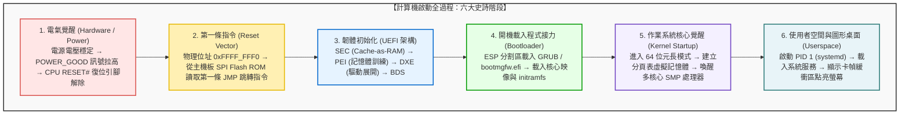
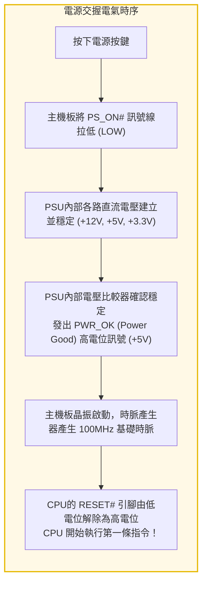
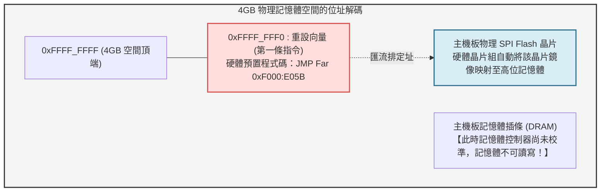
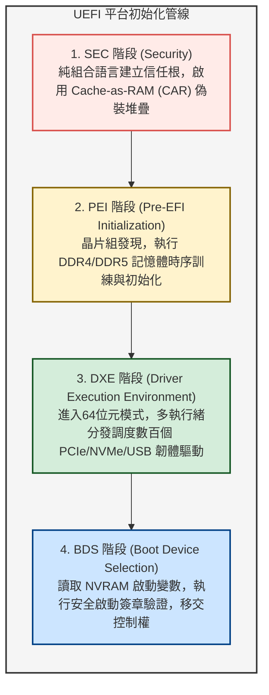
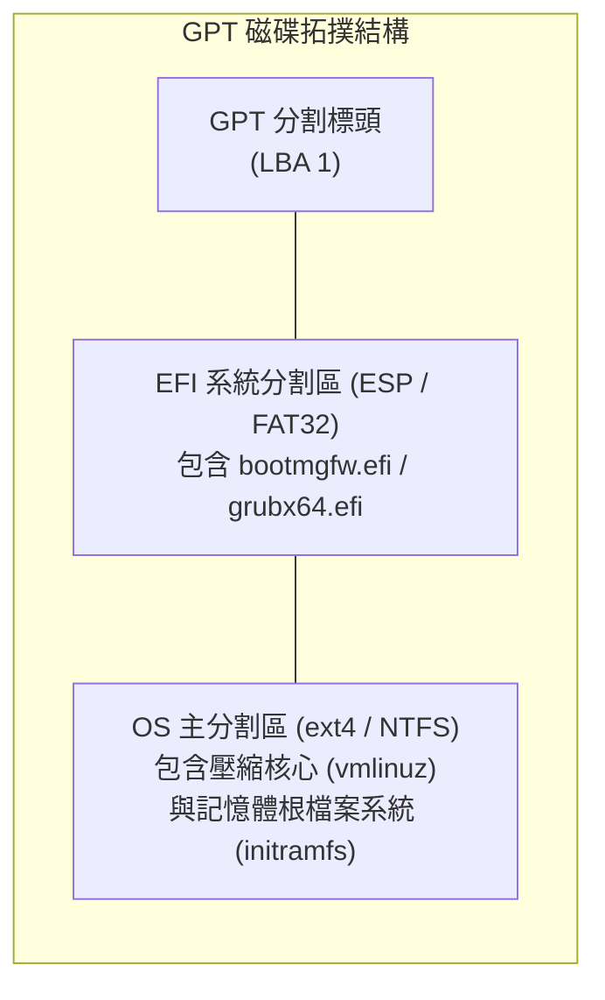
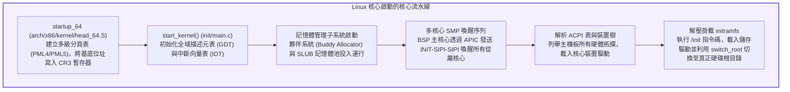
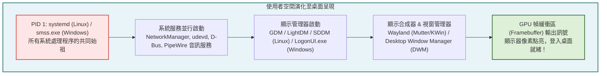

## 引言：從漆黑沉寂到像素閃耀的微秒級創世紀

每天清晨，當我們按下筆記型電腦的電源鍵，或是輕觸手機的側邊喚醒按鈕時，往往覺得這只是稀鬆平常的一刻。幾秒鐘後，螢幕點亮，優雅的作業系統圖示與登入介面映入眼簾。

然而，如果從電氣工程與計算機系統架構的微觀視角來觀察，這短短幾秒鐘內所上演的，是<strong>人類科技史上最精密、最跌宕起伏的連鎖反應</strong>。

在電源按下的最初一微秒，整台電腦處於徹底的「假死」與混沌狀態：
CPU的暫存器中沒有任何有效指令；幾十GB的高速動態隨機存取記憶體（DRAM）中空無一物；獨立顯示卡無法在顯示器上繪製出黑色以外的任何顏色；固態硬碟（NVMe SSD）中即便沉睡著數千萬行龐大的作業系統程式碼，剛剛通電的處理器甚至連讀取儲存裝置的底層驅動程式都不具備。



計算機必須憑藉自身極其微小的初始硬體邏輯，在荒蕪的矽片上憑空建立起現代化作業系統的巍峨秩序。這種自我指涉、自力更生的啟動機制，源自18世紀德國文學中「抓著自己的靴帶把自己從泥潭裡拔出來」的奇幻典故，因此在計算機科學中被稱為<strong>「開機 / 自舉（Bootstrapping / Booting）」</strong>。

---

## 1. 第一階段：電氣覺醒與電源交握（POWER_GOOD）

### 1.1 電源按鍵並非簡單的通電開關
現代電腦機殼上的電源按鈕並不是直接連通交流電的物理開關。它本質上只是一個連接到主機板<strong>嵌入式控制器（EC）</strong>或晶片組的瞬時脈衝觸發器。

電源供應器（PSU）需要將家用 $110\text{V}/220\text{V}$ 交流電降壓並整流為數位電路所需的 $+12\text{V}$、$+5\text{V}$、$+3.3\text{V}$ 等多路直流電壓。由於電容和電感充放電的物理特性，在通電初期的幾十毫秒內，輸出電壓會劇烈抖動。如果此時立刻運行CPU，極其微小的電壓畸變就會導致內部邏輯閘邏輯翻轉，造成系統崩潰甚至擊穿電晶體。



### 1.2 PWR_OK 訊號與硬體重設解除
當PSU內部的檢測電路確認所有供電軌的電壓波動均收斂在額定值的 $\pm 5\%$ 以內後，它會透過主機板主供電介面的第8引腳輸出 <strong>`PWR_OK`（Power Good）</strong>高電位訊號。
主機板晶片組接收到此訊號後，才會開啟主機板上的時脈產生器，向CPU供給穩定的時脈脈衝，並最終釋放CPU的 <strong>`RESET#`</strong> 硬體重設引腳。直到這一瞬間，CPU內部被物理凍結的時脈網路才開始流動。

---

## 2. 第二階段：CPU的第一縷呼吸——重設向量（Reset Vector）

### 2.1 穿越時光：64位元巨獸在16位元實模式下醒來
當今頂級的英特爾酷睿與AMD銳龍處理器，擁有數十個物理核心和上百億個電晶體。然而，當重設訊號解除的第一拍時脈週期，CPU所呈現的姿態令人瞠目結舌：

<strong>現代64位元CPU必須在完全相容1978年英特爾8086晶片的16位元「實模式（Real Mode）」下啟動。</strong>

這是為了保障PC產業跨越近半個世紀的終極向後相容性。在實模式下：
- 位址匯流排被限制在20位元，最大物理記憶體定址僅有可憐的 <strong>1 MB</strong>；
- 沒有任何硬體記憶體分頁或保護機制；
- 位址計算遵循古老的「段基底位址 $\times 16$ + 偏移量」公式。

### 2.2 重設向量位址：`0xFFFF_FFF0`
重設解除瞬間，CPU硬體邏輯強制將段暫存器和指令指標設定為固定初值：
- 代碼段暫存器（CS）：選擇子為 `0xF000`，但內部隱藏基底位址被強制掛鉤在 `0xFFFF_0000`；
- 指令指標（EIP）：`0x0000_FFF0`。

兩者相加，便得到了全球計算機通用的第一條指令物理位址——<strong>重設向量（Reset Vector）</strong>：

$$\text{位址} = 0xFFFF\_0000 + 0x0000\_FFF0 = \mathbf{0xFFFF\_FFF0}$$

該物理位址緊貼著4GB（32位元位址上限）空間頂端僅 <strong>16個位元組</strong> 的地方。



16位元組顯然無法容納任何有意義的程式。因此，主機板廠商在這一點硬編碼了一條長跳轉指令：
```assembly
JMP 0xF000:E05B   ; 跳轉至 SPI Flash ROM 中真正的韌體入口
```
晶片組自動將對該位址的記憶體存取請求攔截，透過SPI匯流排路由至焊在主機板上的韌體晶片——現代電腦的大腦由此步入 <strong>UEFI</strong> 的世界。

---

## 3. 第三階段：韌體的革命——從傳統BIOS到現代化UEFI

### 3.1 傳統BIOS的黃昏
自1981年IBM PC確立以來的<strong>傳統BIOS（Basic Input/Output System）</strong>在現代硬體面前暴露出無法逾越的技術缺陷：
- 侷限在實模式和1MB記憶體屏障，啟動極為緩慢；
- 依賴MBR（主開機紀錄）分割表，無法支援大於 <strong>2.2 TB</strong> 的大容量硬碟；
- 中斷呼叫（如 `INT 10h`, `INT 13h`）全是單執行緒阻塞式的。

2000年代由英特爾主導確立的<strong>UEFI（統一可延伸韌體介面）</strong>徹底重構了韌體體系。UEFI不再是一個簡單的BIOS小程式，它本質上是一個<strong>由C語言編寫的、具備完整驅動模型和檔案系統解析能力的獨立小型預啟動作業系統</strong>。

### 3.2 UEFI 的四大核心執行階段
根據平台初始化（PI）標準規範，UEFI按照四個嚴格的階段推進：



1. <strong>SEC（Security）階段：</strong>
   此階段主記憶體（DRAM）尚未通電，無法建立C語言所需的函式呼叫堆疊。SEC階段利用CPU內部的高速快取記憶體（L2/L3 Cache）偽裝成臨時記憶體，即<strong>Cache-as-RAM（CAR）</strong>技術，搭建起最初的堆疊框架環境。
2. <strong>PEI（Pre-EFI Initialization）階段：</strong>
   執行極其精密複雜的<strong>記憶體訓練（Memory Training）</strong>。向DRAM插條發送高頻探針訊號，測定皮秒級別的訊號反射與相位偏移，校準阻抗與時序參數。經過此階段，數十GB的系統物理記憶體正式開通。
3. <strong>DXE（Driver Execution Environment）階段：</strong>
   UEFI的核心引擎。CPU完全切換至64位元模式並啟用分頁。DXE調度器並行載入主機板各外設的驅動程式：列舉PCIe匯流排、初始化NVMe固態硬碟控制器、啟動USB主機控制器、並透過GOP（圖形輸出協定）初始化顯示卡，螢幕上首次出現廠商LOGO。
4. <strong>BDS（Boot Device Selection）階段：</strong>
   讀取主機板NVRAM（非揮發性記憶體）中的 `BootOrder` 變數，尋找預設的開機分割區並載入作業系統的開機載入程式。

### 3.3 安全開機（Secure Boot）：防禦惡意Rootkit的加密信任鏈
UEFI中最為關鍵的防護層當屬<strong>安全開機（Secure Boot）</strong>。它依託非對稱公開金鑰密碼學，在開機載入程式執行前對其進行嚴格驗證：
- <strong>PK（平台金鑰）：</strong> 主機板廠商掌控的最高授權公鑰；
- <strong>KEK（金鑰交換金鑰）：</strong> 用於認證作業系統廠商頒布的更新憑證；
- <strong>db（允許簽名資料庫）：</strong> 合法簽章的憑證與二進位雜湊白名單；
- <strong>dbx（撤銷簽名資料庫）：</strong> 存在安全漏洞的惡意或廢棄開機程式黑名單。

只有通過驗證且未在黑名單中的作業系統開機檔案（如 `bootmgfw.efi` 或 `grubx64.efi`），才被允許載入執行。

---

## 4. 第四階段：開機載入程式的接力棒（ESP、GRUB與Windows Boot Manager）

### 4.1 GPT 與 EFI 系統分割區（ESP）
UEFI放棄了古老的MBR分割結構，全面採用<strong>GUID分割表（GPT）</strong>。
在GPT磁碟上，存在一個格式化為標準FAT32檔案系統的特殊隱藏分割區——<strong>EFI系統分割區（ESP: EFI System Partition）</strong>。

UEFI原生內建FAT32檔案系統驅動，因此它無需透過磁頭尋道直接讀取物理磁區，而是能像常規軟體一樣直接透過標準路徑讀取可執行檔：

$$\text{Windows 開機程式:} \quad \texttt{\\EFI\\Microsoft\\Boot\\bootmgfw.efi}$$
$$\text{Linux GRUB 開機程式:} \quad \texttt{\\EFI\\ubuntu\\grubx64.efi}$$



### 4.2 退出韌體服務（ExitBootServices）
開機載入程式（GRUB或Windows Boot Manager）的主要職責是：
1. 顯示開機選單（支援雙系統切換或安全模式選擇）；
2. 將壓縮的作業系統核心二進位（Linux下的 `vmlinuz`）及初始化記憶體磁碟（`initramfs`）載入到物理記憶體中；
3. 建構傳遞給核心的命令列開機參數（如 `root=UUID=... ro quiet splash`）；
4. 呼叫 UEFI 提供的最重要 API：
   ```c
   gBS->ExitBootServices(ImageHandle, MapKey);
   ```
這一行程式碼宣告了韌體時代的終結。UEFI在記憶體中占用的所有臨時執行階段驅動與資料結構被徹底回收清空，<strong>計算機的絕對統治權正式移交給作業系統核心</strong>。

---

## 5. 第五階段：作業系統核心覺醒——無序化為秩序

當控制權移交至Linux核心的64位元入口點（`startup_64`）後，核心首先執行自解壓，並進入跨架構的初始樞紐函式 `start_kernel()`。



### 5.1 虛擬記憶體與分頁機制的建立
核心首要任務是建立<strong>虛擬記憶體體系</strong>。透過向CPU控制暫存器 <strong>CR3</strong> 寫入頂級分頁表的物理基底位址，將物理記憶體徹底抽象化為連續的48位元或57位元虛擬位址空間，為後續使用者空間處理程序的記憶體隔離提供鐵壁般的保護。

### 5.2 喚醒沉睡的多核心巨人：SMP 序列
此前所有的開機程式碼都僅僅運行在一個核心——<strong>開機處理器（BSP）</strong>上。現代CPU的其餘幾十個核心（<strong>從屬處理器 AP</strong>）此前一直處於超低功耗的休眠狀態（Wait-for-SIPI）。

BSP透過晶片內部的本地中斷控制器（Local APIC），向匯流排廣播特殊的核間中斷（IPI）：
1. <strong>INIT IPI：</strong> 重設從屬核心內部暫存器；
2. <strong>SIPI 1（Startup IPI）：</strong> 發送從屬核心啟動引導微碼的記憶體向量；
3. <strong>SIPI 2：</strong> 重複廣播確保所有核心甦醒。

一瞬間，從屬核心全員甦醒，初始化各自的分頁環境，並加入核心任務調度器中。系統的平行運算能力瞬間呈指數級爆發。

---

## 6. 第六階段：使用者空間的誕生與圖形桌面呈現

核心初始化完畢後，主動卸去全能特權，從核心態（Ring 0）降權轉入使用者態（Ring 3），呼叫 `kernel_execve` 啟動整個使用者空間的祖先處理程序：<strong>PID 1</strong>。



### 6.1 PID 1 與系統守護處理程序
- 在Linux上，PID 1 是 `systemd`（或傳統 `init`）；
- 在Windows上，它是工作階段管理子系統 `smss.exe`。

`systemd` 利用現代作業系統的插槽啟動（Socket Activation）技術，以極高的並行度喚醒裝置熱插拔服務（udevd）、網路管理（NetworkManager）、系統匯流排（D-Bus）等全部基礎環境。

### 6.2 顯示管理器與幀緩衝區（Framebuffer）
當系統進入圖形化運行目標（`graphical.target`）後，顯示管理器（如GDM或LightDM）被調用。它透過核心的直接渲染管理器（DRM/KMS）驅動，在顯示卡的獨立顯示記憶體（VRAM）中申請並映射了一塊連續的記憶體區域——<strong>幀緩衝區（Framebuffer）</strong>。

Wayland合成器或X11視窗系統將桌布圖片與登入框向量圖元點陣化為數百萬個RGB像素，寫入幀緩衝區。顯示卡上的顯示引擎以數十Gbps的頻寬，透過DisplayPort或HDMI線纜的高速差分訊號將像素流灌入顯示面板的定時控制器（TCON）。

液晶面板背光瞬間亮起，游標在螢幕正中央靜靜閃爍。

---

## 7. 結語：微觀矽片上奔湧的人類工程交響曲

從按下電源按鍵的機械喀噠聲，到桌面圖示排列整齊，在一台搭載NVMe固態硬碟的現代電腦上，通常只需 <strong>5 至 8 秒</strong>。

但這短短的幾秒鐘，卻跨越了半個世紀的技術積澱：
1. 類比電路中毫秒級的電壓監控交握（PSU）；
2. 穿越40餘年時空的16位元實模式重設向量；
3. 將快取記憶體偽裝為記憶體的UEFI非對稱加密防禦；
4. 調度數百個底層驅動的韌體匯流排探索；
5. 在多級虛擬記憶體分頁表上喚醒幾十個沉睡CPU核心的核間中斷；
6. 最終在數百萬像素的幀緩衝區中點亮數位世界的斑斕色彩。

數百億個奈米級電晶體與上千萬行程式碼，在微秒尺度上完成了一場沒有哪怕一次失誤的嚴密接力跑。理解了計算機從黑暗走向光明的這一整段歷程，你便真正讀懂了人類現代計算文明最底層的工程奇蹟。

