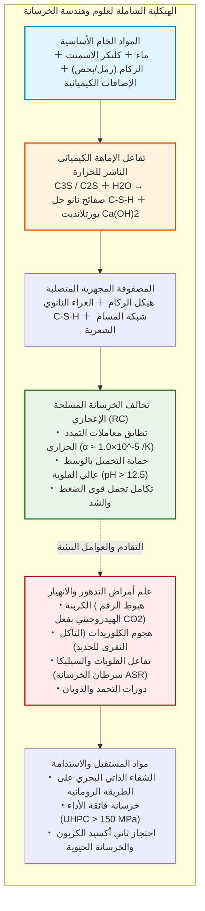
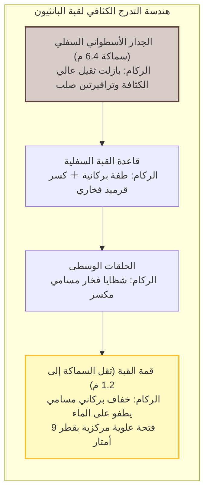
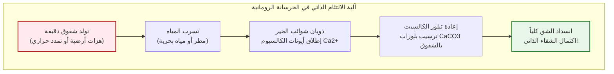
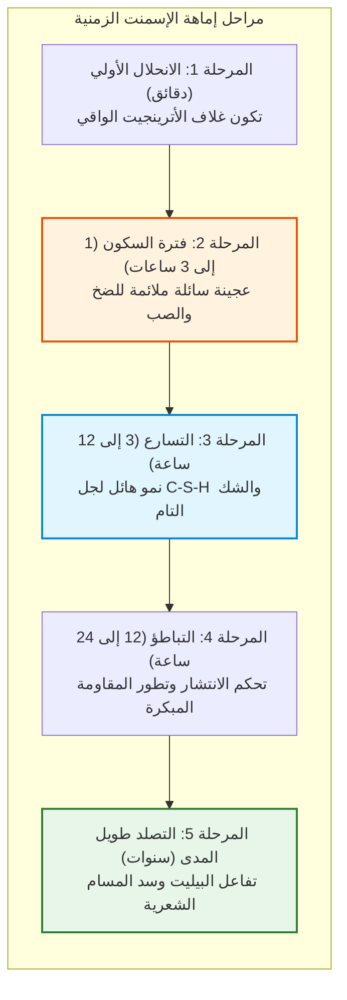
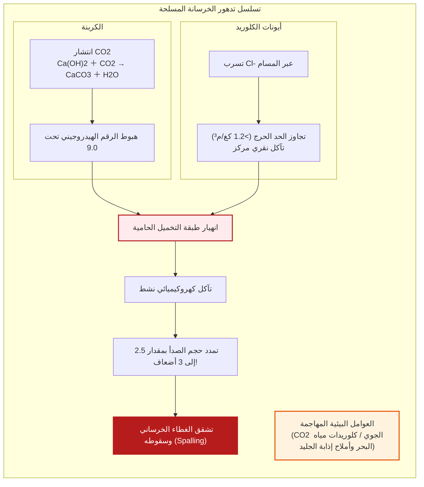
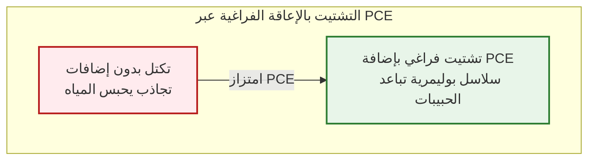
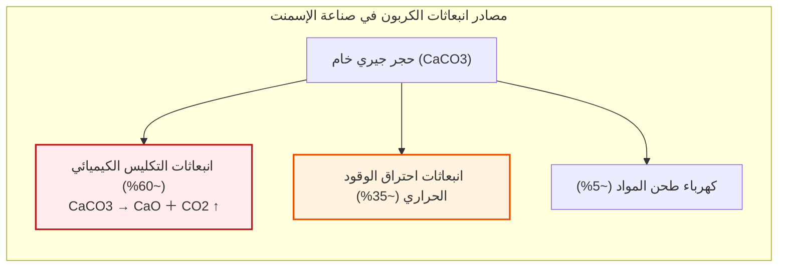

## مقدمة: المادة الأكثر استهلاكاً في العالم بعد الماء

من شبكات الطرق السريعة العابرة للقارات ودعامات الجسور المعلقة العملاقة إلى نوى ناطحات السحاب وسدود المياه الضخمة، يقوم الأساس المادي للحضارة المعاصرة على صخر اصطناعي: **الخرسانة (Concrete)**.

الخرسانة هي **ثاني أكثر مادة استهلاكاً على كوكب الأرض بعد الماء**. ويتجاوز الاستهلاك السنوي العالمي 30 مليار طن (نحو 14 مليار متر مكعب)، أي بمعدل 4 أطنان سنوياً لكل فرد. وتتجاوز كتلتها مجمل إنتاج الصلب والخشب والبلاستيك والزجاج مجتمعين.

ومع ذلك، يسود اعتقاد شائع خاطئ بأن الخرسانة تتصلب ببساطة نتيجة «جفاف الماء وتبخره في الهواء».

من منظور كيمياء المواد، فإن هذا الفهم **خاطئ تماماً**.

الخرسانة **لا تتصلب بالجفاف**. وإذا تُركت لتجف مبكراً، تتوقف قوتها وتتحول إلى ركام هش. إنما تتصلب عبر **تفاعل الإماهة الكيميائي (Hydration Reaction)**: تتحد معادن الكلنكر اللامائية كيميائياً مع جزيئات الماء لتشكل شبكة متداخلة من البلورات النانوية. وعند غمرها بالكامل تحت الماء، تنضج الخرسانة بكفاءة مذهلة وتحقق كثافة ومقاومة انضغاط تفوق نظيرتها في الهواء الجاف.

وعلاوة على ذلك، في حين تُصمم المنشآت الخرسانية المسلحة الحديثة لتدوم ما بين 50 إلى 100 عام، فإن قبة البانثيون الروماني غير المسلحة والأرصفة البحرية القديمة تقاوم الأمواج والزلازل منذ 2000 عام دون أي قضيب تسليح.

---

## الفصل الأول: معجزة روما القديمة – Opus Caementicium

تعتبر قبة البانثيون بروما المكتملة عام 126 م بقطر **43.3 متراً** حتى اليوم **أكبر قبة خرسانية غير مسلحة في العالم**.

تدرج الرومان بالركام من البازلت الكثيف بالأسفل إلى الخفاف الطافي بالأعلى، لتخفيف الوزن من 6.4 م إلى 1.2 م.

### 1.1 الخلط الساخن والشفاء الذاتي

أثبتت دراسات معهد ماساتشوستس (MIT) عام 2023 أن الرومان خلطوا الجير الحي ($\text{CaO}$) مباشرة بالرماد البركاني قبل صب الماء («Hot Mixing»):

$$\text{CaO} + \text{H}_2\text{O} \to \text{Ca(OH)}_2 + 63{,}7\ \text{kJ/mol}$$

خلفت الحرارة العالية ($> 80^\circ\text{C}$) شوائب جيرية نشطة. وحين تتسرب المياه عبر الشقوق، تذوب هذه الشوائب وتتبلور ككالسيت ($\text{CaCO}_3$) يغلق الصدوع ذاتياً.

---

## الفصل الثاني: كيمياء إماهة الإسمنت البورتلاندي

| الطور المعدني | الرمز الإسمنتي | الصيغة | النسبة | الدور الحركي |
| :--- | :--- | :--- | :--- | :--- |
| **الأليت** | **$C_3S$** | $\text{Ca}_3\text{SiO}_5$ | $50 \sim 70\%$ | إماهة سريعة؛ يمنح المقاومة المبكرة وبعمر 28 يوماً |
| **البيليت** | **$C_2S$** | $\text{Ca}_2\text{SiO}_4$ | $15 \sim 30\%$ | إماهة بطيئة؛ يضمن زيادة المقاومة على المدى الطويل |
| **الألومينات** | **$C_3A$** | $\text{Ca}_3\text{Al}_2\text{O}_6$ | $5 \sim 10\%$ | شك مفاجئ سريع؛ الجبس يتحكم في هذا التفاعل |
| **الفيريت** | **$C_4AF$** | $\text{Ca}_4\text{Al}_2\text{Fe}_2\text{O}_{10}$ | $5 \sim 15\%$ | مقاومة الكبريتات ويمنح اللون الرمادي |

$$2 C_3S + 6 H_2O \to C_3S_2H_3 \text{ (جل C-S-H)} + 3 Ca(OH)_2 \text{ (بورتلانديت)} + \Delta H$$

$$2 C_2S + 4 H_2O \to C_3S_2H_3 \text{ (جل C-S-H)} + Ca(OH)_2 + \Delta H$$

يمنح جل C-S-H أكثر من 80% من قوة التماسك، ويوفر هيدروكسيد الكالسيوم وسطاً قلوياً بقيمة **$\text{pH} = 12{,}5 \sim 13{,}5$** يحمي الحديد من الصدأ.

---

## الفصل الثالث: التحالف الإعجازي للخرسانة المسلحة (RC)

```mermaid
flowchart TD
    subgraph MiraculousSynergy["المعجزات الثلاث للخرسانة المسلحة"]
        direction TB
        
        subgraph Thermal["المعجزة 1: التوافق الحراري"]
            ExpConcrete["تمدد الخرسانة<br/>α ≈ 1.0 × 10^-5 /K"]
            ExpSteel["تمدد حديد التسليح<br/>α ≈ 1.2 × 10^-5 /K"]
            ThermalResult["انعدام إجهادات القص الفاصلة بين -30 إلى +50 مئوية!"]
            ExpConcrete --- ExpSteel --> ThermalResult
        end
        
        subgraph Mechanical["المعجزة 2: تكامل الإجهادات"]
            Comp["الخرسانة تتحمل كامل الضغط"]
            Tens["الحديد يتحمل كامل الشد"]
            Adhesion["نتوءات قضبان التسليح تنقل قوى التماسك"]
            Comp --- Tens --> Adhesion
        end
        
        subgraph Chemical["المعجزة 3: غشاء التخميل"]
            Alkali["محلول Ca(OH)2 مشبع<br/>رقم هيدروجيني 12.5 إلى 13.5"]
            PassiveFilm["طبقة أكسيد γ-Fe2O3 نانوية<br/>تحمي الفولاذ من التآكل"]
            CorrosionStop["الحديد لا يصدأ مطلقاً تحت الخرسانة السليمة!"]
            Alkali --> PassiveFilm --> CorrosionStop
        end
    end
    
    style ThermalResult fill:#e1f5fe,stroke:#0288d1,stroke-width:2px
    style Adhesion fill:#fff3e0,stroke:#e65100,stroke-width:2px
    style CorrosionStop fill:#e8f5e9,stroke:#2e7d32,stroke-width:2px
```

---

## الفصل الرابع: أمراض الخرسانة وتدهورها

---

## الفصل الخامس: خرسانة فائقة الأداء (UHPC)

بفضل الملدنات الفائقة (PCE) وتلاشي الفراغات، تقفز مقاومة الخرسانة إلى **$150$ حتى $220\ \text{ميغاباسكال}$** متجردة من المسام المنفذة.

---

## الفصل السادس: إزالة الكربون والخرسانة الحيوية

ينتج الإسمنت **7-8% من انبعاثات $\text{CO}_2$ العالمية**، 60% منها ناتجة حتمياً عن تفكك الحجر الجيري حرارياً ($\text{CaCO}_3 \to \text{CaO} + \text{CO}_2 \uparrow$).

تشمل حلول المستقبل: خبث الأفران، والتمعدن الكربوني القسري، و**الخرسانة الحيوية** المزودة ببكتيريا *Bacillus* التي ترسب الكالسيت لعلاج الشقوق.

---

## خاتمة

الخرسانة صخر بشري الصنع شيد معالم حضارتنا. ومن خلال تحولها إلى مواد مستدامة ذاتية الشفاء وخالية من الكربون، ستظل الركيزة المتينة لمدن المستقبل.
