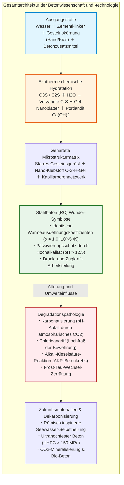
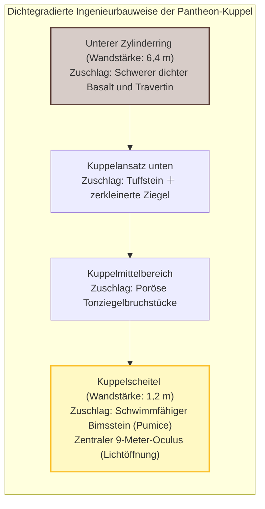
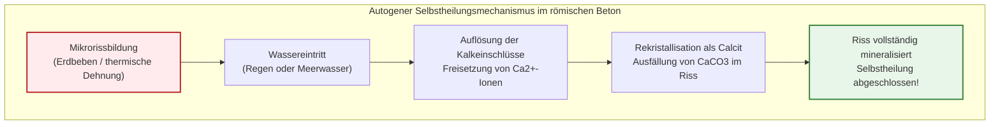
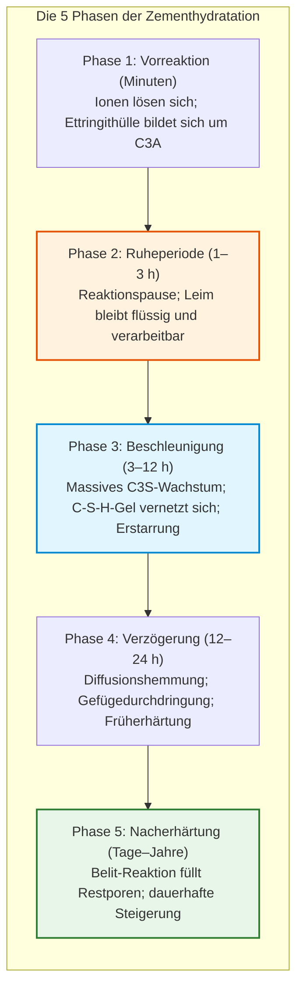
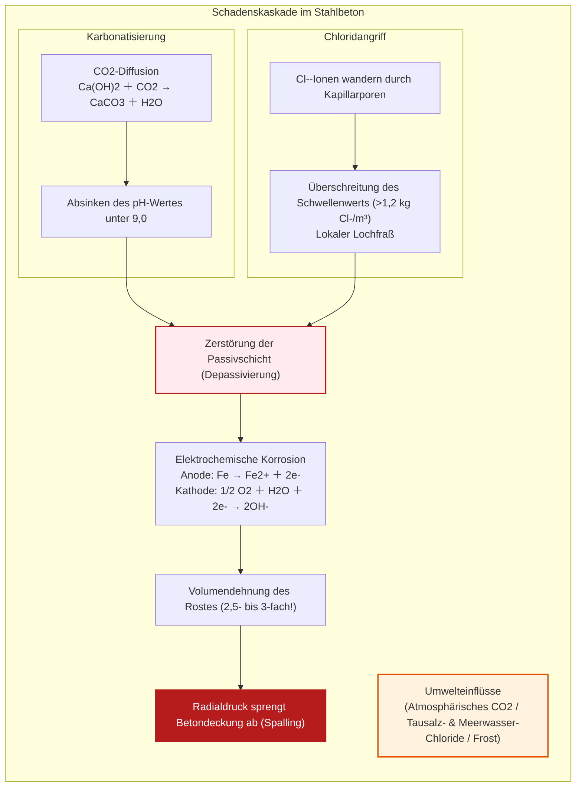
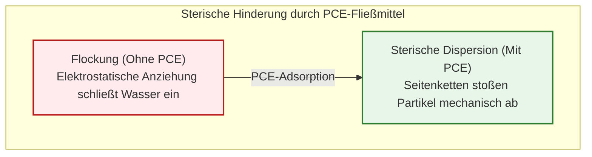
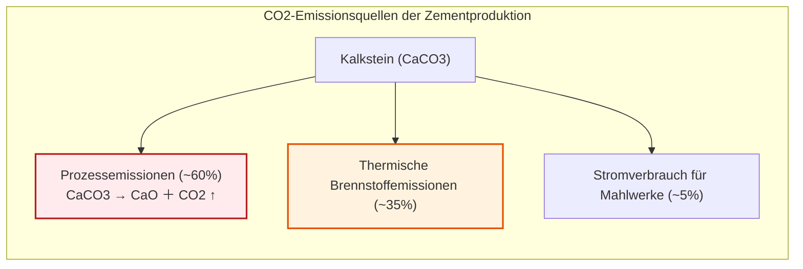

## Einleitung: Der von der Menschheit am zweithäufigsten verbrauchte Stoff

Die weltweiten Autobahntrassen, gewaltige Pfeiler von Hängebrücken über Meeresengen, die Erschütterungen trotzenden Kerne moderner Wolkenkratzer und kolossale Talsperren: Das physische Fundament der modernen Zivilisation besteht nahezu ausnahmslos aus einem künstlichen Gestein – dem **Beton (Concrete)**.

Beton ist nach Wasser der **am zweithäufigsten verbrauchte Stoff der Menschheit**. Mit einem globalen Jahresverbrauch von über 30 Milliarden Tonnen (rund 14 Milliarden Kubikmetern) verbraucht jeder Erdenbürger statistisch etwa 4 Tonnen Beton pro Jahr. Selbst die weltweite Gesamtproduktion von Stahl, Holz, Kunststoff und Glas zusammengenommen erreicht nicht annähernd die gewaltige Masse des jährlich verbauten Betons.

Dennoch unterliegt dieser allgegenwärtige Werkstoff einem weit verbreiteten Alltagsirrtum: Viele glauben, Beton sei ein Gemisch aus Kies, Sand und Zementleim, das schlicht „austrocknet und dadurch aushärtet“.

Aus Sicht der Werkstoffchemie und Thermodynamik ist diese Annahme **grundlegend falsch**.

Beton **erhärtet keineswegs durch Austrocknen**. Wird frischer Beton vorzeitig der Austrocknung preisgegeben, bricht die Festigkeitsentwicklung abrupt ab und das Gefüge zerbröckelt sandig. Das Erstarren beruht vielmehr auf einer exothermen chemischen Kristallisationsreaktion, bei der Klinkermineralien mit Wassermolekülen reagieren und ein mikroskopisches Geflecht nanoskaliger Kristallphasen ausbilden – der **Hydratationsreaktion (Hydration Reaction)**. Unter Wasser vollkommen von Luft abgeschlossen erhärtet Beton sogar zu noch höherer Dichte und Druckfestigkeit als an trockener Luft.

Zudem existiert ein faszinierendes historisches Paradoxon: Während modernen Stahlbetonbauwerken meist eine Lebensdauer von 50 bis 100 Jahren zugeschrieben wird, überdauern das unbewehrte Betondom des Pantheons in Rom und antike römische Hafenmolen seit über 2000 Jahren Wind, Erdbeben und Meerwasser – völlig ohne Stahlbewehrung.

---

## Kapitel 1: Das zweitausendjährige Wunder Roms – Opus Caementicium

Das bedeutendste antike Zeugnis des Betonbaus ist das unter Kaiser Hadrian um 126 n. Chr. vollendete Pantheon in Rom mit seiner unbewehrten Betonkuppel von **43,3 Metern Innendurchmesser**. Bis heute ist sie die **größte unbewehrte Massivbetonkuppel der Erde**.

Römische Baumeister staffelten die Zuschläge nach ihrer Dichte: Schwerer Basalt unten, poröser schwimmfähiger Bimsstein oben, wodurch die Schalenstärke von 6,4 m auf 1,2 m reduziert wurde.

### 1.1 Hot Mixing und selbstheilende Kalkstein-Einschlüsse

Neuere MIT-Forschungen zeigten, dass die Römer ungelöschten Branntkalk ($\text{CaO}$) direkt mit Puzzolanerde mischten („Hot Mixing“):

$$\text{CaO} + \text{H}_2\text{O} \to \text{Ca(OH)}_2 + 63{,}7\ \text{kJ/mol}$$

Die enorme Reaktionswärme ($> 80^\circ\text{C}$) hinterließ mikroskopische weiße Kalkeinschlüsse (*Lime Clasts*). Dringt Wasser in entstehende Haarrisse ein, lösen sich diese Kalkeinschlüsse und rekristallisieren als Calcit ($\text{CaCO}_3$), wodurch Risse autogen versiegelt werden.

Im Meerwasser reagierte Puzzolan zudem über Jahrhunderte zu seltenem **Al-Tobermorit**, wodurch antike Molen im Wellenschlag kontinuierlich an Festigkeit gewannen.

---

## Kapitel 2: Zementhydratation – Warum Wasser zu Stein wird

1824 patentierte Joseph Aspdin den **Portlandzement**, der durch Brennen von Kalkstein und Ton bei $1450^\circ\text{C}$ hergestellt wird.

| Klinkerphase | Zementchemie | Chemische Formel | Anteil | Funktion & Kinetik |
| :--- | :--- | :--- | :--- | :--- |
| **Alit** | **$C_3S$** | $\text{Ca}_3\text{SiO}_5$ | $50 \sim 70\%$ | Schnelle Hydratation; liefert Früh- und 28-Tage-Festigkeit |
| **Belit** | **$C_2S$** | $\text{Ca}_2\text{SiO}_4$ | $15 \sim 30\%$ | Langsame Reaktion; sichert kontinuierliche Nacherhärtung |
| **Aluminat** | **$C_3A$** | $\text{Ca}_3\text{Al}_2\text{O}_6$ | $5 \sim 10\%$ | Äußerst reaktionsfreudig; Gipszusatz verhindert das „Erstarren im Flug“ |
| **Ferrat** | **$C_4AF$** | $\text{Ca}_4\text{Al}_2\text{Fe}_2\text{O}_{10}$ | $5 \sim 15\%$ | Mäßige Kinetik; Sulfatbeständigkeit, graue Farbe |

### 2.1 Die Hydratationsgleichungen und C-S-H-Gel

$$2 C_3S + 6 H_2O \to C_3S_2H_3 \text{ (C-S-H-Gel)} + 3 Ca(OH)_2 \text{ (Portlandit)} + \Delta H$$

$$2 C_2S + 4 H_2O \to C_3S_2H_3 \text{ (C-S-H-Gel)} + Ca(OH)_2 + \Delta H$$

- **C-S-H-Gel**: Nanoskalige Blättchen, die über van-der-Waals-Kräfte **über 80 % der mechanischen Festigkeit** bereitstellen.
- **Portlandit ($\text{Ca(OH)}_2$)**: Schafft ein hochalkalisches Milieu von **$\text{pH} = 12{,}5 \sim 13{,}5$**, das den Bewehrungsstahl vor Rost schützt.

Nach Abrams' Gesetz ($f_c = A / B^{W/Z}$) sinkt die Festigkeit mit steigendem Wasser-Zement-Wert ($W/Z$). Überschüssiges freies Wasser hinterlässt Kapillarporen.

---

## Kapitel 3: Stahl und Stein – Das Wunder des Stahlbetons

Beton besitzt nur etwa ein Zehntel seiner Druckfestigkeit als Zugfestigkeit. Der **Stahlbeton (Reinforced Concrete)** beruht auf drei physikalischen Übereinstimmungen:

```mermaid
flowchart TD
    subgraph MiraculousSynergy["Die drei Wunder des Stahlbeton-Verbunds"]
        direction TB
        
        subgraph Thermal["Wunder 1: Thermische Dehnungsparität"]
            ExpConcrete["Beton-Wärmedehnungskoeffizient<br/>α ≈ 1.0 × 10^-5 /K"]
            ExpSteel["Stahl-Wärmedehnungskoeffizient<br/>α ≈ 1.2 × 10^-5 /K"]
            ThermalResult["Bei -30°C bis +50°C keine inneren Scherspannungsbrüche!"]
            ExpConcrete --- ExpSteel --> ThermalResult
        end
        
        subgraph Mechanical["Wunder 2: Kraftaufteilung"]
            Comp["Beton übernimmt alle Druckkräfte"]
            Tens["Bewehrungsstahl übernimmt alle Zugkräfte"]
            Adhesion["Rippenstahl überträgt Scherkräfte formschlüssig"]
            Comp --- Tens --> Adhesion
        end
        
        subgraph Chemical["Wunder 3: Passivierungsschicht"]
            Alkali["Gesättigtes Ca(OH)2-Milieu<br/>pH-Wert 12,5 bis 13,5"]
            PassiveFilm["Nanometerdünne Passivschicht<br/>aus γ-Fe2O3 schützt den Stahl"]
            CorrosionStop["Absoluter Korrosionsstopp unter intaktem Beton!"]
            Alkali --> PassiveFilm --> CorrosionStop
        end
    end
    
    style ThermalResult fill:#e1f5fe,stroke:#0288d1,stroke-width:2px
    style Adhesion fill:#fff3e0,stroke:#e65100,stroke-width:2px
    style CorrosionStop fill:#e8f5e9,stroke:#2e7d32,stroke-width:2px
```

---

## Kapitel 4: Pathologie des Betonzerfalls

1. **Karbonatisierung**: $\text{CO}_2$ wandelt $\text{Ca(OH)}_2$ in $\text{CaCO}_3$ um; der pH-Wert sinkt unter 9, wodurch der Stahl depassiviert wird. Die Tiefe folgt dem Wurzel-Zeit-Gesetz: $x = A \sqrt{t}$.
2. **Rostexpansion & Abplatzung (Spalling)**: Rost dehnt sich um das **2,5- bis 3-Fache** aus und erzeugt interne Sprengdrücke von mehreren Dutzend MPa.
3. **Chloridangriff**: $\text{Cl}^-$-Ionen zerstören die Passivschicht lokal und verursachen tückischen Lochfraß (*Pitting*).
4. **Alkali-Kieselsäure-Reaktion (AKR)**: „Betonkrebs“ durch quellendes Alkalisilikatgel.

---

## Kapitel 5: Ultrahochfester Beton (UHPC)

Polycarboxylatether-Fließmittel (PCE) ermöglichen durch sterische Hinderung Wasser-Zement-Werte unter 0,20.

UHPC verzichtet auf Grobzuschläge, nutzt feinsten Silikastaub und hochfeste Stahlfasern, um Druckfestigkeiten von **$150 \sim 220\ \text{MPa}$** zu erreichen – bei absoluter Dichtigkeit gegen Schadstoffe.

---

## Kapitel 6: Dekarbonisierung und Zukunft

Zement verursacht ca. **8 % der weltweiten Treibhausgase**. Rund 60 % davon entfallen unvermeidbar auf die Entsäuerung des Kalksteins ($\text{CaCO}_3 \to \text{CaO} + \text{CO}_2 \uparrow$).

Lösungsansätze umfassen:
- **Klinkersubstitution**: Hüttensand (GGBS) und Flugasche verringern den Klinkeranteil um 50–70 %.
- **CO2-Mineralisierung**: Gezieltes Einleiten von $\text{CO}_2$ bindet über 100 kg Kohlenstoff pro Kubikmeter dauerhaft als Kalkstein.
- **Bio-Beton**: Bakterien (*Bacillus*) scheiden bei Risseintritt Calcit aus und heilen Risse bis zu 1 mm eigenständig.

---

## Fazit: Der künstliche Fels der Menschheit

Beton ist kein lebloser grauer Schlamm, sondern eine faszinierende mineralogische Hochleistung. Im Zeitalter der Klimawende wird er vom CO2-Verursacher zum Kohlenstoffspeicher transformiert, der das Fundament künftiger Generationen sichert.
