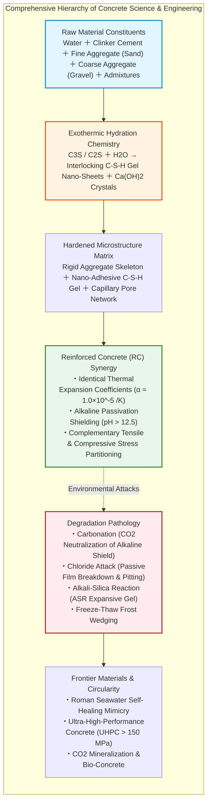
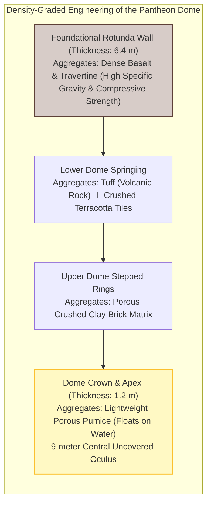
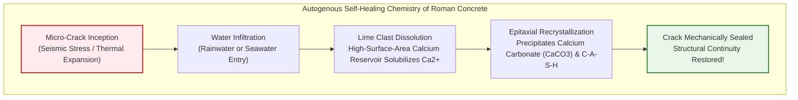
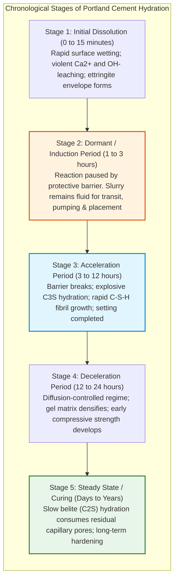
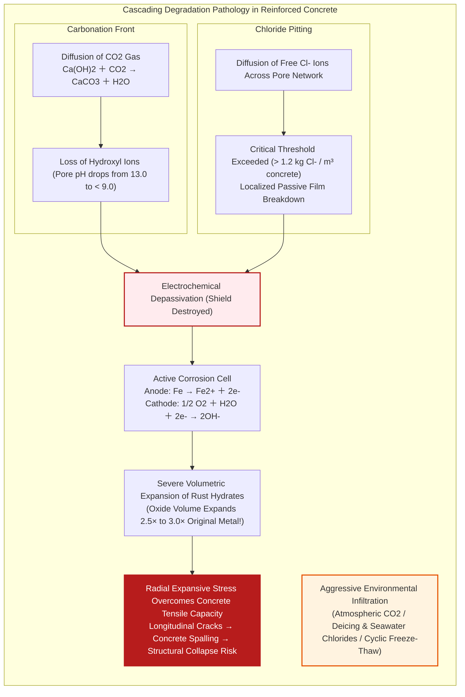
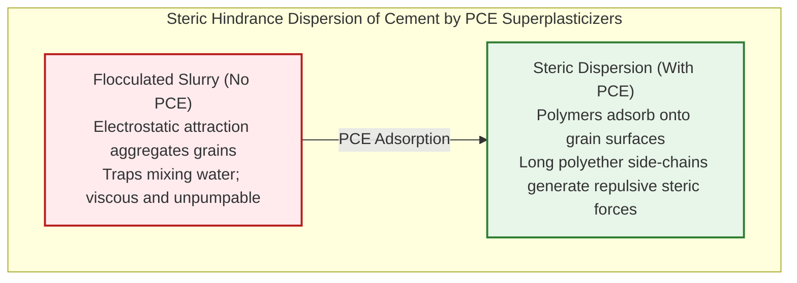
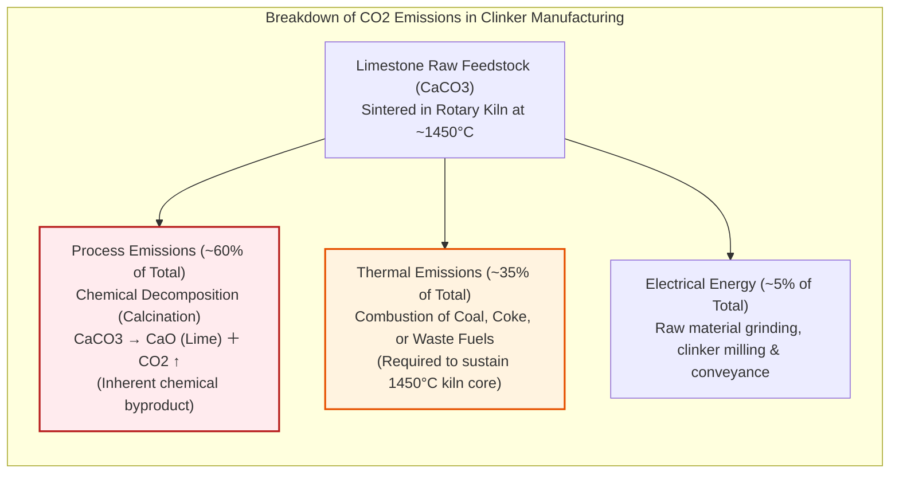

## Introduction: The Substance Humanity Consumes Second Only to Water

The paved ribbons of highway crisscrossing continents, the monumental piers anchoring suspension bridges over ocean straits, the monolithic cores of towering skyscrapers piercing the cloud layer, and the colossal gravity dams holding back millions of tons of river water—all share a common geological foundation: a synthetic rock known as **concrete**.

Concrete is the **second most consumed substance on Earth by humanity, surpassed only by water**. Global consumption exceeds thirty billion metric tons annually (approximately fourteen billion cubic meters). Every man, woman, and child on the planet effectively consumes roughly four metric tons of concrete each year. Even if you combine the global production of structural steel, timber, plastics, and glass, their aggregate mass remains a modest fraction of the staggering tonnage of concrete poured into the Earth's crust every year.

Yet, despite its ubiquitous presence, the broader public harbors a fundamental misconception regarding its mechanical nature: the belief that concrete is formed by mixing gravel and sand with an aqueous cement slurry that simply "dries out and hardens" as water evaporates into thin air.

From the perspectives of inorganic chemistry, thermodynamics, and materials science, this intuition is **fundamentally false**.

Concrete **does not harden by drying**. In fact, if concrete is allowed to dry out prematurely, its internal structure ceases developing strength, disintegrating into a porous, chalky matrix. Concrete solidifies through **hydration reactions**—a complex, exothermic chemical cascade wherein anhydrous calcium silicate minerals react directly with water molecules to precipitate a dense, interlocking network of nanoscale crystalline hydrates. Submerged deep underwater, completely isolated from ambient air, concrete not only cures to perfection, but achieves greater density and compressive strength than it ever could in an open, dry environment.

Furthermore, an intriguing historical paradox confronts civil engineers: while modern reinforced concrete structures are typically engineered for design life spans of fifty to one hundred years before requiring aggressive remediation or demolition, the unreinforced concrete dome of the Roman Pantheon and ancient Mediterranean maritime piers have endured for over two millennia. Battered by centuries of saline seawater, violent earthquakes, and weather, these ancient structures not only remain standing, but have grown structurally stronger with age.

Why does concrete set? Why has Roman concrete survived two thousand years without steel rebar? And why do contemporary reinforced concrete megastructures succumb to carbonation, chloride attack, and structural cancer?

This treatise examines the lifecycle of artificial stone—from the *opus caementicium* of ancient imperial Rome to ultra-high-performance concrete (UHPC) and carbon-negative bio-engineered materials—dissecting its physics, molecular chemistry, and mechanical engineering.

---

## Chapter 1: The Two-Millennium Miracle of Rome—Opus Caementicium

In the annals of architectural engineering, no material commands greater awe and curiosity than **opus caementicium (Roman concrete)**.

Contemporary observers frequently witness modern infrastructure developing cracks, spalling, and succumbing to rebar corrosion within several decades of commissioning. In stark contrast, the Roman Pantheon—commissioned during the reign of Emperor Augustus and rebuilt by Hadrian around 126 CE—features an unreinforced monolithic concrete dome that has survived intact across nineteen centuries without modern tensile reinforcement.

### 1.1 The Engineering Marvel of the Pantheon Dome

The hemispherical dome of the Pantheon spans an interior diameter of **43.3 meters (142 feet)**, matching exactly its interior ceiling height from floor to oculus—a geometry capable of circumscribing a perfect sphere within its internal void.

To this day, it remains the **largest unreinforced solid concrete dome on planet Earth**.

Under elementary mechanics of materials, an unreinforced concrete dome of this colossal span should be an engineering impossibility. Concrete has notoriously low tensile resistance; under gravity dead loads, the outwards hoop stresses and radial bending moments at the lower haunches should generate catastrophic vertical tensile cracks, causing the lateral supporting rotunda walls to burst outwards and the entire dome to collapse inward.

Roman engineers circumvented structural failure through a sophisticated empirical mastery of **density-graded materials science**:
1. **Graded Aggregate Specific Gravity (Density Stratification)**:
   At the base of the rotunda, the supporting drum walls are 6.4 meters thick, cast with dense, heavy volcanic basalt and hard travertine aggregates. As the dome rises toward the zenith, the aggregate selection transitions progressively: from solid tuff to crushed terracotta bricks, culminating at the apex with **scoria and pumice**—a vesicular volcanic glass so porous it floats on water. The dome's shell thickness tapers from 6.4 meters at the springing to a mere 1.2 meters at the top.
2. **The 9-Meter Oculus**:
   By leaving a nine-meter circular aperture open at the crown, Roman builders eliminated the massive deadweight that would otherwise occupy the highest structural moment arm.

Yet, beyond structural geometry, the most profound secret resided within the chemistry of the binder itself: **Roman concrete does not decay over time; it actively heals and gains strength.**

### 1.2 Pozzolana and the Chemistry of Hot Mixing

Recent high-resolution synchrotron X-ray diffraction, spectroscopic imaging, and electron microscopy conducted by international research teams (notably from MIT and Lawrence Berkeley National Laboratory) have unlocked the chemical secrets of Roman mortar.

Roman builders combined volcanic tephra from the Pozzuoli region near the Bay of Naples (**pozzolana**) with lime derived from calcinated limestone.

Historical consensus long held that Romans slaked their quicklime ($\text{CaO}$) with water first to produce a hydrated lime putty ($\text{Ca(OH)}_2$), which was subsequently stirred into volcanic ash. However, 2023 discoveries revealed that the Romans employed **"hot mixing"**: dry quicklime was blended directly with volcanic ash and aggregates before adding water.

When water is added directly to unslaked quicklime, an intensely exothermic hydration reaction erupts:

$$\text{CaO} + \text{H}_2\text{O} \to \text{Ca(OH)}_2 + 63.7\ \text{kJ/mol}$$

The heat generated drives localized internal temperatures above $80^\circ\text{C}$ to $100^\circ\text{C}$. This thermal spike dramatically alters reaction kinetics, accelerating the dissolution of volcanic silica and leaving behind macroscopic white mineral inclusions known as **"lime clasts"** dispersed throughout the mortar.

These lime clasts serve as functional reservoirs of reactive calcium. Whenever micro-cracks propagate through the concrete matrix, moisture infiltrates the crack channel and contacts the lime clast. The clast dissolves, releasing a saturated solution of calcium ions ($\text{Ca}^{2+}$), which reacts with atmospheric carbon dioxide or dissolved carbonates to precipitate **calcium carbonate ($\text{CaCO}_3$) crystals**, sealing the fissure autogenously within days.

### 1.3 Marine Self-Healing: The Growth of Al-Tobermorite

The maritime breakwaters and harbor piers built by the Romans in coastal sites such as Portus Cosanus have survived submerged in turbulent seawater for over twenty-two centuries.

In modern Portland cement, seawater is a catastrophic degradation agent: magnesium and sulfate ions trigger expansive ettringite formation and decalcify the binding matrix into friable magnesium silicate hydrates.

In Roman marine concrete, seawater acts as a **catalytic strengthening agent**.

As alkaline seawater percolates through the porous volcanic ash matrix containing leucite and volcanic glass, it gradually dissolves aluminosilicate minerals. Over decades and centuries, this ongoing hydrothermal process precipitates rare interlocking crystals of **aluminous tobermorite (Al-Tobermorite: $\text{Ca}_5\text{Si}_5\text{Al}(\text{OH})\text{O}_{17} \cdot 5\text{H}_2\text{O}$)** and **phillipsite**.

These sheet-silicate crystals grow directly inside voids and micro-cracks, reinforcing the matrix and enhancing shear strength under continuous hydrodynamic wave action.

---

## Chapter 2: Molecular Mechanics of Cement Hydration—Why Concrete Does Not "Dry"

The industrial revolution transformed cement chemistry. In 1824, an English stonemason named Joseph Aspdin patented a synthetic hydraulic binder produced by firing pulverized limestone and clay in a kiln, naming it **Portland Cement** due to its aesthetic resemblance to the fine building stone quarried on the Isle of Portland in Dorset.

Modern Portland cement is an artificial silicate mineral aggregate synthesized to achieve rapid setting, high early compressive strength, and uniform mechanical consistency.

### 2.1 The Four Primary Clinker Mineral Phases

When limestone ($\text{CaCO}_3$) and aluminosilicate clays ($\text{SiO}_2, \text{Al}_2\text{O}_3, \text{Fe}_2\text{O}_3$) are blended and heated to sintering temperatures around $1450^\circ\text{C}$ in industrial rotary kilns, decarbonation and partial melting yield hard, nodular pellets known as **cement clinker**.

Using standard cement chemistry notation (where $C = \text{CaO}$, $S = \text{SiO}_2$, $A = \text{Al}_2\text{O}_3$, $F = \text{Fe}_2\text{O}_3$, and $H = \text{H}_2\text{O}$), the clinker comprises four essential mineral phases:

| Mineral Name | Cement Chem Notation | Chemical Composition | Mass Fraction | Kinetic Role & Hydration Characteristics |
| :--- | :--- | :--- | :--- | :--- |
| **Alite** | **$C_3S$** | $\text{Ca}_3\text{SiO}_5$ (Tricalcium Silicate) | $50 \sim 70\%$ | Rapid hydration. Dominates early-to-mid strength gain (1 to 28 days). High heat of hydration. |
| **Belite** | **$C_2S$** | $\text{Ca}_2\text{SiO}_4$ (Dicalcium Silicate) | $15 \sim 30\%$ | Slow, prolonged hydration. Governs long-term strength gain (months to decades). Low heat evolution. |
| **Aluminate** | **$C_3A$** | $\text{Ca}_3\text{Al}_2\text{O}_6$ (Tricalcium Aluminate) | $5 \sim 10\%$ | Violent flash-setting kinetics. Responsible for initial setting behavior and early heat generation. |
| **Ferrite** | **$C_4AF$** | $\text{Ca}_4\text{Al}_2\text{Fe}_2\text{O}_{10}$ (Tetracalcium Aluminoferrite) | $5 \sim 15\%$ | Moderate reaction rate. Enhances sulfate resistance and imparts characteristic gray coloration. |

If pure $C_3A$ is mixed with water, it hydrates violently within minutes, locking the paste in a rigid state—a catastrophic failure mode termed **flash set**. To prevent this, clinker nodules are ground together with a critical fraction ($3 \sim 5\%$) of **calcium sulfate dihydrate (gypsum: $\text{CaSO}_4 \cdot 2\text{H}_2\text{O}$)**. Soluble sulfate ions instantly suppress $C_3A$ reactivity by precipitating a protective passivating barrier of ettringite needles around the aluminate grains.

### 2.2 Hydration Reactions and the Birth of C-S-H Gel

The instant water contacts dry cement particles, an intricate chain of chemical transformations commences.

The mechanical strength of concrete is derived primarily from the hydration of alite ($C_3S$) and belite ($C_2S$):

$$2 C_3S + 6 H_2O \to C_3S_2H_3 \text{ (C-S-H gel)} + 3 Ca(OH)_2 \text{ (Portlandite)} + \Delta H$$

$$2 C_2S + 4 H_2O \to C_3S_2H_3 \text{ (C-S-H gel)} + Ca(OH)_2 + \Delta H$$

These stoichiometric reactions yield two distinct phases:
1. **Calcium Silicate Hydrate Gel (C-S-H Gel)**:
   An amorphous-to-semicrystalline colloidal gel characterized by a variable stoichiometry ($\text{Ca/Si} \approx 1.5 \sim 2.0$). It precipitates as nanoscale sheets, fibrils, and agglomerates radiating outward from cement clinker grains. Driven by high surface area and van der Waals attraction, these nanostructures entangle and cross-link with neighboring grains, fusing sand and gravel into monolithic stone. **Over 80% of concrete's mechanical cohesive strength originates within this C-S-H nano-glue.**
2. **Portlandite ($\text{Ca(OH)}_2$)**:
   Hexagonal prismatic crystals that precipitate alongside C-S-H. While contributing minimally to tensile and shear strength, portlandite buffers the capillary pore solution to a **highly basic pH of $12.5 \sim 13.5$**.

### 2.3 Water-Cement Ratio and Abrams' Law

In concrete proportioning, the single most critical parameter governing compressive strength and permeability is the **water-cement ratio ($W/C$ or $w/c$)**.

Stoichiometrically, fully hydrating Portland cement requires approximately **0.25 kg of water per 1.0 kg of cement** (chemically bound water). An additional **0.15 kg of water** is adsorbed within the gel pores, meaning a total $W/C$ of roughly **0.40** provides complete chemical hydration.

Historically, however, unadulterated concrete mixtures at $W/C = 0.40$ were too stiff and viscous to be worked and placed around dense steel reinforcement. Builders added surplus water (free water) to achieve fluidity.

In 1918, Duff Abrams formulated the empirical relationship governing this trade-off, known as **Abrams' Law**:

$$f_c = \frac{A}{B^{W/C}}$$

Where $f_c$ is 28-day compressive strength, and $A$ and $B$ are constants.

Surplus water not consumed in hydration remains trapped in the matrix. As this excess water evaporates or bleeds outward, it leaves behind an interconnected labyrinth of **capillary pores ($10\ \text{nm} \sim 10\ \mu\text{m}$)**. Higher capillary porosity reduces solid cross-sectional area, degrading compressive strength and providing permeable channels for destructive environmental ions.

---

## Chapter 3: The Miraculous Marriage—Reinforced Concrete (RC)

Unreinforced concrete is a brittle stone: capable of supporting immense compressive forces, it fails abruptly under tension. In general engineering practice, concrete's **tensile strength is merely one-tenth ($8\% \sim 12\%$) of its compressive strength**.

Under transverse bending, an unreinforced concrete beam experiences extreme tension along its bottom face. Long before the top compressive zone approaches its capacity, micro-cracks coalesce at the bottom, causing instantaneous catastrophic fracture.

The solution emerged in the mid-19th century with the development of **Reinforced Concrete (RC)**, pioneered by French innovators including Joseph-Louis Lambot, François Coignet, and Joseph Monier.

Embedding steel bars (rebar) inside a cast mineral slurry appears deceptively straightforward. Yet, beneath this simple composite lies a series of **three extraordinary physical and chemical coincidences**:

```mermaid
flowchart TD
    subgraph MiraculousSynergy["The Triple Coincidence Underpinning Reinforced Concrete"]
        direction TB
        
        subgraph Thermal["Coincidence 1: Thermodynamic Compatibility"]
            ExpConcrete["Concrete Coefficient of Thermal Expansion<br/>α ≈ 1.0 × 10^-5 /K"]
            ExpSteel["Carbon Steel Rebar Expansion<br/>α ≈ 1.2 × 10^-5 /K"]
            ThermalResult["Thermal Strain Parity Across -30°C to +50°C<br/>Zero Internal Interfacial Shear Rupture!"]
            ExpConcrete --- ExpSteel --> ThermalResult
        end
        
        subgraph Mechanical["Coincidence 2: Mechanical Complementarity"]
            Comp["Concrete Bears Compressive Forces<br/>(Economical, Fire-Resistant Mass)"]
            Tens["Steel Bears All Tensile Stresses<br/>(Ductility, Yield Strength fy > 400 MPa)"]
            Adhesion["Deformed Rebar Ribs Interlock Mechanically<br/>(High Shear Stress Transfer Across Interface)"]
            Comp --- Tens --> Adhesion
        end
        
        subgraph Chemical["Coincidence 3: Electrochemical Passivation Shield"]
            Alkali["Saturated Ca(OH)2 Pore Solution<br/>Hyper-Alkaline Medium (pH 12.5 to 13.5)"]
            PassiveFilm["Spontaneous Formation of Nanometer-Thin<br/>Gamma-Fe2O3 Passive Oxide Layer"]
            CorrosionStop["Complete Corrosion Immunity:<br/>Rebar Remains Pristine Despite Moisture & Oxygen!"]
            Alkali --> PassiveFilm --> CorrosionStop
        end
    end
    
    style ThermalResult fill:#e1f5fe,stroke:#0288d1,stroke-width:2px
    style Adhesion fill:#fff3e0,stroke:#e65100,stroke-width:2px
    style CorrosionStop fill:#e8f5e9,stroke:#2e7d32,stroke-width:2px
```

### 3.1 Thermodynamic Parity: Thermal Expansion Coefficients

Had steel and concrete possessed divergent thermal expansion rates, reinforced concrete could not exist as a durable composite.

| Material | Coefficient of Linear Thermal Expansion $\alpha$ ($10^{-6}/\text{K}$) | Behavioral Characteristics in Composite Action |
| :--- | :--- | :--- |
| **Structural Concrete** | **$10 \sim 12$** | Composed of rock aggregates and C-S-H binder |
| **Carbon Steel Rebar** | **$12$** | Low-carbon structural alloy |
| Structural Aluminum | $23$ | Expands twice as fast; causes interfacial debonding |
| Structural Glass | $3 \sim 9$ | Stiff and brittle; fractures under thermal gradient |
| Timber (Longitudinal) | $3 \sim 5$ | Anisotropic thermal response accompanied by moisture swelling |

The thermal expansion coefficients of structural concrete and mild steel are **virtually identical ($\alpha \approx 1.0 \sim 1.2 \times 10^{-5}\ /\text{K}$)**.

Under scorching summer sun ($+40^\circ\text{C}$) or deep winter freezes ($-20^\circ\text{C}$), steel rebar and surrounding concrete expand and contract in near-perfect mechanical harmony. No internal shear stresses develop at their interface to destroy bonding.

### 3.2 Mechanical Stress Partitioning and Fire Protection

In standard RC flexural theory, structural engineers operate on the assumption that concrete on the tension side of the neutral axis will crack under service loads.

Tensile resistance of the cracked concrete is mathematically discounted; the full tensile force is transferred to the embedded steel reinforcement:

$$M = A_s \cdot f_y \cdot j \cdot d$$

Where $A_s$ is steel cross-sectional area, $f_y$ is yield strength, $d$ is effective depth, and $j \cdot d$ represents the internal lever arm between the center of compression and tension.

In return, concrete envelops the steel rebar, offering low thermal conductivity that insulates the steel against fire-induced loss of yield strength, while providing continuous lateral restraint that prevents slender steel rods from buckling under compression.

### 3.3 The Pourbaix Mechanism: The Alkaline Passivation Shield

Iron is thermodynamically predisposed to revert to iron oxides (rust) in the presence of ambient humidity and atmospheric oxygen. Why, then, does steel rebar embedded in moist concrete not corrode into dust within months?

The explanation lies in the **Pourbaix Diagram (Potential-pH Equilibrium)** of iron.

Because the cement hydration process saturates pore fluid with calcium hydroxide ($\text{Ca(OH)}_2$) and minor alkali hydroxides ($\text{NaOH}, \text{KOH}$), the internal liquid environment maintains a **hyper-alkaline pH of $12.5$ to $13.5$**.

Under this high pH, iron undergoes spontaneous surface oxidation to form a continuous, nanometer-thin ($1 \sim 3\ \text{nm}$) film of **gamma-ferric oxide ($\gamma\text{-Fe}_2\text{O}_3$) and magnetite ($\text{Fe}_3\text{O}_4$)**.

This barrier is the **passive film (passivation layer)**. It seals all active iron sites, suppressing metal dissolution rates to negligible levels ($< 0.1\ \mu\text{m/year}$). As long as the concrete maintains its alkaline chemistry, embedded rebar remains electrochemically immune to corrosion.

---

## Chapter 4: The Pathology of Degradation—Why Modern Concrete Fails

Despite its robust mechanical properties, modern reinforced concrete is not immortal. Civil infrastructure worldwide faces maintenance deficits due to four primary degradation mechanisms:

### 4.1 Carbonation: Atmospheric De-Alkalization

The alkaline buffer protecting steel rebar is vulnerable to the trace concentration of carbon dioxide ($\text{CO}_2$, approximately $0.042\%$ or $420\ \text{ppm}$) present in Earth's atmosphere.

Gaseous $\text{CO}_2$ diffuses into concrete's unsaturated capillary pore system, dissolves into pore moisture, and forms carbonic acid ($\text{H}_2\text{CO}_3$). This acid neutralizes the calcium hydroxide reserve:

$$\text{Ca(OH)}_2 + \text{CO}_2 \to \text{CaCO}_3 + \text{H}_2\text{O}$$

This neutralization process is **carbonation**.

As $\text{Ca(OH)}_2$ is converted to insoluble calcite ($\text{CaCO}_3$), the pH of the pore fluid plummets from **$13.0$ down to below $8.5 \sim 9.0$**. Once pH drops below $11.5$, the gamma-ferric oxide passivation film destabilizes and dissolves.

Under Fickian diffusion models, the carbonation depth $x$ advances proportionally to the **square root of exposure time $t$** (the root-$t$ law):

$$x = A \sqrt{t}$$

Where $A$ is the carbonation coefficient, dictated by concrete porosity (water-cement ratio), environmental relative humidity (peaking around $50\% \sim 65\%$), and atmospheric $\text{CO}_2$ concentration.

Once the carbonation front penetrates through the **concrete cover** (the $30 \sim 50\ \text{mm}$ layer of unreinforced concrete encasing the rebar), corrosion initiates.

### 4.2 Rust Volumetric Expansion and Spalling

Corrosion of steel within concrete is damaging not merely due to the reduction of rebar tensile area, but because **corrosion products occupy 2.5 to 3.5 times the volume of the pristine steel consumed**.

Constrained within a rigid, low-ductility concrete matrix, the swelling ferric rust generates internal radial tensile stresses exceeding **$30 \sim 50\ \text{MPa}$**.

Because concrete's tensile strength rarely exceeds $3 \sim 4\ \text{MPa}$, the internal bursting pressure rapidly exceeds the matrix capacity. Longitudinal cracking propagates parallel to the rebar cage, culminating in **delamination and spalling**—the violent fracturing and detachment of concrete chunks, leaving exposed rebar unprotected against accelerated atmospheric decay.

### 4.3 Chloride Attack: Pitting Corrosion

In coastal maritime environments and highway bridges treated with winter deicing salts ($\text{NaCl}, \text{CaCl}_2$), the primary threat is **chloride-induced corrosion**.

Chloride ions ($\text{Cl}^-$) possess a small ionic radius and high diffusivity. Even when the concrete maintains a high alkaline pH ($> 12.5$), once the concentration of free chloride ions adjacent to the steel crosses the **critical chloride threshold** (approximately **$1.2\ \text{kg of Cl}^-$ per cubic meter of concrete**, or $0.4\%$ by weight of cement), chlorides attack the passive oxide film:

$$\text{Fe} + 2\text{Cl}^- \to \text{FeCl}_2 + 2e^-$$

$$\text{FeCl}_2 + 2\text{H}_2\text{O} \to \text{Fe(OH)}_2 + 2\text{HCl} + 2e^-$$

Crucially, **chloride ions are not consumed in the corrosion process**. They act as regenerative catalysts, generating localized hydrochloric acid ($\text{HCl}$) that creates micro-acidic pits.

This initiates **pitting corrosion**: severe, concentrated section loss focused at localized points along the bar, while surrounding steel appears pristine. A rebar can lose half its cross-sectional load capacity with zero warning cracks on the external concrete surface, creating risks of sudden brittle failure.

### 4.4 Alkali-Silica Reaction (ASR) and Freeze-Thaw Wedging

1. **Alkali-Silica Reaction (ASR)**: Known colloquially as "concrete cancer." Reactive amorphous silica minerals in aggregates (such as opal, chalcedony, or strained quartz) react with potassium and sodium alkali hydroxides ($\text{Na}^+, \text{K}^+, \text{OH}^-$) leached from high-alkali cement. The reaction precipitates an **alkali-silica gel**. Upon absorbing moisture, this gel expands volumetrically, developing internal swelling pressures that shatter the concrete matrix from within, producing characteristic pattern cracking.
2. **Freeze-Thaw Cycling**: In sub-zero climates, water freezing within capillary pores undergoes a **$9\%$ volumetric expansion**. If the water saturation degree exceeds the critical saturation threshold ($91.7\%$), hydraulic pressure generates micro-fracturing. Successive freeze-thaw cycles cause progressive surface scaling and aggregate pop-outs. This is mitigated by **Air-Entraining (AE) agents**, which introduce trillions of microscopic air bubbles ($20 \sim 200\ \mu\text{m}$) that serve as expansion relief chambers.

---

## Chapter 5: Frontier Materials—Ultra-High Performance Concrete (UHPC)

Modern materials science has engineered high-performance formulations that eliminate internal defects and transcend traditional durability limitations.

### 5.1 Polycarboxylate Superplasticizers (PCE) and Packing Density

The fundamental rule of modern high-performance concrete is: **minimize capillary porosity by maximizing particle packing density**.

The introduction of **polycarboxylate ether (PCE) superplasticizers** in the 1980s revolutionized concrete mixing.

Traditional cement grains suspended in water naturally flocculate due to electrostatic Van der Waals attractions, trapping large volumes of mixing water within agglomerations. PCE polymers feature a negatively charged backbone that adsorbs onto cement grains, while long, neutral polyether side chains extend into the aqueous phase, generating powerful **steric hindrance forces**.

This steric repulsion disperses individual cement grains, liberating trapped water and allowing formulations to achieve self-consolidating fluidity at ultra-low water-cement ratios ($W/C < 0.20$).

### 5.2 Ultra-High-Performance Concrete (UHPC)

By applying continuous particle packing theory across all size scales, engineers formulated **Ultra-High-Performance Concrete (UHPC)**:
- **Exclusion of Coarse Gravel**: Macro-aggregates, which create weak interfacial transition zones (ITZ), are eliminated in favor of fine quartz sand ($100 \sim 600\ \mu\text{m}$).
- **Silica Fume Densification**: Amorphous silica fume ($0.1\ \mu\text{m}$) fills the interstitial voids between cement grains while fueling secondary pozzolanic reactions that convert porous portlandite into dense C-S-H gel.
- **High-Strength Steel Micro-Fibers**: High-tensile brass-coated steel micro-fibers ($d \approx 0.2\ \text{mm}, L \approx 13\ \text{mm}$) are incorporated at $2\% \sim 3\%$ by volume.

| Engineering Property | Normal Concrete (NC) | Ultra-High-Performance Concrete (UHPC) | Performance Ratio |
| :--- | :--- | :--- | :--- |
| **Compressive Strength ($f'_c$)** | $25 \sim 40\ \text{MPa}$ | **$150 \sim 220\ \text{MPa}$** | **$5\times \sim 8\times$** (Approaching mild steel) |
| **Direct Tensile Strength ($f_t$)** | $2 \sim 3\ \text{MPa}$ | **$10 \sim 15\ \text{MPa}$** | **$5\times$** |
| **Fracture Energy (Toughness)** | $0.1\ \text{kJ/m}^2$ | **$20 \sim 30\ \text{kJ/m}^2$** | **$200\times \sim 300\times$** (Pseudo-ductile yield behavior) |
| **Chloride Ion Diffusion ($D_{\text{cl}}$)** | $1 \times 10^{-11}\ \text{m}^2/\text{s}$ | **$< 1 \times 10^{-13}\ \text{m}^2/\text{s}$** | **$< 1/100$** (Virtually impermeable) |

With compressive strength exceeding $200\ \text{MPa}$ and an internal structure devoid of interconnected capillary pores, UHPC structures resist environmental degradation for centuries with minimal maintenance.

---

## Chapter 6: Decarbonization and the Future of Concrete

The defining challenge facing 21st-century concrete engineering is its **carbon footprint**.

### 6.1 The 8% Climate Challenge: Calcination Chemistry

The cement industry contributes **$7\% \sim 8\%$ of total global anthropogenic greenhouse gas emissions**—roughly triple the emissions of the entire commercial aviation sector.

The primary obstacle in decarbonizing cement manufacturing is that the majority of emissions are not caused by fossil fuel combustion, but are an unavoidable consequence of the **stoichiometric chemical reaction** required to produce clinker:

Even if rotary kilns were energized entirely by clean hydrogen or solar thermal electricity, the calcination of limestone to obtain lime ($\text{CaO}$) inevitably releases one mole of gaseous $\text{CO}_2$ for every mole of calcium carbonate decomposed.

### 6.2 Supplementary Cementitious Materials (SCMs)

The most immediate strategy for carbon reduction is substituting clinker with industrial byproducts: **Ground Granulated Blast-Furnace Slag (GGBS)** from iron manufacturing and **Fly Ash** from coal-fired power plants.

These materials exhibit pozzolanic and latent hydraulic properties, consuming free calcium hydroxide to form durable C-S-H gel while reducing clinker content by up to $50\% \sim 70\%$, directly scaling back embodied carbon.

### 6.3 Carbon-Negative Mineralization and Curing

Modern precast engineering has pioneered **carbon-mineralized concrete** technologies (such as CO2-SUICOM and CarbonCure). During mixing or in dedicated curing chambers, high-purity recycled industrial $\text{CO}_2$ is injected into the fresh slurry:

$$\text{Ca}^{2+} + 2\text{OH}^- + \text{CO}_2 \to \text{CaCO}_3 \text{ (nano-calcite)} + \text{H}_2\text{O}$$

Rather than waiting for slow atmospheric carbonation, controlled carbonation curing precipitates nanoscale calcium carbonate crystals directly into micro-pores within hours. This accelerates early compressive strength while permanently sequestering more than $100\ \text{kg}$ of $\text{CO}_2$ per cubic meter as solid geological stone.

### 6.4 Biological Self-Healing: Bio-Concrete

Pioneered by Henk Jonkers at Delft University of Technology, **self-healing bio-concrete** integrates biological organisms into civil engineering.

During mixing, dormant endospores of alkali-resistant bacteria (such as *Bacillus pseudofirmus*) are encapsulated alongside nutrient precursors (calcium lactate) in biodegradable clay pellets:
1. **Dormant Phase**: Under high-pH dry conditions, bacterial spores remain dormant, surviving indefinitely.
2. **Crack Activation**: When cracks propagate and water penetrates the matrix, moisture dissolves the pellet coatings, activating the bacteria.
3. **Biological Mineralization**: The bacteria metabolize calcium lactate, consuming oxygen and precipitating insoluble limestone (calcite) directly inside the crack void:

$$\text{Ca(C}_3\text{H}_5\text{O}_3)_2 + 5\text{O}_2 \xrightarrow{\text{Bacteria}} \text{CaCO}_3 + 4\text{CO}_2 + 5\text{H}_2\text{O}$$

The biological calcite seals fractures up to $1.0\ \text{mm}$ in width within weeks, restoring structural impermeability and protecting internal steel rebar from water intrusion.

---

## Conclusion: The Stone Cast by Human Hands

From volcanic ash and limestone baked in Roman kilns to modern high-performance composites and self-healing bio-materials, concrete represents human ingenuity shaping the physical world.

Concrete is not an inert gray mass; it is a **dynamic chemical synthesis**, where water and silicate minerals weave nanoscale crystal networks to transform fluid slurry into monolithic rock. It is a testament to material compatibility, where the thermal expansion of steel and the compressive strength of stone unite to sustain modern civilization.

As civil engineering confronts global environmental responsibilities, concrete is transforming from a carbon-intensive material into an adaptable medium capable of sequestering carbon, healing its own cracks, and supporting resilient infrastructure for generations to come.
