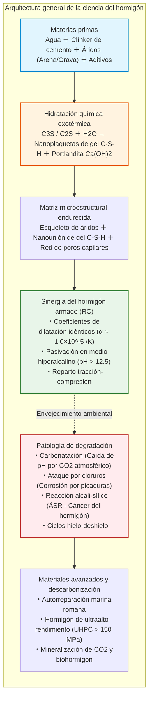
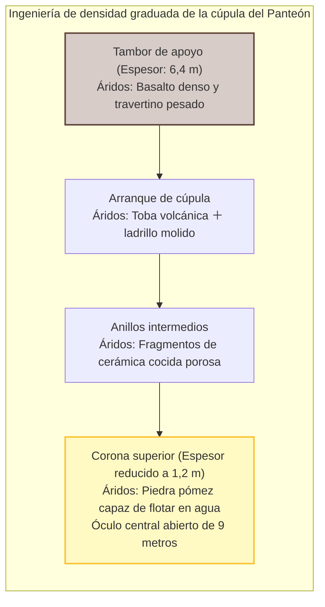
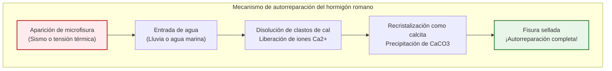
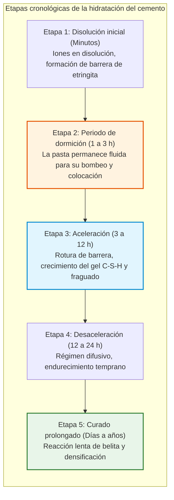
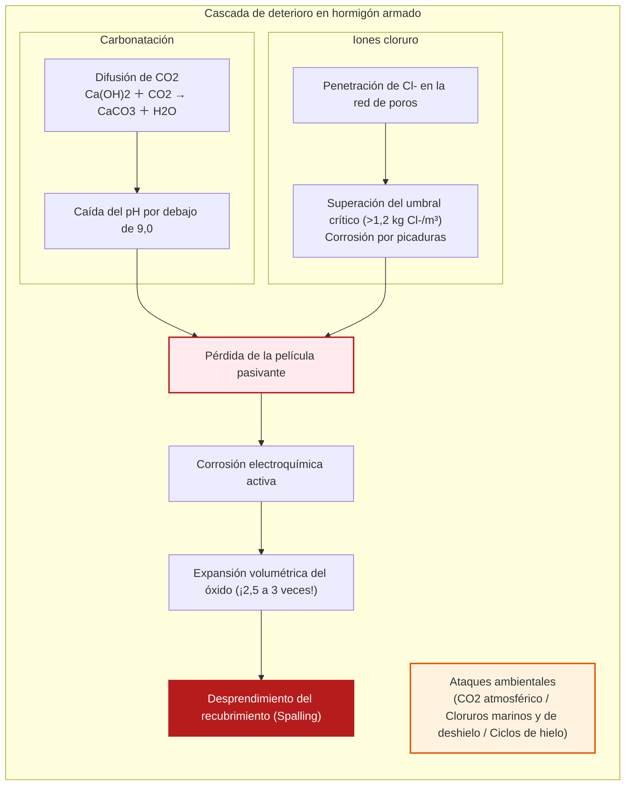
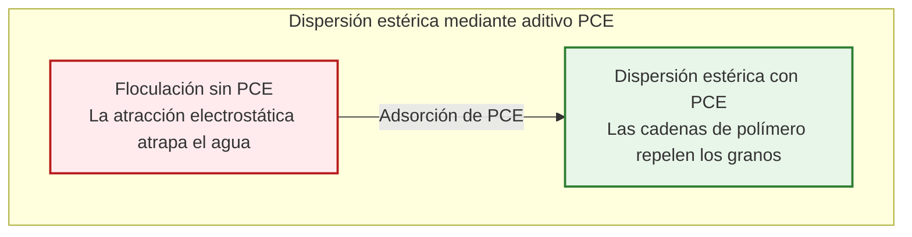
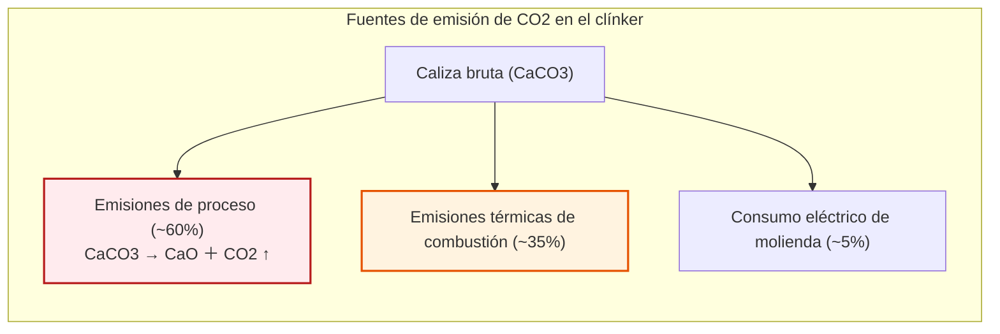

## Introducción: La sustancia más consumida por la humanidad tras el agua

Desde autopistas y viaductos oceánicos hasta los núcleos de rascacielos y presas hidroeléctricas, el mundo moderno descansa sobre una roca artificial: el **hormigón (concreto)**.

Es la **segunda sustancia más consumida en la Tierra después del agua**, con más de 30.000 millones de toneladas al año (unas 4 toneladas anuales por habitante), superando con creces la masa combinada de acero, madera, plástico y vidrio.

Sin embargo, persiste la creencia popular de que el hormigón fragua «secándose al aire».

En ciencia de materiales, esto es **completamente falso**.

El hormigón **no fragua secándose**. Si se seca prematuramente, pierde su resistencia y se pulveriza. Se consolida mediante una **reacción de hidratación**: los minerales anhidros del clínker reaccionan químicamente con el agua, formando una red entrelazada de nanocristales. Sumergido en agua, cura a la perfección, logrando mayor resistencia que en aire seco.

Además, mientras que las obras contemporáneas de hormigón armado se proyectan para 50 a 100 años de servicio, la cúpula de hormigón en masa del Panteón de Roma y los puertos mediterráneos llevan 2.000 años intactos sin acero de refuerzo.

---

## Capítulo 1: El prodigio romano – Opus Caementicium

Terminado en el año 126 d. C. bajo el emperador Adriano, el Panteón de Roma ostenta una cúpula esférica de **43,3 metros de luz**. Es la **mayor cúpula de hormigón en masa no armado del mundo**.

Los constructores romanos escalonaron los áridos por densidad, desde el basalto denso en la base hasta la piedra pómez ligera en la cúspide.

### 1.1 El amasado en caliente y la autorreparación

El MIT constató en 2023 que los romanos mezclaban cal viva ($\text{CaO}$) directamente con puzolana antes de añadir agua («Hot Mixing»):

$$\text{CaO} + \text{H}_2\text{O} \to \text{Ca(OH)}_2 + 63{,}7\ \text{kJ/mol}$$

La intensa reacción térmica ($> 80^\circ\text{C}$) dejó nódulos de cal sin reaccionar. Cuando el agua penetra por una fisura, disuelve estos clastos y precipita calcita ($\text{CaCO}_3$), sellando la grieta de forma autónoma.

En puertos marítimos, la interacción con el agua de mar hace crecer cristales de **tobermorita aluminosa**, consolidando el hormigón durante siglos.

---

## Capítulo 2: Hidratación del cemento Portland

Patentado en 1824 por Joseph Aspdin, el cemento Portland se obtiene cociendo caliza y arcilla a $1450^\circ\text{C}$.

| Fase del clínker | Notación | Fórmula | Proporción | Comportamiento cinético |
| :--- | :--- | :--- | :--- | :--- |
| **Alita** | **$C_3S$** | $\text{Ca}_3\text{SiO}_5$ | $50 \sim 70\%$ | Hidratación rápida; resistencia a 28 días |
| **Belita** | **$C_2S$** | $\text{Ca}_2\text{SiO}_4$ | $15 \sim 30\%$ | Hidratación lenta; resistencia a largo plazo |
| **Aluminato** | **$C_3A$** | $\text{Ca}_3\text{Al}_2\text{O}_6$ | $5 \sim 10\%$ | Fraguado flash; el yeso frena esta reacción |
| **Ferrito** | **$C_4AF$** | $\text{Ca}_4\text{Al}_2\text{Fe}_2\text{O}_{10}$ | $5 \sim 15\%$ | Resistencia a sulfatos, color gris característico |

### 2.1 Ecuaciones de hidratación y gel C-S-H

$$2 C_3S + 6 H_2O \to C_3S_2H_3 \text{ (Gel C-S-H)} + 3 Ca(OH)_2 \text{ (Portlandita)} + \Delta H$$

$$2 C_2S + 4 H_2O \to C_3S_2H_3 \text{ (Gel C-S-H)} + Ca(OH)_2 + \Delta H$$

- **Gel C-S-H**: Nanoplacas entrelazadas que aportan **más del 80 % de la resistencia mecánica**.
- **Portlandita ($\text{Ca(OH)}_2$)**: Otorga un pH fuertemente alcalino de **$12{,}5 \sim 13{,}5$**, protegiendo la armadura frente a la corrosión.

Conforme a la ley de Abrams ($f_c = A / B^{a/c}$), reducir la relación agua/cemento ($a/c$) disminuye los poros capilares y aumenta la resistencia.

---

## Capítulo 3: El matrimonio del hormigón armado (RC)

```mermaid
flowchart TD
    subgraph MiraculousSynergy["Las tres coincidencias del hormigón armado"]
        direction TB
        
        subgraph Thermal["Coincidencia 1: Paridad térmica"]
            ExpConcrete["Dilatación del hormigón<br/>α ≈ 1.0 × 10^-5 /K"]
            ExpSteel["Dilatación del acero corrugado<br/>α ≈ 1.2 × 10^-5 /K"]
            ThermalResult["¡Cero tensiones cortantes internas de -30°C a +50°C!"]
            ExpConcrete --- ExpSteel --> ThermalResult
        end
        
        subgraph Mechanical["Coincidencia 2: Reparto de esfuerzos"]
            Comp["El hormigón resiste toda la compresión"]
            Tens["El acero resiste toda la tracción"]
            Adhesion["Las corrugas transmiten el esfuerzo rasante"]
            Comp --- Tens --> Adhesion
        end
        
        subgraph Chemical["Coincidencia 3: Capa pasivante"]
            Alkali["Solución de Ca(OH)2 saturada<br/>pH de 12,5 a 13,5"]
            PassiveFilm["Película nanométrica de γ-Fe2O3<br/>protectora en el acero"]
            CorrosionStop["¡El acero no se oxida bajo hormigón sano!"]
            Alkali --> PassiveFilm --> CorrosionStop
        end
    end
    
    style ThermalResult fill:#e1f5fe,stroke:#0288d1,stroke-width:2px
    style Adhesion fill:#fff3e0,stroke:#e65100,stroke-width:2px
    style CorrosionStop fill:#e8f5e9,stroke:#2e7d32,stroke-width:2px
```

---

## Capítulo 4: Patología y causas de deterioro

1. **Carbonatación**: El $\text{CO}_2$ convierte $\text{Ca(OH)}_2$ en $\text{CaCO}_3$, bajando el pH por debajo de 9. La profundidad sigue la ley de la raíz del tiempo: $x = A \sqrt{t}$.
2. **Expansión y desprendimiento (Spalling)**: El óxido se expande **2,5 a 3 veces**, fracturando el recubrimiento de hormigón.
3. **Cloruros**: Generan picaduras localizadas extremadamente destructivas sin fisuras visibles externas.
4. **Reacción álcali-sílice (ÁSR)**: Cáncer del hormigón por gel expansivo de sílice.

---

## Capítulo 5: Hormigón de ultraalto rendimiento (UHPC)

Los superfluidificantes policarboxílicos (PCE) dispersan los granos de cemento mediante repulsión estérica, permitiendo relaciones $a/c < 0{,}20$.

El **UHPC** suprime la grava, agrega humo de sílice y microfibras de acero, alcanzando resistencias a compresión de **$150$ a $220\ \text{MPa}$**.

---

## Capítulo 6: Descarbonización y biohormigón

El cemento produce el **7-8 % del $\text{CO}_2$ mundial**, del cual un 60 % se debe inevitablemente a la descarbonatación de la caliza ($\text{CaCO}_3 \to \text{CaO} + \text{CO}_2 \uparrow$).

Las vías de descarbonización incluyen:
- **Ecorremplazo del clínker**: Escorias de alto horno (GGBS) y cenizas volantes reducen el clínker un 50-70 %.
- **Mineralización de carbono**: Inyección de $\text{CO}_2$ fijando más de 100 kg de carbono por metro cúbico.
- **Biohormigón autorreparable**: Bacterias *Bacillus* encapsuladas precipitan calcita y sellan fisuras de hasta 1 mm de ancho.

---

## Conclusión: La roca forjada por la mano humana

El hormigón no es lodo inerte, sino una sinfonía cristalina a escala molecular. Frente a los retos de la sostenibilidad, se transforma en un reservorio de carbono y un material autorreparable para sostener el porvenir de la humanidad.
