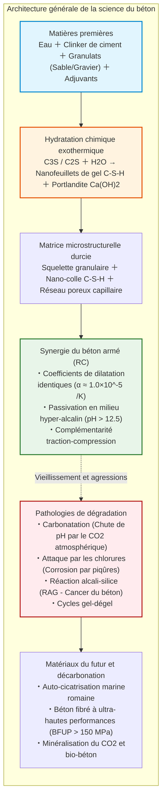
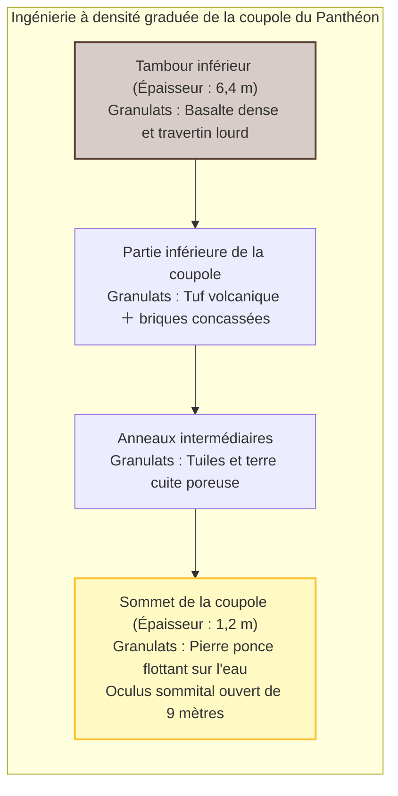
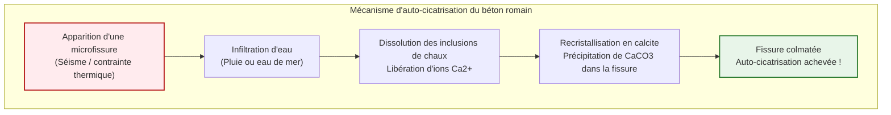
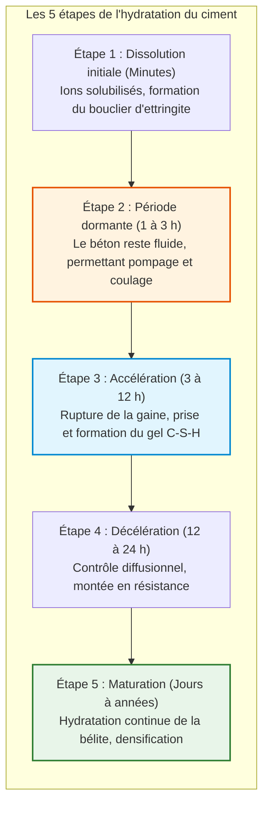
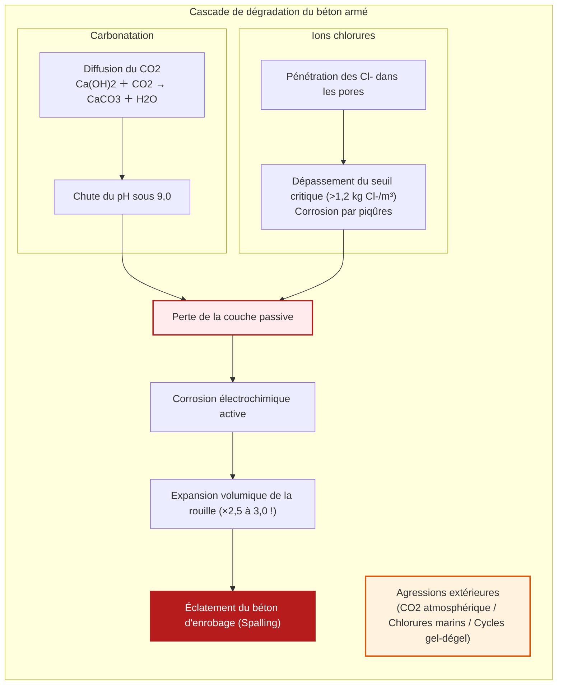
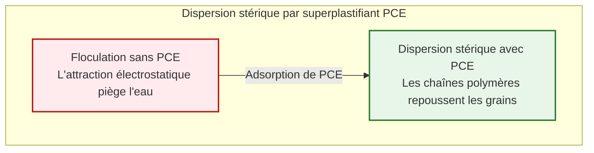
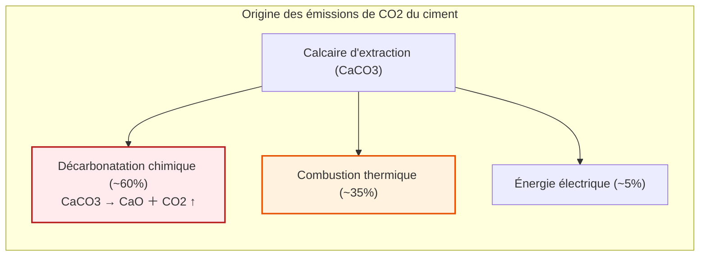

## Introduction : Le matériau le plus consommé par l'humanité après l'eau

Des autoroutes aux ponts suspendus colossaux, des gratte-ciel aux barrages hydroélectriques, le socle matériel de notre civilisation est sculpté dans une pierre artificielle : le **béton (Concrete)**.

Le béton est la **deuxième substance la plus consommée sur Terre après l'eau**. Sa production dépasse 30 milliards de tonnes par an, soit 4 tonnes par habitant. Sa masse éclipse la production combinée de l'acier, du bois, du plastique et du verre.

Pourtant, une croyance populaire tenace affirme que le béton durcit simplement en « séchant ».

En chimie des matériaux, cette idée est **fondamentalement fausse**.

Le béton **ne durcit pas par séchage**. Une déshydratation précoce arrête sa prise et le rend pulvérulent. Il se solidifie par **réaction d'hydratation** : les minéraux anhydres du clinker réagissent chimiquement avec l'eau pour précipiter un maillage dense de nano-cristaux. Immergé sous l'eau, le béton durcit parfaitement, atteignant des résistances mécaniques supérieures à celles obtenues à l'air libre.

De plus, alors que nos structures modernes en béton armé sont conçues pour durer 50 à 100 ans, le dôme en béton non armé du Panthéon de Rome et les quais portuaires antiques bravent les éléments depuis deux millénaires sans acier.

---

## Chapitre 1 : Le miracle antique – L'Opus Caementicium

Achevé sous l'empereur Hadrien en 126 de notre ère, le Panthéon de Rome possède une coupole en béton sans armature de **43,3 mètres de portée**. Elle reste à ce jour la **plus grande coupole en béton non armé au monde**.

Les Romains ont gradué la densité des granulats du lourd basalte à la pierre ponce ultra-légère au sommet.

### 1.1 Le « malaxage à chaud » et l'auto-cicatrisation

Le MIT a démontré en 2023 que les Romains mélangeaient de la chaux vive ($\text{CaO}$) directement avec la pouzzolane avant d'ajouter l'eau :

$$\text{CaO} + \text{H}_2\text{O} \to \text{Ca(OH)}_2 + 63{,}7\ \text{kJ/mol}$$

Cette chaleur ($> 80^\circ\text{C}$) a laissé des inclusions de chaux non réagie. Lorsque l'eau pénètre dans les fissures, elle dissout ces inclusions et précipite de la calcite ($\text{CaCO}_3$), colmatant la brèche de manière autonome.

Dans l'eau de mer, la réaction pouzzolanique forme en continu de la **tobermorite alumineuse**, renforçant la cohésion de la roche au fil des siècles.

---

## Chapitre 2 : La chimie de l'hydratation du ciment Portland

Breveté en 1824 par Joseph Aspdin, le ciment Portland est issu de la cuisson à $1450^\circ\text{C}$ de calcaire et d'argile.

| Phase clinker | Formule cimentière | Formule chimique | Proportion | Rôle cinétique |
| :--- | :--- | :--- | :--- | :--- |
| **Alite** | **$C_3S$** | $\text{Ca}_3\text{SiO}_5$ | $50 \sim 70\%$ | Hydratation rapide ; résistance initiale et à 28 jours |
| **Bélite** | **$C_2S$** | $\text{Ca}_2\text{SiO}_4$ | $15 \sim 30\%$ | Hydratation lente ; gain de résistance à long terme |
| **Aluminate** | **$C_3A$** | $\text{Ca}_3\text{Al}_2\text{O}_6$ | $5 \sim 10\%$ | Prise flash immédiate ; tempérée par l'ajout de gypse |
| **Ferrite** | **$C_4AF$** | $\text{Ca}_4\text{Al}_2\text{Fe}_2\text{O}_{10}$ | $5 \sim 15\%$ | Résistance aux sulfates, donne la couleur grise |

### 2.1 Les réactions et la naissance du gel C-S-H

$$2 C_3S + 6 H_2O \to C_3S_2H_3 \text{ (Gel C-S-H)} + 3 Ca(OH)_2 \text{ (Portlandite)} + \Delta H$$

$$2 C_2S + 4 H_2O \to C_3S_2H_3 \text{ (Gel C-S-H)} + Ca(OH)_2 + \Delta H$$

- **Gel C-S-H** : Nanofeuillets assurant **plus de 80 % de la cohésion mécanique**.
- **Portlandite ($\text{Ca(OH)}_2$)** : Confère un pH hyper-basique de **$12{,}5$ à $13{,}5$**, créant un bouclier anti-corrosion pour l'acier.

Selon la loi d'Abrams ($f_c = A / B^{E/C}$), réduire le ratio eau/ciment ($E/C$) est impératif pour limiter la porosité capillaire.

---

## Chapitre 3 : La symbiose du béton armé

```mermaid
flowchart TD
    subgraph MiraculousSynergy["Les 3 miracles physiques et chimiques du béton armé"]
        direction TB
        
        subgraph Thermal["Miracle 1 : Dilatation thermique"]
            ExpConcrete["Dilatation du béton<br/>α ≈ 1.0 × 10^-5 /K"]
            ExpSteel["Dilatation de l'acier<br/>α ≈ 1.2 × 10^-5 /K"]
            ThermalResult["Aucun cisaillement d'interface de -30°C à +50°C !"]
            ExpConcrete --- ExpSteel --> ThermalResult
        end
        
        subgraph Mechanical["Miracle 2 : Répartition des contraintes"]
            Comp["Le béton reprend la compression"]
            Tens["L'acier reprend la traction"]
            Adhesion["Les nervures de l'armature transfèrent le cisaillement"]
            Comp --- Tens --> Adhesion
        end
        
        subgraph Chemical["Miracle 3 : Bouclier de passivation"]
            Alkali["Milieu hyper-alcalin saturé en Ca(OH)2<br/>pH de 12,5 à 13,5"]
            PassiveFilm["Film nanométrique de γ-Fe2O3<br/>protecteur sur l'acier"]
            CorrosionStop["L'acier ne rouille pas sous le béton intact !"]
            Alkali --> PassiveFilm --> CorrosionStop
        end
    end
    
    style ThermalResult fill:#e1f5fe,stroke:#0288d1,stroke-width:2px
    style Adhesion fill:#fff3e0,stroke:#e65100,stroke-width:2px
    style CorrosionStop fill:#e8f5e9,stroke:#2e7d32,stroke-width:2px
```

---

## Chapitre 4 : Pathologies et dégradation

1. **Carbonatation** : Le $\text{CO}_2$ réagit avec $\text{Ca(OH)}_2$ en formant $\text{CaCO}_3$, abaissant le pH sous 9. La profondeur suit la loi $x = A \sqrt{t}$.
2. **Éclatement (Spalling)** : La rouille s'expanse de **2,5 à 3,0 fois**, créant des pressions radiales destructrices.
3. **Attaque par les chlorures** : Corrosion par piqûres insidieuse.
4. **Réaction alcali-granulat (RAG)** : « Cancer du béton » par gel expansif.

---

## Chapitre 5 : Béton fibré à ultra-hautes performances (BFUP)

Les superplastifiants polycarboxylates (PCE) dispersent les grains par encombrement stérique, permettant un ratio $E/C < 0{,}20$.

Le **BFUP** élimine le gravier, incorpore de la fumée de silice et des microfibres d'acier, atteignant des résistances en compression de **$150$ à $220\ \text{MPa}$**.

---

## Chapitre 6 : Décarbonation et bio-béton

Le ciment est responsable de **7 à 8 % des émissions mondiales de $\text{CO}_2$**, dues pour 60 % à la décarbonatation du calcaire ($\text{CaCO}_3 \to \text{CaO} + \text{CO}_2 \uparrow$).

Les technologies d'avenir incluent :
- **Laitiers et cendres volantes** (50 à 70 % de clinker en moins).
- **Minéralisation du carbone** (stockage de plus de 100 kg de $\text{CO}_2/\text{m}^3$).
- **Bio-béton bactérien** : des spores de *Bacillus* et du lactate de calcium sécrètent du calcaire pour réparer les fissures de 1 mm en quelques semaines.

---

## Conclusion : La pierre moulée par l'homme

De la chaux antique aux nano-gels contemporains, le béton illustre la maîtrise humaine de la matière. En se décarbonant, ce roc artificiel continuera de porter l'architecture des siècles futurs.
