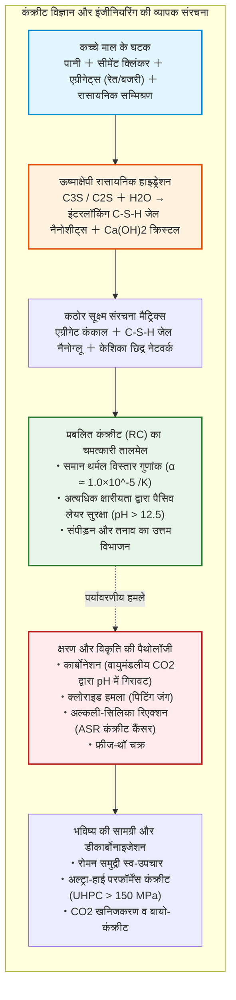
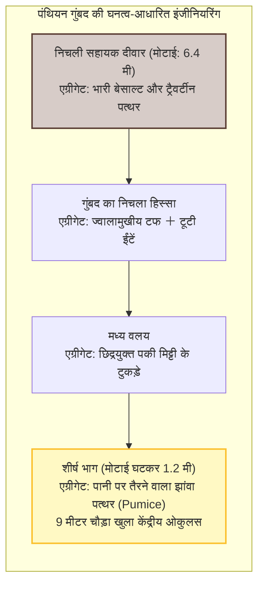
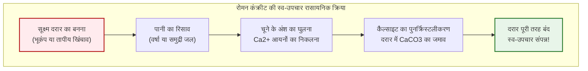
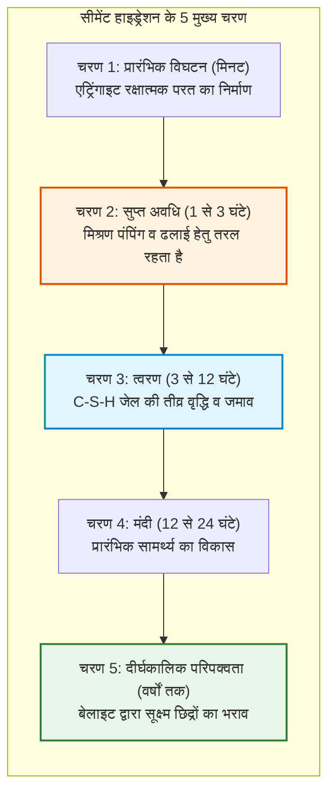
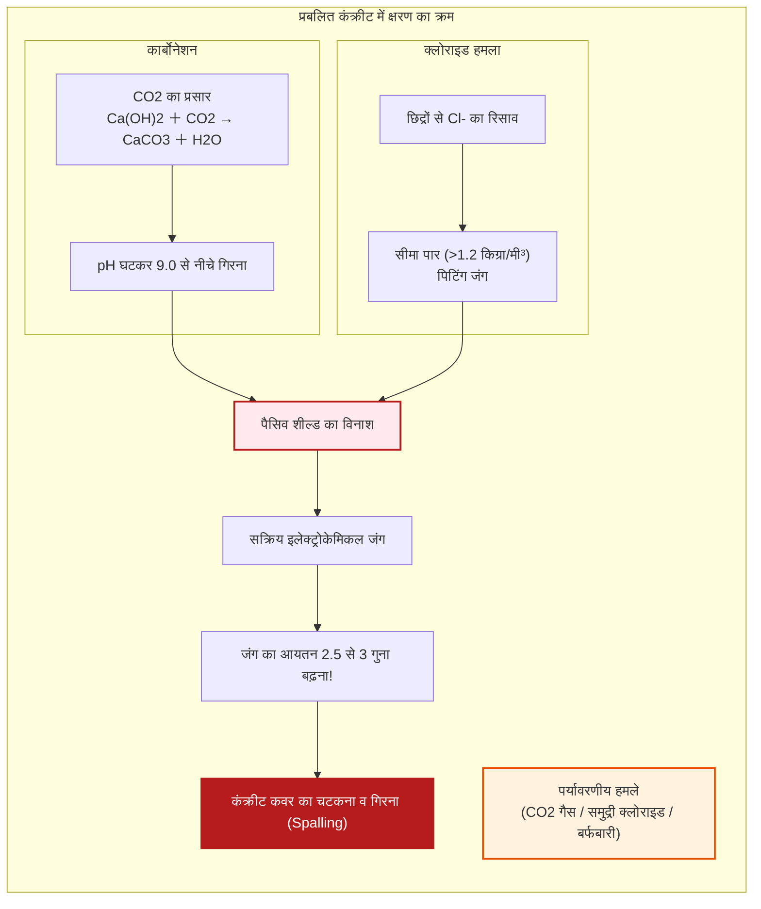
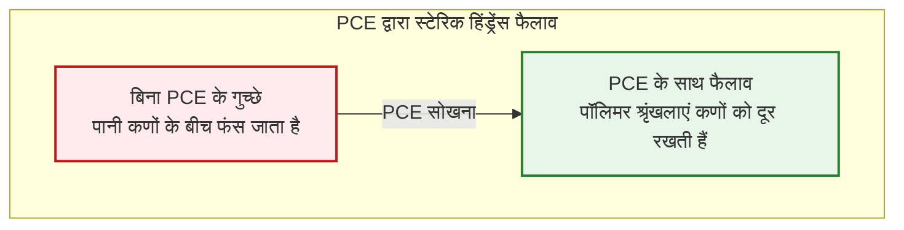
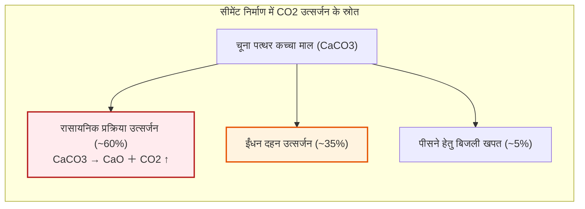

## परिचय: पानी के बाद मानवता द्वारा सर्वाधिक उपभोग किया जाने वाला पदार्थ

महाद्वीपों को जोड़ने वाले राजमार्गों, समुद्री पुलों के विशाल खंभों, गगनचुंबी इमारतों के कोर और नदियों को थामने वाले बांधों का आधार एक कृत्रिम पत्थर है: **कंक्रीट (Concrete)**।

कंक्रीट पृथ्वी पर **पानी के बाद दूसरा सबसे अधिक खपत होने वाला पदार्थ** है। इसका वैश्विक वार्षिक उपयोग 30 अरब टन (लगभग 14 अरब घन मीटर) से अधिक है, यानी प्रति व्यक्ति लगभग 4 टन सालाना। यह स्टील, लकड़ी, प्लास्टिक और कांच के कुल उत्पादन से भी कहीं अधिक है।

फिर भी एक आम गलतफहमी है कि कंक्रीट धूप में केवल «हवा से सूखकर» सख्त होता है।

पदार्थ विज्ञान की दृष्टि से यह **पूरी तरह से गलत** है।

कंक्रीट **सूखने से नहीं जमता**। यदि यह समय से पहले सूख जाए, तो इसकी शक्ति खत्म हो जाती है और यह भुरभुरा हो जाता है। यह **हाइड्रेशन प्रतिक्रिया (Hydration Reaction)** द्वारा जमता है: सीमेंट के क्लिंकर खनिज पानी के अणुओं के साथ रासायनिक रूप से बंधकर नैनोस्केल क्रिस्टल का एक सघन जाल बनाते हैं। पानी में पूरी तरह डूबा रहने पर कंक्रीट हवा की तुलना में कहीं अधिक मजबूत और सघन बनता है।

इसके अलावा, जहां आधुनिक आरसीसी संरचनाएं 50 से 100 वर्षों के लिए डिजाइन की जाती हैं, वहीं रोम के पंथियन का बिना सरिए वाला गुंबद और समुद्री घाट 2000 वर्षों से बिना किसी लोहे के सीने ताने खड़े हैं।

---

## अध्याय 1: प्राचीन रोम का दो हजार साल पुराना चमत्कार – Opus Caementicium

126 ईस्वी में सम्राट हैड्रियन के शासन में निर्मित रोम का पंथियन (Pantheon) **43.3 मीटर** आंतरिक व्यास वाला गुंबद समेटे हुए है। यह आज भी **दुनिया का सबसे बड़ा बिना सरिए वाला कंक्रीट गुंबद** है।

रोमन वास्तुकारों ने आधार पर भारी बेसाल्ट और शीर्ष पर हल्के झांवा पत्थर (प्यूमिस) का प्रयोग कर गुंबद की मोटाई को 6.4 मीटर से घटाकर 1.2 मीटर कर दिया।

### 1.1 'हॉट मिक्सिंग' और स्व-उपचार

एमआईटी (MIT) के 2023 के शोध से पता चला कि रोमनों ने बिना बुझा चूना ($\text{CaO}$) सीधे ज्वालामुखीय राख (पोज़ोलाना) के साथ मिलाकर पानी डाला («Hot Mixing»):

$$\text{CaO} + \text{H}_2\text{O} \to \text{Ca(OH)}_2 + 63{,}7\ \text{kJ/mol}$$

उच्च तापमान ($> 80^\circ\text{C}$) के कारण बिना घुले चूने के टुकड़े सुरक्षित रह गए। जब दरारें आती हैं, तो पानी चूने को घोलकर कैल्साइट ($\text{CaCO}_3$) के रूप में जमा देता है और दरारें स्वतः भर जाती हैं।

---

## अध्याय 2: पोर्टलैंड सीमेंट का हाइड्रेशन रसायन

| क्लिंकर खनिज | रासायनिक नाम | सूत्र | अनुपात | क्रियात्मक भूमिका |
| :--- | :--- | :--- | :--- | :--- |
| **एलाइट** | **$C_3S$** | $\text{Ca}_3\text{SiO}_5$ | $50 \sim 70\%$ | तीव्र हाइड्रेशन; शुरुआती और 28 दिनों की मजबूती |
| **बेलाइट** | **$C_2S$** | $\text{Ca}_2\text{SiO}_4$ | $15 \sim 30\%$ | धीमा हाइड्रेशन; दीर्घकालिक मजबूती |
| **एल्युमिनेट** | **$C_3A$** | $\text{Ca}_3\text{Al}_2\text{O}_6$ | $5 \sim 10\%$ | फ्लैश सेटिंग; जिप्सम इसे नियंत्रित करता है |
| **फेराइट** | **$C_4AF$** | $\text{Ca}_4\text{Al}_2\text{Fe}_2\text{O}_{10}$ | $5 \sim 15\%$ | सल्फेट प्रतिरोध और सीमेंट को धूसर रंग देना |

$$2 C_3S + 6 H_2O \to C_3S_2H_3 \text{ (C-S-H जेल)} + 3 Ca(OH)_2 \text{ (पोर्टलैंडाइट)} + \Delta H$$

$$2 C_2S + 4 H_2O \to C_3S_2H_3 \text{ (C-S-H जेल)} + Ca(OH)_2 + \Delta H$$

C-S-H जेल 80% से अधिक ताकत देता है, और कैल्शियम हाइड्रोक्साइड **$\text{pH} = 12{,}5 \sim 13{,}5$** बनाकर सरिए को जंग से बचाता है।

---

## अध्याय 3: प्रबलित कंक्रीट (RC) का अनूठा संगम

```mermaid
flowchart TD
    subgraph MiraculousSynergy["प्रबलित कंक्रीट के तीन वैज्ञानिक चमत्कार"]
        direction TB
        
        subgraph Thermal["चमत्कार 1: थर्मल विस्तार की समानता"]
            ExpConcrete["कंक्रीट का विस्तार गुणांक<br/>α ≈ 1.0 × 10^-5 /K"]
            ExpSteel["स्टील का विस्तार गुणांक<br/>α ≈ 1.2 × 10^-5 /K"]
            ThermalResult["-30°C से +50°C तक आंतरिक दरार का कोई खतरा नहीं!"]
            ExpConcrete --- ExpSteel --> ThermalResult
        end
        
        subgraph Mechanical["चमत्कार 2: भार का संतुलन"]
            Comp["कंक्रीट संपीड़न (दबाव) सहन करता है"]
            Tens["स्टील खिंचाव (तनाव) सहन करता है"]
            Adhesion["सरिए की पसलियां पकड़ बनाती हैं"]
            Comp --- Tens --> Adhesion
        end
        
        subgraph Chemical["चमत्कार 3: पैसिवेशन शील्ड"]
            Alkali["संतृप्त Ca(OH)2 घोल<br/>pH 12.5 से 13.5"]
            PassiveFilm["स्टील पर γ-Fe2O3 की नैनो परत<br/>जंग से सुरक्षा देती है"]
            CorrosionStop["कंक्रीट के अंदर सरिया कभी नहीं सड़ता!"]
            Alkali --> PassiveFilm --> CorrosionStop
        end
    end
    
    style ThermalResult fill:#e1f5fe,stroke:#0288d1,stroke-width:2px
    style Adhesion fill:#fff3e0,stroke:#e65100,stroke-width:2px
    style CorrosionStop fill:#e8f5e9,stroke:#2e7d32,stroke-width:2px
```

---

## अध्याय 4: कंक्रीट का क्षरण और विनाश

---

## अध्याय 5: अल्ट्रा-हाई परफॉर्मेंस कंक्रीट (UHPC)

पॉलीकार्बोक्सिलेट सुपरप्लास्टिसाइज़र (PCE) कणों को अलग रखते हैं, जिससे पानी की आवश्यकता $W/C < 0{,}20$ तक घट जाती है।

**UHPC** में बारीक सिलिका फ्यूम और स्टील माइक्रोफाइबर होते हैं, जो **$150$ से $220\ \text{MPa}$** की संपीड़न शक्ति प्रदान करते हैं।

---

## अध्याय 6: डीकार्बोनाइजेशन और बायो-कंक्रीट

सीमेंट उद्योग दुनिया के **7-8% $\text{CO}_2$ उत्सर्जन** के लिए जिम्मेदार है, जिसका 60% चूना पत्थर के जलने ($\text{CaCO}_3 \to \text{CaO} + \text{CO}_2 \uparrow$) से निकलता है।

समाधानों में ब्लास्ट फर्नेस स्लैग, $\text{CO}_2$ खनिजकरण और **बायो-कंक्रीट** शामिल हैं, जिसमें *Bacillus* बैक्टीरिया दरारें पड़ने पर कैल्साइट बनाकर उन्हें स्वतः भर देते हैं।

---

## निष्कर्ष

कंक्रीट मात्र एक धूसर पदार्थ नहीं, बल्कि मानवीय बुद्धि द्वारा गढ़ा गया पत्थर है। पर्यावरण के अनुकूल और स्व-उपचारकारी तकनीकों के साथ, यह कृत्रिम चट्टान आने वाले सदियों तक मानव सभ्यता को थामे रखेगी।
