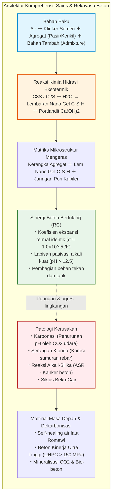
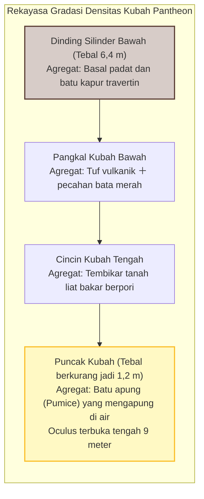
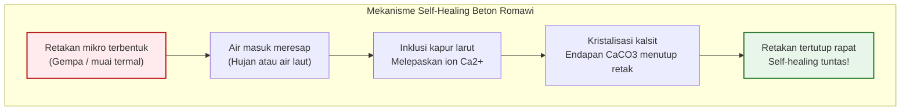
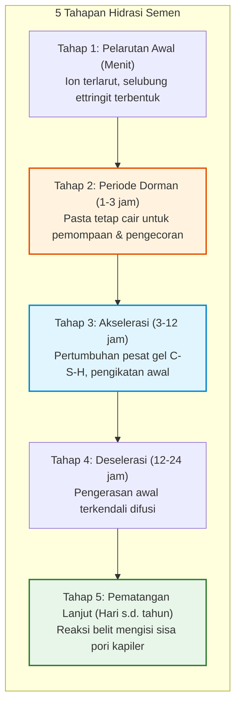
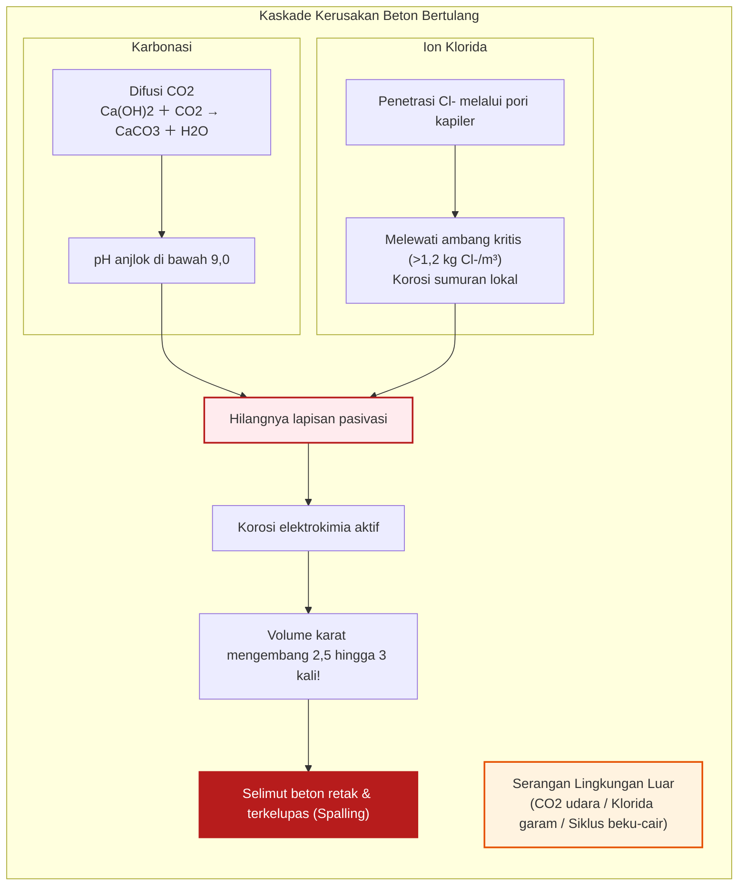
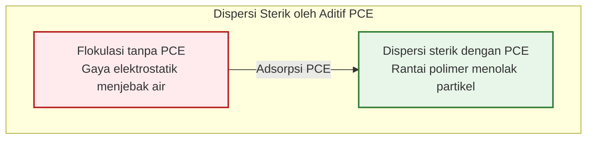
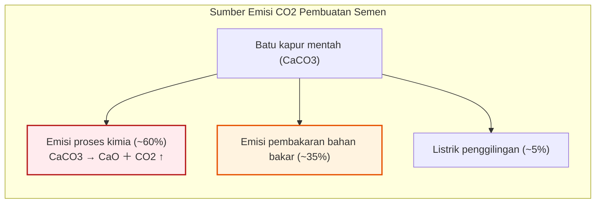

## Pendahuluan: Bahan yang Paling Banyak Dikonsumsi Manusia Setelah Air

Dari jalan raya antar-benua, pilar jembatan gantung raksasa, inti gedung pencakar langit hingga bendungan gravitasi penahan sungai, landasan fisik peradaban modern dibangun dari batu buatan manusia: **beton (concrete)**.

Beton adalah **zat kedua yang paling banyak dikonsumsi di Bumi setelah air**. Konsumsi global melampaui 30 miliar ton per tahun (sekitar 14 miliar meter kubik), atau sekitar 4 ton per kapita per tahun. Massa ini mengerdilkan total gabungan baja, kayu, plastik, dan kaca.

Namun masyarakat kerap keliru mengira bahwa beton mengeras karena «mengering terkena angin».

Secara ilmu kimia material, anggapan ini **sama sekali keliru**.

Beton **tidak mengeras karena kering**. Jika dibiarkan mengering terlalu dini, proses pengerasan terhenti dan beton akan rapuh hancur. Beton mengeras melalui **reaksi hidrasi eksotermik**: mineral anhidrat klinker semen mengikat molekul air secara kimiawi, menumbuhkan jalinan kristal nanoskopis. Direndam di dalam air tanpa udara, beton justru mengeras lebih rapat dan lebih kuat dibandingkan di udara kering.

Selain itu, kubah beton tanpa tulangan Pantheon di Roma dan dermaga laut kuno telah bertahan selama 2.000 tahun tanpa sebatang pun tulangan baja.

---

## Bab 1: Keajaiban Dua Milenium Roma – Opus Caementicium

Selesai dibangun pada tahun 126 M di bawah Kaisar Hadrian, Pantheon di Roma memiliki kubah beton tanpa tulangan selebar **43,3 meter**. Ini tetap menjadi **kubah beton tak bertulang terbesar di dunia**.

Insinyur Romawi mengatur densitas agregat dari basal berat di dasar hingga batu apung ringan di puncak, menipiskan kubah dari 6,4 m menjadi 1,2 m.

### 1.1 Hot Mixing dan Self-Healing Inklusi Kapur

Studi MIT tahun 2023 membuktikan bahwa bangsa Romawi mencampur kapur tohor ($\text{CaO}$) langsung dengan abu vulkanik pozzolana sebelum diberi air («Hot Mixing»):

$$\text{CaO} + \text{H}_2\text{O} \to \text{Ca(OH)}_2 + 63{,}7\ \text{kJ/mol}$$

Panas reaksi ($> 80^\circ\text{C}$) menyisakan gumpalan kapur reaktif (*Lime Clasts*). Saat air merembes melalui retakan mikro, gumpalan ini larut dan mengkristal kembali sebagai kalsit ($\text{CaCO}_3$), menutup celah secara mandiri.

---

## Bab 2: Kimia Hidrasi Semen Portland

| Fase Klinker | Notasi | Rumus | Porsi | Peran Kinetika |
| :--- | :--- | :--- | :--- | :--- |
| **Alit** | **$C_3S$** | $\text{Ca}_3\text{SiO}_5$ | $50 \sim 70\%$ | Hidrasi cepat; kekuatan awal dan 28 hari |
| **Belit** | **$C_2S$** | $\text{Ca}_2\text{SiO}_4$ | $15 \sim 30\%$ | Hidrasi lambat; pengerasan jangka panjang |
| **Aluminat** | **$C_3A$** | $\text{Ca}_3\text{Al}_2\text{O}_6$ | $5 \sim 10\%$ | Paling reaktif; gipsum mengendalikan flash setting |
| **Ferit** | **$C_4AF$** | $\text{Ca}_4\text{Al}_2\text{Fe}_2\text{O}_{10}$ | $5 \sim 15\%$ | Ketahanan sulfat, memberi warna abu-abu |

$$2 C_3S + 6 H_2O \to C_3S_2H_3 \text{ (Gel C-S-H)} + 3 Ca(OH)_2 \text{ (Portlandit)} + \Delta H$$

$$2 C_2S + 4 H_2O \to C_3S_2H_3 \text{ (Gel C-S-H)} + Ca(OH)_2 + \Delta H$$

Gel C-S-H menyumbang lebih dari 80% kekuatan rekat, sementara portlandit menjaga cairan pori pada **$\text{pH} = 12{,}5 \sim 13{,}5$**, mempasivasi baja tulangan dari karat.

Menurut Hukum Abrams ($f_c = A / B^{w/c}$), meminimalkan rasio air-semen ($w/c$) sangat krusial untuk mencegah terbentuknya pori kapiler.

---

## Bab 3: Sinergi Beton Bertulang (RC)

```mermaid
flowchart TD
    subgraph MiraculousSynergy["Tiga Fondasi Sinergi Beton Bertulang"]
        direction TB
        
        subgraph Thermal["Fondasi 1: Keselarasan Termal"]
            ExpConcrete["Muai termal beton<br/>α ≈ 1.0 × 10^-5 /K"]
            ExpSteel["Muai termal baja tulangan<br/>α ≈ 1.2 × 10^-5 /K"]
            ThermalResult["Nol retak geser antarmuka dari -30°C hingga +50°C!"]
            ExpConcrete --- ExpSteel --> ThermalResult
        end
        
        subgraph Mechanical["Fondasi 2: Pembagian Beban"]
            Comp["Beton menahan seluruh gaya tekan"]
            Tens["Baja menahan seluruh gaya tarik"]
            Adhesion["Ulir tulangan mentransfer tegangan lekat"]
            Comp --- Tens --> Adhesion
        end
        
        subgraph Chemical["Fondasi 3: Selimut Pasivasi"]
            Alkali["Larutan jenuh Ca(OH)2<br/>pH 12,5 hingga 13,5"]
            PassiveFilm["Lapisan oksida γ-Fe2O3<br/>nanometer pelindung baja"]
            CorrosionStop["Baja tidak berkarat di bawah beton utuh!"]
            Alkali --> PassiveFilm --> CorrosionStop
        end
    end
    
    style ThermalResult fill:#e1f5fe,stroke:#0288d1,stroke-width:2px
    style Adhesion fill:#fff3e0,stroke:#e65100,stroke-width:2px
    style CorrosionStop fill:#e8f5e9,stroke:#2e7d32,stroke-width:2px
```

---

## Bab 4: Patologi Kerusakan Beton

1. **Karbonasi**: Gas $\text{CO}_2$ menetralkan $\text{Ca(OH)}_2$ menjadi $\text{CaCO}_3$, menurunkan pH di bawah 9. Kedalaman karbonasi mengikuti hukum akar waktu: $x = A \sqrt{t}$.
2. **Ekspansi Karat & Spalling**: Karat mengembang **2,5 hingga 3 kali lipat**, memecahkan selimut beton (*spalling*).
3. **Klorida**: Menyebabkan korosi sumuran (*pitting*) lokal yang berbahaya tanpa retakan luar.
4. **Reaksi Alkali-Silika (ASR)**: Kanker beton akibat pembengkakan gel silika.

---

## Bab 5: Beton Kinerja Ultra Tinggi (UHPC)

Superplasticizer polikarboksilat (PCE) mendispersikan partikel semen melalui tolakan sterik sehingga rasio $w/c$ bisa ditekan di bawah 0,20.

**UHPC** meniadakan kerikil kasar, memakai silica fume dan serat mikro baja, mencapai kuat tekan **$150 \sim 220\ \text{MPa}$**.

---

## Bab 6: Dekarbonisasi dan Masa Depan Bio-Beton

Industri semen menyumbang **7-8% emisi $\text{CO}_2$ global**, di mana 60% berasal dari dekarbonasi batu kapur ($\text{CaCO}_3 \to \text{CaO} + \text{CO}_2 \uparrow$).

Jalan keluar meliputi terak tanur tiup (GGBS), mineralisasi $\text{CO}_2$, serta **bio-beton mandiri** berbasis bakteri *Bacillus* yang menutup celah retakan dengan endapan kalsit.

---

## Kesimpulan

Beton adalah karya besar kecerdasan rekayasa manusia. Melalui transformasi menuju bahan rendah karbon dan mampu memulihkan dirinya sendiri, batu buatan ini akan terus menjadi penopang kokoh peradaban masa depan.
