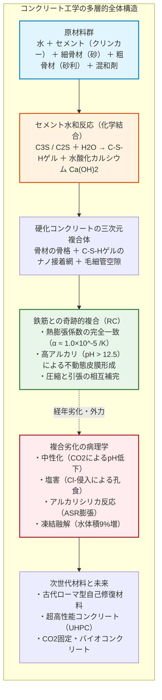
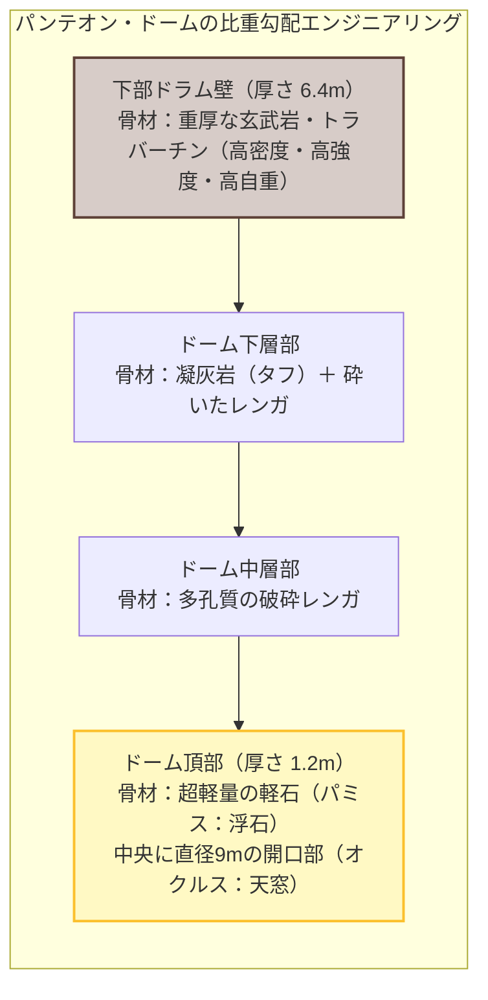
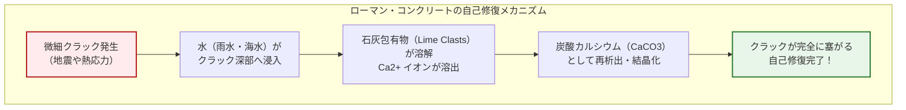
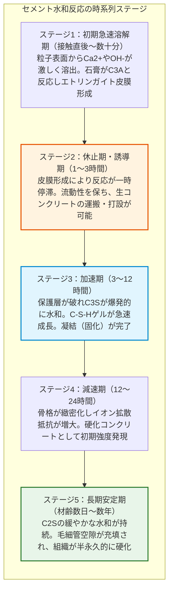
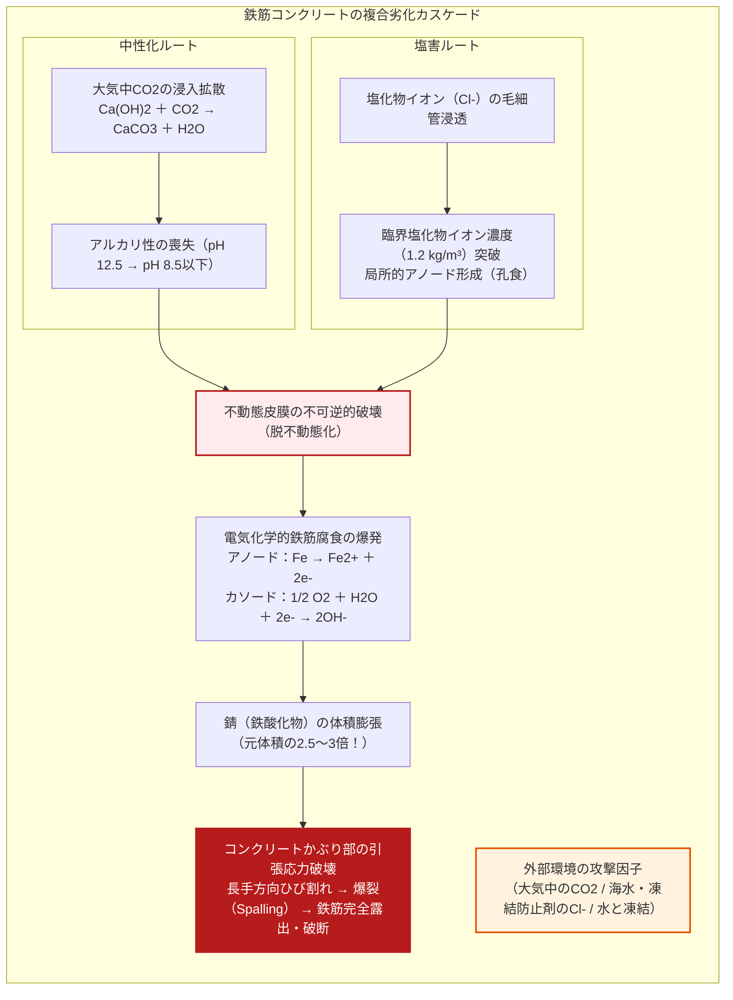
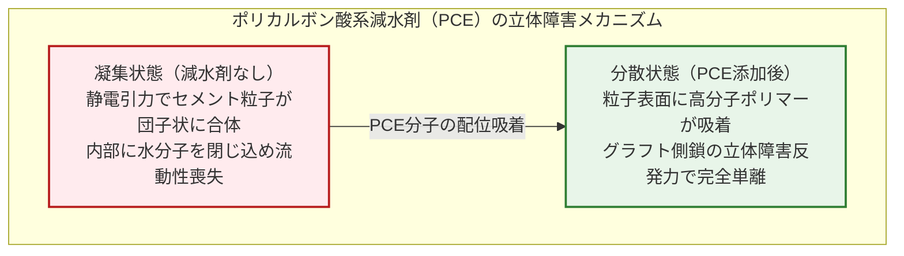
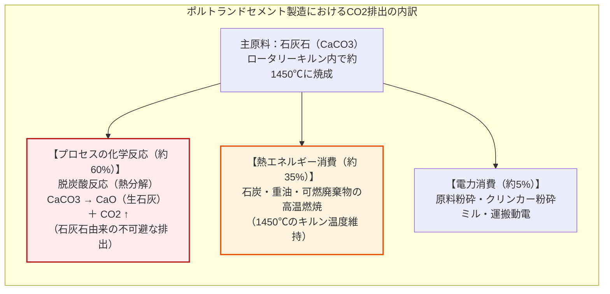

## はじめに：人類が水に次いで最も大量に消費する物質

私たちが歩く舗装道路、川をまたぐ巨大な橋脚、頭上にそびえ立つタワーマンションや超高層ビル、そして大地を支えるダムや港湾の防波堤——。現代文明の輪郭を形作っている人工の基盤は、そのほとんどが灰色の人工石、すなわち**コンクリート（Concrete）**によって築かれている。

コンクリートは、人類が地球上で**「水に次いで2番目に多く消費している物質」**である。その年間使用量は世界全体で300億トン（およそ140億立方メートル）を超え、地球上のすべての人間が毎年一人あたり約4トンものコンクリートを消費している計算になる。鉄鋼、プラスチック、木材、ガラスといった他のあらゆる人工材料をすべて合算しても、コンクリートの総質量には遠く及ばない。

日常においてあまりにも身近なこの材料について、多くの人々は「砂利と砂をセメントの水溶液で練り合わせ、水分が蒸発して乾燥するとカチカチに固まるもの」という直感的なイメージを抱いている。

しかし、材料科学と化学の観点から言えば、この認識は**根本的に誤っている**。

コンクリートは**「乾燥して固まる」のではない**。むしろ乾燥させてしまうと強度が発現せず、ボロボロに崩壊してしまう。コンクリートが固まる本質は、セメント化合物が水分子と化学的に結合し、ミクロなナノ結晶を複雑に絡み合わせながら新しい岩石鉱物を合成していく**「水和反応（Hydration Reaction）」**という極めて精密な化学プロセスにある。水中に沈めておいても、コンクリートは水中で完全に硬化し、むしろ空気中よりも強固になる。

さらに歴史に目を向ければ、現代の鉄筋コンクリート構造物の寿命が50年から100年程度と見積もられているのに対し、2000年前に古代ローマ人が築いたパンテオンの巨大ドームや地中海の港湾埠頭は、補強の鉄筋を一本も使っていないにもかかわらず、地震や海水に洗われながら現代に至るまで完璧な姿を留めている。

なぜコンクリートは固まるのか？ なぜ古代ローマのコンクリートは2000年壊れないのか？ そして、なぜ現代の鉄筋コンクリートは中性化や塩害によって崩壊の危機に瀕するのか？

本稿では、古代ローマの「オプス・カエメンティキウム」から現代の超高強度コンクリート、そしてカーボンニュートラルを実現する最先端の脱炭素材料に至るまで、人類文明を支える人工岩石の全貌を物理学・化学・材料工学の視点から徹底的に解剖する。

---

## 第1章：2000年の風雪に耐える古代ローマの奇跡——オプス・カエメンティキウム

古代ローマの建築技術を語る上で、最大の謎と賞賛の的であり続けてきたのが**「オプス・カエメンティキウム（Opus Caementicium：ローマン・コンクリート）」**である。

現代の私たちが日常で目にするコンクリート構造物の多くは、建設後数十年の経過でひび割れが生じ、鉄筋が錆びて剥落し、補修工事や解体建て替えを余儀なくされる。しかし、古代ローマ人が西暦126年に完成させたローマ市内の神殿「パンテオン（Pantheon）」の無筋コンクリートドームは、2000年近い歳月と数々の地震を経験しながら、今なお完全な形で青空を見上げている。

### 1.1 パンテオンの奇跡：直径43.3メートルの無筋ドーム

パンテオンの円形ドームは、**内径43.3メートル、頂部までの高さ43.3メートル**という完全な球がすっぽりと収まる幾何学的プロポーションを誇る。

驚くべきことに、この巨大なドームには**鉄筋が一箇所も入っていない**。現代の構造工学の常識からすれば、鉄筋の入っていない無筋コンクリートでこれほどのスパンを持つ大空間を覆えば、自重による引張応力でドームが自壊するか、あるいは外側に開く推力（スラスト）によって周囲の壁が外側に吹き飛んで崩壊するはずであった。

ローマの建築家たちは、力学の数学的理論が未発達であった時代に、驚くべき経験的材料工学を駆使していた。
1. **骨材の比重勾配化（Graded Density）**:
   ドームの基礎と下部側壁には、重く頑丈な玄武岩やトラバーチン（石灰華）を骨材として使用し、壁厚を6.4メートルまで厚くして土台を安定させた。上層に向かうにつれて骨材を凝灰岩、割れレンガへと切り替え、最頂部（オクルス周辺）には水に浮くほど多孔質な火山噴出物である**「軽石（パミス）」**を採用。頂部の厚さをわずか1.2メートルにまで絞り込んだ。
2. **オクルス（Oculus：天窓）による頂部自重の排除**:
   ドームの最も重荷となる頂点部をあえて直径9メートルの空洞とし、ドーム全体の重量を劇的に削減した。

しかし、構造的な工夫以上に科学者たちを驚嘆させたのは、**「2000年間、コンクリートそのものが風化せず、むしろ時間とともに強度を増していった」**という材料科学の事実であった。

### 1.2 ポッツォラーナ（火山灰）とホットミキシングの秘密

近年、マサチューセッツ工科大学（MIT）やローレンス・バークレー国立研究所などの国際研究チームによる先端X線回折分析や電子顕微鏡解析により、ローマン・コンクリートの化学的秘密が次々と白日の下に晒された。

古代ローマ人は、ナポリ近郊のポッツオーリ（Pozzuoli）周辺で産出する**反応性火山灰（ポッツォラーナ：Pozzolana）**と、石灰石を焼成して得られる**生石灰（酸化カルシウム：$\text{CaO}$）**を混ぜ合わせていた。

長く信じられていた通説では、ローマ人はまず生石灰を水で消して「消石灰（水酸化カルシウム：$\text{Ca(OH)}_2$）」のスラリーを作り、それを火山灰と骨材に混ぜていた（消和混合）と考えられていた。しかし2023年のMITの研究により、ローマ人は生石灰を直接骨材や火山灰と混ぜ、そこへ水を投入する**「ホットミキシング（Hot Mixing）」**と呼ばれる高温発熱プロセスを採用していたことが判明した。

生石灰に水を加えると、以下の激しい発熱反応が瞬時に発生する：

$$\text{CaO} + \text{H}_2\text{O} \to \text{Ca(OH)}_2 + 63.7\ \text{kJ/mol}$$

この反応熱により、混合物全体の温度は $80 \sim 100^\circ\text{C}$ を超える高温に達する。この高温環境が、通常では反応しにくいシリカやアルミナの溶解を促進し、コンクリートマトリックス中に**「石灰包有物（Lime Clasts：未反応の微小な白色石灰塊）」**を意図的に残留させていたのである。

### 1.3 海水がコンクリートを強くする：アルミニウム・トバモライトの結晶成長

さらに驚異的なのは、地中海各地に築かれた古代ローマの港湾防波堤である。海水という過酷な腐食環境に2000年間浸されながら、崩壊するどころか、現代の海洋コンクリートを遥かに凌ぐ耐久性を維持している。

現代のポルトランドセメントでは、海水中の硫酸塩やマグネシウムイオンがコンクリート内部に侵入すると、エトリンガイトの異常膨張やケイ酸マグネシウムの形成を引き起こし、組織を崩壊へと導く。

しかし、ローマン・コンクリートにおいては、海水が**「触媒かつ強化剤」**として機能する。

火山灰中の白榴石（リューサイト）や火山ガラスに海水が触れると、アルカリ性の海水が鉱物を徐々に溶解し、**「アルミニウム置換型トバモライト（Al-Tobermorite：$\text{Ca}_5\text{Si}_5\text{Al}(\text{OH})\text{O}_{17} \cdot 5\text{H}_2\text{O}$）」**および**「プロンビエライト（Plombierite）」**という極めて稀少で強靭な層状ケイ酸塩鉱物が、微細な隙間を埋めるようにゆっくりと成長する。

このインターロッキング（かみ合い）結晶網が、コンクリート内部のクラックの進展を物理的に阻止し、時間の経過とともに構造物をより硬く、より強靭に進化させていたのである。

---

## 第2章：セメント水和反応の分子機構——なぜ「乾く」のではなく固まるのか

19世紀初頭、イギリスのレンガ積み職人ジョセフ・アスプディン（Joseph Aspdin）が1824年に特許を取得した**「ポルトランドセメント（Portland Cement）」**の発明により、コンクリートは工業化の時代へと突入した。その硬化した色調が英国ポートランド島で産出する最高級建築用石灰岩に似ていたことから名付けられたこのセメントは、現代の土木・建築で使われるセメントのデファクトスタンダードである。

### 2.1 セメントクリンカーの4大鉱物相

石灰石（$\text{CaCO}_3$）と粘土（$\text{SiO}_2, \text{Al}_2\text{O}_3, \text{Fe}_2\text{O}_3$ を含む）を微粉砕して調合し、巨大な回転窯（ロータリーキルン）の中で約 $1450^\circ\text{C}$ の超高温で焼成すると、部分溶融（焼結）を経てゴルフボール大の灰黒色の塊**「クリンカー（Clinker）」**が生成する。

このクリンカーには、セメント化学において「ボーグの4大鉱物（Bogue's Compounds）」と呼ばれる4つの主要な結晶相が存在する：

| 鉱物名 | セメント化学表記 | 化学組成 | 質量比率 | 水和特性と役割 |
| :--- | :--- | :--- | :--- | :--- |
| **エーライト（Alite）** | **$C_3S$** | $\text{Ca}_3\text{SiO}_5$（ケイ酸三カルシウム） | $50 \sim 70\%$ | 水和が速い。初期〜中期強度（材齢28日まで）の発現を主導。 |
| **ビーライト（Belite）** | **$C_2S$** | $\text{Ca}_2\text{SiO}_4$（ケイ酸二カルシウム） | $15 \sim 30\%$ | 水和が極めて遅い。長期強度（材齢数ヶ月〜数年）を継続的に増進。 |
| **アルミネート（Aluminate）** | **$C_3A$** | $\text{Ca}_3\text{Al}_2\text{O}_6$（アルミン酸三カルシウム） | $5 \sim 10\%$ | 水と瞬時に反応し急結（Flash Set）を引き起こす。初期発熱大。 |
| **フェライト（Ferrite）** | **$C_4AF$** | $\text{Ca}_4\text{Al}_2\text{Fe}_2\text{O}_{10}$（鉄アルミン酸四カルシウム） | $5 \sim 15\%$ | 水和速度は中庸。耐硫酸塩性に寄与し、セメント特有の灰色を呈す。 |

純粋な $C_3A$ に水を加えると、わずか数分で石膏のように固まってしまい作業が不可能になる（急結）。これを防ぐため、クリンカーを粉砕する最終工程で**数パーセントの石膏（二水石膏：$\text{CaSO}_4 \cdot 2\text{H}_2\text{O}$）**を必ず添加する。石膏から溶け出した硫酸イオンが $C_3A$ の表面に保護被膜（エトリンガイト）を瞬時に形成し、急激な水和反応を巧みに抑制（遅延）するのである。

### 2.2 水和反応の化学方程式とC-S-Hゲルの誕生

セメント粉末に水を投入した瞬間、固相と液相の間で複雑な化学反応の連鎖が幕を開ける。

コンクリートの最終的な強度と緻密さを決定づける最も重要な反応は、主成分であるケイ酸カルシウム類（$C_3S$ および $C_2S$）の水和反応である：

$$2 C_3S + 6 H_2O \to C_3S_2H_3 \text{ (C-S-H gel)} + 3 Ca(OH)_2 \text{ (Portlandite)} + \Delta H$$

$$2 C_2S + 4 H_2O \to C_3S_2H_3 \text{ (C-S-H gel)} + Ca(OH)_2 + \Delta H$$

この反応式が示しているのは、以下の2つの決定的な生成物である：
1. **カルシウムシリケート水和物（C-S-Hゲル：Calcium Silicate Hydrate）**:
   化学量論比が一定ではない非晶質（アモルファス）または極めて微細なナノ結晶状のゲル。セメント粒子から放射状に針状・網目状に成長し、隣り合う粒子同士を分子間力（ファンデルワールス力）で強固に架橋・結束する。コンクリートが発現する**強度の80%以上は、このC-S-Hゲルのナノ接着力に由来する**。
2. **水酸化カルシウム（Portlandite：$\text{Ca(OH)}_2$）**:
   水和反応の副産物として大量に析出する六角板状の結晶。機械的強度にはあまり寄与しないが、間隙水に溶解することで**強烈なアルカリ性（$\text{pH} \approx 12.5 \sim 13.5$）**の液相環境を作り出す。この高アルカリ性が、後述する「鉄筋を錆から守る奇跡の防壁」となる。

### 2.3 水セメント比（W/C）とエイブラムスの法則

コンクリート配合設計において、品質と強度を支配する最も根本的なパラメータが**水セメント比（Water-Cement Ratio：$W/C$）**である。

セメントが完全に水和反応を起こすために化学量論的に必要な水の量（結合水）は、セメント質量の約 $25\%$ にすぎない。また、ゲルの微細間隙を埋めるゲル水を含めても約 $40\%$ あれば水和は完結する。

しかし、実際の現場で $W/C = 25 \sim 30\%$ のパサパサの配合を作ると、粘性が高すぎて型枠の隅々や鉄筋の隙間に流し込むことができない。そのため、歴史的には施工性（ワーカビリティ）を確保するために余分な水（自由水）を加えて配合していた。

1918年、アメリカの材料学者ダフ・エイブラムス（Duff Abrams）は、コンクリートの圧縮強度 $f_c$ と水セメント比 $W/C$ の間に成り立つ普遍的な反比例関係を定式化した。これが**「エイブラムスの法則（Abrams' Law）」**である：

$$f_c = \frac{A}{B^{W/C}}$$

ここで $A$ および $B$ はセメント種別や材齢に応じた実験定数である。現代の土木・建築基準では、実用的な範囲において以下の直線関係式として扱われることが多い：

$$f_c = k_1 \cdot \left(\frac{C}{W}\right) - k_2$$

余分な水が多ければ多いほど、水和反応後にコンクリート内部に取り残された自由水が蒸発し、微小な**「毛細管空隙（Capillary Pores）」**として無数に残存する。この空隙が多孔質構造を作り出し、機械的強度を急激に低下させ、外部からの劣化因子の侵入経路となってしまう。

現代のコンクリート工学とは、後述する高性能減水剤（化学混和剤）を駆使して、**「可能な限り少ない水（$W/C$ を $30 \sim 40\%$、あるいはそれ以下に絞り込む）で、高い流動性を実現する戦い」**の歴史であった。

---

## 第3章：鉄と石の奇跡の結婚——鉄筋コンクリート（RC）が成立する物理的・化学的必然

純粋なコンクリート（無筋コンクリート）は、巨大な圧縮力に対しては岩石のように耐えるが、引き伸ばそうとする力（引張応力）に対しては極めて脆い。一般にコンクリートの**引張強度は、圧縮強度のわずか10分の1（約 $1/10 \sim 1/12$）**程度しかない。

梁の中央に上から重荷をかけると、梁の上面には圧縮力が働き、下面には強い引張力が働く。無筋コンクリートの梁は、上面が破壊される遥か手前で、下面に微細なひび割れが走った瞬間に脆性破壊（一瞬での真っ二つの破断）を起こしてしまう。

この致命的な弱点を克服したのが、19世紀中頃にフランスの造園家ジョセフ・モニエ（Joseph Monier）らが発明した**「鉄筋コンクリート（Reinforced Concrete：RC）」**である。

コンクリートの中に鋼鉄の棒（鉄筋）を埋め込むというアイデアは、一見すると単純な思いつきのように思える。しかし、物理学・材料力学・電気化学の観点から深く掘り下げると、鉄とコンクリートの組み合わせは**「自然界が意図して用意したとしか思えない3つの奇跡的な一致」**によって支えられていることがわかる。

```mermaid
flowchart TD
    subgraph MiraculousSynergy["鉄筋コンクリート（RC）を成立させる3大奇跡"]
        direction TB
        
        subgraph Thermal["奇跡1：熱力学的整合性"]
            ExpConcrete["コンクリートの線膨張係数<br/>α ≈ 1.0 × 10^-5 /K"]
            ExpSteel["鉄筋（炭素鋼）の線膨張係数<br/>α ≈ 1.2 × 10^-5 /K"]
            ThermalResult["真夏（+40℃）から真冬（-20℃）まで<br/>熱膨張・収縮のズレによる内部応力破断が起きない！"]
            ExpConcrete --- ExpSteel --> ThermalResult
        end
        
        subgraph Mechanical["奇跡2：力学的相互補完"]
            Comp["コンクリートが全圧縮力を負担<br/>（安価・高耐力・耐火被覆）"]
            Tens["鉄筋が全引張力を負担<br/>（高い降伏強度・優れた靭性）"]
            Adhesion["変形鉄筋の節（リブ）による<br/>超強力な機械的付着強度（せん断伝達）"]
            Comp --- Tens --> Adhesion
        end
        
        subgraph Chemical["奇跡3：電気化学的防食シールド"]
            Alkali["セメント水和による強アルカリ環境<br/>Ca(OH)2 飽和水溶液（pH ≈ 12.5 〜 13.5）"]
            PassiveFilm["鉄表面にナノメートル単位の緻密な<br/>『不動態皮膜（γ-Fe2O3 / Fe3O4）』が瞬時に形成"]
            CorrosionStop["酸素と水分が存在しても<br/>鉄筋が絶対に錆びない防食シールド！"]
            Alkali --> PassiveFilm --> CorrosionStop
        end
    end
    
    style ThermalResult fill:#e1f5fe,stroke:#0288d1,stroke-width:2px
    style Adhesion fill:#fff3e0,stroke:#e65100,stroke-width:2px
    style CorrosionStop fill:#e8f5e9,stroke:#2e7d32,stroke-width:2px
```

### 3.1 奇跡の熱膨張係数の一致

もし、コンクリートと鉄の熱膨張係数が異なっていたら、鉄筋コンクリートという構造材料はこの世に存在し得なかった。

| 材料 | 線熱膨張係数 $\alpha$ ($10^{-6}/\text{K}$) | 特性 |
| :--- | :--- | :--- |
| **普通コンクリート** | **$10 \sim 12$** | 岩石骨材とC-S-Hゲルの複合体 |
| **構造用炭素鋼（鉄筋）** | **$12$** | 炭素量 $0.15 \sim 0.25\%$ のフェライト・パーライト鋼 |
| アルミニウム | $23$ | コンクリートの2倍以上（界面剥離を起こす） |
| ガラス | $3 \sim 9$ | コンクリートの半分程度（温度差で破断する） |
| 木材（長手方向） | $3 \sim 5$ | 熱膨張係数が小さく湿潤膨張が大きい |

コンクリートと鉄筋の線熱膨張係数は、偶然にも**ほぼ完全に同一（約 $1.0 \sim 1.2 \times 10^{-5}\ /\text{K}$）**である。

もし鉄筋がコンクリートの2倍膨張するアルミニウムのような材料であったなら、真夏の炎天下でコンクリート内部から鉄筋が膨れ上がってコンクリートを粉々に破壊し、真冬の寒波では鉄筋が縮んでコンクリートとの付着が完全に剥離してしまう。

両者がまったく同じペースで伸び、同じペースで縮むからこそ、四季の温度変化を経ても内部応力による剥離が起きず、一体の部材として働き続けることができる。

### 3.2 圧縮と引張の完璧な役割分担

鉄筋コンクリート梁の設計では、初等梁理論（ベルヌーイ・オイラーの仮定）に基づき、明確な力学的役割分担が行われる。

曲げモーメント $M$ を受けるRC梁において、引張側のコンクリートに微細なひび割れが入ることは設計上**最初から許容されている**。コンクリートの引張負担能力はゼロと見なし、引張側のすべての応力を断面下部に配した鉄筋が引き受ける：

$$M = A_s \cdot f_y \cdot j \cdot d$$

ここで $A_s$ は鉄筋断面積、$f_y$ は鉄筋の降伏強度、$d$ は有効成（梁の圧縮縁から鉄筋重心までの距離）、$j \cdot d$ は応力中心間距離（内力レバーアーム）である。

コンクリートは圧縮力を担うだけでなく、鉄筋をすっぽりと包み込むことで、鋼材の最大の弱点である**「火災時の熱（熱伝導率の低さによる断熱被覆）」**と**「座屈（細長い圧縮材が横に折れ曲がることの防止）」**から鉄筋を守り抜く。

### 3.3 プールベ図が示す強アルカリの盾：不動態皮膜

鉄という金属は、熱力学的に極めて酸化されやすい（錆びやすい）物質である。水分と酸素が存在する環境下にあれば、鉄は急速に酸化して赤錆（$\text{Fe}_2\text{O}_3 \cdot n\text{H}_2\text{O}$）へと変化し、ボロボロに朽ち果ててしまうはずである。

しかし、なぜコンクリートの中に入った鉄筋は、水気を含んだ生コンクリートを流し込まれたにもかかわらず、何十年も錆びずにピカピカの金属光沢を保ち続けることができるのか？

その答えは、前述したセメント水和反応の副産物**「水酸化カルシウム $\text{Ca(OH)}_2$」**にある。

水酸化カルシウムが毛細管空隙の水分に飽和溶解することにより、コンクリート内部の間隙水溶液は**$\text{pH} = 12.5 \sim 13.5$ という強烈な強アルカリ性**に達する。

電気化学の基礎理論である**プールベ図（Pourbaix Diagram：電位-pH図）**において、鉄（$\text{Fe}$）は $\text{pH} > 11.5$ の酸化性高アルカリ領域において、表面に厚さわずか数ナノメートル（$1 \sim 3\ \text{nm}$）の極めて緻密で不溶性の**ガンマ酸化第二鉄（$\gamma\text{-Fe}_2\text{O}_3$）または四三酸化鉄（$\text{Fe}_3\text{O}_4$）の結晶皮膜**を自己形成する。

このナノ皮膜を**「不動態皮膜（Passive Film）」**と呼ぶ。

この強固な不動態皮膜が鉄表面のすべての反応サイトを完全にシールドするため、周囲に酸素や水分子が豊富に存在していようとも、鉄イオンの溶出（アノード反応）が完全に遮断される。コンクリート内部の鉄筋は、**セメント自身が作り出す強アルカリの魔法のバリアによって電気化学的に完全武装されている**のである。

---

## 第4章：コンクリートはなぜ壊れるのか——劣化の病理学と耐用年数

これほど完璧に見える鉄筋コンクリートであるが、現実のインフラは半永久的ではない。なぜ現代のコンクリート構造物は、わずか数十年から百年程度でひび割れ、剥落し、寿命を迎えるのか？

その原因は、コンクリートという材料が**「外部環境と絶え間なく化学物質を交換する多孔質体」**であることにある。

### 4.1 中性化（Carbonation）：大気によるアルカリの強奪

鉄筋を保護している強アルカリ性は、大気中にわずか $0.04\%$（約420 ppm）含まれる**二酸化炭素（$\text{CO}_2$）**によって静かに奪い去られる。

大気中の $\text{CO}_2$ ガスがコンクリート表面の微細な細孔を通じて内部へと拡散し、間隙水に溶解すると炭酸（$\text{H}_2\text{CO}_3$）となる。これが水酸化カルシウムと中和反応を起こし、不溶性の炭酸カルシウム（$\text{CaCO}_3$）へと変換される：

$$\text{Ca(OH)}_2 + \text{CO}_2 \to \text{CaCO}_3 + \text{H}_2\text{O}$$

この現象をコンクリートの**「中性化（Carbonation）」**と呼ぶ。

中性化が進行すると、間隙水のアルカリ度は急激に低下し、**$\text{pH}$ は $8.5 \sim 9.0$ 付近まで落ち込む**。プールベ図が示す通り、$\text{pH} < 11.5$ となった領域では鉄の不動態皮膜は熱力学的に維持できなくなり、完全に溶解・消失してしまう。

中性化が進行する深さ $x$ は、拡散理論に基づき、**経過時間 $t$ の平方根に比例する（ルートt則）**：

$$x = A \sqrt{t}$$

ここで $A$ は中性化速度係数であり、コンクリートの水セメント比（空隙の多さ）、湿度、環境の $\text{CO}_2$ 濃度に依存する。

鉄筋を覆っているコンクリートの厚みを**「かぶり厚（Cover Depth：通常 $30 \sim 50\ \text{mm}$）」**と呼ぶ。中性化前線がかぶり厚を突破して鉄筋表面に到達した瞬間、鉄筋の防食シールドは完全に失われ、空気中の酸素と水分によって鉄筋が激しく錆び始める。

### 4.2 錆の体積膨張と爆裂（Spalling）の力学

鉄筋が錆びる最大の問題は、鉄の断面積が減ることだけではない。**「錆（鉄酸化物）の体積が、元の鉄の約2.5倍から3倍以上に膨張する」**点にある。

コンクリートという極めて硬く逃げ場のないマトリックスの内部で、鉄筋が直径を膨らませようとすると、周囲のコンクリートに対して**数十メガパスカル（$\text{MPa}$）に達する強烈な内部膨張圧**が放射状にかかる。

前述の通り、コンクリートは圧縮には強いが引張には脆い。鉄筋の膨張圧による引張応力がコンクリートの引張強度を超えた瞬間、鉄筋に沿って縦方向のひび割れが走り、最終的には表面のコンクリートがガラガラと音を立てて剥がれ落ちる。この破壊現象を**「爆裂（スコーリング／Spalling）」**と呼ぶ。

爆裂が起きると鉄筋は直接外気に晒され、腐食の速度は数十倍に跳ね上がり、構造物は急激に耐荷力を失って死に至る。

### 4.3 塩害（Chloride Attack）：塩化物イオンによる局所テロ

沿岸部の構造物や、冬期に凍結防止剤（塩化ナトリウムや塩化カルシウム）が大量散布される高速道路の橋梁において、最大の天敵となるのが**「塩害（Chloride Attack）」**である。

塩化物イオン（$\text{Cl}^-$）は、水分子よりも小さな半径を持つ極めて浸透力の高いアニオンである。コンクリートが依然として $\text{pH} > 12.5$ の強アルカリ性を保っていても、コンクリート中の塩化物イオン濃度が限界値（**鋼材腐食発生限界濃度：コンクリート体積あたり約 $1.2\ \text{kg/m}^3$**）を超えると、塩化物イオンは不動態皮膜の微細な欠陥部に集中的に割り込み、皮膜を局所的に破壊する。

$$\text{Fe} + 2\text{Cl}^- \to \text{FeCl}_2 + 2e^-$$

$$\text{FeCl}_2 + 2\text{H}_2\text{O} \to \text{Fe(OH)}_2 + 2\text{HCl} + 2e^-$$

この反応の恐ろしい点は、**「塩化物イオン自身は消費されず、遊離して次の反応を触媒する」**とともに、反応部位で塩酸（$\text{HCl}$）が生成してミクロな超強酸環境を作り出す点にある。

これにより、鉄筋の全体ではなく、わずか数ミリメートルの微小なスポットが集中的に虫食いのようにえぐり取られる**「孔食（Pitting Corrosion）」**が発生する。外見上はコンクリートに何のひび割れも見られないのに、内部の鉄筋が針の先のように局所断線し、ある日突然大崩落を引き起こすという極めて危険な破壊形態をとる。

### 4.4 アルカリシリカ反応（ASR）と凍結融解

中性化や塩害が「鉄筋の腐食」を起点とするのに対し、コンクリートそのものが内部から自壊していく病理も存在する：

1. **アルカリシリカ反応（ASR：Alkali-Silica Reaction）**:
   別名「コンクリートの癌」。セメント中のアルカリ金属イオン（$\text{Na}^+, \text{K}^+$）と、骨材（砂利や砂）の中に含まれる反応性シリカ鉱物（オパール、カルセドニー、クリストバライトなど）が数年から十数年かけて化学反応し、吸水膨張性の**アルカリシリカゲル**を生成する。このゲルが周囲の水分を吸って膨潤し、コンクリートを内部から破裂させ、特徴的な「亀甲状のひび割れ」を無数に発生させる。
2. **凍結融解作用（Freeze-Thaw Damage）**:
   寒冷地において、コンクリートの毛細管空隙に入り込んだ水分が冬場に凍結すると、氷の体積膨張率（**約 $9\%$**）により強烈な凍結圧（最大約 $200\ \text{MPa}$）が発生する。融解と凍結が何百回も繰り返されるうちに、コンクリートは表面からパラパラと剥がれ落ち（スケーリング）、組織がボロボロに崩壊する。

---

## 第5章：超高強度・超高耐久コンクリートの最先端技術

劣化のメカニズムを解明した材料科学者たちは、20世紀末から現代にかけて、かつての常識を覆すハイパフォーマンス材料をつぎつぎと開発してきた。

### 5.1 最密充填理論と高性能減水剤（SP）の革命

コンクリートを高強度化・高耐久化するための物理的鉄則は**「空隙（ポア）をゼロに近づけること」**である。

1980年代以降に実用化された**ポリカルボン酸系高性能AE減水剤（Superplasticizer：PCE）**は、セメント工学に決定的なブレークスルーをもたらした。

従来のセメント粒子は、水中で粒子表面の静電気力によって互いに凝集し、その内部に大量の水を閉じ込めてしまっていた。ポリカルボン酸系減水剤は、長い親水性ポリエーテル側鎖を持つ高分子ポリマーである。セメント粒子表面に吸着すると、高分子の立体障害反発力（Steric Hindrance）によってセメント粒子同士を強力に反発・分散させる。

これにより、**水セメント比を $W/C = 20\%$ 前後、あるいはそれ以下という極限の少水状態に抑え込みながら、水のように滑らかに流動するコンクリート**の調合が可能になった。

### 5.2 超高性能繊維補強コンクリート（UHPC）の異次元物性

この最密充填理論の頂点に君臨するのが**超高性能繊維補強コンクリート（Ultra-High Performance Concrete：UHPC）**である。

UHPCの設計思想は徹底している：
- **粗骨材（砂利）の完全排除**: 破壊の起点となる脆い巨視的骨材を一切使わない。
- **マイクロシリカフュームの充填**: シリコン金属製造の副産物である超微粒子シリカ（平均粒径約 $0.1\ \mu\text{m}$、セメント粒子の100分の1の細かさ）をブレンドし、セメント粒子間の微小な隙間を完全に埋め尽くす（マイクロフィラー効果）と同時に、強力なポッツォラン反応を起こす。
- **高強度微細鋼繊維の混入**: 直径 $0.2\ \text{mm}$、長さ十数ミリの極細鋼繊維を体積比で $2 \sim 3\%$ 均一分散させる。

| 物性項目 | 普通コンクリート（NC） | 超高性能コンクリート（UHPC） | 比較倍率 |
| :--- | :--- | :--- | :--- |
| **設計基準圧縮強度** | $24 \sim 40\ \text{MPa}$ | **$150 \sim 220\ \text{MPa}$** | **約5〜8倍**（鋼材に匹敵） |
| **引張強度** | $2 \sim 3\ \text{MPa}$ | **$10 \sim 15\ \text{MPa}$** | **約5倍** |
| **破壊エネルギー（靭性）** | $0.1\ \text{kJ/m}^2$ | **$20 \sim 30\ \text{kJ/m}^2$** | **200〜300倍**（脆性破壊しない） |
| **塩化物イオン拡散係数** | $1 \times 10^{-11}\ \text{m}^2/\text{s}$ | **$< 1 \times 10^{-13}\ \text{m}^2/\text{s}$** | **1/100以下**（物質が侵入不能） |

UHPCの圧縮強度は $150 \sim 200\ \text{MPa}$ を超え、構造用鋼材の耐力に迫る。内部の空隙がほぼ完全に消滅しているため、水も塩化物イオンも二酸化炭素も内部に侵入することが力学的に不可能であり、**過酷な海洋環境や寒冷地であっても100年〜200年以上の完全メンテナンスフリー**を実現する。

---

## 第6章：地球環境との相克と脱炭素コンクリートの未来

21世紀、コンクリートが直面している最大の課題は、劣化ではなく**「環境負荷（カーボンフットプリント）」**である。

### 6.1 8%の衝撃：セメント製造とCO2排出のジレンマ

現代の地球規模の気候変動問題において、セメント産業は巨大な排出源となっている。世界中のセメント製造から排出される二酸化炭素（$\text{CO}_2$）は、**全人類の年間総排出量の約 $7 \sim 8\%$** を占めている。これは全世界の航空機輸送から排出される全 $\text{CO}_2$ の約3倍に相当する。

セメント製造に伴う $\text{CO}_2$ 排出の構造的な難しさは、その排出の過半が「化石燃料の燃焼」ではなく、**「原材料そのものの化学変化」**から不可避的に生じる点にある：

キルンをどんなに再生可能エネルギーや水素燃料で加熱しようとも、石灰石（$\text{CaCO}_3$）から酸化カルシウム（$\text{CaO}$）を取り出す化学反応そのものから、石灰石1モルあたり1モルの $\text{CO}_2$ が必然的に気体として大気中へ放出される。

### 6.2 産業副産物の活用：混合セメント（スラグラッシュとフライアッシュ）

この不可避なクリンカー排出量を削減するための最も即効性の高いアプローチが、製鉄所の高炉から出る副産物**「高炉スラグ微粉末（GGBS）」**や、火力発電所の石炭燃焼灰である**「フライアッシュ（Fly Ash）」**をセメントに大量混合する技術である。

これらは本来廃棄物となる産業副産物でありながら、微粉末シリカ・アルミナを含むため、セメント水和時に副生する水酸化カルシウムと長期的にポッツォラン反応を起こして強靭なC-S-Hゲルを形成する。クリンカー使用量を $50 \sim 70\%$ 削減した高炉セメントB種・C種は、大幅な $\text{CO}_2$ 削減を達成するとともに、耐塩害性と化学抵抗性を飛躍的に高める。

### 6.3 炭素を吸って固まる：カーボンリサイクル・コンクリート

さらに一歩進め、コンクリートを**「炭素の排出源」から「炭素の隔離貯留層（カーボンシンク）」へと転換する**革新的な技術が実用化されている。

大林組や鹿島建設などが開発を進める「CO2固定型コンクリート（例：CO2-SUICOM）」は、セメントの大部分を高炉スラグなどに置き換えた上で、製造工程（プレキャスト工場の養生槽）において**高濃度の排ガス $\text{CO}_2$ を強制的に吸着・固定化**させる。

$$\text{Ca}^{2+} + 2\text{OH}^- + \text{CO}_2 \to \text{CaCO}_3 + \text{H}_2\text{O}$$

通常の中性化は鉄筋の腐食を招くため忌避されるが、工場製造の無筋ブロックや特殊防食筋部材において意図的に強制炭酸化を行うことで、コンクリート組織を極限まで緻密化させながら、**コンクリート1立方メートルあたり100kg以上の $\text{CO}_2$ を半永久的に鉱物（石灰石）として封じ込める**。製造時の排出量よりも吸収・固定量の方が多い「カーボンネガティブ・コンクリート」がすでに現実の土木資材として稼働している。

### 6.4 自己治癒する生命：バイオコンクリート

古代ローマの自己修復能力をバイオテクノロジーによって現代に蘇らせたのが、オランダのデルフト工科大学のエリック・スホラーン（Henk Jonkers）教授らが開発した**「バイオコンクリート（Self-Healing Bio-Concrete）」**である。

コンクリートを練り混ぜる際、休眠状態にある特定の**アルカリ耐性芽胞菌（バチルス属細菌）**と、そのエサとなる**乳酸カルシウム**を小さな生分解性カプセルに封入してコンクリート内部に均一に混入させておく。

1. **休眠期**: 強アルカリ（$\text{pH} > 12$）で乾燥した通常環境下では、細菌は芽胞（内生胞子）の殻に閉じこもり、活動を完全に停止して何十年も生き続ける。
2. **クラック発生と覚醒**: 地震や経年劣化によってコンクリートにひび割れが走り、外部から水分と酸素が浸入した瞬間、休眠していた細菌が覚醒する。
3. **生化学的析出**: 細菌が乳酸カルシウムを代謝・消費し、間隙水中の炭酸イオンとカルシウムイオンを結合させて**炭酸カルシウム（方解石：$\text{CaCO}_3$）の結晶を自ら分泌・合成**する：

$$\text{Ca(C}_3\text{H}_5\text{O}_3)_2 + 5\text{O}_2 \xrightarrow{\text{Bacteria}} \text{CaCO}_3 + 4\text{CO}_2 + 5\text{H}_2\text{O}$$

この生体結晶が幅 $0.5 \sim 1.0\ \text{mm}$ 以下のひび割れを数週間で完全に埋め戻し、コンクリート自らが傷口を塞いで水の浸入を遮断する。生命の力を借りた真の自己治癒インフラが、すでに実橋梁やトンネルの補修材として実用化され始めている。

---

## 第7章：結論——人類が手にした「人工の岩石」が拓く未来

砂浜の砂利と貝殻の灰から始まったコンクリートの歴史は、古代ローマの壮大なドームを経て、産業革命のセメント化学、20世紀の鉄筋コンクリートによる大摩天楼都市の建設、そして21世紀の分子シミュレーションとナノマテリアル、バイオテクノロジーへと至る、**自然の模倣から自然の凌駕へと続く壮大な知の航海**であった。

コンクリートは決して、無機質で無愛想な灰色の塊ではない。

それは、水分子が鉱物粒子と手を取り合ってナノレベルの結晶樹を編み上げる**化学の交響曲**であり、鉄と石が同じ熱膨張率という奇跡的な物理の一致によって結ばれた**材料工学の結晶**である。

気候変動という惑星規模の試練に直面する今、コンクリートは「大量の二酸化炭素を撒き散らす過去の遺物」から、「大気中の炭素を安全に大地へと固定化し、傷ついた自己を自ら修復して数百年生き続ける生きたインフラ」へと不可逆的な脱皮を遂げようとしている。

人類が自らの手で岩石を創り出し、重力を手懐けて空間を切り拓く限り、この泥から生まれた人工の巨人は、これからも静かに、そして力強く文明の足元を支え続けていくのである。
