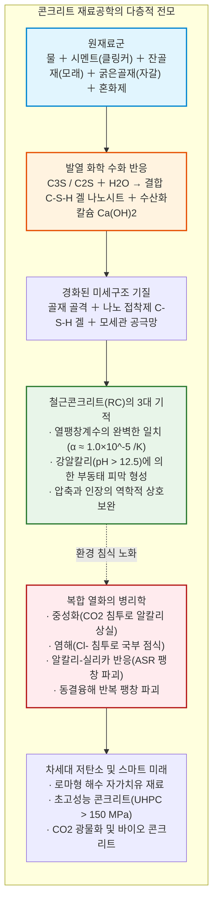
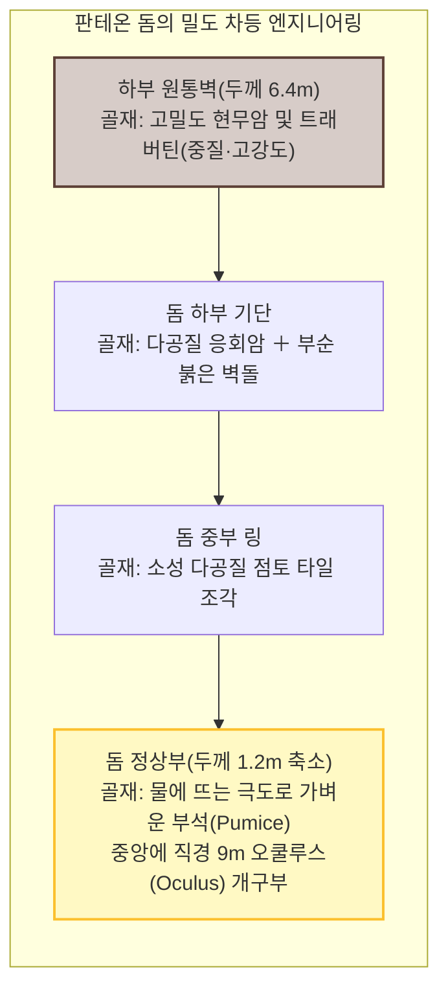
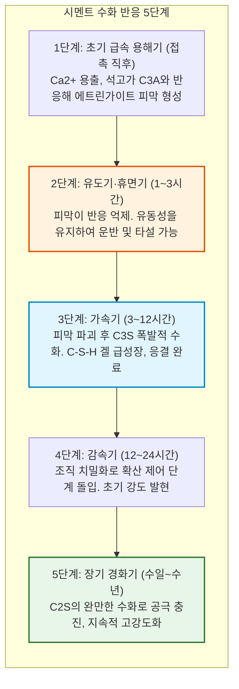
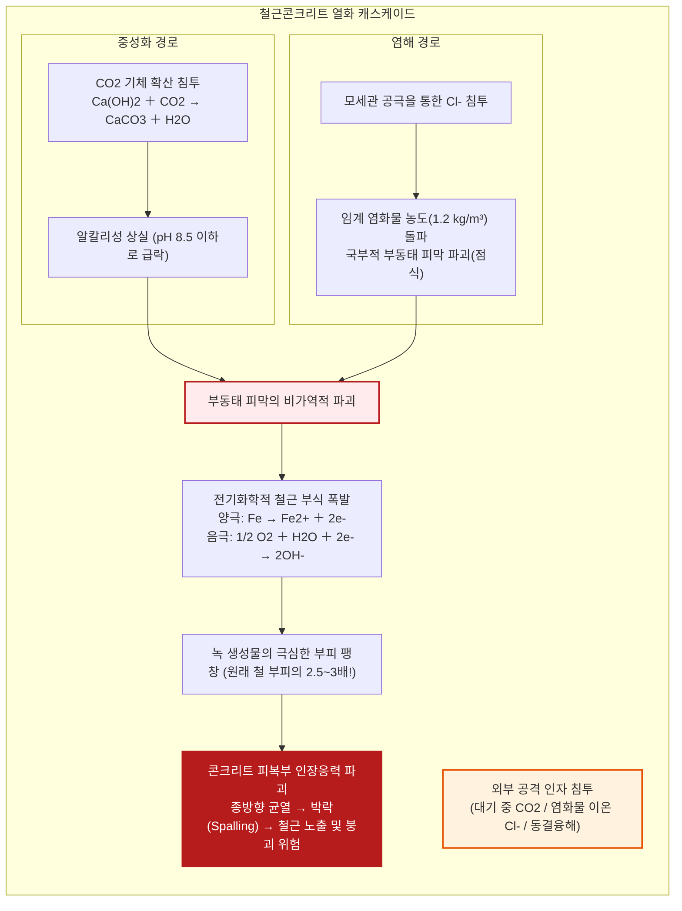
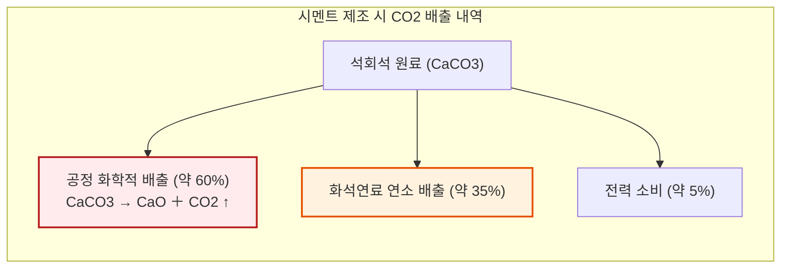

## 서론: 인류가 물 다음으로 가장 많이 소비하는 물질

고속도로의 아스팔트 하부 기층, 바다를 가로지르는 거대한 교각, 구름을 뚫고 솟아오른 초고층 빌딩의 코어월, 수억 톤의 강물을 막아내는 댐에 이르기까지 현대 문명의 물리적 토대는 대부분 회색의 인공 암석인 **콘크리트(Concrete)**로 구축되어 있다.

콘크리트는 지구상에서 인류가 **'물 다음으로 가장 많이 소비하는 물질'**이다. 연간 전 세계 소비량은 300억 톤(약 140억 입방미터)을 초과하며, 이는 전 세계 인류가 매년 1인당 약 4톤의 콘크리트를 소비하는 셈이다. 철강, 목재, 플라스틱, 유리의 전 세계 생산량을 모두 합쳐도 콘크리트 총량에는 턱없이 미치지 못한다.

그러나 이토록 친숙한 재료에 대해 대중은 "모래와 자갈을 시멘트 풀에 버무려 수분이 증발해 마르면 단단해지는 것"이라는 직관적인 오해를 품고 있다.

화학 및 재료역학의 관점에서 이는 **근본적으로 잘못된 상식**이다.

콘크리트는 **'말라서 굳는' 것이 아니다**. 오히려 조기에 건조되면 수화 반응이 중단되어 푸석푸석하게 바스러지고 만다. 콘크리트가 굳는 본질은 시멘트 화합물이 물 분자와 화학적으로 결합하여 나노 단위의 결정망을 얽어 짜며 새로운 인공 암석을 합성해내는 **'수화 반응(Hydration Reaction)'**이다. 콘크리트는 물속에 완전히 잠겨 있어도 완벽하게 경화되며, 오히려 건조한 공기 중보다 물속에서 더 높은 강도를 발현한다.

나아가 현대 철근콘크리트 구조물의 수명이 50~100년 정도로 평가되는 반면, 2000년 전 고대 로마인이 지은 판테온의 거대 돔과 지중해 해만 부두는 철근 한 가닥 쓰지 않았음에도 지진과 파도를 견뎌내며 완벽한 모습을 간직하고 있다.

콘크리트는 왜 굳는가? 왜 고대 로마의 콘크리트는 2000년 동안 부서지지 않는가? 그리고 현대의 철근콘크리트는 왜 중성화와 염해로 무너지는가? 인공 암석의 전모를 재료과학과 공학의 시선으로 해부한다.

---

## 제1장: 2000년 풍상을 견뎌낸 고대 로마의 기적——오푸스 카에멘티키움

기원후 126년 하드리아누스 황제 때 완공된 로마의 신전 판테온(Pantheon)은 내경 **43.3미터**, 높이 43.3미터의 완벽한 구를 품은 거대한 콘크리트 돔을 자랑한다.

놀랍게도 이 거대한 돔에는 **철근이 전혀 들어있지 않다**. 무근 콘크리트 돔은 자중에 의한 인장력으로 파괴되어야 마땅하지만, 2000년 동안 지진을 버텨냈다.

로마인들은 하부 벽체는 무거운 현무암으로 두껍게(6.4m) 쌓고, 위로 올라갈수록 다공질 부석(Pumice)으로 골재를 교체하여 정상부 두께를 1.2m까지 줄이고 중앙을 뚫어(오쿨루스) 자중을 극소화했다.

### 1.1 '핫 믹싱'과 생석회 잔유물의 자가 치유

2023년 MIT 연구팀은 로마인들이 소석회가 아닌 생석회($\text{CaO}$)를 화산재(포졸라나)와 직접 버무린 뒤 물을 붓는 **'핫 믹싱(Hot Mixing)'** 공법을 썼음을 규명했다. 물과 반응할 때 발생하는 격렬한 열($80^\circ\text{C}$ 이상) 덕분에 매트릭스 속에 미반응 '석회 포유물(Lime Clasts)'이 형성되었다.

균열이 생기면 침투한 물이 석회 포유물을 녹여 방해석($\text{CaCO}_3$)으로 재결정화되어 금을 스스로 메웠다. 또한 해수 속의 광물과 반응하여 희귀한 판상 광물인 **알루미늄 토버모라이트(Al-Tobermorite)**가 결정화되며 해수 속에서 시간이 흐를수록 더욱 단단해졌다.

---

## 제2장: 시멘트 수화 반응의 분자 기구——왜 말라서 굳는 게 아닌가

1824년 조셉 애스프딘이 발명한 **포틀랜드 시멘트**는 석회석과 점토를 $1450^\circ\text{C}$ 에서 소성해 만든 클링커로 이루어진다.

| 광물명 | 시멘트 화학 표기 | 화학식 | 질량비 | 수화 특성과 역할 |
| :--- | :--- | :--- | :--- | :--- |
| **알라이트(Alite)** | **$C_3S$** | $\text{Ca}_3\text{SiO}_5$ | $50 \sim 70\%$ | 수화가 빠름. 초기~28일 강도 발현 주도. |
| **벨라이트(Belite)** | **$C_2S$** | $\text{Ca}_2\text{SiO}_4$ | $15 \sim 30\%$ | 수화가 매우 느림. 장기 강도(수개월~수년) 증진. |
| **알루미네이트** | **$C_3A$** | $\text{Ca}_3\text{Al}_2\text{O}_6$ | $5 \sim 10\%$ | 물과 폭발적으로 반응(순결). 석고로 반응을 지연시킴. |
| **페라이트** | **$C_4AF$** | $\text{Ca}_4\text{Al}_2\text{Fe}_2\text{O}_{10}$ | $5 \sim 15\%$ | 수화 속도 완만. 회색 색조와 내황산염성 부여. |

### 2.1 수화 화학반응식과 C-S-H 겔

$$2 C_3S + 6 H_2O \to C_3S_2H_3 \text{ (C-S-H 겔)} + 3 Ca(OH)_2 \text{ (수산화칼슘)} + \Delta H$$

$$2 C_2S + 4 H_2O \to C_3S_2H_3 \text{ (C-S-H 겔)} + Ca(OH)_2 + \Delta H$$

- **C-S-H 겔**: 나노 결정성 겔로, 반데르발스 힘으로 얽히며 **콘크리트 강도의 80% 이상을 제공하는 나노 접착제**.
- **수산화칼슘($Ca(OH)_2$)**: 강알칼리성(**$\text{pH} \approx 12.5 \sim 13.5$**)을 부여해 내부 철근의 부식을 원천 차단.

에이브람스의 법칙($f_c = A / B^{W/C}$)에 따라 잉여수가 많을수록 모세관 공극이 남아 강도가 급락하므로, 현대 공학은 물-시멘트비($W/C$)를 $30 \sim 40\%$ 이하로 낮추는 것을 핵심으로 한다.

---

## 제3장: 철과 돌의 기적의 결혼——철근콘크리트(RC)의 필연

콘크리트는 인장강도가 압축강도의 10분의 1에 불과하다. 철근을 매립한 **철근콘크리트(RC)**가 인류 최고의 건축 재료가 된 것은 **세 가지 기적** 덕분이다:

```mermaid
flowchart TD
    subgraph MiraculousSynergy["철근콘크리트(RC)를 성립시키는 3대 기적"]
        direction TB
        
        subgraph Thermal["기적 1: 열팽창계수의 일치"]
            ExpConcrete["콘크리트 열팽창계수<br/>α ≈ 1.0 × 10^-5 /K"]
            ExpSteel["철근(탄소강) 열팽창계수<br/>α ≈ 1.2 × 10^-5 /K"]
            ThermalResult["영하 30℃부터 영상 50℃까지<br/>온도 변화에 따른 계면 박리가 전혀 일어나지 않음!"]
            ExpConcrete --- ExpSteel --> ThermalResult
        end
        
        subgraph Mechanical["기적 2: 역학적 상호보완"]
            Comp["콘크리트가 모든 압축력 부담<br/>(저렴하고 거대한 강성, 내화 피복)"]
            Tens["철근이 모든 인장력 부담<br/>(높은 항복강도와 우수한 연성)"]
            Adhesion["이형철근 마디의 기계적 맞물림<br/>(완벽한 전단 응력 전달)"]
            Comp --- Tens --> Adhesion
        end
        
        subgraph Chemical["기적 3: 강알칼리 부동태 피막"]
            Alkali["수산화칼슘 포화 수용액<br/>초강알칼리성 환경 (pH 12.5~13.5)"]
            PassiveFilm["철 표면에 나노미터 두께의<br/>치밀한 γ-Fe2O3 부동태 피막 자가 형성"]
            CorrosionStop["전기화학적 산화 반응 차단<br/>습기 속에서도 철근이 절대 녹슬지 않음!"]
            Alkali --> PassiveFilm --> CorrosionStop
        end
    end
    
    style ThermalResult fill:#e1f5fe,stroke:#0288d1,stroke-width:2px
    style Adhesion fill:#fff3e0,stroke:#e65100,stroke-width:2px
    style CorrosionStop fill:#e8f5e9,stroke:#2e7d32,stroke-width:2px
```

1. **열팽창계수의 일치**: $\alpha \approx 1.0 \sim 1.2 \times 10^{-5}\ /\text{K}$ 로 거의 동일하여 사계절 온도 변화에도 계면이 박리되지 않는다.
2. **역학적 보완**: 콘크리트는 압축을, 철근은 인장을 맡고, 콘크리트는 철근의 내화 피복재 역할을 한다.
3. **부동태 피막(Passive Film)**: $\text{pH} > 12.5$ 의 강알칼리 환경에서 철 표면에 두께 수 나노미터의 $\gamma\text{-Fe}_2\text{O}_3$ 산화 피막이 형성되어 산소와 물이 있어도 녹이 슬지 않는다.

---

## 제4장: 콘크리트의 병리학——왜 부서지는가

1. **중성화(Carbonation)**: $\text{CO}_2$ 가 침투해 $\text{Ca(OH)}_2$ 를 $\text{CaCO}_3$ 로 바꾸면서 $\text{pH}$ 가 9 이하로 떨어져 부동태 피막이 파괴된다.
2. **녹의 팽창과 박락(Spalling)**: 녹의 부피는 쇠의 **2.5~3배**로 팽창하며 수십 MPa의 압력으로 콘크리트를 쪼개고 떨어져 나가게 한다.
3. **염해(Chloride Attack)**: 해수나 제설제의 염화물 이온이 피막을 뚫고 들어가 철근을 바늘구멍처럼 파먹는 점식(Pitting)을 일으킨다.
4. **알칼리-실리카 반응(ASR)**: 시멘트 알칼리와 골재 실리카가 반응해 팽창 겔을 형성하며 거미줄 균열을 유발한다.

---

## 제5장: 최첨단 초고성능 콘크리트(UHPC)

폴리카르복실산계 감수제(PCE)의 입체장애 반발력 덕분에 물을 거의 쓰지 않고도 반죽을 흘려 넣을 수 있게 되었다.

자갈을 없애고 미세 실리카 흄과 강섬유를 배합한 **초고성능 콘크리트(UHPC)**는 압축강도 **$150 \sim 220\ \text{MPa}$** 를 발휘하며, 공극이 완전히 사라져 염분과 물이 전혀 스며들지 않는다.

---

## 제6장: 탈탄소와 미래의 바이오 콘크리트

시멘트 제조는 석회석 열분해($\text{CaCO}_3 \to \text{CaO} + \text{CO}_2$)로 인해 **전 세계 $\text{CO}_2$ 배출량의 약 8%**를 차지한다.

- **고로슬래그·플라이애시 대체**: 클링커 소비를 50~70% 감축.
- **탄소 고정 콘크리트**: 양생 시 고농도 $\text{CO}_2$ 를 주입해 암석으로 영구 광물화.
- **자가 치유 바이오 콘크리트**: 포자균 박테리아와 젖산칼슘을 혼합하여 균열로 물이 들어오면 세균이 깨어나 방해석 결정을 분비해 상처를 스스로 봉합.

---

## 결론: 인간의 손으로 빚어낸 바위의 존엄

고대 로마의 화산재부터 현대의 나노 복합재와 바이오 기술에 이르기까지 콘크리트는 자연의 암석을 능가하려는 인간 지성의 결정체다. 흙과 물이 직조해낸 이 인공의 거인은 앞으로도 조용히 인류 문명의 발밑을 지탱해 나갈 것이다.
