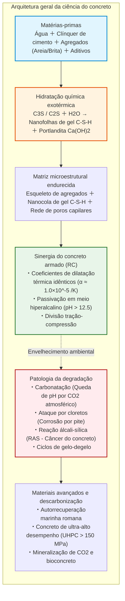
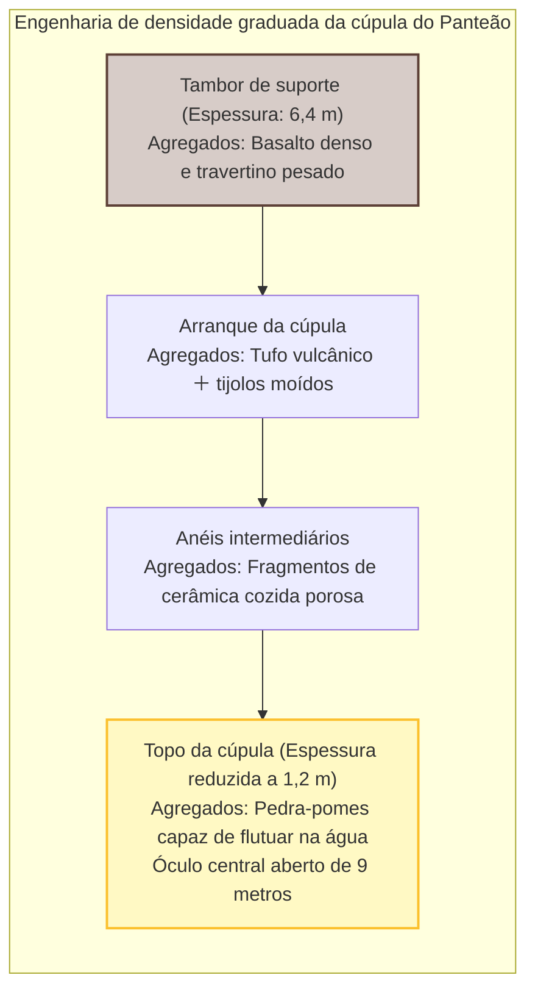
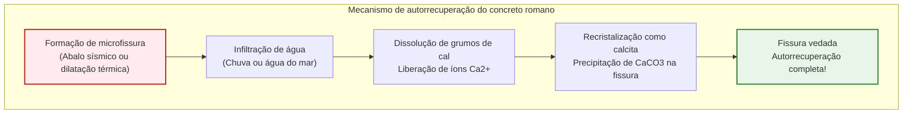
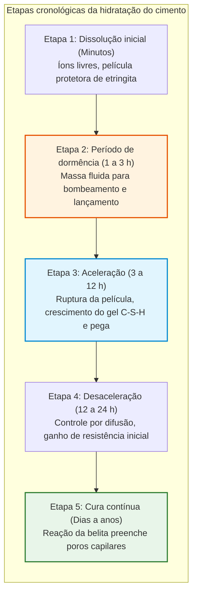
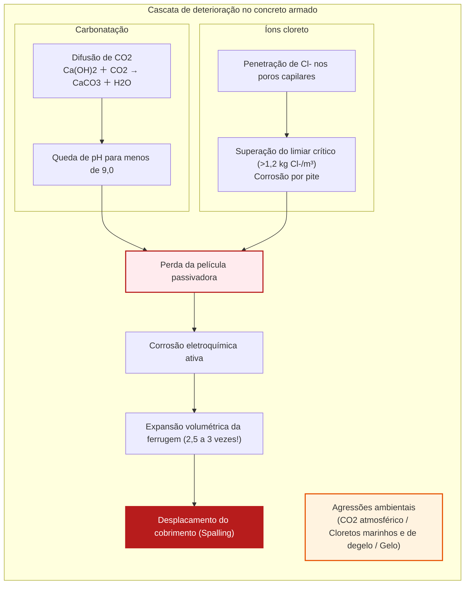
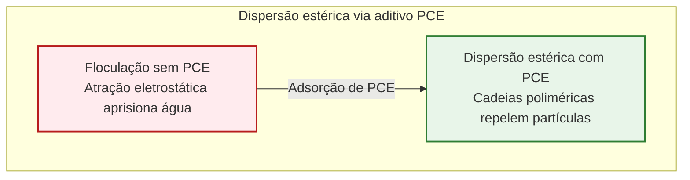
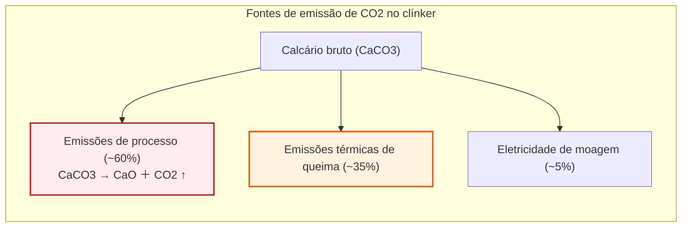

## Introdução: A substância mais consumida pela humanidade depois da água

De rodovias a pilares monumentais de pontes sobre estreitos marítimos, de núcleos de arranha-céus a barragens gigantescas, a base física da civilização moderna assenta sobre uma rocha artificial: o **concreto**.

O concreto é a **segunda substância mais consumida no planeta depois da água**. Com consumo global anual superior a 30 bilhões de toneladas (cerca de 14 bilhões de metros cúbicos), cada habitante do planeta consome em média 4 toneladas anuais. Sua massa supera com folga a produção somada de aço, madeira, plástico e vidro.

No entanto, ainda impera a crença comum de que o concreto endurece ao «secar ao ar livre».

Sob a ótica da química de materiais, isso é **completamente falso**.

O concreto **não endurece por secagem**. Se secar precocemente, perde sua resistência mecânica e esfarela. Ele se consolida por uma **reação de hidratação**: minerais anidros do clínquer reagem quimicamente com moléculas de água, precipitando uma rede de nanocristais entrelaçados. Submerso em água e isolado do ar, o concreto cura perfeitamente, alcançando densidade e resistência ainda maiores do que ao ar seco.

Além disso, enquanto estruturas modernas de concreto armado são projetadas para 50 a 100 anos, a cúpula de concreto não armado do Panteão de Roma e cais portuários marítimos resistem há dois milênios sem uma única barra de aço.

---

## Capítulo 1: O prodígio romano – Opus Caementicium

Concluído em 126 d.C. sob o imperador Adriano, o Panteão de Roma ostenta uma cúpula de **43,3 metros de vão livre**. É a **maior cúpula de concreto não armado do mundo**.

Os romanos escalonaram os agregados por densidade: basalto na base e pedra-pomes leve no topo, reduzindo a espessura de 6,4 m para 1,2 m.

### 1.1 Mistura a quente e autorrecuperação

Pesquisas do MIT em 2023 revelaram que os romanos misturavam cal virgem ($\text{CaO}$) diretamente com pozolana antes de adicionar água («Hot Mixing»):

$$\text{CaO} + \text{H}_2\text{O} \to \text{Ca(OH)}_2 + 63{,}7\ \text{kJ/mol}$$

A reação térmica violenta ($> 80^\circ\text{C}$) deixou grumos de cal não reagida. Ao penetrar água por fissuras, dissolve esses grumos e precipita calcita ($\text{CaCO}_3$), selando a trinca de forma autônoma.

---

## Capítulo 2: Hidratação do cimento Portland

Patenteado em 1824 por Joseph Aspdin, o cimento Portland é produzido calcinando calcário e argila a $1450^\circ\text{C}$.

| Fase do clínquer | Notação | Fórmula | Fração | Comportamento cinético |
| :--- | :--- | :--- | :--- | :--- |
| **Alita** | **$C_3S$** | $\text{Ca}_3\text{SiO}_5$ | $50 \sim 70\%$ | Hidratação rápida; fornece resistência inicial e aos 28 dias |
| **Belita** | **$C_2S$** | $\text{Ca}_2\text{SiO}_4$ | $15 \sim 30\%$ | Hidratação lenta; garante resistência de longo prazo |
| **Aluminato** | **$C_3A$** | $\text{Ca}_3\text{Al}_2\text{O}_6$ | $5 \sim 10\%$ | Pega rápida (flash set); gesso retarda essa reação |
| **Ferrito** | **$C_4AF$** | $\text{Ca}_4\text{Al}_2\text{Fe}_2\text{O}_{10}$ | $5 \sim 15\%$ | Resistência a sulfatos, cor cinza característica |

### 2.1 Equações de hidratação e gel C-S-H

$$2 C_3S + 6 H_2O \to C_3S_2H_3 \text{ (Gel C-S-H)} + 3 Ca(OH)_2 \text{ (Portlandita)} + \Delta H$$

$$2 C_2S + 4 H_2O \to C_3S_2H_3 \text{ (Gel C-S-H)} + Ca(OH)_2 + \Delta H$$

- **Gel C-S-H**: Nanofolhas responsáveis por **mais de 80% da resistência mecânica**.
- **Portlandita ($\text{Ca(OH)}_2$)**: Garante pH fortemente alcalino de **$12{,}5 \sim 13{,}5$**, passivando o aço contra corrosão.

Conforme a Lei de Abrams ($f_c = A / B^{a/c}$), diminuir a relação água/cimento ($a/c$) reduz poros capilares e amplia a resistência.

---

## Capítulo 3: A simbiose do concreto armado (RC)

```mermaid
flowchart TD
    subgraph MiraculousSynergy["As três coincidências do concreto armado"]
        direction TB
        
        subgraph Thermal["Coincidência 1: Paridade térmica"]
            ExpConcrete["Dilatação do concreto<br/>α ≈ 1.0 × 10^-5 /K"]
            ExpSteel["Dilatação do aço de armadura<br/>α ≈ 1.2 × 10^-5 /K"]
            ThermalResult["Zero tensões cisalhantes internas de -30°C a +50°C!"]
            ExpConcrete --- ExpSteel --> ThermalResult
        end
        
        subgraph Mechanical["Coincidência 2: Divisão de esforços"]
            Comp["O concreto suporta toda a compressão"]
            Tens["O aço suporta toda a tração"]
            Adhesion["As nervuras das barras transferem a aderência mecânica"]
            Comp --- Tens --> Adhesion
        end
        
        subgraph Chemical["Coincidência 3: Película passivadora"]
            Alkali["Solução de Ca(OH)2 saturada<br/>pH de 12,5 a 13,5"]
            PassiveFilm["Película nanométrica de γ-Fe2O3<br/>protetora no aço"]
            CorrosionStop["O aço não enferruja sob concreto íntegro!"]
            Alkali --> PassiveFilm --> CorrosionStop
        end
    end
    
    style ThermalResult fill:#e1f5fe,stroke:#0288d1,stroke-width:2px
    style Adhesion fill:#fff3e0,stroke:#e65100,stroke-width:2px
    style CorrosionStop fill:#e8f5e9,stroke:#2e7d32,stroke-width:2px
```

---

## Capítulo 4: Patologia e deterioração

1. **Carbonatação**: O $\text{CO}_2$ converte $\text{Ca(OH)}_2$ em $\text{CaCO}_3$, reduzindo o pH para baixo de 9. A profundidade segue a raiz do tempo: $x = A \sqrt{t}$.
2. **Expansão e desplacamento (Spalling)**: A ferrugem se expande **2,5 a 3 vezes**, rompendo o cobrimento de concreto.
3. **Cloretos**: Geram corrosão por pite localizada e imperceptível exteriormente.
4. **Reação álcali-sílica (RAS)**: Expansão interna de gel de sílica hidratado.

---

## Capítulo 5: Concreto de ultra-alto desempenho (UHPC)

Superplastificantes policarboxílicos (PCE) dispersam as partículas de cimento por repulsão estérica, permitindo relações $a/c < 0{,}20$.

O **UHPC** elimina brita graúda, incorpora sílica ativa ultrafina e microfibras de aço, alcançando resistências de **$150$ a $220\ \text{MPa}$**.

---

## Capítulo 6: Descarbonização e bioconcreto

O cimento emite **7 a 8% do $\text{CO}_2$ global**, dos quais 60% decorrem inevitavelmente da descarbonatação do calcário ($\text{CaCO}_3 \to \text{CaO} + \text{CO}_2 \uparrow$).

As rotas sustentáveis incluem escorias de alto-forno, mineralização forçada de $\text{CO}_2$ e **bioconcreto autorreparável** com bactérias *Bacillus*.

---

## Conclusão: A rocha esculpida pelo ser humano

O concreto é uma conquista de dois milênios de engenharia. Adaptando-se às exigências climáticas, essa rocha moldável continuará erguendo as cidades do amanhã com segurança e sustentabilidade.
