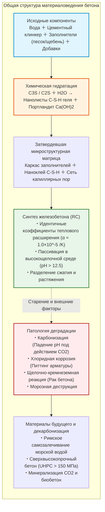
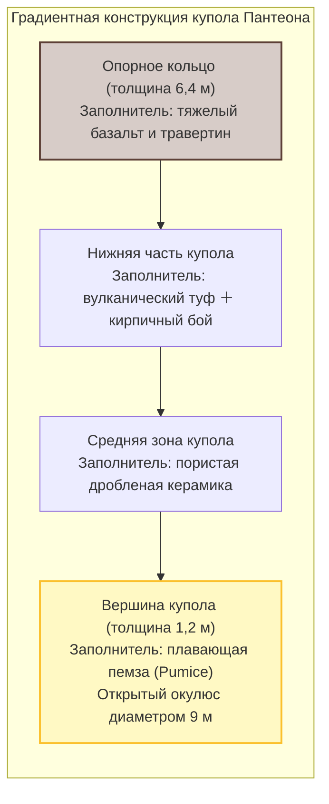
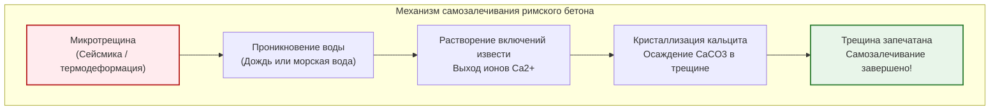
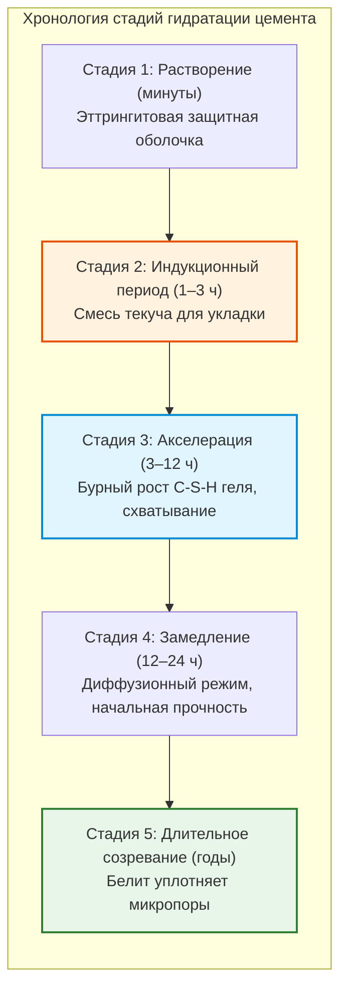
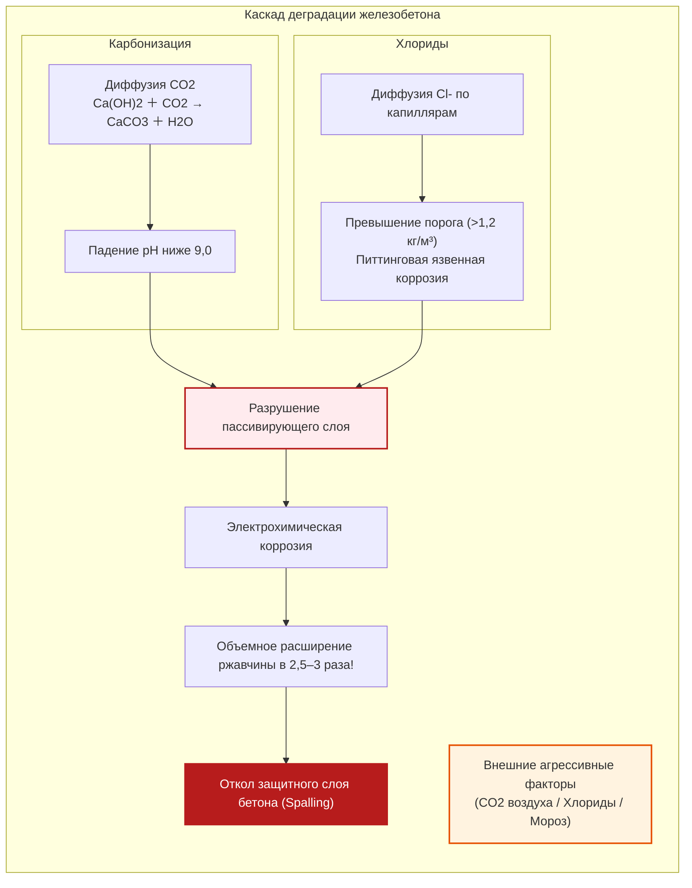
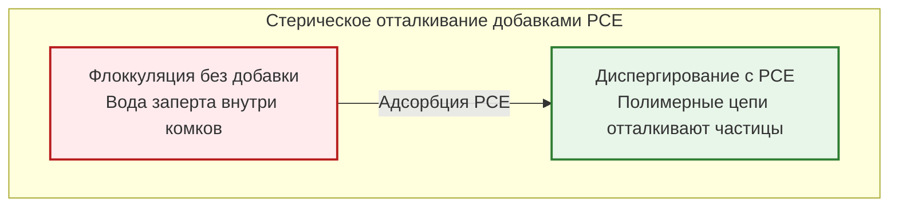
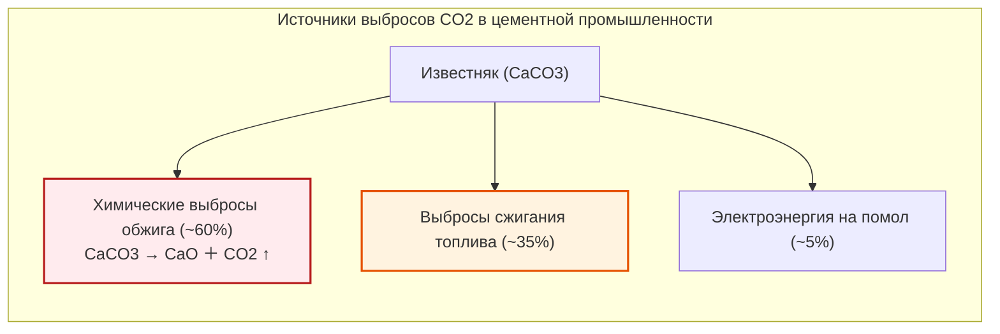

## Введение: Второе по потреблению вещество человечества после воды

Автомагистрали, гигантские пилоны вантовых мостов, монолитные ядра небоскребов и плотины гидроэлектростанций созданы из искусственного камня — **бетона (Concrete)**.

Бетон — **второе по объему потребления вещество на Земле после воды**. Ежегодный мировой объем превышает 30 миллиардов тонн (около 14 миллиардов кубических метров) — примерно 4 тонны на каждого жителя планеты в год.

Распространено ошибочное представление, будто бетон «просто высыхает на воздухе».

С точки зрения химии это **абсолютно неверно**.

Бетон **не твердеет от высыхания**. При раннем испарении влаги процесс гидратации прекращается, и структура рассыпается в песок. Затвердевание — это **реакция гидратации**: безводные силикаты клинкера связываются с молекулами воды, кристаллизуясь в плотный гель. Погруженный в воду бетон набирает еще большую плотность и прочность, чем на воздухе.

Более того, неармированный бетонный купол римского Пантеона и портовые волноломы стоят уже 2000 лет без стальной арматуры.

---

## Глава 1: Римское чудо — Opus Caementicium

Купол римского Пантеона диаметром **43,3 метра**, возведенный в 126 г. н.э., до сих пор является **крупнейшим неармированным бетонным куполом в мире**.

Римляне применили градиент заполнителей: тяжелый базальт внизу и легчайшую пемзу на вершине.

### 1.1 «Горячее смешивание» и самозалечивание

В 2023 году ученые MIT выяснили, что римляне смешивали негашеную известь ($\text{CaO}$) с пуццоланом до добавления воды («Hot Mixing»):

$$\text{CaO} + \text{H}_2\text{O} \to \text{Ca(OH)}_2 + 63{,}7\ \text{кДж/моль}$$

При появлении микротрещин вода растворяет оставшиеся частицы извести, и они кристаллизуются в виде кальцита ($\text{CaCO}_3$), герметизируя трещину.

---

## Глава 2: Химия гидратации портландцемента

| Фаза клинкера | Обозначение | Формула | Доля | Кинетическая роль |
| :--- | :--- | :--- | :--- | :--- |
| **Алит** | **$C_3S$** | $\text{Ca}_3\text{SiO}_5$ | $50 \sim 70\%$ | Быстрая реакция; ранняя и марочная прочность |
| **Белит** | **$C_2S$** | $\text{Ca}_2\text{SiO}_4$ | $15 \sim 30\%$ | Медленная гидратация; рост прочности годами |
| **Алюминат** | **$C_3A$** | $\text{Ca}_3\text{Al}_2\text{O}_6$ | $5 \sim 10\%$ | Мгновенное схватывание; гипс тормозит реакцию |
| **Феррит** | **$C_4AF$** | $\text{Ca}_4\text{Al}_2\text{Fe}_2\text{O}_{10}$ | $5 \sim 15\%$ | Сульфатостойкость, серый оттенок |

$$2 C_3S + 6 H_2O \to C_3S_2H_3 \text{ (C-S-H гель)} + 3 Ca(OH)_2 \text{ (Портландит)} + \Delta H$$

$$2 C_2S + 4 H_2O \to C_3S_2H_3 \text{ (C-S-H гель)} + Ca(OH)_2 + \Delta H$$

C-S-H гель обеспечивает более 80% прочности, а гидроксид кальция создает щелочную среду с **$\text{pH} = 12{,}5 \sim 13{,}5$**, защищающую сталь.

---

## Глава 3: Физико-химический союз железобетона

```mermaid
flowchart TD
    subgraph MiraculousSynergy["Три основы железобетона"]
        direction TB
        
        subgraph Thermal["Совпадение 1: Тепловое расширение"]
            ExpConcrete["Коэффициент бетона<br/>α ≈ 1.0 × 10^-5 /K"]
            ExpSteel["Коэффициент стали<br/>α ≈ 1.2 × 10^-5 /K"]
            ThermalResult["Отсутствие сдвигов при температурах от -30°C до +50°C!"]
            ExpConcrete --- ExpSteel --> ThermalResult
        end
        
        subgraph Mechanical["Совпадение 2: Распределение сил"]
            Comp["Бетон держит все сжатие"]
            Tens["Сталь держит все растяжение"]
            Adhesion["Рифление арматуры обеспечивает сцепление"]
            Comp --- Tens --> Adhesion
        end
        
        subgraph Chemical["Совпадение 3: Пассивация"]
            Alkali["Насыщенный раствор Ca(OH)2<br/>pH 12,5–13,5"]
            PassiveFilm["Нанопленка γ-Fe2O3<br/>защищает металл от коррозии"]
            CorrosionStop["Сталь в монолите не ржавеет!"]
            Alkali --> PassiveFilm --> CorrosionStop
        end
    end
    
    style ThermalResult fill:#e1f5fe,stroke:#0288d1,stroke-width:2px
    style Adhesion fill:#fff3e0,stroke:#e65100,stroke-width:2px
    style CorrosionStop fill:#e8f5e9,stroke:#2e7d32,stroke-width:2px
```

---

## Глава 4: Патология разрушения

Ржавчина увеличивается в объеме в **2,5–3 раза**, вызывая сколы бетона (*Spalling*). Хлориды провоцируют локальный питтинг, а щелочи вызывают «рак бетона» (ASR).

---

## Глава 5: Сверхвысокопрочный бетон (UHPC)

Поликарбоксилатные гиперпластификаторы (PCE) обеспечивают пространственное отталкивание цементных зерен, снижая В/Ц ниже 0,20.

**UHPC** исключает крупный щебень, включает микрокремнезем и стальную микрофибру, достигая прочности на сжатие **$150 \sim 220\ \text{МПа}$**.

---

## Глава 6: Декарбонизация и биобетон

Производство клинкера дает **7–8% мировых выбросов $\text{CO}_2$**, главным образом из-за декарбонизации известняка ($\text{CaCO}_3 \to \text{CaO} + \text{CO}_2 \uparrow$).

Будущее за заменой клинкера шлаками, принудительной минерализацией $\text{CO}_2$ и **биобетоном** со спорами бактерий *Bacillus*, заращивающими трещины кристаллами кальцита.

---

## Заключение

Бетон — рукотворный камень, несущий на себе всю архитектуру современной эпохи. Превращаясь в углеродно-нейтральный самозалечивающийся композит, он продолжит служить фундаментом цивилизации.
