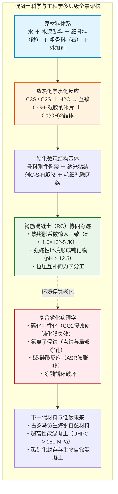
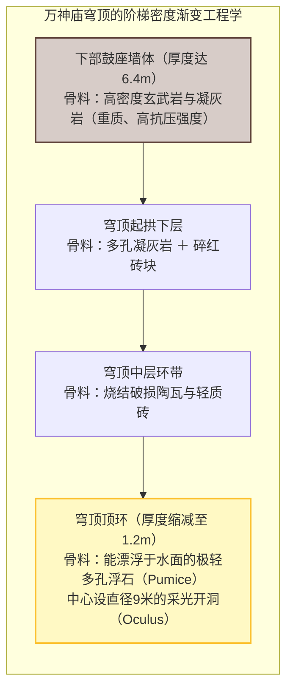
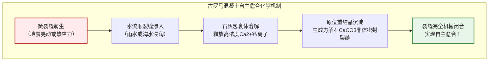
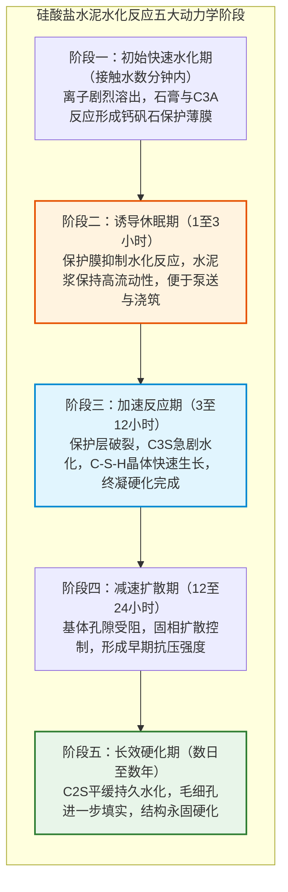
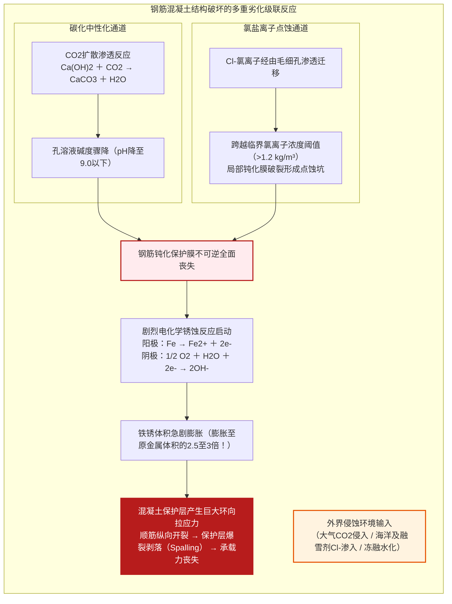
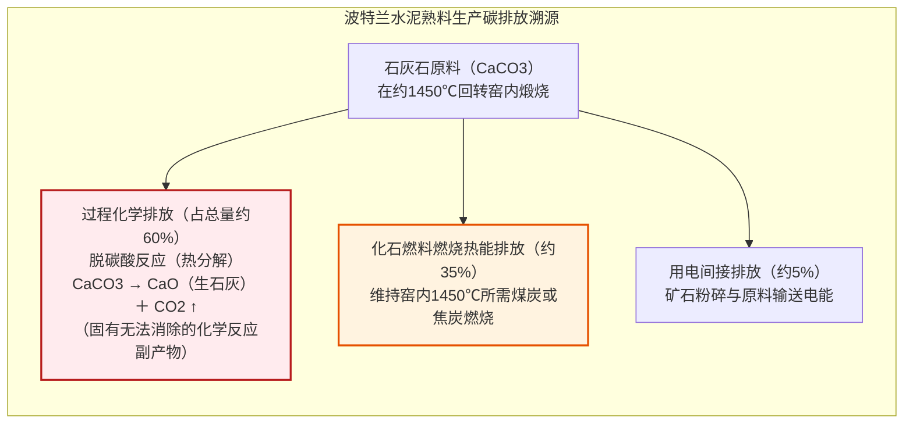

## 引言：人类消耗量仅次于水的宏伟物质

从纵横大陆的高速公路、跨越海峡的悬索桥巨型桥墩，到直插云霄的摩天大楼核心筒，再到拦截江河的重力大坝——现代文明的物质基石，绝大部分是由一种灰色的人造岩石所浇筑，这就是**混凝土（Concrete）**。

混凝土是人类在地球上**“消耗量仅次于水的第二大物质”**。全球每年的使用量超过300亿吨（约140亿立方米），相当于地球上每人每年平均消费约4吨混凝土。即便将全球钢铁、木材、塑料和玻璃的年产量全部相加，其总质量也远不及混凝土的零头。

然而，对于这种朝夕相伴的材料，公众普遍存在一个直觉性的误区：“混凝土是由沙石混合水泥浆后，水分蒸发风干硬化而成的”。

从无机化学与材料科学的角度而言，这种常识性认知是**根本错误的**。

混凝土**绝非因“干燥”而硬化**。事实上，若过早风干脱水，混凝土将彻底失去强度、粉化崩解。其硬化的核心机制，是水泥矿物与水分子发生剧烈化学反应、生成交错互锁的纳米级水化产物晶体的过程，即**“水化反应（Hydration Reaction）”**。将混凝土完全浸没于水底，它不仅能完美硬化，其密实度与抗压强度反而显著高于干燥空气中的试件。

此外，历史还呈现出一个令人惊叹的悖论：现代钢筋混凝土结构的预期寿命通常仅为50至100年，而两千年前古罗马人修建的万神庙无筋混凝土穹顶以及地中海古代海港码头，在没有一根钢筋加固的前提下，历经两千年风浪洗礼与频繁地震，至今仍完好无损，甚至随岁月流逝强度愈发坚硬。

混凝土究竟如何凝结？古罗马混凝土为何历经两千年不坏？现代钢筋混凝土又为何频遭碳化与盐害侵蚀？本文将从物理学、分子化学与结构力学全景剖析人造岩石的科学全貌。

---

## 第一章：两千年风霜下的古罗马奇迹——罗马混凝土（Opus Caementicium）

谈及古代建筑工程，最大的奇迹莫过于古罗马的**“罗马混凝土（Opus Caementicium）”**。

建于公元126年哈德良皇帝时期的罗马万神庙（Pantheon），其巨大的半球形无筋混凝土穹顶跨度达**43.3米**，高度亦为43.3米，内部恰好能容纳一个完整的球体。

更为不可思议的是，这座穹顶**内部未配置任何一根金属钢筋**。按照传统结构力学计算，无筋大跨度拱顶在自重引起的环向拉应力下极易开裂崩塌，但万神庙却傲立了近两千年。

罗马建筑师通过**骨料比重梯度化（Graded Density）**完美解决了荷载问题：基础使用致密的玄武岩，向上依次递减，顶部则换成极轻的多孔浮石，厚度从6.4米骤降至1.2米，并在顶心开辟9米空心圆洞（天窗）大幅削减自重。

### 1.1 “热混合”工艺与石灰碎屑自愈合

麻省理工学院（MIT）在2023年的突破性研究揭示，古罗马人将未经消解的生石灰（$\text{CaO}$）与火山灰（Pozzolana）直接混合，再加入水进行搅拌，即所谓的**“热混合（Hot Mixing）”**。

生石灰剧烈水化释放大量热量（反应热达 $63.7\ \text{kJ/mol}$），局部温度飙升至 $80^\circ\text{C}$ 以上，促使基体中保留了微小的未完全反应的“白色石灰包裹体（Lime Clasts）”。

当外力使混凝土产生微裂纹时，雨水或海水顺裂隙浸入，迅速溶解石灰包裹体释放 $\text{Ca}^{2+}$，与碳酸根结合结晶析出**方解石（$\text{CaCO}_3$）**，自动封堵裂缝，赋予了古罗马混凝土神奇的“自愈”能力。

### 1.2 海水催化下的托贝莫来石晶体生长

在地中海沿岸罗马海港工程中，海水更化身为增强催化剂。海水与火山灰中的斜长石、火山玻璃发生极为缓慢的水热反应，逐渐结晶生成极为稀有的**铝置换托贝莫来石（Al-Tobermorite）**与钙十字沸石。这些层状硅酸盐板状晶体如骨针般穿插于孔隙中，使古代混凝土在海水浸泡下历经千年反而愈加坚如磐石。

---

## 第二章：水泥水化反应的分子机制——为什么遇水成岩

1824年英国泥瓦匠约瑟夫·阿斯普丁（Joseph Aspdin）发明了**波特兰水泥（Portland Cement，硅酸盐水泥）**。

### 2.1 熟料四大矿物相

石灰石与粘土在回转窑中经约 $1450^\circ\text{C}$ 高温煅烧烧结，生成含有“博格四大化合物”的水泥熟料：

| 矿物名称 | 水泥化学简写 | 分子化学式 | 质量占比 | 水化动力学特性与作用 |
| :--- | :--- | :--- | :--- | :--- |
| **硅酸三钙（阿利特）** | **$C_3S$** | $\text{Ca}_3\text{SiO}_5$ | $50 \sim 70\%$ | 水化速度快，提供主要早期及28天抗压强度 |
| **硅酸二钙（贝利特）** | **$C_2S$** | $\text{Ca}_2\text{SiO}_4$ | $15 \sim 30\%$ | 水化缓慢平稳，持续贡献数月至数年的后期强度 |
| **铝酸三钙** | **$C_3A$** | $\text{Ca}_3\text{Al}_2\text{O}_6$ | $5 \sim 10\%$ | 反应迅猛放热大，需加石膏抑制其“瞬凝” |
| **铁铝酸四钙** | **$C_4AF$** | $\text{Ca}_4\text{Al}_2\text{Fe}_2\text{O}_{10}$ | $5 \sim 15\%$ | 反应平缓，贡献抗硫酸盐性能并呈现水泥灰色 |

### 2.2 水化化学方程式与C-S-H凝胶

硅酸钙矿物的水化反应如下：

$$2 C_3S + 6 H_2O \to C_3S_2H_3 \text{ (C-S-H 凝胶)} + 3 Ca(OH)_2 \text{ (氢氧化钙)} + \Delta H$$

$$2 C_2S + 4 H_2O \to C_3S_2H_3 \text{ (C-S-H 凝胶)} + Ca(OH)_2 + \Delta H$$

反应生成物具有至关重要的分工：
1. **水化硅酸钙凝胶（C-S-H gel）**：非晶态纳米片状凝胶，通过范德华力紧密交联，**贡献了混凝土80%以上的机械粘结强度**。
2. **氢氧化钙（$\text{Ca(OH)}_2$）**：形成六角板状晶体，使内部孔隙液维持 **$\text{pH} = 12.5 \sim 13.5$ 的强碱性**，为内部钢筋构筑钝化防护盾。

### 2.3 水灰比（W/C）与阿布拉姆斯定律

混凝土完全水化所需的理论化学结合水仅占水泥质量的约25%，加上凝胶吸附水，**水灰比（W/C）达到0.40**即已足够。多余的自由水蒸发后会形成相互连通的毛细孔，严重削弱强度。

阿布拉姆斯定律（Abrams' Law）给出了强度与水灰比的经典反比关系：

$$f_c = \frac{A}{B^{W/C}}$$

现代高性能混凝土的核心原则，就是利用高效减水剂大幅降低水灰比至0.20~0.30，最大限度消除内部空隙。

---

## 第三章：钢与石的旷世奇缘——钢筋混凝土（RC）的物理化学必然

混凝土抗拉强度极弱（仅为抗压强度的 $1/10$ 左右）。将钢筋埋入混凝土中构成**钢筋混凝土（Reinforced Concrete，RC）**，之所以能成为近现代最伟大的结构材料，依赖于**三大力学与化学奇迹**：

1. **热膨胀系数契合**：混凝土与钢材的线膨胀系数均为约 $1.0 \sim 1.2 \times 10^{-5}\ /\text{K}$，四季冷热交替时二者几乎同步伸缩，避免了界面剪切破坏。
2. **受力完美互补**：混凝土抗压、钢筋抗拉，加之变形钢筋的肋纹咬合，共同承受弯矩。同时混凝土作为天然阻燃绝热层保护钢筋免遭火灾软化。
3. **电化学钝化防锈**：在 $\text{pH} > 12.5$ 强碱环境下，依据普尔贝（Pourbaix）电位-pH图，钢筋表面形成一层仅 $1 \sim 3\ \text{nm}$ 厚的高致密**$\gamma\text{-Fe}_2\text{O}_3$ 钝化保护膜**，隔绝腐蚀反应。

---

## 第四章：混凝土的病理学——结构为何衰亡

1. **碳化（Carbonation）**：空气中微量 $\text{CO}_2$ 渗入孔隙与水反应生成碳酸，消耗 $\text{Ca(OH)}_2$ 沉淀出 $\text{CaCO}_3$。孔隙水 $\text{pH}$ 跌破9.0，钢筋表面钝化膜瓦解。碳化深度遵循平方根定律 $x = A \sqrt{t}$。
2. **铁锈膨胀与混凝土保护层爆裂（Spalling）**：铁锈氧化物的体积是原钢材体积的 **2.5至3.0倍**，在坚硬孔壁内产生数十兆帕的放射状膨胀应力，导致混凝土沿钢筋方向纵向开裂并大面积爆裂脱落。
3. **氯盐侵蚀（Chloride Attack）**：海水及融雪剂中的氯离子具有强穿透性，当浓度超过临界阈值（约 $1.2\ \text{kg/m}^3$）时，诱发不可预测且危险的局部“点蚀（Pitting）”，外表看似完好，内部钢筋已被蚀穿切断。
4. **碱-硅酸反应（ASR，混凝土癌症）**：水泥中的碱金属离子与活性骨料中的硅反应生成吸水膨胀的碱-硅酸凝胶，引发网状龟裂。

---

## 第五章：前沿科技——超高性能混凝土（UHPC）

为彻底阻断毛细孔，科学家提出了**最密实颗粒堆积理论**。

1980年代发明的**聚羧酸系高性能减水剂（PCE）**通过空间位阻效应彻底分散水泥颗粒，使水灰比能降至0.20以下。在此基础上诞生的**超高性能混凝土（UHPC）**：
- 剔除粗骨料（石子），消除界面过渡区缺陷；
- 掺入微米级硅灰（比水泥细100倍），产生极高密实度及强力二次火山灰反应；
- 掺入体积比 $2\% \sim 3\%$ 的超强微细钢纤维。

| 性能指标 | 普通混凝土（NC） | 超高性能混凝土（UHPC） | 提升幅度 |
| :--- | :--- | :--- | :--- |
| **抗压强度** | $25 \sim 40\ \text{MPa}$ | **$150 \sim 220\ \text{MPa}$** | **提高5至8倍**（比肩结构钢） |
| **抗拉强度** | $2 \sim 3\ \text{MPa}$ | **$10 \sim 15\ \text{MPa}$** | **提高5倍** |
| **断裂能（韧性）** | $0.1\ \text{kJ/m}^2$ | **$20 \sim 30\ \text{kJ/m}^2$** | **提升200至300倍**（克服脆性） |
| **氯离子扩散系数** | $1 \times 10^{-11}\ \text{m}^2/\text{s}$ | **$< 1 \times 10^{-13}\ \text{m}^2/\text{s}$** | **降至1/100以下**（几乎绝对不透水） |

---

## 第六章：脱碳转型与低碳智能材料的未来

水泥工业约占**全球人为 $\text{CO}_2$ 排放总量的7%至8%**。其核心痛点在于：排放中的约60%来自于石灰石煅烧分解的固有化学方程式（$\text{CaCO}_3 \to \text{CaO} + \text{CO}_2 \uparrow$），即使改用绿氢加热也无法避免。

现代前沿解决方案包括：
1. **工业副产物矿物掺合料**：以矿渣微粉（GGBS）和粉煤灰替代50%至70%熟料；
2. **碳矿化封存混凝土**：在搅拌或养护阶段将工业废气 $\text{CO}_2$ 注入混凝土，生成纳米级碳酸钙，永久封存上百公斤 $\text{CO}_2/\text{m}^3$；
3. **生物自愈混凝土（Bio-Concrete）**：将耐碱芽孢杆菌与乳酸钙微胶囊置于混凝土中。一旦开裂渗水，细菌苏醒并代谢乳酸钙分泌出方解石（$\text{CaCO}_3$）晶体，数周内自行长肉愈合裂纹。

---

## 结语：人类手铸之岩，筑起文明不朽之基

从古罗马的火山灰砂浆到现代纳米工程与生物混凝土，混凝土的演进史是人类认知重力与材料本质的宏大史诗。

它并非冰冷单调的灰色块体，而是水与无机分子在微观尺度编织的晶体交响乐。面向未来的绿色城市，这尊从泥土中诞生的人造巨人，仍将稳健支撑着人类文明迈向更广阔的苍穹。
