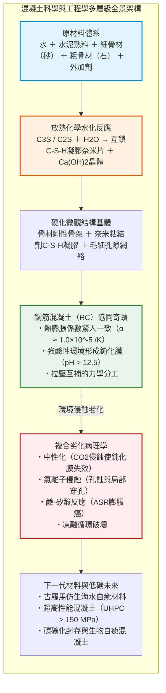
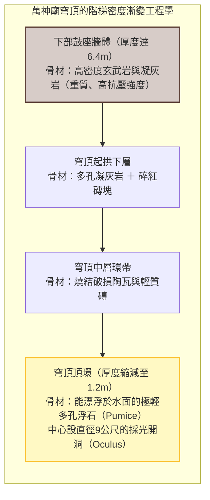
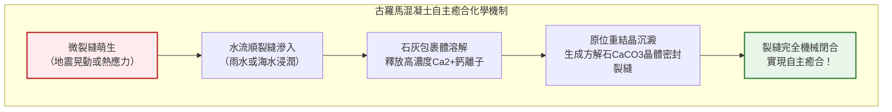
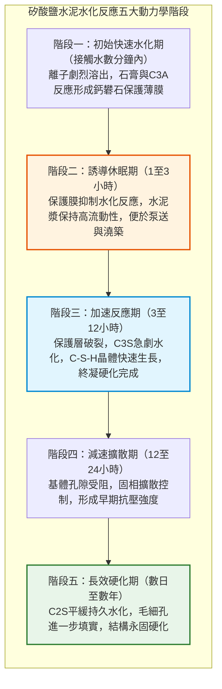
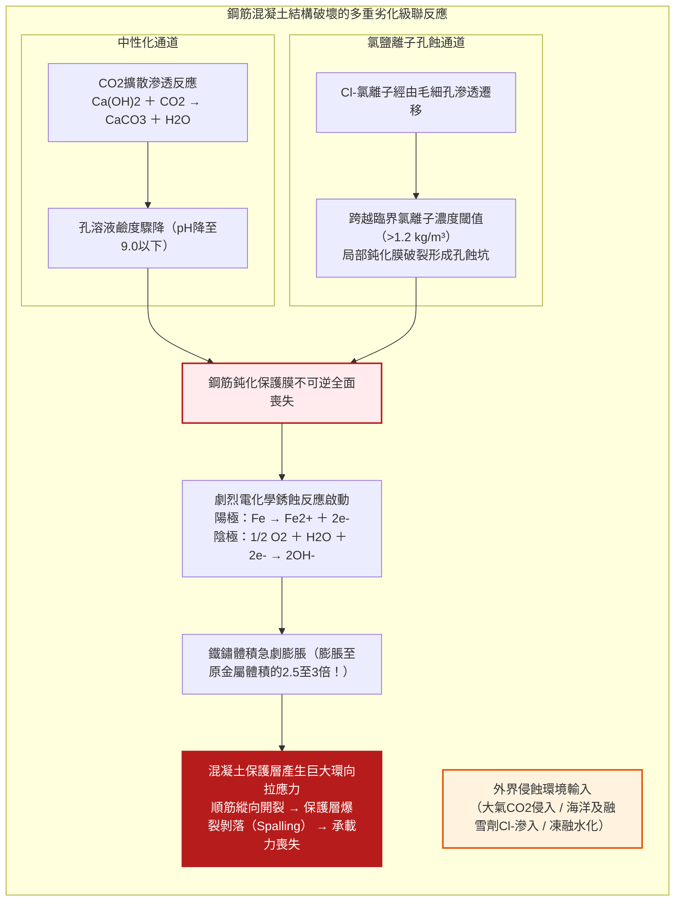
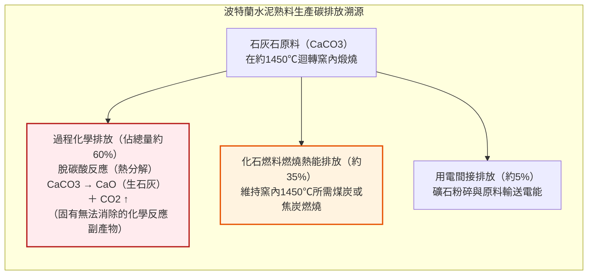

## 引言：人類消耗量僅次於水的宏偉物質

從縱橫大陸的高速公路、跨越海峽的懸索橋巨型橋墩，到直插雲霄的摩天大樓核心筒，再到攔截江河的重力大壩——現代文明的物質基石，絕大部分是由一種灰色的人造岩石所澆築，這就是**混凝土（Concrete）**。

混凝土是人類在地球上**「消耗量僅次於水的第二大物質」**。全球每年的使用量超過300億噸（約140億立方公尺），相當於地球上每人每年平均消費約4噸混凝土。即便將全球鋼鐵、木材、塑膠和玻璃的年產量全部相加，其總質量也遠不及混凝土的零頭。

然而，對於這種朝夕相伴的材料，公眾普遍存在一個直覺性的誤區：「混凝土是由沙石混合水泥漿後，水分蒸發風乾硬化而成的」。

從無機化學與材料科學的角度而言，這種常識性認知是**根本錯誤的**。

混凝土**絕非因「乾燥」而硬化**。事實上，若過早風乾脫水，混凝土將徹底失去強度、粉化崩解。其硬化的核心機制，是水泥礦物與水分子發生劇烈化學反應、生成交錯互鎖的奈米級水化產物晶體的過程，即**「水化反應（Hydration Reaction）」**。將混凝土完全浸沒於水底，它不僅能完美硬化，其密實度與抗壓強度反而顯著高於乾燥空氣中的試件。

此外，歷史還呈現出一個令人驚嘆的悖論：現代鋼筋混凝土結構的預期壽命通常僅為50至100年，而兩千年前古羅馬人修建的萬神廟無筋混凝土穹頂以及地中海古代海港碼頭，在沒有一根鋼筋加固的前提下，歷經兩千年風浪洗禮與頻繁地震，至今仍完好無損，甚至隨歲月流逝強度愈發堅硬。

混凝土究竟如何凝結？古羅馬混凝土為何歷經兩千年不壞？現代鋼筋混凝土又為何頻遭中性化與鹽害侵蝕？本文將從物理學、分子化學與結構力學全景剖析人造岩石的科學全貌。

---

## 第一章：兩千年風霜下的古羅馬奇蹟——羅馬混凝土（Opus Caementicium）

談及古代建築工程，最大的奇蹟莫過於古羅馬的**「羅馬混凝土（Opus Caementicium）」**。

建於西元126年哈德良皇帝時期的羅馬萬神廟（Pantheon），其巨大的半球形無筋混凝土穹頂跨度達**43.3公尺**，高度亦為43.3公尺，內部恰好能容納一個完整的球體。

更為不可思議的是，這座穹頂**內部未配置任何一根金屬鋼筋**。按照傳統結構力學計算，無筋大跨度拱頂在自重引起的環向拉應力下極易開裂崩塌，但萬神廟卻傲立了近兩千年。

羅馬建築師透過**骨材比重梯度化（Graded Density）**完美解決了載重問題：基礎使用緻密的玄武岩，向上依次遞減，頂部則換成極輕的多孔浮石，厚度從6.4公尺驟降至1.2公尺，並在頂心開闢9公尺空心圓洞（天窗）大幅削減自重。

### 1.1 「熱混合」工藝與石灰碎屑自癒合

麻省理工學院（MIT）在2023年的突破性研究揭示，古羅馬人將未經消解的生石灰（$\text{CaO}$）與火山灰（Pozzolana）直接混合，再加入水進行攪拌，即所謂的**「熱混合（Hot Mixing）」**。

生石灰劇烈水化釋放大量熱量（反應熱達 $63.7\ \text{kJ/mol}$），局部溫度飆升至 $80^\circ\text{C}$ 以上，促使基體中保留了微小的未完全反應的「白色石灰包裹體（Lime Clasts）」。

當外力使混凝土產生微裂紋時，雨水或海水順裂隙浸入，迅速溶解石灰包裹體釋放 $\text{Ca}^{2+}$，與碳酸根結合結晶析出**方解石（$\text{CaCO}_3$）**，自動封堵裂縫，賦予了古羅馬混凝土神奇的「自癒」能力。

### 1.2 海水催化下的托貝莫來石晶體生長

在地中海沿岸羅馬海港工程中，海水更化身為增強催化劑。海水與火山灰中的斜長石、火山玻璃發生極為緩慢的水熱反應，逐漸結晶生成極為稀有的**鋁置換托貝莫來石（Al-Tobermorite）**與鈣十字沸石。這些層狀矽酸鹽板狀晶體如骨針般穿插於孔隙中，使古代混凝土在海水浸泡下歷經千年反而愈加堅如磐石。

---

## 第二章：水泥水化反應的分子機制——為什麼遇水成岩

1824年英國泥瓦匠約瑟夫·阿斯普丁（Joseph Aspdin）發明了**波特蘭水泥（Portland Cement，矽酸鹽水泥）**。

### 2.1 熟料四大礦物相

石灰石與粘土在迴轉窯中經約 $1450^\circ\text{C}$ 高溫煅燒燒結，生成含有「博格四大化合物」的水泥熟料：

| 礦物名稱 | 水泥化學簡寫 | 分子化學式 | 質量佔比 | 水化動力學特性與作用 |
| :--- | :--- | :--- | :--- | :--- |
| **矽酸三鈣（阿利特）** | **$C_3S$** | $\text{Ca}_3\text{SiO}_5$ | $50 \sim 70\%$ | 水化速度快，提供主要早期及28天抗壓強度 |
| **矽酸二鈣（貝利特）** | **$C_2S$** | $\text{Ca}_2\text{SiO}_4$ | $15 \sim 30\%$ | 水化緩慢平穩，持續貢獻數月至數年的後期強度 |
| **鋁酸三鈣** | **$C_3A$** | $\text{Ca}_3\text{Al}_2\text{O}_6$ | $5 \sim 10\%$ | 反應迅猛放熱大，需加石膏抑制其「瞬凝」 |
| **鐵鋁酸四鈣** | **$C_4AF$** | $\text{Ca}_4\text{Al}_2\text{Fe}_2\text{O}_{10}$ | $5 \sim 15\%$ | 反應平緩，貢獻抗硫酸鹽性能並呈現水泥灰色 |

### 2.2 水化化學方程式與C-S-H凝膠

矽酸鈣礦物的水化反應如下：

$$2 C_3S + 6 H_2O \to C_3S_2H_3 \text{ (C-S-H 凝膠)} + 3 Ca(OH)_2 \text{ (氫氧化鈣)} + \Delta H$$

$$2 C_2S + 4 H_2O \to C_3S_2H_3 \text{ (C-S-H 凝膠)} + Ca(OH)_2 + \Delta H$$

反應生成物具有至關重要的分工：
1. **水化矽酸鈣凝膠（C-S-H gel）**：非晶態奈米片狀凝膠，透過凡得瓦力緊密交聯，**貢獻了混凝土80%以上的機械粘結強度**。
2. **氫氧化鈣（$\text{Ca(OH)}_2$）**：形成六角板狀晶體，使內部孔隙液維持 **$\text{pH} = 12.5 \sim 13.5$ 的強鹼性**，為內部鋼筋構築鈍化防護盾。

### 2.3 水灰比（W/C）與阿布拉姆斯定律

混凝土完全水化所需的理論化學結合水僅佔水泥質量的約25%，加上凝膠吸附水，**水灰比（W/C）達到0.40**即已足夠。多餘的自由水蒸發後會形成相互連通的毛細孔，嚴重削弱強度。

阿布拉姆斯定律（Abrams' Law）給出了強度與水灰比的經典反比關係：

$$f_c = \frac{A}{B^{W/C}}$$

現代高性能混凝土的核心原則，就是利用高效減水劑大幅降低水灰比至0.20~0.30，最大限度消除內部空隙。

---

## 第三章：鋼與石的曠世奇緣——鋼筋混凝土（RC）的物理化學必然

混凝土抗拉強度極弱（僅為抗壓強度的 $1/10$ 左右）。將鋼筋埋入混凝土中構成**鋼筋混凝土（Reinforced Concrete，RC）**，之所以能成為近現代最偉大的結構材料，依賴於**三大力學與化學奇蹟**：

```mermaid
flowchart TD
    subgraph MiraculousSynergy["鋼筋混凝土（RC）成立的三大物理化學奇蹟"]
        direction TB
        
        subgraph Thermal["奇蹟一：熱膨脹係數驚人契合"]
            ExpConcrete["混凝土線膨脹係數<br/>α ≈ 1.0 × 10^-5 /K"]
            ExpSteel["結構鋼筋線膨脹係數<br/>α ≈ 1.2 × 10^-5 /K"]
            ThermalResult["在-30℃至+50℃溫差環境下<br/>二者同步脹縮，完全杜絕界面剪切脫開！"]
            ExpConcrete --- ExpSteel --> ThermalResult
        end
        
        subgraph Mechanical["奇蹟二：力學性能完美互補"]
            Comp["混凝土承擔全部受壓應力<br/>（成本低廉、剛度巨大、防火包覆）"]
            Tens["鋼筋承擔全部受拉應力<br/>（高屈服強度、延性極佳）"]
            Adhesion["變形鋼筋肋紋提供強大機械咬合力<br/>（界面應力無損傳遞）"]
            Comp --- Tens --> Adhesion
        end
        
        subgraph Chemical["奇蹟三：強鹼性電化學電位保護盾"]
            Alkali["氫氧化鈣飽和水溶液<br/>形成強鹼性微環境（pH 12.5至13.5）"]
            PassiveFilm["鋼筋表面自發形成數奈米厚度<br/>極為緻密的γ-Fe2O3鈍化膜"]
            CorrosionStop["徹底阻斷電化學銹蝕通道<br/>鋼筋在濕潤環境中永不生鏽！"]
            Alkali --> PassiveFilm --> CorrosionStop
        end
    end
    
    style ThermalResult fill:#e1f5fe,stroke:#0288d1,stroke-width:2px
    style Adhesion fill:#fff3e0,stroke:#e65100,stroke-width:2px
    style CorrosionStop fill:#e8f5e9,stroke:#2e7d32,stroke-width:2px
```

1. **熱膨脹係數契合**：混凝土與鋼材的線膨脹係數均為約 $1.0 \sim 1.2 \times 10^{-5}\ /\text{K}$，四季冷熱交替時二者幾乎同步伸縮，避免了界面剪切破壞。
2. **受力完美互補**：混凝土抗壓、鋼筋抗拉，加之變形鋼筋的肋紋咬合，共同承受彎矩。同時混凝土作為天然阻燃絕熱層保護鋼筋免遭火災軟化。
3. **電化學鈍化防鏽**：在 $\text{pH} > 12.5$ 強鹼環境下，依據普爾貝（Pourbaix）電位-pH圖，鋼筋表面形成一層僅 $1 \sim 3\ \text{nm}$ 厚的高緻密**$\gamma\text{-Fe}_2\text{O}_3$ 鈍化保護膜**，隔絕腐蝕反應。

---

## 第四章：混凝土的病理學——結構為何衰亡

1. **中性化（Carbonation）**：空氣中微量 $\text{CO}_2$ 滲入孔隙與水反應生成碳酸，消耗 $\text{Ca(OH)}_2$ 沉澱出 $\text{CaCO}_3$。孔隙水 $\text{pH}$ 跌破9.0，鋼筋表面鈍化膜瓦解。中性化深度遵循平方根定律 $x = A \sqrt{t}$。
2. **鐵鏽膨脹與混凝土保護層爆裂（Spalling）**：鐵鏽氧化物的體積是原鋼材體積的 **2.5至3.0倍**，在堅硬孔壁內產生數十兆帕的放射狀膨脹應力，導致混凝土沿鋼筋方向縱向開裂並大面積爆裂脫落。
3. **氯鹽侵蝕（Chloride Attack）**：海水及融雪劑中的氯離子具有強穿透性，當濃度超過臨界閾值（約 $1.2\ \text{kg/m}^3$）時，誘發不可預測且危險的局部「孔蝕（Pitting）」，外表看似完好，內部鋼筋已被蝕穿切斷。
4. **鹼-矽酸反應（ASR，混凝土癌症）**：水泥中的鹼金屬離子與活性骨材中的矽反應生成吸水膨脹的鹼-矽酸凝膠，引發網狀龜裂。

---

## 第五章：前沿科技——超高性能混凝土（UHPC）

為徹底阻斷毛細孔，科學家提出了**最密實顆粒堆積理論**。

1980年代發明的**聚羧酸系高性能減水劑（PCE）**透過空間位阻效應徹底分散水泥顆粒，使水灰比能降至0.20以下。在此基礎上誕生的**超高性能混凝土（UHPC）**：
- 剔除粗骨材（石子），消除界面過渡區缺陷；
- 摻入微米級矽灰（比水泥細100倍），產生極高密實度及強力二次火山灰反應；
- 摻入體積比 $2\% \sim 3\%$ 的超強微細鋼纖維。

| 性能指標 | 普通混凝土（NC） | 超高性能混凝土（UHPC） | 提升幅度 |
| :--- | :--- | :--- | :--- |
| **抗壓強度** | $25 \sim 40\ \text{MPa}$ | **$150 \sim 220\ \text{MPa}$** | **提高5至8倍**（比肩結構鋼） |
| **抗拉強度** | $2 \sim 3\ \text{MPa}$ | **$10 \sim 15\ \text{MPa}$** | **提高5倍** |
| **斷裂能（韌性）** | $0.1\ \text{kJ/m}^2$ | **$20 \sim 30\ \text{kJ/m}^2$** | **提升200至300倍**（克服脆性） |
| **氯離子擴散係數** | $1 \times 10^{-11}\ \text{m}^2/\text{s}$ | **$< 1 \times 10^{-13}\ \text{m}^2/\text{s}$** | **降至1/100以下**（幾乎絕對不透水） |

---

## 第六章：脫碳轉型與低碳智能材料的未來

水泥工業約佔**全球人為 $\text{CO}_2$ 排放總量的7%至8%**。其核心痛點在於：排放中的約60%來自於石灰石煅燒分解的固有化學方程式（$\text{CaCO}_3 \to \text{CaO} + \text{CO}_2 \uparrow$），即使改用綠氫加熱也無法避免。

現代前沿解決方案包括：
1. **工業副產物礦物摻合料**：以高爐礦渣微粉（GGBS）和飛灰替代50%至70%熟料；
2. **碳礦化封存混凝土**：在攪拌或養護階段將工業廢氣 $\text{CO}_2$ 注入混凝土，生成奈米級碳酸鈣，永久封存上百公斤 $\text{CO}_2/\text{m}^3$；
3. **生物自癒混凝土（Bio-Concrete）**：將耐鹼芽孢桿菌與乳酸鈣微膠囊置於混凝土中。一旦開裂滲水，細菌甦醒並代謝乳酸鈣分泌出方解石（$\text{CaCO}_3$）晶體，數週內自行長肉癒合裂紋。

---

## 結語：人類手鑄之岩，築起文明不朽之基

從古羅馬的火山灰砂漿到現代奈米工程與生物混凝土，混凝土的演進史是人類認知重力與材料本質的宏大史詩。

它並非冰冷單調的灰色塊體，而是水與無機分子在微觀尺度編織的晶體交響樂。面向未來的綠色城市，這尊從泥土中誕生的人造巨人，仍將穩健支撐著人類文明邁向更廣闊的蒼穹。
