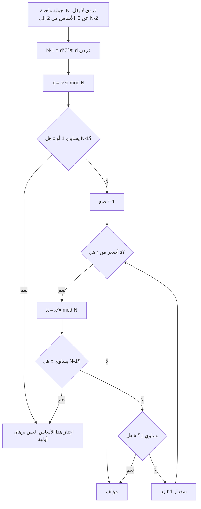
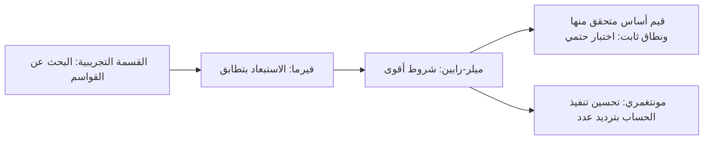

## مقدمة: التمييز بين اختبار الأولية والتحليل إلى عوامل

يجيب اختبار الأولية عن سؤال: هل هذا العدد الصحيح أولي؟ أما إيجاد العوامل الفعلية لعدد مؤلف فهو مسألة أخرى. توليد أعداد أولية كبيرة مهم في [تشفير المفتاح العام، مثل RSA](https://kenji.blog/ar/p/modern-cryptography-public-key-hash-signature/)، لكن عملية الضرب نفسها ليست العملية الصعبة. كذلك لا يكفي العثور على أعداد أولية لضمان أمان مخطط تشفير كامل.

سنقارن القسمة التجريبية واختبار فيرما وميلر–رابين، ثم نقدم تنفيذًا بلغة C++ للأعداد الصحيحة غير السالبة ذات 64 بتًا. نطاقه هو $0\le N<2^{64}$، ولا يشمل الأعداد التي يبلغ طولها آلاف البتات والمستخدمة في توليد مفاتيح RSA. يعتمد الزمن على التنفيذ والمدخل، ولذلك لا نضمن زمنًا معينًا أو نسبة تسريع عامة.

## 1. الأعداد الأولية والقسمة التجريبية

العدد الأولي عدد صحيح لا يقل عن 2، وقواسِمه الموجبة الوحيدة هي 1 ونفسه. والعدد المؤلف عدد صحيح لا يقل عن 2 وليس أوليًا. أما الصفر والواحد والأعداد الصحيحة السالبة فليست أولية ولا مؤلفة.

إذا كان العدد المؤلف $N=ab$ يملك عاملين يحققان $2\le a\le b$، فإن $a\le\sqrt N$. لذلك يكفي البحث عن قواسم حتى الجذر التربيعي. نختبر 2 أولًا، ثم المرشحين الفرديين فقط.

```cpp
#include <cstdint>

bool is_prime_trial_division(std::int64_t n) {
    if (n < 2) return false;
    if (n == 2) return true;
    if (n % 2 == 0) return false;
    for (std::int64_t i = 3; i <= n / i; i += 2) {
        if (n % i == 0) return false;
    }
    return true;
}
```

قد يتجاوز الضرب ذو الإشارة (signed) في الشرط `i*i <= n` سعة التمثيل. وللقيم الموجبة، يتجنب الشرط المكافئ `i <= n/i` تكوين هذا الناتج. تقبل الدالة نطاق `std::int64_t`، وتعيد `false` للمدخلات السالبة أيضًا.

يبلغ عدد عمليات القسمة في أسوأ حالة $\mathcal{O}(\sqrt N)$. ويعطي اختبار الأعداد الفردية فقط نحو $\sqrt N/2$ مرشحًا، لكن تكرار الاختبار على مدخلات كبيرة قد يبقى مكلفًا. ولا يوجد عدد موحد من الخانات العشرية يفصل ما هو عملي عما ليس كذلك.

## 2. اختبار فيرما والرفع إلى قوة بترديد عدد

تنص مبرهنة فيرما الصغرى على أنه لعدد أولي $p$ وعدد صحيح $a$ يحقق $\gcd(a,p)=1$:

$$
a^{p-1}\equiv1\pmod p.
$$

إذن، عند $N>2$، إذا لم يحقق أساس $1<a<N-1$ هذا التطابق، فإن $N$ مؤلف. لكن اجتياز الاختبار لا يثبت الأولية. عدد كارمايكل $561=3\cdot11\cdot17$ يجتاز الاختبار لجميع قيم الأساس الأولية نسبيًا مع 561. أما الأساس 3 فليس أوليًا نسبيًا معه، و$3^{560}\bmod561=375$، لذلك يفشل. فلا يصح القول إن أي أساس يخدع الاختبار بالضرورة.

لا نحتاج إلى حساب ناتج رفع العدد الصحيح إلى قوة كاملًا قبل أخذ باقي القسمة. يأخذ الرفع الثنائي إلى قوة باقي القسمة بعد كل ضرب. يمكن ترجمة الدوال المساعدة التالية بصورة منفصلة. الأساس والأس وأطراف الضرب أعداد صحيحة غير سالبة ذات 64 بتًا، والمقياس `m` (modulus) عدد صحيح موجب ذو 64 بتًا. يسبب المقياس الصفري استثناءً.

```cpp
#include <cstdint>
#include <stdexcept>

#if !defined(__SIZEOF_INT128__)
#error "This example requires unsigned __int128 support"
#endif

using u64 = std::uint64_t;
using u128 = unsigned __int128;

u64 mod_mul(u64 a, u64 b, u64 m) {
    if (m == 0) throw std::invalid_argument("Modulus must be positive");
    return static_cast<u64>(static_cast<u128>(a) * b % m);
}

u64 mod_pow(u64 base, u64 exp, u64 m) {
    if (m == 0) throw std::invalid_argument("Modulus must be positive");
    u64 result = 1 % m;
    base %= m;
    while (exp > 0) {
        if (exp & 1) result = mod_mul(result, base, m);
        base = mod_mul(base, base, m);
        exp >>= 1;
    }
    return result;
}
```

النتيجة هي أصغر باقٍ غير سالب. عندما يكون الأس صفرًا تُعاد $1\bmod m$، أي صفر إذا كان المقياس واحدًا. ويُعامل $0^0$ هنا وفق اتفاق الحساب نفسه. تمرير أساس سالب مباشرة إلى وسيط بلا إشارة (unsigned) ليس ضمن الاستخدام المقصود.

`unsigned __int128` امتداد، وليس نوعًا من معيار ISO C++. يدعمه GCC على منصات مستهدفة مناسبة، ويكشف الكود غياب الدعم وقت الترجمة. لا نفترض عمله دون تغيير في كل بيئة MSVC؛ راجع [توثيق GCC](https://gcc.gnu.org/onlinedocs/gcc/_005f_005fint128.html). لتمثيل جميع نواتج ضرب قيمتين بلا إشارة من 64 بتًا، نحتاج إلى 128 بتًا بلا إشارة؛ فالنوع ذو الإشارة من 128 بتًا لا يغطي كل تلك النواتج.

## 3. شروط ميلر–رابين ومعنى الاحتمال

بترديد عدد أولي فردي، تكون جذور 1 التربيعية هي 1 و −1 فقط. يجمع ميلر–رابين هذه الخاصية مع مبرهنة فيرما الصغرى. ولعدد فردي $N\ge3$، نكتب:

$$
N-1=d\,2^s,\qquad d\text{ is odd},\quad s\ge1.
$$

أي إن d فردي. يجتاز أساس $a$ يحقق $1<a<N-1$ الجولة إذا تحقق أحد الشرطين:

$$
a^d\equiv1\pmod N
\quad\text{or}\quad
\exists r\ (0\le r<s):\ a^{d2^r}\equiv-1\pmod N.
$$

يجتاز العدد الأولي دائمًا، بينما يثبت الفشل أن العدد مؤلف. وإذا أعطى التربيع المتكرر 1 وكانت القيمة السابقة ليست 1 ولا −1، فهذا يثبت أيضًا أن العدد مؤلف. أصغر باقٍ غير سالب للعدد −1 هو $N-1$، لكن التعبير `-1 % N` عند استخدام أعداد ذات إشارة في C++ لا يعيد هذه القيمة. مثلًا، ناتج `-1 % 7` هو −1. يجب التمييز بين الباقي الرياضي و[قواعد القسمة والباقي في C++](https://eel.is/c++draft/expr.mul).

لعدد مؤلف فردي ثابت $N$، يجتاز كل أساس يُختار بصورة مستقلة وبانتظام من $2\le a\le N-2$ باحتمال لا يزيد على $1/4$. لذلك يُحد احتمال اجتياز الجولات $k$ كلها خطأً كما يلي:

$$
\Pr[\text{all }k\text{ rounds pass}\mid N\text{ is composite}]\le4^{-k}.
$$

هذا احتمال خطأ يتعلق بالاختيار العشوائي لقيم الأساس. ولا يمكن إعادة صياغته مباشرة على أن احتمال كون العدد مؤلفًا بعد الاجتياز هو $4^{-k}$. كما لا تنطبق حجة الاختيار المستقل المنتظم على أي مجموعة ثابتة اعتباطية من قيم الأساس. عند N=3 يكون مجال الأساس فارغًا، لذلك يعالج التنفيذ هذه الحالة مسبقًا. وتميز [ورقة رابين الأصلية](https://math.nyu.edu/~goodman/teaching/Algebra_2_2021/MillerRabinTest.pdf) أيضًا بين القبول الاحتمالي وبرهان الأولية.

يوضح الرسم جولة واحدة لأساس عادي. نفترض معالجة N=3 مسبقًا، وأن المدخل الفردي يسمح باختيار أساس من المجال المحدد.



## 4. الاختبار الحتمي ضمن نطاق ثابت

في نطاق محدود من الأعداد الصحيحة، تتيح مجموعة كافية من قيم الأساس، تدعمها نتائج تحقق معروفة، إجراء الاختبار دون عشوائية. وتعرض [سجلات قيم الأساس لاختبار SPRP](https://miller-rabin.appspot.com/) الشروط المستخدمة هنا. جميع الحدود العليا صارمة، أي إن العدد يجب أن يكون أصغر منها.

| نطاق المدخل | قيم الأساس المختبرة |
| --- | --- |
| $N<4759123141$ | 2, 7, 61 |
| $N<1122004669633$ | 2, 13, 23, 1662803 |
| $N<2^{64}$ | 2, 325, 9375, 28178, 450775, 9780504, 1795265022 |

المجموعة الأخيرة تضم سبع قيم صحيحة للأساس، وليس سبعة أعداد أولية؛ فالعدد 325، مثلًا، مؤلف. وينسب السجل نتيجة القيم السبع إلى Jim Sinclair عام 2011. لا يعيد هذا المقال البحث الكامل في نطاق 64 بتًا بصورة مستقلة.

تصلح أيضًا الأعداد الأولية الاثنا عشر الأولى `2, 3, 5, 7, 11, 13, 17, 19, 23, 29, 31, 37` لهذا النطاق. تعطي [نتيجة Sorenson–Webster](https://arxiv.org/abs/1509.00864) العدد 318665857834031151167461 بوصفه أصغر عدد مؤلف يجتاز شروط ميلر–رابين لجميع قيم الأساس الاثنتي عشرة (strong pseudoprime to all twelve bases)؛ وهو أكبر من $2^{64}$. يستخدم التنفيذ التالي تفرعات الجدول ذات 3 و 4 و 7 قيم للأساس، وليس البديل ذي الاثنتي عشرة قيمة.

## 5. مثال C++ كامل

يغطي نوع المدخل `u64` المجال $0\le N\le2^{64}-1$. يعيد الصفر والواحد `false`، لكنهما ليسا مؤلفين، لذلك يعرض الإخراج `Not prime`. يتم تحويل النوع قبل تكوين الناتج في الضرب بترديد عدد. يُستبدل كل أساس بباقيه عند القسمة على N؛ وإذا أصبح صفرًا نتجاوز ذلك الأساس فقط ونواصل فحص البقية. فالأساس الصفري وحده لا يقرر ما إذا كان العدد كله أوليًا أو مؤلفًا.

الكتلة التالية برنامج كامل يتضمن الدوال المساعدة، ولا ينبغي إلحاق الكتل السابقة به مرة أخرى. على هدف مناسب لـ GCC، يمكن ترجمته بأمر مثل `g++ -std=c++17 -O2 primality.cpp -o primality`.

```cpp
#include <cstdint>
#include <stdexcept>

#if !defined(__SIZEOF_INT128__)
#error "This example requires unsigned __int128 support"
#endif

using u64 = std::uint64_t;
using u128 = unsigned __int128;

u64 mod_mul(u64 a, u64 b, u64 m) {
    if (m == 0) throw std::invalid_argument("Modulus must be positive");
    return static_cast<u64>(static_cast<u128>(a) * b % m);
}

u64 mod_pow(u64 base, u64 exp, u64 m) {
    if (m == 0) throw std::invalid_argument("Modulus must be positive");
    u64 result = 1 % m;
    base %= m;
    while (exp > 0) {
        if (exp & 1) result = mod_mul(result, base, m);
        base = mod_mul(base, base, m);
        exp >>= 1;
    }
    return result;
}

#include <iostream>
#include <initializer_list>
#include <vector>

bool is_prime_miller_rabin(u64 n) {
    if (n < 2) return false;
    for (u64 p : {2ULL, 3ULL, 5ULL, 7ULL}) {
        if (n == p) return true;
        if (n % p == 0) return false;
    }

    u64 d = n - 1;
    unsigned s = 0;
    while ((d & 1) == 0) {
        d >>= 1;
        ++s;
    }

    std::vector<u64> bases;
    if (n < 4759123141ULL) {
        bases = {2, 7, 61};
    } else if (n < 1122004669633ULL) {
        bases = {2, 13, 23, 1662803};
    } else {
        bases = {2, 325, 9375, 28178, 450775, 9780504, 1795265022};
    }

    for (u64 a : bases) {
        a %= n;
        if (a == 0) continue; // No witness from this base; keep testing the others.
        u64 x = mod_pow(a, d, n);
        if (x == 1 || x == n - 1) continue;

        bool passed = false;
        for (unsigned r = 1; r < s; ++r) {
            x = mod_mul(x, x, n);
            if (x == n - 1) {
                passed = true;
                break;
            }
            if (x == 1) return false;
        }
        if (!passed) return false;
    }
    return true;
}

int main() {
    const std::vector<u64> cases = {
        0, 1, 2, 73, 561, 1000000007, 998244353,
        1000000000000000003ULL, 1000000000000000007ULL,
        18446744073709551557ULL, 18446744073709551615ULL
    };
    for (u64 n : cases) {
        std::cout << n << " is "
                  << (is_prime_miller_rabin(n) ? "Prime" : "Not prime") << '\n';
    }
}
```

يصنف الإخراج 0 و 1 على أنهما `Not prime`، و 2 و 73 على أنهما `Prime`، و 561 على أنه `Not prime`، و 1000000007 و 998244353 و 1000000000000000003 على أنها `Prime`، و 1000000000000000007 على أنه `Not prime`، و 18446744073709551557 على أنه `Prime`، و 18446744073709551615 على أنه `Not prime`. العدد المؤلف الأخير هو $2^{64}-1$. هذا مثال تعليمي واختبار للأعداد الصحيحة ضمن المجال المحدد، وليس مولّدًا تشفيريًا للأعداد الأولية، أو تنفيذًا بزمن ثابت، أو مكتبة تتحقق من سلاسل الإدخال.

## 6. التعقيد وضرب مونتغمري

إذا عُدّ كل ضرب بترديد عدد عملية واحدة، فإن الرفع الثنائي إلى قوة وجولة ميلر–رابين يحتاجان إلى $\mathcal{O}(\log N)$ عملية، واختبار k قيم للأساس يحتاج إلى $\mathcal{O}(k\log N)$ عملية. وتحتاج القسمة التجريبية إلى $\mathcal{O}(\sqrt N)$ عملية قسمة. وباستخدام طول المدخل $b=\lfloor\log_2 N\rfloor+1$، يكون عدد عمليات الضرب بترديد عدد $\mathcal{O}(kb)$. وللأعداد الصحيحة ذات الدقة الاعتباطية، يجب أن يشمل التعقيد بالبتات تكلفة الضرب وحساب الباقي أيضًا.

يحتاج هذا النطاق الثابت إلى سبع قيم للأساس كحد أقصى. لكن البت قد يحتاج إلى ضرب شرطي إضافة إلى التربيع، كما تضيف سلسلة التربيع اللاحقة عمليات أخرى. لذلك لا يحد $7\times64=448$ جميع العمليات الأساسية. وعند مقارنة الأزمنة، يجب تحديد المعالج والمترجم وخيارات التحسين ومجموعة المدخلات وطريقة القياس.

يغيّر ضرب مونتغمري التمثيل لتجنب القسمة على المقياس عند تكرار العمليات بالمقياس نفسه. وفي البناء المعتاد الذي يكون فيه أساس نظام العد قوة للعدد اثنين، يجب أن يكون المقياس فرديًا وأوليًا نسبيًا مع أساس نظام العد. إلى جانب الضرب والإزاحة، توجد عمليات جمع ومعالجة للحمل بين الخانات وطرح شرطي؛ كما أن التحويل والحساب المسبق لهما تكلفة. لا توجد ضمانة لتسريع بمقدار مرتين أو ثلاث. راجع الإجراءات والشروط في [HAC، الفصل 14، الخوارزميات 14.32 و 14.36 و 14.94](https://cacr.uwaterloo.ca/hac/about/chap14.pdf). لا ينفذ الكود السابق هذه التقنية.

## 7. خاتمة

تبحث القسمة التجريبية عن القواسم مباشرة، بينما يستبعد اختبار فيرما المرشحين بتطابق. ويستخدم ميلر–رابين شروطًا أقوى. ويجب التمييز بين صورته الاحتمالية العامة والاختبار الحتمي بمجموعة متحقق منها من قيم الأساس ونطاق مدخل محدود.



تعتمد الصحة على نطاق المدخل وأنواع الأعداد الصحيحة وتجاوز سعة التمثيل وشروط المقياس والتعامل مع الأساس، إضافة إلى الرياضيات. ولا تمتد ضمانات كود 64 بتًا إلى الأعداد ذات الطول الاعتباطي أو إلى نظام تشفير كامل.

### المراجع

- [HAC، الفصل 4: فيرما وميلر–رابين وشروط احتمال الخطأ](https://cacr.uwaterloo.ca/hac/about/chap4.pdf) (مرجع من 1996؛ يجب تمييز التطورات اللاحقة ومعايير توليد المفاتيح الحالية عنه)
- [Rabin (1980): Probabilistic Algorithm for Testing Primality](https://math.nyu.edu/~goodman/teaching/Algebra_2_2021/MillerRabinTest.pdf)
- [سجلات قيم الأساس لاختبار SPRP لميلر–رابين الحتمي](https://miller-rabin.appspot.com/)
- [Sorenson–Webster: Strong Pseudoprimes to Twelve Prime Bases](https://arxiv.org/abs/1509.00864) (نسخة أولية عام 2015، ونشر في مجلة عام 2017)
- [GCC: امتداد الأعداد الصحيحة ذات 128 بتًا](https://gcc.gnu.org/onlinedocs/gcc/_005f_005fint128.html)
- [مسودة C++: القسمة والباقي](https://eel.is/c++draft/expr.mul)
- [HAC، الفصل 14: حساب مونتغمري](https://cacr.uwaterloo.ca/hac/about/chap14.pdf)
