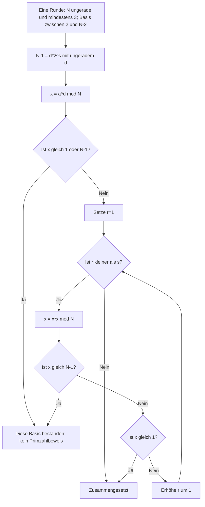
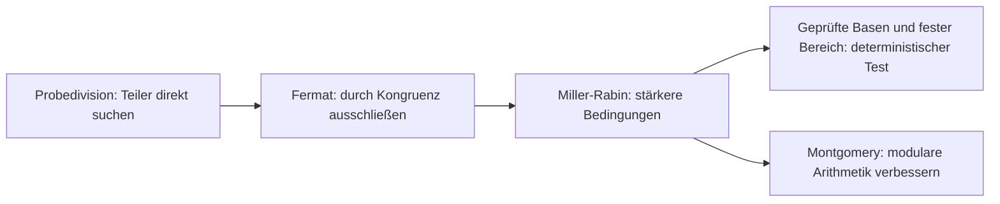

## Einleitung: Primzahltest und Faktorisierung unterscheiden

Ein Primzahltest beantwortet, ob eine ganze Zahl prim ist. Die Faktoren einer zusammengesetzten Zahl tatsächlich zu finden, ist eine andere Aufgabe. Große Primzahlen zu erzeugen ist für [Public-Key-Kryptographie wie RSA](https://kenji.blog/de/p/modern-cryptography-public-key-hash-signature/) wichtig; die Multiplikation selbst ist jedoch nicht die schwierige Operation. Primzahlen zu finden garantiert auch nicht allein die Sicherheit eines kryptographischen Verfahrens.

Wir vergleichen Probedivision, Fermat-Test und Miller–Rabin und zeigen eine C++-Implementierung für nichtnegative 64-Bit-Ganzzahlen. Ihr Bereich ist $0\le N<2^{64}$, nicht die mehrere Tausend Bit langen Zahlen für die RSA-Schlüsselerzeugung. Die Laufzeit hängt von Implementierung und Eingabe ab; eine allgemeingültige Zeit oder Beschleunigung wird nicht zugesichert.

## 1. Primzahlen und Probedivision

Eine Primzahl ist eine ganze Zahl ab 2, deren einzige positive Teiler 1 und sie selbst sind. Eine ganze Zahl ab 2, die nicht prim ist, heißt zusammengesetzt. Null, eins und negative ganze Zahlen sind weder prim noch zusammengesetzt.

Hat eine zusammengesetzte Zahl $N=ab$ Faktoren mit $2\le a\le b$, so gilt $a\le\sqrt N$. Daher genügt die Suche nach Teilern bis zur Quadratwurzel. Zuerst wird 2 geprüft, danach nur ungerade Kandidaten.

```cpp
#include <cstdint>

bool is_prime_trial_division(std::int64_t n) {
    if (n < 2) return false;
    if (n == 2) return true;
    if (n % 2 == 0) return false;
    for (std::int64_t i = 3; i <= n / i; i += 2) {
        if (n % i == 0) return false;
    }
    return true;
}
```

Die vorzeichenbehaftete Multiplikation in `i*i <= n` kann überlaufen. Für positive Werte vermeidet die gleichwertige Bedingung `i <= n/i` dieses Produkt. Die Funktion nimmt Werte aus dem Bereich von `std::int64_t` an und liefert auch für negative Eingaben `false`.

Die Anzahl der Divisionen im schlechtesten Fall ist $\mathcal{O}(\sqrt N)$. Bei ausschließlich ungeraden Kandidaten sind es ungefähr $\sqrt N/2$ Kandidaten. Viele Tests mit großen Eingaben können trotzdem aufwendig sein. Es gibt keine allgemeingültige Dezimalstellenzahl als Grenze der praktischen Nutzbarkeit.

## 2. Fermat-Test und modulare Exponentiation

Der kleine fermatsche Satz besagt für eine Primzahl $p$ und eine ganze Zahl $a$ mit $\gcd(a,p)=1$:

$$
a^{p-1}\equiv1\pmod p.
$$

Für $N>2$ beweist daher eine Basis $1<a<N-1$, bei der diese Kongruenz nicht gilt, dass $N$ zusammengesetzt ist. Das Bestehen des Tests beweist keine Primzahleigenschaft. Die Carmichael-Zahl $561=3\cdot11\cdot17$ besteht für alle zu 561 teilerfremden Basen. Die Basis 3 ist jedoch nicht teilerfremd, und $3^{560}\bmod561=375$, sodass sie nicht besteht. Die Aussage, jede beliebige Basis täusche den Test, ist unzutreffend.

Die vollständige ganzzahlige Potenz muss nicht zuerst gebildet werden. Binäre Exponentiation reduziert nach jeder Multiplikation modulo m. Die folgenden Hilfsfunktionen lassen sich separat kompilieren. Basis, Exponent und Multiplikationsoperanden sind nichtnegative 64-Bit-Ganzzahlen; der Modul `m` ist eine positive 64-Bit-Ganzzahl. Modul null löst eine Ausnahme aus.

```cpp
#include <cstdint>
#include <stdexcept>

#if !defined(__SIZEOF_INT128__)
#error "This example requires unsigned __int128 support"
#endif

using u64 = std::uint64_t;
using u128 = unsigned __int128;

u64 mod_mul(u64 a, u64 b, u64 m) {
    if (m == 0) throw std::invalid_argument("Modulus must be positive");
    return static_cast<u64>(static_cast<u128>(a) * b % m);
}

u64 mod_pow(u64 base, u64 exp, u64 m) {
    if (m == 0) throw std::invalid_argument("Modulus must be positive");
    u64 result = 1 % m;
    base %= m;
    while (exp > 0) {
        if (exp & 1) result = mod_mul(result, base, m);
        base = mod_mul(base, base, m);
        exp >>= 1;
    }
    return result;
}
```

Das Ergebnis ist der kleinste nichtnegative Rest. Exponent null liefert $1\bmod m$, also null bei Modul eins. Auch $0^0$ wird hier nach dieser Rechenkonvention behandelt. Eine negative Basis direkt an einen vorzeichenlosen Parameter zu übergeben liegt außerhalb der vorgesehenen Schnittstelle.

`unsigned __int128` ist eine Erweiterung und kein Datentyp des ISO-C++-Standards. GCC unterstützt sie auf geeigneten Zielplattformen; fehlende Unterstützung wird beim Kompilieren erkannt. Unveränderte Nutzbarkeit in jeder MSVC-Umgebung wird nicht vorausgesetzt; siehe [GCC-Dokumentation](https://gcc.gnu.org/onlinedocs/gcc/_005f_005fint128.html). Um alle möglichen Produkte zweier vorzeichenloser 64-Bit-Werte darzustellen, sind vorzeichenlose 128 Bit nötig. Ein vorzeichenbehafteter 128-Bit-Typ deckt nicht alle diese Produkte ab.

## 3. Miller–Rabin-Bedingungen und Bedeutung der Wahrscheinlichkeit

Modulo einer ungeraden Primzahl sind die einzigen Quadratwurzeln von 1 die Werte 1 und −1. Miller–Rabin verbindet dies mit dem kleinen fermatschen Satz. Für ungerades $N\ge3$ schreiben wir:

$$
N-1=d\,2^s,\qquad d\text{ is odd},\quad s\ge1.
$$

Dabei ist d ungerade. Eine Basis $a$ mit $1<a<N-1$ besteht, wenn eine der Bedingungen gilt:

$$
a^d\equiv1\pmod N
\quad\text{or}\quad
\exists r\ (0\le r<s):\ a^{d2^r}\equiv-1\pmod N.
$$

Eine Primzahl besteht immer; ein Fehlschlag beweist Zusammengesetztheit. Ergibt das wiederholte Quadrieren 1, obwohl der vorherige Wert weder 1 noch −1 war, beweist auch das Zusammengesetztheit. Der kleinste nichtnegative Rest von −1 ist $N-1$, doch der vorzeichenbehaftete C++-Ausdruck `-1 % N` liefert diesen Wert nicht. Beispielsweise ist `-1 % 7` gleich −1. Der mathematische Rest ist von den [C++-Regeln für Division und Rest](https://eel.is/c++draft/expr.mul) zu unterscheiden.

Für eine feste ungerade zusammengesetzte Zahl $N$ besteht jede unabhängig und gleichverteilt aus $2\le a\le N-2$ gewählte Basis mit Wahrscheinlichkeit höchstens $1/4$. Damit gilt für das irrtümliche Bestehen aller $k$ Runden:

$$
\Pr[\text{all }k\text{ rounds pass}\mid N\text{ is composite}]\le4^{-k}.
$$

Dies ist eine Fehlerwahrscheinlichkeit bezüglich der zufälligen Basenwahl. Daraus folgt nicht unmittelbar, dass die Zahl nach bestandenem Test mit Wahrscheinlichkeit $4^{-k}$ zusammengesetzt ist. Das Argument gilt auch nicht für eine beliebige feste Basenmenge. Für N=3 ist das Basenintervall leer; deshalb wird dieser Fall vorab behandelt. Auch [Rabins Originalarbeit](https://math.nyu.edu/~goodman/teaching/Algebra_2_2021/MillerRabinTest.pdf) unterscheidet probabilistisches Bestehen von einem Primzahlbeweis.

Das Diagramm zeigt eine Runde für eine gewöhnliche Basis. N=3 wurde bereits behandelt; für die ungerade Eingabe muss im genannten Intervall eine Basis existieren.



## 4. Deterministischer Test in einem festen Bereich

In einem begrenzten Ganzzahlbereich ermöglicht eine hinreichende, durch bekannte Überprüfungen gestützte Basenmenge einen Test ohne Zufall. Die [SPRP-Basenaufzeichnungen](https://miller-rabin.appspot.com/) nennen die hier verwendeten Bedingungen. Alle oberen Grenzen sind strikt.

| Eingabebereich | Geprüfte Basen |
| --- | --- |
| $N<4759123141$ | 2, 7, 61 |
| $N<1122004669633$ | 2, 13, 23, 1662803 |
| $N<2^{64}$ | 2, 325, 9375, 28178, 450775, 9780504, 1795265022 |

Die letzte Menge enthält sieben ganzzahlige Basen, nicht sieben Primzahlen: 325 ist beispielsweise zusammengesetzt. Die Aufzeichnung schreibt dieses Ergebnis mit sieben Basen Jim Sinclair im Jahr 2011 zu. Die vollständige Suche im 64-Bit-Bereich wird hier nicht unabhängig wiederholt.

Alternativ reichen die ersten zwölf Primzahlen `2, 3, 5, 7, 11, 13, 17, 19, 23, 29, 31, 37` für diesen 64-Bit-Bereich. Das [Ergebnis von Sorenson–Webster](https://arxiv.org/abs/1509.00864) nennt 318665857834031151167461 als kleinste zusammengesetzte Zahl, die zu allen zwölf Basen eine starke Pseudoprimzahl ist; sie ist größer als $2^{64}$. Die folgende Implementierung nutzt die Verzweigungen mit 3, 4 und 7 Basen aus der Tabelle, nicht die Zwölf-Basen-Alternative.

## 5. Vollständiges C++-Beispiel

Der Eingabetyp `u64` umfasst $0\le N\le2^{64}-1$. Null und eins liefern `false`, sind jedoch nicht zusammengesetzt; die Ausgabe lautet daher `Not prime`. Bei modularer Multiplikation erfolgt die Typumwandlung vor der Produktbildung. Jede Basis wird modulo N reduziert. Wird sie null, wird nur diese Basis übersprungen und mit den anderen fortgefahren. Eine Nullbasis allein entscheidet nicht, ob die ganze Zahl prim oder zusammengesetzt ist.

Der nächste Block ist ein vollständiges Programm samt Hilfsfunktionen. Die vorherigen Blöcke dürfen nicht zusätzlich angehängt werden. Auf einer geeigneten GCC-Zielplattform lässt es sich etwa mit `g++ -std=c++17 -O2 primality.cpp -o primality` kompilieren.

```cpp
#include <cstdint>
#include <stdexcept>

#if !defined(__SIZEOF_INT128__)
#error "This example requires unsigned __int128 support"
#endif

using u64 = std::uint64_t;
using u128 = unsigned __int128;

u64 mod_mul(u64 a, u64 b, u64 m) {
    if (m == 0) throw std::invalid_argument("Modulus must be positive");
    return static_cast<u64>(static_cast<u128>(a) * b % m);
}

u64 mod_pow(u64 base, u64 exp, u64 m) {
    if (m == 0) throw std::invalid_argument("Modulus must be positive");
    u64 result = 1 % m;
    base %= m;
    while (exp > 0) {
        if (exp & 1) result = mod_mul(result, base, m);
        base = mod_mul(base, base, m);
        exp >>= 1;
    }
    return result;
}

#include <iostream>
#include <initializer_list>
#include <vector>

bool is_prime_miller_rabin(u64 n) {
    if (n < 2) return false;
    for (u64 p : {2ULL, 3ULL, 5ULL, 7ULL}) {
        if (n == p) return true;
        if (n % p == 0) return false;
    }

    u64 d = n - 1;
    unsigned s = 0;
    while ((d & 1) == 0) {
        d >>= 1;
        ++s;
    }

    std::vector<u64> bases;
    if (n < 4759123141ULL) {
        bases = {2, 7, 61};
    } else if (n < 1122004669633ULL) {
        bases = {2, 13, 23, 1662803};
    } else {
        bases = {2, 325, 9375, 28178, 450775, 9780504, 1795265022};
    }

    for (u64 a : bases) {
        a %= n;
        if (a == 0) continue; // No witness from this base; keep testing the others.
        u64 x = mod_pow(a, d, n);
        if (x == 1 || x == n - 1) continue;

        bool passed = false;
        for (unsigned r = 1; r < s; ++r) {
            x = mod_mul(x, x, n);
            if (x == n - 1) {
                passed = true;
                break;
            }
            if (x == 1) return false;
        }
        if (!passed) return false;
    }
    return true;
}

int main() {
    const std::vector<u64> cases = {
        0, 1, 2, 73, 561, 1000000007, 998244353,
        1000000000000000003ULL, 1000000000000000007ULL,
        18446744073709551557ULL, 18446744073709551615ULL
    };
    for (u64 n : cases) {
        std::cout << n << " is "
                  << (is_prime_miller_rabin(n) ? "Prime" : "Not prime") << '\n';
    }
}
```

Die Ausgabe klassifiziert 0 und 1 als `Not prime`, 2 und 73 als `Prime`, 561 als `Not prime`, 1000000007, 998244353 und 1000000000000000003 als `Prime`, 1000000000000000007 als `Not prime`, 18446744073709551557 als `Prime` und 18446744073709551615 als `Not prime`. Die letzte zusammengesetzte Zahl ist $2^{64}-1$. Dies ist ein Lehrbeispiel und ein Test für allgemeine Ganzzahlen im angegebenen Bereich, kein kryptographischer Primzahlgenerator, keine Implementierung mit konstanter Laufzeit und keine Bibliothek zur Prüfung von Eingabezeichenketten.

## 6. Komplexität und Montgomery-Multiplikation

Zählt eine modulare Multiplikation als eine Operation, benötigen binäre Exponentiation und eine Miller–Rabin-Runde $\mathcal{O}(\log N)$ Operationen; für k Basen sind es $\mathcal{O}(k\log N)$. Probedivision benötigt $\mathcal{O}(\sqrt N)$ Divisionen. Mit der Eingabelänge $b=\lfloor\log_2 N\rfloor+1$ benötigt Miller–Rabin $\mathcal{O}(kb)$ modulare Multiplikationen. Bei Ganzzahlen beliebiger Genauigkeit muss die Bitkomplexität auch Multiplikation und modulare Reduktion berücksichtigen.

Dieser feste Bereich erfordert höchstens sieben Basen. Pro Bit kann jedoch neben einer Quadrierung eine bedingte Multiplikation anfallen, und die anschließende Quadrierungskette benötigt weitere Operationen. Deshalb begrenzt $7\times64=448$ nicht sämtliche elementaren Operationen. Laufzeitvergleiche sollten CPU, Compiler, Optimierungsoptionen, Eingabemenge und Messmethode angeben.

Montgomery-Multiplikation ändert die Darstellung, um bei wiederholten Operationen mit demselben Modul die Division durch diesen Modul zu vermeiden. In der üblichen Konstruktion mit einer Zweierpotenz als Darstellungsbasis muss der Modul ungerade und zur Darstellungsbasis teilerfremd sein. Neben Multiplikationen und Verschiebungen werden Additionen, Übertragsbehandlung und bedingte Subtraktionen benötigt; Umwandlung und Vorberechnung verursachen ebenfalls Aufwand. Eine allgemeine Verdopplung oder Verdreifachung der Geschwindigkeit ist nicht garantiert. Verfahren und Bedingungen stehen in [HAC, Kapitel 14, Algorithmen 14.32, 14.36 und 14.94](https://cacr.uwaterloo.ca/hac/about/chap14.pdf). Im obigen Code ist dieses Verfahren nicht implementiert.

## 7. Fazit

Probedivision sucht unmittelbar nach Teilern, während der Fermat-Test Kandidaten durch eine Kongruenz ausschließt. Miller–Rabin nutzt stärkere Bedingungen. Seine allgemeine probabilistische Form ist vom deterministischen Test mit überprüfter Basenmenge und begrenztem Eingabebereich zu unterscheiden.



Die Korrektheit hängt neben der Mathematik von Eingabegrenzen, Ganzzahltypen, Überläufen, Modulbedingungen und der Behandlung der Basen ab. Garantien für 64-Bit-Code lassen sich weder auf beliebig lange Ganzzahlen noch auf ein vollständiges Kryptosystem übertragen.

### Quellen

- [HAC, Kapitel 4: Fermat, Miller–Rabin und Bedingungen der Fehlerwahrscheinlichkeit](https://cacr.uwaterloo.ca/hac/about/chap4.pdf) (Quelle von 1996; spätere Primzahlresultate und aktuelle Vorgaben zur Schlüsselerzeugung unterscheiden)
- [Rabin (1980): Probabilistic Algorithm for Testing Primality](https://math.nyu.edu/~goodman/teaching/Algebra_2_2021/MillerRabinTest.pdf)
- [SPRP-Basenaufzeichnungen für deterministisches Miller–Rabin](https://miller-rabin.appspot.com/)
- [Sorenson–Webster: Strong Pseudoprimes to Twelve Prime Bases](https://arxiv.org/abs/1509.00864) (Vorabfassung 2015, Zeitschriftenveröffentlichung 2017)
- [GCC: Erweiterung für 128-Bit-Ganzzahlen](https://gcc.gnu.org/onlinedocs/gcc/_005f_005fint128.html)
- [C++-Arbeitsentwurf: Division und Rest](https://eel.is/c++draft/expr.mul)
- [HAC, Kapitel 14: Montgomery-Arithmetik](https://cacr.uwaterloo.ca/hac/about/chap14.pdf)
