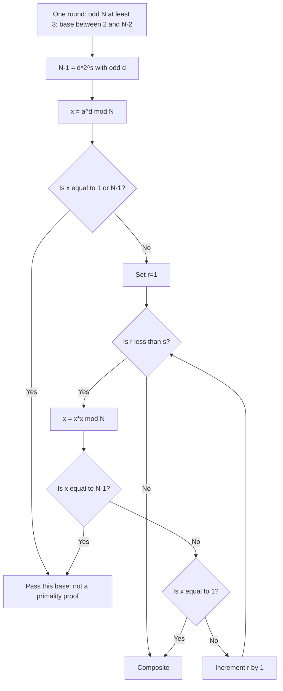
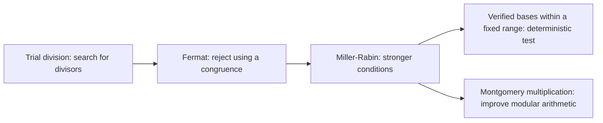

## Introduction: Primality Testing Is Different from Factoring

Primality testing answers whether an integer is prime. Finding the actual factors of a composite integer is a different task. Generating large primes matters in [public-key cryptography such as RSA](https://kenji.blog/en/p/modern-cryptography-public-key-hash-signature/), but multiplication itself is not the difficult operation. Finding primes alone does not guarantee a cryptographic scheme's security either.

We will compare trial division, Fermat's test, and Miller–Rabin, then implement a test for nonnegative 64-bit integers in C++. The implementation covers $0\le N<2^{64}$, not the integers thousands of bits long used in RSA key generation. Execution time depends on the implementation and input, so no universal timing or speedup is promised.

## 1. Prime Numbers and Trial Division

A prime is an integer at least 2 whose only positive divisors are 1 and itself. A composite is an integer at least 2 that is not prime. Zero, one, and negative integers are neither prime nor composite.

If a composite $N=ab$ has factors satisfying $2\le a\le b$, then $a\le\sqrt N$. It is therefore enough to search for divisors through the square root. Test 2 first, then try only odd candidates.

```cpp
#include <cstdint>

bool is_prime_trial_division(std::int64_t n) {
    if (n < 2) return false;
    if (n == 2) return true;
    if (n % 2 == 0) return false;
    for (std::int64_t i = 3; i <= n / i; i += 2) {
        if (n % i == 0) return false;
    }
    return true;
}
```

The condition `i*i <= n` can overflow signed multiplication. For positive values, the equivalent `i <= n/i` avoids that product. This function accepts the `std::int64_t` range and returns `false` for negative inputs too.

The worst-case division count is $\mathcal{O}(\sqrt N)$. Trying only odd candidates gives roughly $\sqrt N/2$ candidates, but repeated tests on large inputs can still be expensive. There is no universal digit-count boundary for practicality.

## 2. Fermat's Test and Modular Exponentiation

Fermat's little theorem states that for prime $p$ and an integer $a$ satisfying $\gcd(a,p)=1$:

$$
a^{p-1}\equiv1\pmod p.
$$

Thus, for $N>2$, choosing $1<a<N-1$ and finding that this congruence fails proves that $N$ is composite. Passing it alone does not prove primality. The Carmichael number $561=3\cdot11\cdot17$ passes every base coprime to 561. However, base 3 is not coprime, and $3^{560}\bmod561=375$, so it fails. Saying that every base necessarily fools the test is inaccurate.

We need not construct the full integer power. Binary exponentiation reduces modulo the modulus after each multiplication. The following helpers can be compiled on their own. The base, exponent, and multiplication operands are nonnegative 64-bit integers; the modulus `m` is a positive 64-bit integer. A zero modulus throws an exception.

```cpp
#include <cstdint>
#include <stdexcept>

#if !defined(__SIZEOF_INT128__)
#error "This example requires unsigned __int128 support"
#endif

using u64 = std::uint64_t;
using u128 = unsigned __int128;

u64 mod_mul(u64 a, u64 b, u64 m) {
    if (m == 0) throw std::invalid_argument("Modulus must be positive");
    return static_cast<u64>(static_cast<u128>(a) * b % m);
}

u64 mod_pow(u64 base, u64 exp, u64 m) {
    if (m == 0) throw std::invalid_argument("Modulus must be positive");
    u64 result = 1 % m;
    base %= m;
    while (exp > 0) {
        if (exp & 1) result = mod_mul(result, base, m);
        base = mod_mul(base, base, m);
        exp >>= 1;
    }
    return result;
}
```

The result is the least nonnegative residue. An exponent of zero returns $1\bmod m$, which is zero when the modulus is one. This computational convention also handles $0^0$ here. Passing a negative base directly to an unsigned parameter is outside the intended interface.

`unsigned __int128` is an extension rather than an ISO C++ standard type. GCC supports it on suitable targets, and the code detects unsupported implementations at compile time. It is not assumed to work unchanged in every MSVC environment; see [GCC's documentation](https://gcc.gnu.org/onlinedocs/gcc/_005f_005fint128.html). The product of two full-range unsigned 64-bit values needs unsigned 128-bit storage; signed 128-bit storage cannot represent every such product.

## 3. Miller–Rabin Conditions and the Meaning of Probability

Modulo an odd prime, the only square roots of 1 are 1 and −1. Miller–Rabin combines this fact with Fermat's little theorem. For odd $N\ge3$, write:

$$
N-1=d\,2^s,\qquad d\text{ is odd},\quad s\ge1.
$$

A base $a$ satisfying $1<a<N-1$ passes if either condition holds:

$$
a^d\equiv1\pmod N
\quad\text{or}\quad
\exists r\ (0\le r<s):\ a^{d2^r}\equiv-1\pmod N.
$$

A prime always passes; failure proves compositeness. If repeated squaring produces 1 when the previous value was neither 1 nor −1, that also proves compositeness. The least nonnegative residue of mathematical −1 is $N-1$, but the signed C++ expression `-1 % N` does not return that value. For example, `-1 % 7` is −1. Distinguish the mathematical residue from [C++ division and remainder rules](https://eel.is/c++draft/expr.mul).

For a fixed odd composite $N$, each independently and uniformly chosen base from $2\le a\le N-2$ passes with probability at most $1/4$. The probability of incorrectly passing all $k$ rounds is therefore bounded by:

$$
\Pr[\text{all }k\text{ rounds pass}\mid N\text{ is composite}]\le4^{-k}.
$$

This is an error probability over the random base choices. It cannot simply be restated as a probability of $4^{-k}$ that an integer is composite after passing. Nor does the independent-uniform-random-base argument apply to an arbitrary fixed base set. The base interval is empty for N=3, so the implementation handles it first. [Rabin's original paper](https://math.nyu.edu/~goodman/teaching/Algebra_2_2021/MillerRabinTest.pdf) likewise distinguishes randomized acceptance from a primality proof.

The following diagram shows one ordinary-base round. N=3 has already been handled; the odd input must actually admit a base in the stated interval.



## 4. Deterministic Testing Within a Fixed Range

Within a bounded integer range, a sufficient base set supported by known verification results allows testing without randomness. The [SPRP base records](https://miller-rabin.appspot.com/) list the conditions used here. Every boundary is strict.

| Input range | Bases to test |
| --- | --- |
| $N<4759123141$ | 2, 7, 61 |
| $N<1122004669633$ | 2, 13, 23, 1662803 |
| $N<2^{64}$ | 2, 325, 9375, 28178, 450775, 9780504, 1795265022 |

The last set contains seven integer bases, not seven primes: 325, for instance, is composite. The records attribute this seven-base result to Jim Sinclair in 2011. This article does not independently repeat the entire 64-bit search.

Alternatively, the first twelve primes `2, 3, 5, 7, 11, 13, 17, 19, 23, 29, 31, 37` also suffice for this 64-bit range. The [Sorenson–Webster result](https://arxiv.org/abs/1509.00864) gives 318665857834031151167461 as the first composite that is a strong pseudoprime to all twelve bases; it exceeds $2^{64}$. The implementation below uses the table's 3/4/7-base branches, not the twelve-base alternative.

## 5. A Complete C++ Example

The input type `u64` covers $0\le N\le2^{64}-1$. Zero and one return `false`, but are not composite, so the output says `Not prime`. Modular multiplication casts before forming the product. Each base is reduced modulo N. If it becomes zero, skip that base and keep checking the others: a zero base alone does not decide whether the entire integer is prime or composite.

The next block is a complete program including its helpers. Do not concatenate the previous blocks into it. On a suitable GCC target, compile with a command such as `g++ -std=c++17 -O2 primality.cpp -o primality`.

```cpp
#include <cstdint>
#include <stdexcept>

#if !defined(__SIZEOF_INT128__)
#error "This example requires unsigned __int128 support"
#endif

using u64 = std::uint64_t;
using u128 = unsigned __int128;

u64 mod_mul(u64 a, u64 b, u64 m) {
    if (m == 0) throw std::invalid_argument("Modulus must be positive");
    return static_cast<u64>(static_cast<u128>(a) * b % m);
}

u64 mod_pow(u64 base, u64 exp, u64 m) {
    if (m == 0) throw std::invalid_argument("Modulus must be positive");
    u64 result = 1 % m;
    base %= m;
    while (exp > 0) {
        if (exp & 1) result = mod_mul(result, base, m);
        base = mod_mul(base, base, m);
        exp >>= 1;
    }
    return result;
}

#include <iostream>
#include <initializer_list>
#include <vector>

bool is_prime_miller_rabin(u64 n) {
    if (n < 2) return false;
    for (u64 p : {2ULL, 3ULL, 5ULL, 7ULL}) {
        if (n == p) return true;
        if (n % p == 0) return false;
    }

    u64 d = n - 1;
    unsigned s = 0;
    while ((d & 1) == 0) {
        d >>= 1;
        ++s;
    }

    std::vector<u64> bases;
    if (n < 4759123141ULL) {
        bases = {2, 7, 61};
    } else if (n < 1122004669633ULL) {
        bases = {2, 13, 23, 1662803};
    } else {
        bases = {2, 325, 9375, 28178, 450775, 9780504, 1795265022};
    }

    for (u64 a : bases) {
        a %= n;
        if (a == 0) continue; // No witness from this base; keep testing the others.
        u64 x = mod_pow(a, d, n);
        if (x == 1 || x == n - 1) continue;

        bool passed = false;
        for (unsigned r = 1; r < s; ++r) {
            x = mod_mul(x, x, n);
            if (x == n - 1) {
                passed = true;
                break;
            }
            if (x == 1) return false;
        }
        if (!passed) return false;
    }
    return true;
}

int main() {
    const std::vector<u64> cases = {
        0, 1, 2, 73, 561, 1000000007, 998244353,
        1000000000000000003ULL, 1000000000000000007ULL,
        18446744073709551557ULL, 18446744073709551615ULL
    };
    for (u64 n : cases) {
        std::cout << n << " is "
                  << (is_prime_miller_rabin(n) ? "Prime" : "Not prime") << '\n';
    }
}
```

The output classifies 0 and 1 as `Not prime`; 2 and 73 as `Prime`; 561 as `Not prime`; 1000000007, 998244353, and 1000000000000000003 as `Prime`; 1000000000000000007 as `Not prime`; 18446744073709551557 as `Prime`; and 18446744073709551615 as `Not prime`. The last composite is $2^{64}-1$. This is a teaching and general-integer-testing example for the stated range, not a cryptographic prime generator, constant-time implementation, or library that validates input strings.

## 6. Complexity and Montgomery Multiplication

Counting a modular multiplication as one operation, binary exponentiation and one Miller–Rabin round use $\mathcal{O}(\log N)$ operations; testing k bases uses $\mathcal{O}(k\log N)$. Trial division uses $\mathcal{O}(\sqrt N)$ divisions. In terms of input length $b=\lfloor\log_2 N\rfloor+1$, Miller–Rabin uses $\mathcal{O}(kb)$ modular multiplications. For arbitrary-precision integers, bit complexity must also include the costs of multiplication and modular reduction.

This fixed range needs at most seven bases. However, a bit can require a conditional multiplication as well as a squaring, and the subsequent squaring chain adds operations. Thus $7\times64=448$ is not a bound on all elementary operations. A timing comparison should specify the CPU, compiler, optimization flags, input set, and measurement method.

Montgomery multiplication changes the representation to avoid division by the modulus during repeated operations with the same modulus. In the usual construction with a power-of-two radix, the modulus must be odd and coprime to the radix. It also uses additions, carry handling, and conditional subtraction, as well as multiplication and shifts; conversion and setup have costs too. There is no guaranteed twofold or threefold speedup. See [HAC chapter 14, Algorithms 14.32, 14.36, and 14.94](https://cacr.uwaterloo.ca/hac/about/chap14.pdf) for procedures and conditions. It is not implemented in the code above.

## 7. Conclusion

Trial division directly searches for divisors, while Fermat's test rejects candidates through a congruence. Miller–Rabin uses stronger conditions. Its general randomized form must be distinguished from deterministic testing with a verified base set and a restricted input range.



Correctness depends on input bounds, integer types, overflow, modulus conditions, and base handling as well as the mathematics. Do not extend the guarantees of 64-bit code to arbitrary-length integers or an entire cryptographic system.

### References

- [HAC chapter 4: Fermat, Miller–Rabin, and error-probability conditions](https://cacr.uwaterloo.ca/hac/about/chap4.pdf) (a 1996 source; distinguish later primality results and current key-generation standards)
- [Rabin (1980): Probabilistic Algorithm for Testing Primality](https://math.nyu.edu/~goodman/teaching/Algebra_2_2021/MillerRabinTest.pdf)
- [Deterministic Miller–Rabin SPRP base records](https://miller-rabin.appspot.com/)
- [Sorenson–Webster: Strong Pseudoprimes to Twelve Prime Bases](https://arxiv.org/abs/1509.00864) (2015 preprint, 2017 journal publication)
- [GCC: 128-bit integer extension](https://gcc.gnu.org/onlinedocs/gcc/_005f_005fint128.html)
- [C++ working draft: division and remainder](https://eel.is/c++draft/expr.mul)
- [HAC chapter 14: Montgomery arithmetic](https://cacr.uwaterloo.ca/hac/about/chap14.pdf)
