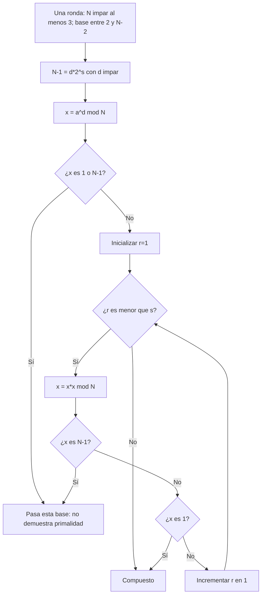
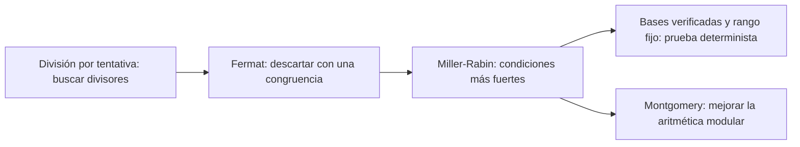

## Introducción: distinguir primalidad de factorización

Una prueba de primalidad responde si un entero es primo. Encontrar los factores de un entero compuesto es un problema distinto. Generar primos grandes importa en la [criptografía de clave pública, como RSA](https://kenji.blog/es/p/modern-cryptography-public-key-hash-signature/), pero la multiplicación en sí no es la operación difícil. Encontrar primos tampoco garantiza por sí solo la seguridad de un esquema criptográfico.

Compararemos la división por tentativa, la prueba de Fermat y Miller–Rabin, y presentaremos una implementación en C++ para enteros no negativos de 64 bits. Su dominio es $0\le N<2^{64}$; no abarca los enteros de miles de bits empleados en la generación de claves RSA. El tiempo depende de la implementación y de la entrada, por lo que no se garantiza una duración ni un factor de aceleración universal.

## 1. Primos y división por tentativa

Un primo es un entero mayor o igual que 2 cuyos únicos divisores positivos son 1 y él mismo. Un compuesto es un entero mayor o igual que 2 que no es primo. El cero, el uno y los enteros negativos no son primos ni compuestos.

Si un compuesto $N=ab$ tiene factores con $2\le a\le b$, entonces $a\le\sqrt N$. Basta, por tanto, buscar divisores hasta la raíz cuadrada. Primero se comprueba el 2 y después solo candidatos impares.

```cpp
#include <cstdint>

bool is_prime_trial_division(std::int64_t n) {
    if (n < 2) return false;
    if (n == 2) return true;
    if (n % 2 == 0) return false;
    for (std::int64_t i = 3; i <= n / i; i += 2) {
        if (n % i == 0) return false;
    }
    return true;
}
```

La multiplicación con signo de `i*i <= n` puede desbordarse. Para valores positivos, la condición equivalente `i <= n/i` evita ese producto. Esta función admite el rango de `std::int64_t` y también devuelve `false` para entradas negativas.

El número de divisiones en el peor caso es $\mathcal{O}(\sqrt N)$. Probar solo impares da aproximadamente $\sqrt N/2$ candidatos, pero muchas pruebas con entradas grandes pueden seguir siendo costosas. No hay un número de dígitos universal que separe lo práctico de lo impráctico.

## 2. Fermat y la exponenciación modular

El pequeño teorema de Fermat establece que, para un primo $p$ y un entero $a$ con $\gcd(a,p)=1$:

$$
a^{p-1}\equiv1\pmod p.
$$

Por tanto, para $N>2$, si se elige $1<a<N-1$ y falla la congruencia, $N$ es compuesto. Superarla no demuestra primalidad. El número de Carmichael $561=3\cdot11\cdot17$ supera todas las bases coprimas con 561. La base 3 no es coprima y $3^{560}\bmod561=375$, por lo que falla. Es incorrecto afirmar que cualquier base engaña necesariamente a la prueba.

No hace falta construir la potencia entera completa. La exponenciación binaria reduce módulo m tras cada multiplicación. Las siguientes funciones auxiliares se pueden compilar por separado. La base, el exponente y los operandos de multiplicación son enteros no negativos de 64 bits; el módulo `m` es un entero positivo de 64 bits. Un módulo cero provoca una excepción.

```cpp
#include <cstdint>
#include <stdexcept>

#if !defined(__SIZEOF_INT128__)
#error "This example requires unsigned __int128 support"
#endif

using u64 = std::uint64_t;
using u128 = unsigned __int128;

u64 mod_mul(u64 a, u64 b, u64 m) {
    if (m == 0) throw std::invalid_argument("Modulus must be positive");
    return static_cast<u64>(static_cast<u128>(a) * b % m);
}

u64 mod_pow(u64 base, u64 exp, u64 m) {
    if (m == 0) throw std::invalid_argument("Modulus must be positive");
    u64 result = 1 % m;
    base %= m;
    while (exp > 0) {
        if (exp & 1) result = mod_mul(result, base, m);
        base = mod_mul(base, base, m);
        exp >>= 1;
    }
    return result;
}
```

El resultado es el residuo no negativo mínimo. El exponente cero devuelve $1\bmod m$, que vale cero si el módulo es uno. Aquí se aplica también esa convención computacional a $0^0$. Pasar directamente una base negativa a un parámetro sin signo queda fuera del uso previsto.

`unsigned __int128` es una extensión, no un tipo del estándar ISO C++. GCC la admite en destinos adecuados, y el código detecta durante la compilación si no está disponible. No se supone que funcione sin cambios en cualquier entorno MSVC; véase la [documentación de GCC](https://gcc.gnu.org/onlinedocs/gcc/_005f_005fint128.html). El producto de dos valores sin signo de 64 bits necesita almacenamiento sin signo de 128 bits para cubrir todo el rango; el tipo con signo de 128 bits no puede representar todos esos productos.

## 3. Condiciones de Miller–Rabin y significado de la probabilidad

Módulo un primo impar, las únicas raíces cuadradas de 1 son 1 y −1. Miller–Rabin combina este hecho con el pequeño teorema de Fermat. Para un impar $N\ge3$, se escribe:

$$
N-1=d\,2^s,\qquad d\text{ is odd},\quad s\ge1.
$$

Es decir, d es impar. Una base $a$ con $1<a<N-1$ supera la prueba si se cumple alguna de estas condiciones:

$$
a^d\equiv1\pmod N
\quad\text{or}\quad
\exists r\ (0\le r<s):\ a^{d2^r}\equiv-1\pmod N.
$$

Un primo siempre pasa; un fallo demuestra que es compuesto. Si al elevar repetidamente al cuadrado se obtiene 1 y el valor anterior no era 1 ni −1, también se demuestra que es compuesto. El residuo no negativo mínimo de −1 es $N-1$, pero la expresión con signo de C++ `-1 % N` no devuelve ese valor. Por ejemplo, `-1 % 7` da −1. Hay que distinguir el residuo matemático de las [reglas de división y resto de C++](https://eel.is/c++draft/expr.mul).

Para un compuesto impar fijo $N$, cada base elegida de manera independiente y uniforme entre $2\le a\le N-2$ pasa con probabilidad como máximo $1/4$. Por tanto, la probabilidad de superar erróneamente las $k$ rondas satisface:

$$
\Pr[\text{all }k\text{ rounds pass}\mid N\text{ is composite}]\le4^{-k}.
$$

Esta es una probabilidad de error sobre la selección aleatoria de bases. No puede reformularse directamente como una probabilidad de $4^{-k}$ de que el entero sea compuesto después de pasar. El argumento tampoco se aplica a un conjunto fijo arbitrario de bases. Para N=3 el intervalo de bases está vacío, por lo que la implementación lo trata primero. El [artículo original de Rabin](https://math.nyu.edu/~goodman/teaching/Algebra_2_2021/MillerRabinTest.pdf) también distingue la aceptación probabilística de una demostración de primalidad.

El siguiente diagrama representa una ronda con una base ordinaria. N=3 ya se ha tratado: el impar de entrada debe admitir una base dentro del intervalo indicado.



## 4. Prueba determinista dentro de un rango fijo

Dentro de un rango acotado, un conjunto suficiente de bases respaldado por resultados de verificación conocidos permite probar sin aleatoriedad. Los [registros de bases SPRP](https://miller-rabin.appspot.com/) indican las condiciones que se usan aquí. Todos los límites superiores son estrictos.

| Rango de entrada | Bases que se prueban |
| --- | --- |
| $N<4759123141$ | 2, 7, 61 |
| $N<1122004669633$ | 2, 13, 23, 1662803 |
| $N<2^{64}$ | 2, 325, 9375, 28178, 450775, 9780504, 1795265022 |

El último conjunto contiene siete bases enteras, no siete primos: por ejemplo, 325 es compuesto. El registro atribuye este resultado de siete bases a Jim Sinclair en 2011. Este artículo no repite de forma independiente toda la búsqueda de 64 bits.

También sirven los doce primeros primos `2, 3, 5, 7, 11, 13, 17, 19, 23, 29, 31, 37` para ese rango de 64 bits. El [resultado de Sorenson–Webster](https://arxiv.org/abs/1509.00864) da 318665857834031151167461 como el primer compuesto que es pseudoprimo fuerte para las doce bases; supera $2^{64}$. La implementación siguiente utiliza las ramas de 3, 4 y 7 bases de la tabla, no la alternativa de doce bases.

## 5. Ejemplo completo en C++

El tipo de entrada `u64` abarca $0\le N\le2^{64}-1$. Cero y uno devuelven `false`, pero no son compuestos, de modo que la salida dice `Not prime`. La multiplicación modular convierte el tipo antes de formar el producto. Cada base se reduce módulo N; si resulta cero, se omite solo esa base y se siguen probando las demás. Una base cero no decide por sí sola si el entero es primo o compuesto.

El siguiente bloque es un programa completo con sus funciones auxiliares. No hay que concatenarle los bloques anteriores. En un destino GCC adecuado, se compila con un comando como `g++ -std=c++17 -O2 primality.cpp -o primality`.

```cpp
#include <cstdint>
#include <stdexcept>

#if !defined(__SIZEOF_INT128__)
#error "This example requires unsigned __int128 support"
#endif

using u64 = std::uint64_t;
using u128 = unsigned __int128;

u64 mod_mul(u64 a, u64 b, u64 m) {
    if (m == 0) throw std::invalid_argument("Modulus must be positive");
    return static_cast<u64>(static_cast<u128>(a) * b % m);
}

u64 mod_pow(u64 base, u64 exp, u64 m) {
    if (m == 0) throw std::invalid_argument("Modulus must be positive");
    u64 result = 1 % m;
    base %= m;
    while (exp > 0) {
        if (exp & 1) result = mod_mul(result, base, m);
        base = mod_mul(base, base, m);
        exp >>= 1;
    }
    return result;
}

#include <iostream>
#include <initializer_list>
#include <vector>

bool is_prime_miller_rabin(u64 n) {
    if (n < 2) return false;
    for (u64 p : {2ULL, 3ULL, 5ULL, 7ULL}) {
        if (n == p) return true;
        if (n % p == 0) return false;
    }

    u64 d = n - 1;
    unsigned s = 0;
    while ((d & 1) == 0) {
        d >>= 1;
        ++s;
    }

    std::vector<u64> bases;
    if (n < 4759123141ULL) {
        bases = {2, 7, 61};
    } else if (n < 1122004669633ULL) {
        bases = {2, 13, 23, 1662803};
    } else {
        bases = {2, 325, 9375, 28178, 450775, 9780504, 1795265022};
    }

    for (u64 a : bases) {
        a %= n;
        if (a == 0) continue; // No witness from this base; keep testing the others.
        u64 x = mod_pow(a, d, n);
        if (x == 1 || x == n - 1) continue;

        bool passed = false;
        for (unsigned r = 1; r < s; ++r) {
            x = mod_mul(x, x, n);
            if (x == n - 1) {
                passed = true;
                break;
            }
            if (x == 1) return false;
        }
        if (!passed) return false;
    }
    return true;
}

int main() {
    const std::vector<u64> cases = {
        0, 1, 2, 73, 561, 1000000007, 998244353,
        1000000000000000003ULL, 1000000000000000007ULL,
        18446744073709551557ULL, 18446744073709551615ULL
    };
    for (u64 n : cases) {
        std::cout << n << " is "
                  << (is_prime_miller_rabin(n) ? "Prime" : "Not prime") << '\n';
    }
}
```

La salida clasifica 0 y 1 como `Not prime`; 2 y 73 como `Prime`; 561 como `Not prime`; 1000000007, 998244353 y 1000000000000000003 como `Prime`; 1000000000000000007 como `Not prime`; 18446744073709551557 como `Prime`; y 18446744073709551615 como `Not prime`. El último compuesto es $2^{64}-1$. Es un ejemplo didáctico y de prueba de enteros dentro del rango indicado, no un generador criptográfico de primos, una implementación de tiempo constante ni una biblioteca con validación de cadenas de entrada.

## 6. Complejidad y multiplicación de Montgomery

Si una multiplicación modular cuenta como una operación, la exponenciación binaria y una ronda de Miller–Rabin usan $\mathcal{O}(\log N)$ operaciones; probar k bases usa $\mathcal{O}(k\log N)$. La división por tentativa requiere $\mathcal{O}(\sqrt N)$ divisiones. Con la longitud de entrada $b=\lfloor\log_2 N\rfloor+1$, Miller–Rabin usa $\mathcal{O}(kb)$ multiplicaciones modulares. Para enteros de precisión arbitraria, la complejidad en bits incluye además el costo de multiplicar y reducir módulo N.

Este rango fijo necesita como máximo siete bases. Sin embargo, un bit puede requerir una multiplicación condicional además de un cuadrado, y la cadena posterior de cuadrados añade operaciones. Por tanto, $7\times64=448$ no acota todas las operaciones elementales. Al comparar tiempos, se deben especificar CPU, compilador, opciones de optimización, conjunto de entradas y método de medición.

La multiplicación de Montgomery cambia la representación para evitar la división por el módulo al repetir operaciones con el mismo módulo. En la construcción habitual con una base de numeración (radix) que es potencia de dos, el módulo debe ser impar y coprimo con esa base de numeración. Además de multiplicaciones y desplazamientos, se usan sumas, manejo de acarreos y restas condicionales; las conversiones y la preparación también tienen costo. No se garantiza una aceleración de dos o tres veces. Véanse los procedimientos y condiciones en el [capítulo 14 de HAC, algoritmos 14.32, 14.36 y 14.94](https://cacr.uwaterloo.ca/hac/about/chap14.pdf). El código anterior no implementa esta técnica.

## 7. Conclusión

La división por tentativa busca divisores directamente, mientras Fermat descarta candidatos mediante una congruencia. Miller–Rabin usa condiciones más fuertes. Hay que distinguir su forma probabilística general de la prueba determinista con un conjunto de bases verificado y un rango restringido.



La corrección depende de los límites de entrada, los tipos enteros, el desbordamiento, las condiciones del módulo y el tratamiento de las bases, además de las matemáticas. Las garantías del código de 64 bits no se extienden a enteros de longitud arbitraria ni a un sistema criptográfico completo.

### Referencias

- [HAC, capítulo 4: Fermat, Miller–Rabin y condiciones de la probabilidad de error](https://cacr.uwaterloo.ca/hac/about/chap4.pdf) (fuente de 1996; distinguir resultados posteriores de primalidad y normas actuales de generación de claves)
- [Rabin (1980): Probabilistic Algorithm for Testing Primality](https://math.nyu.edu/~goodman/teaching/Algebra_2_2021/MillerRabinTest.pdf)
- [Registros de bases SPRP para Miller–Rabin determinista](https://miller-rabin.appspot.com/)
- [Sorenson–Webster: Strong Pseudoprimes to Twelve Prime Bases](https://arxiv.org/abs/1509.00864) (prepublicación de 2015, publicación en revista en 2017)
- [GCC: extensión de enteros de 128 bits](https://gcc.gnu.org/onlinedocs/gcc/_005f_005fint128.html)
- [Borrador de C++: división y resto](https://eel.is/c++draft/expr.mul)
- [HAC, capítulo 14: aritmética de Montgomery](https://cacr.uwaterloo.ca/hac/about/chap14.pdf)
