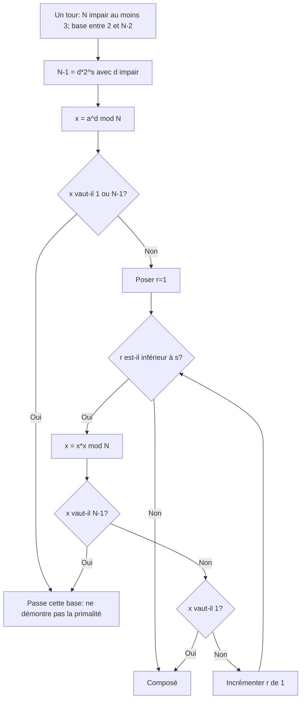
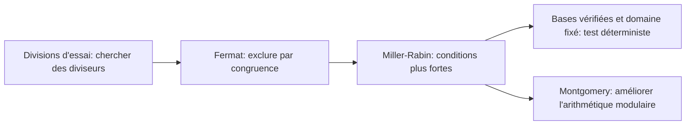

## Introduction : distinguer primalité et factorisation

Un test de primalité répond à la question « cet entier est-il premier ? ». Trouver les facteurs d'un entier composé est un autre problème. La génération de grands nombres premiers joue un rôle dans la [cryptographie à clé publique, notamment RSA](https://kenji.blog/fr/p/modern-cryptography-public-key-hash-signature/), mais la multiplication elle-même n'est pas l'opération difficile. Trouver des nombres premiers ne suffit pas non plus à garantir la sécurité d'un schéma cryptographique.

Nous comparerons les divisions d'essai, le test de Fermat et celui de Miller–Rabin, puis présenterons une implémentation C++ pour les entiers non négatifs de 64 bits. Son domaine est $0\le N<2^{64}$ : il ne couvre pas les entiers de plusieurs milliers de bits utilisés pour générer des clés RSA. Le temps dépend de l'implémentation et des entrées ; aucune durée ni accélération universelle n'est garantie.

## 1. Nombres premiers et divisions d'essai

Un nombre premier est un entier au moins égal à 2 dont les seuls diviseurs positifs sont 1 et lui-même. Un entier au moins égal à 2 qui n'est pas premier est composé. Zéro, un et les entiers négatifs ne sont ni premiers ni composés.

Si un entier composé $N=ab$ possède des facteurs avec $2\le a\le b$, alors $a\le\sqrt N$. Il suffit donc de chercher des diviseurs jusqu'à la racine carrée. On teste d'abord 2, puis seulement les candidats impairs.

```cpp
#include <cstdint>

bool is_prime_trial_division(std::int64_t n) {
    if (n < 2) return false;
    if (n == 2) return true;
    if (n % 2 == 0) return false;
    for (std::int64_t i = 3; i <= n / i; i += 2) {
        if (n % i == 0) return false;
    }
    return true;
}
```

La multiplication signée dans `i*i <= n` peut déborder. Pour des valeurs positives, la condition équivalente `i <= n/i` évite ce produit. Cette fonction accepte l'intervalle de `std::int64_t` et renvoie aussi `false` pour les entrées négatives.

Le nombre de divisions dans le pire cas est $\mathcal{O}(\sqrt N)$. En ne testant que les impairs, on obtient environ $\sqrt N/2$ candidats, mais des tests répétés sur de grandes entrées peuvent rester coûteux. Aucun nombre de chiffres ne fixe une frontière universelle de faisabilité pratique.

## 2. Fermat et l'exponentiation modulaire

Le petit théorème de Fermat affirme que, pour un nombre premier $p$ et un entier $a$ tel que $\gcd(a,p)=1$ :

$$
a^{p-1}\equiv1\pmod p.
$$

Ainsi, pour $N>2$, si une base $1<a<N-1$ ne satisfait pas cette congruence, $N$ est composé. La satisfaire ne démontre pas la primalité. Le nombre de Carmichael $561=3\cdot11\cdot17$ passe le test pour toutes les bases premières avec 561. En revanche, la base 3 n'est pas première avec 561 et $3^{560}\bmod561=375$ : elle échoue. Dire que toute base trompe nécessairement le test est donc inexact.

Il n'est pas nécessaire de construire la puissance entière complète. L'exponentiation binaire effectue une réduction modulaire après chaque multiplication. Les fonctions auxiliaires suivantes peuvent être compilées séparément. La base, l'exposant et les opérandes de multiplication sont des entiers non négatifs de 64 bits ; le module `m` est un entier strictement positif de 64 bits. Un module nul déclenche une exception.

```cpp
#include <cstdint>
#include <stdexcept>

#if !defined(__SIZEOF_INT128__)
#error "This example requires unsigned __int128 support"
#endif

using u64 = std::uint64_t;
using u128 = unsigned __int128;

u64 mod_mul(u64 a, u64 b, u64 m) {
    if (m == 0) throw std::invalid_argument("Modulus must be positive");
    return static_cast<u64>(static_cast<u128>(a) * b % m);
}

u64 mod_pow(u64 base, u64 exp, u64 m) {
    if (m == 0) throw std::invalid_argument("Modulus must be positive");
    u64 result = 1 % m;
    base %= m;
    while (exp > 0) {
        if (exp & 1) result = mod_mul(result, base, m);
        base = mod_mul(base, base, m);
        exp >>= 1;
    }
    return result;
}
```

Le résultat est le plus petit résidu non négatif. Un exposant nul renvoie $1\bmod m$, donc zéro lorsque le module vaut un. On applique ici aussi cette convention de calcul à $0^0$. Passer directement une base négative à un paramètre non signé ne fait pas partie de l'usage prévu.

`unsigned __int128` est une extension, pas un type du standard ISO C++. GCC le prend en charge sur des cibles adaptées, et le code détecte son absence à la compilation. On ne suppose pas qu'il fonctionne tel quel dans tout environnement MSVC ; voir la [documentation GCC](https://gcc.gnu.org/onlinedocs/gcc/_005f_005fint128.html). Pour représenter tous les produits possibles de deux valeurs non signées de 64 bits, il faut 128 bits non signés : le type signé de 128 bits ne les couvre pas tous.

## 3. Conditions de Miller–Rabin et sens de la probabilité

Modulo un nombre premier impair, les seules racines carrées de 1 sont 1 et −1. Miller–Rabin combine ce fait avec le petit théorème de Fermat. Pour un entier impair $N\ge3$, on écrit :

$$
N-1=d\,2^s,\qquad d\text{ is odd},\quad s\ge1.
$$

Autrement dit, d est impair. Une base $a$ avec $1<a<N-1$ passe le test si l'une des conditions suivantes est satisfaite :

$$
a^d\equiv1\pmod N
\quad\text{or}\quad
\exists r\ (0\le r<s):\ a^{d2^r}\equiv-1\pmod N.
$$

Un nombre premier passe toujours ; un échec démontre que le nombre est composé. Si les carrés successifs donnent 1 alors que la valeur précédente n'était ni 1 ni −1, cela démontre également qu'il est composé. Le plus petit résidu non négatif de −1 est $N-1$, mais l'expression signée C++ `-1 % N` ne renvoie pas cette valeur. Par exemple, `-1 % 7` vaut −1. Il faut distinguer le résidu mathématique des [règles de division et de reste du C++](https://eel.is/c++draft/expr.mul).

Pour un entier composé impair fixé $N$, chaque base choisie indépendamment et uniformément parmi $2\le a\le N-2$ passe avec une probabilité d'au plus $1/4$. La probabilité de passer à tort les $k$ tours vérifie donc :

$$
\Pr[\text{all }k\text{ rounds pass}\mid N\text{ is composite}]\le4^{-k}.
$$

Il s'agit d'une probabilité d'erreur sur le choix aléatoire des bases. On ne peut pas la reformuler directement comme une probabilité de $4^{-k}$ que l'entier soit composé après avoir passé le test. L'argument ne s'applique pas non plus à un ensemble fixe arbitraire de bases. Pour N=3, l'intervalle des bases est vide : l'implémentation traite donc ce cas d'abord. L'[article original de Rabin](https://math.nyu.edu/~goodman/teaching/Algebra_2_2021/MillerRabinTest.pdf) distingue lui aussi acceptation probabiliste et démonstration de primalité.

Le diagramme présente un tour pour une base ordinaire. N=3 a déjà été traité ; l'entier impair d'entrée doit admettre une base dans l'intervalle indiqué.



## 4. Test déterministe dans un intervalle fixé

Dans un intervalle borné d'entiers, un ensemble suffisant de bases, étayé par des résultats de vérification connus, permet un test sans hasard. Les [registres de bases SPRP](https://miller-rabin.appspot.com/) donnent les conditions utilisées ici. Toutes les bornes supérieures sont strictes.

| Domaine d'entrée | Bases testées |
| --- | --- |
| $N<4759123141$ | 2, 7, 61 |
| $N<1122004669633$ | 2, 13, 23, 1662803 |
| $N<2^{64}$ | 2, 325, 9375, 28178, 450775, 9780504, 1795265022 |

Le dernier ensemble contient sept bases entières, pas sept nombres premiers : 325, par exemple, est composé. Le registre attribue à Jim Sinclair ce résultat utilisant sept bases, obtenu en 2011. Cet article ne reproduit pas indépendamment toute la recherche sur 64 bits.

Les douze premiers nombres premiers `2, 3, 5, 7, 11, 13, 17, 19, 23, 29, 31, 37` suffisent aussi pour cet intervalle de 64 bits. Le [résultat de Sorenson–Webster](https://arxiv.org/abs/1509.00864) donne 318665857834031151167461 comme le plus petit entier composé qui est pseudo-premier fort pour les douze bases ; il dépasse $2^{64}$. L'implémentation suivante utilise les branches à 3, 4 et 7 bases du tableau, et non la variante à douze bases.

## 5. Exemple complet en C++

Le type d'entrée `u64` couvre $0\le N\le2^{64}-1$. Zéro et un renvoient `false`, mais ne sont pas composés : la sortie affiche donc `Not prime`. La multiplication modulaire effectue la conversion de type avant de former le produit. Chaque base est réduite modulo N ; si elle devient nulle, on ignore cette base seulement et on continue les autres. Une base nulle ne décide pas à elle seule si l'entier est premier ou composé.

Le bloc suivant est un programme complet comprenant ses fonctions auxiliaires. Il ne faut pas y concaténer les blocs précédents. Sur une cible GCC adaptée, on peut compiler avec une commande telle que `g++ -std=c++17 -O2 primality.cpp -o primality`.

```cpp
#include <cstdint>
#include <stdexcept>

#if !defined(__SIZEOF_INT128__)
#error "This example requires unsigned __int128 support"
#endif

using u64 = std::uint64_t;
using u128 = unsigned __int128;

u64 mod_mul(u64 a, u64 b, u64 m) {
    if (m == 0) throw std::invalid_argument("Modulus must be positive");
    return static_cast<u64>(static_cast<u128>(a) * b % m);
}

u64 mod_pow(u64 base, u64 exp, u64 m) {
    if (m == 0) throw std::invalid_argument("Modulus must be positive");
    u64 result = 1 % m;
    base %= m;
    while (exp > 0) {
        if (exp & 1) result = mod_mul(result, base, m);
        base = mod_mul(base, base, m);
        exp >>= 1;
    }
    return result;
}

#include <iostream>
#include <initializer_list>
#include <vector>

bool is_prime_miller_rabin(u64 n) {
    if (n < 2) return false;
    for (u64 p : {2ULL, 3ULL, 5ULL, 7ULL}) {
        if (n == p) return true;
        if (n % p == 0) return false;
    }

    u64 d = n - 1;
    unsigned s = 0;
    while ((d & 1) == 0) {
        d >>= 1;
        ++s;
    }

    std::vector<u64> bases;
    if (n < 4759123141ULL) {
        bases = {2, 7, 61};
    } else if (n < 1122004669633ULL) {
        bases = {2, 13, 23, 1662803};
    } else {
        bases = {2, 325, 9375, 28178, 450775, 9780504, 1795265022};
    }

    for (u64 a : bases) {
        a %= n;
        if (a == 0) continue; // No witness from this base; keep testing the others.
        u64 x = mod_pow(a, d, n);
        if (x == 1 || x == n - 1) continue;

        bool passed = false;
        for (unsigned r = 1; r < s; ++r) {
            x = mod_mul(x, x, n);
            if (x == n - 1) {
                passed = true;
                break;
            }
            if (x == 1) return false;
        }
        if (!passed) return false;
    }
    return true;
}

int main() {
    const std::vector<u64> cases = {
        0, 1, 2, 73, 561, 1000000007, 998244353,
        1000000000000000003ULL, 1000000000000000007ULL,
        18446744073709551557ULL, 18446744073709551615ULL
    };
    for (u64 n : cases) {
        std::cout << n << " is "
                  << (is_prime_miller_rabin(n) ? "Prime" : "Not prime") << '\n';
    }
}
```

La sortie classe 0 et 1 comme `Not prime` ; 2 et 73 comme `Prime` ; 561 comme `Not prime` ; 1000000007, 998244353 et 1000000000000000003 comme `Prime` ; 1000000000000000007 comme `Not prime` ; 18446744073709551557 comme `Prime` ; et 18446744073709551615 comme `Not prime`. Le dernier composé est $2^{64}-1$. C'est un exemple pédagogique et de test d'entiers dans le domaine indiqué, pas un générateur cryptographique de nombres premiers, une implémentation en temps constant ou une bibliothèque de validation des chaînes d'entrée.

## 6. Complexité et multiplication de Montgomery

En comptant une multiplication modulaire comme une opération, l'exponentiation binaire et un tour de Miller–Rabin demandent $\mathcal{O}(\log N)$ opérations ; tester k bases en demande $\mathcal{O}(k\log N)$. Les divisions d'essai nécessitent $\mathcal{O}(\sqrt N)$ divisions. En fonction de la longueur d'entrée $b=\lfloor\log_2 N\rfloor+1$, Miller–Rabin demande $\mathcal{O}(kb)$ multiplications modulaires. Pour les entiers de précision arbitraire, la complexité en bits doit aussi inclure le coût de multiplication et de réduction modulaire.

Cet intervalle fixé exige au plus sept bases. Mais un bit peut demander une multiplication conditionnelle en plus d'un carré, et la suite de carrés ajoute des opérations. Ainsi, $7\times64=448$ ne borne pas toutes les opérations élémentaires. Une comparaison des temps doit préciser processeur, compilateur, options d'optimisation, ensemble d'entrées et méthode de mesure.

La multiplication de Montgomery change la représentation pour éviter la division par le module lors d'opérations répétées avec un même module. Dans la construction usuelle où la base de numération est une puissance de deux, le module doit être impair et premier avec cette base de numération. Outre multiplications et décalages, il faut des additions, la gestion des retenues et des soustractions conditionnelles ; conversions et préparation ont aussi un coût. Aucun gain systématique d'un facteur deux ou trois n'est garanti. Voir le [chapitre 14 du HAC, algorithmes 14.32, 14.36 et 14.94](https://cacr.uwaterloo.ca/hac/about/chap14.pdf) pour les procédures et conditions. Cette technique n'est pas implémentée dans le code ci-dessus.

## 7. Conclusion

Les divisions d'essai cherchent directement des diviseurs, tandis que Fermat élimine des candidats par une congruence. Miller–Rabin utilise des conditions plus fortes. Il faut distinguer sa forme probabiliste générale du test déterministe avec un ensemble de bases vérifié et un domaine restreint.



La correction dépend des bornes d'entrée, des types entiers, des débordements, des conditions sur le module et du traitement des bases, en plus des mathématiques. Les garanties du code sur 64 bits ne s'étendent ni aux entiers de longueur arbitraire ni à un système cryptographique entier.

### Références

- [HAC, chapitre 4 : Fermat, Miller–Rabin et conditions des probabilités d'erreur](https://cacr.uwaterloo.ca/hac/about/chap4.pdf) (source de 1996 ; distinguer les résultats ultérieurs et les normes actuelles de génération de clés)
- [Rabin (1980): Probabilistic Algorithm for Testing Primality](https://math.nyu.edu/~goodman/teaching/Algebra_2_2021/MillerRabinTest.pdf)
- [Registres des bases SPRP pour Miller–Rabin déterministe](https://miller-rabin.appspot.com/)
- [Sorenson–Webster: Strong Pseudoprimes to Twelve Prime Bases](https://arxiv.org/abs/1509.00864) (prépublication de 2015, publication en revue en 2017)
- [GCC : extension d'entiers de 128 bits](https://gcc.gnu.org/onlinedocs/gcc/_005f_005fint128.html)
- [Projet de norme C++ : division et reste](https://eel.is/c++draft/expr.mul)
- [HAC, chapitre 14 : arithmétique de Montgomery](https://cacr.uwaterloo.ca/hac/about/chap14.pdf)
