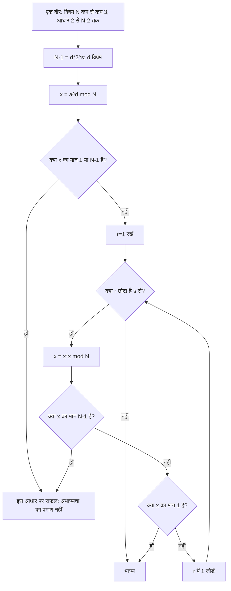
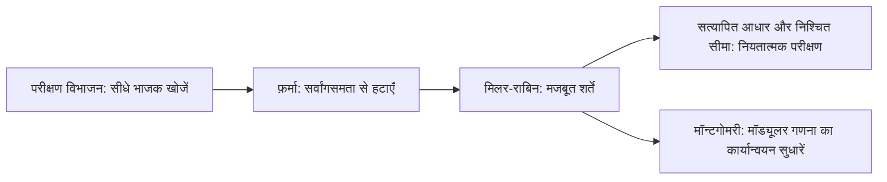

## परिचय: अभाज्यता परीक्षण और गुणनखंडन में अंतर

अभाज्यता परीक्षण बताता है कि कोई पूर्णांक अभाज्य है या नहीं। भाज्य संख्या के वास्तविक गुणनखंड निकालना अलग समस्या है। [RSA जैसी सार्वजनिक-कुंजी क्रिप्टोग्राफी](https://kenji.blog/hi/p/modern-cryptography-public-key-hash-signature/) में बड़ी अभाज्य संख्याएँ उत्पन्न करना महत्वपूर्ण है, लेकिन गुणा करना स्वयं कठिन क्रिया नहीं है। केवल अभाज्य संख्याएँ मिलने से पूरी क्रिप्टोग्राफिक योजना सुरक्षित नहीं हो जाती।

हम परीक्षण विभाजन, फ़र्मा (Fermat) परीक्षण और मिलर–राबिन की तुलना करेंगे तथा गैर-ऋणात्मक 64-बिट पूर्णांकों के लिए C++ उदाहरण देंगे। कार्यान्वयन की सीमा $0\le N<2^{64}$ है; RSA कुंजी निर्माण की हज़ारों बिट लंबी संख्याएँ इसमें शामिल नहीं हैं। समय कार्यान्वयन और इनपुट पर निर्भर करता है, इसलिए निश्चित सेकंड या सार्वभौमिक गति-वृद्धि का दावा नहीं किया जाता।

## 1. अभाज्य संख्याएँ और परीक्षण विभाजन

अभाज्य संख्या 2 या उससे बड़ा वह पूर्णांक है जिसके धनात्मक भाजक केवल 1 और वह स्वयं हैं। 2 या उससे बड़ा ऐसा पूर्णांक जो अभाज्य नहीं है, भाज्य (composite) कहलाता है। शून्य, एक और ऋणात्मक पूर्णांक न अभाज्य हैं, न भाज्य।

यदि भाज्य संख्या $N=ab$ के गुणनखंड $2\le a\le b$ को संतुष्ट करते हैं, तो $a\le\sqrt N$ होता है। इसलिए वर्गमूल तक भाजक खोजना पर्याप्त है। पहले 2 जाँचें और उसके बाद केवल विषम उम्मीदवार।

```cpp
#include <cstdint>

bool is_prime_trial_division(std::int64_t n) {
    if (n < 2) return false;
    if (n == 2) return true;
    if (n % 2 == 0) return false;
    for (std::int64_t i = 3; i <= n / i; i += 2) {
        if (n % i == 0) return false;
    }
    return true;
}
```

शर्त `i*i <= n` के सचिह्न (signed) गुणा में अतिप्रवाह हो सकता है। धनात्मक मानों के लिए समतुल्य `i <= n/i` यह गुणनफल बनाने से बचाता है। यह फ़ंक्शन `std::int64_t` की सीमा स्वीकार करता है और ऋणात्मक इनपुट के लिए भी `false` लौटाता है।

सबसे खराब स्थिति में भाग देने की क्रियाओं की संख्या $\mathcal{O}(\sqrt N)$ है। केवल विषम उम्मीदवारों से लगभग $\sqrt N/2$ उम्मीदवार मिलते हैं, पर बड़े इनपुट पर बार-बार परीक्षण फिर भी महँगा हो सकता है। व्यावहारिकता की कोई सार्वभौमिक दशमलव-अंक सीमा नहीं है।

## 2. फ़र्मा परीक्षण और मॉड्यूलर घात गणना

अभाज्य $p$ और $\gcd(a,p)=1$ को संतुष्ट करने वाले पूर्णांक $a$ के लिए फ़र्मा का लघु प्रमेय बताता है:

$$
a^{p-1}\equiv1\pmod p.
$$

इसलिए $N>2$ के लिए, यदि $1<a<N-1$ वाला आधार सर्वांगसमता को संतुष्ट नहीं करता, तो $N$ भाज्य है। परीक्षण में सफल होना अभाज्यता का प्रमाण नहीं है। कार्माइकल संख्या $561=3\cdot11\cdot17$ सभी ऐसे आधारों पर सफल होती है जो 561 के सह-अभाज्य हैं। लेकिन आधार 3 सह-अभाज्य नहीं है और $3^{560}\bmod561=375$ है, इसलिए असफल होता है। यह कहना गलत है कि हर आधार परीक्षण को अवश्य धोखा देता है।

पहले पूरा पूर्णांक घात बनाने की आवश्यकता नहीं है। द्विआधारी घात गणना हर गुणा के बाद मापांक के अनुसार शेष लेती है। निम्न सहायक फ़ंक्शनों को अलग से संकलित किया जा सकता है। आधार, घातांक और गुणा के संकार्य गैर-ऋणात्मक 64-बिट पूर्णांक हैं; मापांक `m` धनात्मक 64-बिट पूर्णांक है। शून्य मापांक पर अपवाद उठता है।

```cpp
#include <cstdint>
#include <stdexcept>

#if !defined(__SIZEOF_INT128__)
#error "This example requires unsigned __int128 support"
#endif

using u64 = std::uint64_t;
using u128 = unsigned __int128;

u64 mod_mul(u64 a, u64 b, u64 m) {
    if (m == 0) throw std::invalid_argument("Modulus must be positive");
    return static_cast<u64>(static_cast<u128>(a) * b % m);
}

u64 mod_pow(u64 base, u64 exp, u64 m) {
    if (m == 0) throw std::invalid_argument("Modulus must be positive");
    u64 result = 1 % m;
    base %= m;
    while (exp > 0) {
        if (exp & 1) result = mod_mul(result, base, m);
        base = mod_mul(base, base, m);
        exp >>= 1;
    }
    return result;
}
```

परिणाम सबसे छोटा गैर-ऋणात्मक शेष है। घातांक शून्य हो तो $1\bmod m$ लौटता है, इसलिए मापांक 1 पर परिणाम 0 है। यहाँ $0^0$ भी इसी गणना-परंपरा के अनुसार लिया जाता है। ऋणात्मक आधार को सीधे अचिह्न (unsigned) पैरामीटर में देना अपेक्षित उपयोग का भाग नहीं है।

`unsigned __int128` ISO C++ का मानक प्रकार नहीं, बल्कि उपयुक्त लक्ष्य प्लेटफ़ॉर्म पर GCC आदि का विस्तार है। कोड संकलन के समय असमर्थित वातावरण पहचानता है। हर MSVC वातावरण में बिना बदलाव काम करने की धारणा नहीं है; [GCC दस्तावेज़](https://gcc.gnu.org/onlinedocs/gcc/_005f_005fint128.html) देखें। दो अचिह्न 64-बिट मानों के सभी संभावित गुणनफल रखने के लिए अचिह्न 128-बिट भंडारण चाहिए; सचिह्न 128-बिट प्रकार सभी गुणनफल नहीं रख सकता।

## 3. मिलर–राबिन की शर्तें और प्रायिकता का अर्थ

विषम अभाज्य मापांक पर 1 के वर्गमूल केवल 1 और −1 होते हैं। मिलर–राबिन यह गुण फ़र्मा के लघु प्रमेय से जोड़ता है। विषम $N\ge3$ के लिए लिखें:

$$
N-1=d\,2^s,\qquad d\text{ is odd},\quad s\ge1.
$$

अर्थात d विषम है। आधार $a$ यदि $1<a<N-1$ पूरा करता है, तो निम्न में से कोई एक शर्त होने पर उस दौर में सफल होता है:

$$
a^d\equiv1\pmod N
\quad\text{or}\quad
\exists r\ (0\le r<s):\ a^{d2^r}\equiv-1\pmod N.
$$

अभाज्य संख्या हमेशा सफल होती है; असफलता भाज्य होने का प्रमाण है। यदि बार-बार वर्ग करने पर 1 मिले जबकि पिछला मान न 1 था, न −1, तो भी संख्या भाज्य है। गणित में −1 का सबसे छोटा गैर-ऋणात्मक शेष $N-1$ है, लेकिन C++ का सचिह्न व्यंजक `-1 % N` यह मान नहीं लौटाता। उदाहरण के लिए `-1 % 7` का परिणाम −1 है। गणितीय शेष और [C++ के भाग व शेष के नियम](https://eel.is/c++draft/expr.mul) अलग समझें।

एक निश्चित विषम भाज्य संख्या $N$ के लिए, $2\le a\le N-2$ से स्वतंत्र और एकसमान रूप से चुना गया प्रत्येक आधार अधिकतम $1/4$ प्रायिकता से सफल होता है। इसलिए गलती से सभी $k$ दौर सफल होने की प्रायिकता यह सीमा संतुष्ट करती है:

$$
\Pr[\text{all }k\text{ rounds pass}\mid N\text{ is composite}]\le4^{-k}.
$$

यह आधारों के यादृच्छिक चयन पर त्रुटि की प्रायिकता है। इसे सीधे यह नहीं कह सकते कि परीक्षण में सफल संख्या के भाज्य होने की प्रायिकता $4^{-k}$ है। किसी मनमाने निश्चित आधार-समुच्चय पर भी स्वतंत्र एकसमान यादृच्छिक चयन का तर्क लागू नहीं होता। N=3 के लिए आधारों का अंतराल खाली है, इसलिए कार्यान्वयन इसे पहले संभालता है। [राबिन का मूल शोधपत्र](https://math.nyu.edu/~goodman/teaching/Algebra_2_2021/MillerRabinTest.pdf) भी संभाव्य स्वीकृति और अभाज्यता के प्रमाण को अलग रखता है।

नीचे सामान्य आधार के लिए एक दौर का प्रवाह है। N=3 पहले संभाला गया है; विषम इनपुट के लिए दिए गए अंतराल में कोई आधार चुनना संभव होना चाहिए।



## 4. निश्चित सीमा में नियतात्मक परीक्षण

पूर्णांकों की सीमित श्रेणी में ज्ञात सत्यापन परिणामों पर आधारित पर्याप्त आधार-समुच्चय से बिना यादृच्छिकता परीक्षण किया जा सकता है। [SPRP आधारों के रिकॉर्ड](https://miller-rabin.appspot.com/) में प्रयुक्त शर्तें दी गई हैं। हर ऊपरी सीमा सख्त है, अर्थात संख्या उससे छोटी होनी चाहिए।

| इनपुट सीमा | जाँचे जाने वाले आधार |
| --- | --- |
| $N<4759123141$ | 2, 7, 61 |
| $N<1122004669633$ | 2, 13, 23, 1662803 |
| $N<2^{64}$ | 2, 325, 9375, 28178, 450775, 9780504, 1795265022 |

अंतिम समुच्चय सात पूर्णांक आधारों का है, सात अभाज्यों का नहीं; उदाहरण के लिए 325 भाज्य है। रिकॉर्ड सात आधारों का यह परिणाम 2011 में Jim Sinclair को श्रेय देता है। इस लेख में पूरे 64-बिट क्षेत्र की खोज स्वतंत्र रूप से दोहराई नहीं गई है।

विकल्प के रूप में पहले बारह अभाज्य `2, 3, 5, 7, 11, 13, 17, 19, 23, 29, 31, 37` भी इस 64-बिट सीमा के लिए पर्याप्त हैं। [Sorenson–Webster के परिणाम](https://arxiv.org/abs/1509.00864) में सभी बारह आधारों पर प्रबल छद्म अभाज्य (strong pseudoprime) होने वाली सबसे छोटी भाज्य संख्या 318665857834031151167461 है, जो $2^{64}$ से बड़ी है। नीचे का कार्यान्वयन बारह आधारों के विकल्प के बजाय तालिका की 3, 4, 7 आधारों वाली शाखाएँ चुनता है।

## 5. संपूर्ण C++ उदाहरण

इनपुट प्रकार `u64` की सीमा $0\le N\le2^{64}-1$ है। शून्य और एक के लिए `false` लौटता है, लेकिन वे भाज्य नहीं हैं, इसलिए आउटपुट `Not prime` कहता है। मॉड्यूलर गुणा में गुणनफल बनाने से पहले प्रकार बदलता है। हर आधार का N से भाग देने पर शेष लिया जाता है; शून्य मिले तो केवल वही आधार छोड़ा जाता है और बाकी जाँचे जाते हैं। आधार शून्य होने से पूरी संख्या के अभाज्य या भाज्य होने का निर्णय नहीं होता।

अगला ब्लॉक सहायक फ़ंक्शनों सहित पूरा प्रोग्राम है। पिछले ब्लॉकों को फिर से इसमें जोड़ने की आवश्यकता नहीं है। उपयुक्त GCC लक्ष्य पर `g++ -std=c++17 -O2 primality.cpp -o primality` जैसी कमांड से संकलित करें।

```cpp
#include <cstdint>
#include <stdexcept>

#if !defined(__SIZEOF_INT128__)
#error "This example requires unsigned __int128 support"
#endif

using u64 = std::uint64_t;
using u128 = unsigned __int128;

u64 mod_mul(u64 a, u64 b, u64 m) {
    if (m == 0) throw std::invalid_argument("Modulus must be positive");
    return static_cast<u64>(static_cast<u128>(a) * b % m);
}

u64 mod_pow(u64 base, u64 exp, u64 m) {
    if (m == 0) throw std::invalid_argument("Modulus must be positive");
    u64 result = 1 % m;
    base %= m;
    while (exp > 0) {
        if (exp & 1) result = mod_mul(result, base, m);
        base = mod_mul(base, base, m);
        exp >>= 1;
    }
    return result;
}

#include <iostream>
#include <initializer_list>
#include <vector>

bool is_prime_miller_rabin(u64 n) {
    if (n < 2) return false;
    for (u64 p : {2ULL, 3ULL, 5ULL, 7ULL}) {
        if (n == p) return true;
        if (n % p == 0) return false;
    }

    u64 d = n - 1;
    unsigned s = 0;
    while ((d & 1) == 0) {
        d >>= 1;
        ++s;
    }

    std::vector<u64> bases;
    if (n < 4759123141ULL) {
        bases = {2, 7, 61};
    } else if (n < 1122004669633ULL) {
        bases = {2, 13, 23, 1662803};
    } else {
        bases = {2, 325, 9375, 28178, 450775, 9780504, 1795265022};
    }

    for (u64 a : bases) {
        a %= n;
        if (a == 0) continue; // No witness from this base; keep testing the others.
        u64 x = mod_pow(a, d, n);
        if (x == 1 || x == n - 1) continue;

        bool passed = false;
        for (unsigned r = 1; r < s; ++r) {
            x = mod_mul(x, x, n);
            if (x == n - 1) {
                passed = true;
                break;
            }
            if (x == 1) return false;
        }
        if (!passed) return false;
    }
    return true;
}

int main() {
    const std::vector<u64> cases = {
        0, 1, 2, 73, 561, 1000000007, 998244353,
        1000000000000000003ULL, 1000000000000000007ULL,
        18446744073709551557ULL, 18446744073709551615ULL
    };
    for (u64 n : cases) {
        std::cout << n << " is "
                  << (is_prime_miller_rabin(n) ? "Prime" : "Not prime") << '\n';
    }
}
```

आउटपुट में 0 और 1 `Not prime`,2 और 73 `Prime`,561 `Not prime`,1000000007,998244353,1000000000000000003 `Prime`,1000000000000000007 `Not prime`,18446744073709551557 `Prime`, और 18446744073709551615 `Not prime` हैं। अंतिम भाज्य संख्या $2^{64}-1$ है। यह निर्धारित सीमा में सीखने और सामान्य पूर्णांक जाँचने का उदाहरण है, क्रिप्टोग्राफिक अभाज्य जनरेटर, स्थिर-समय कार्यान्वयन या इनपुट स्ट्रिंग सत्यापित करने वाली लाइब्रेरी नहीं।

## 6. जटिलता और मॉन्टगोमरी गुणन

एक मॉड्यूलर गुणा को एक क्रिया गिनने पर द्विआधारी घात गणना और मिलर–राबिन का एक दौर $\mathcal{O}(\log N)$ क्रियाएँ लेते हैं; k आधारों का परीक्षण $\mathcal{O}(k\log N)$ लेता है। परीक्षण विभाजन में $\mathcal{O}(\sqrt N)$ बार भाग दिया जाता है। इनपुट लंबाई $b=\lfloor\log_2 N\rfloor+1$ के अनुसार मिलर–राबिन में $\mathcal{O}(kb)$ मॉड्यूलर गुणा होते हैं। मनमानी परिशुद्धता के पूर्णांकों की बिट-जटिलता में गुणा और मापांक के अनुसार शेष निकालने का खर्च भी जोड़ना होगा।

इस निश्चित सीमा में अधिकतम सात आधार चाहिए। लेकिन एक बिट पर वर्ग के अलावा सशर्त गुणा भी हो सकता है, और आगे की वर्ग-शृंखला भी क्रियाएँ जोड़ती है। इसलिए सभी मूल क्रियाओं को $7\times64=448$ से सीमित नहीं कर सकते। समय की तुलना में CPU, संकलक, अनुकूलन विकल्प, इनपुट-समुच्चय और मापन विधि स्पष्ट करें।

मॉन्टगोमरी गुणन समान मापांक पर बार-बार गणना करते समय निरूपण बदलकर उस मापांक से भाग देने से बचता है। सामान्य रचना में संख्या-पद्धति का आधार (radix) दो की घात होता है; तब मापांक विषम और उस आधार के सह-अभाज्य होना चाहिए। गुणा और बिट-शिफ्ट के अलावा जोड़, कैरी का प्रबंधन और सशर्त घटाव भी होते हैं; रूपांतरण और पूर्वगणना का खर्च भी है। हमेशा दो या तीन गुना गति मिलने की गारंटी नहीं है। प्रक्रिया और शर्तों के लिए [HAC अध्याय 14, एल्गोरिदम 14.32, 14.36 और 14.94](https://cacr.uwaterloo.ca/hac/about/chap14.pdf) देखें। ऊपर के कोड में यह तकनीक लागू नहीं की गई है।

## 7. निष्कर्ष

परीक्षण विभाजन सीधे भाजक खोजता है, जबकि फ़र्मा परीक्षण सर्वांगसमता से उम्मीदवार हटाता है। मिलर–राबिन अधिक मजबूत शर्तें प्रयोग करता है। सामान्य संभाव्य रूप और सत्यापित आधार-समुच्चय व सीमित इनपुट पर नियतात्मक परीक्षण में अंतर रखना चाहिए।



शुद्धता केवल गणित पर नहीं, बल्कि इनपुट सीमा, पूर्णांक प्रकार, अतिप्रवाह, मापांक की शर्तों और आधारों के प्रबंधन पर भी निर्भर है। 64-बिट कोड की गारंटी मनमानी लंबाई के पूर्णांकों या पूरे क्रिप्टोग्राफिक तंत्र तक नहीं फैलती।

### संदर्भ

- [HAC अध्याय 4: फ़र्मा, मिलर–राबिन और त्रुटि प्रायिकता की शर्तें](https://cacr.uwaterloo.ca/hac/about/chap4.pdf) (1996 का स्रोत; बाद के अभाज्यता परिणाम और वर्तमान कुंजी निर्माण मानकों से अलग समझें)
- [Rabin (1980): Probabilistic Algorithm for Testing Primality](https://math.nyu.edu/~goodman/teaching/Algebra_2_2021/MillerRabinTest.pdf)
- [नियतात्मक मिलर–राबिन के SPRP आधार रिकॉर्ड](https://miller-rabin.appspot.com/)
- [Sorenson–Webster: Strong Pseudoprimes to Twelve Prime Bases](https://arxiv.org/abs/1509.00864) (2015 का प्रीप्रिंट, 2017 में जर्नल प्रकाशन)
- [GCC: 128-बिट पूर्णांक विस्तार](https://gcc.gnu.org/onlinedocs/gcc/_005f_005fint128.html)
- [C++ कार्यशील मसौदा: भाग और शेष](https://eel.is/c++draft/expr.mul)
- [HAC अध्याय 14: मॉन्टगोमरी गणना](https://cacr.uwaterloo.ca/hac/about/chap14.pdf)
